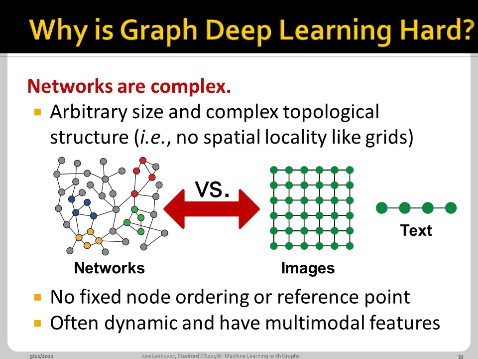
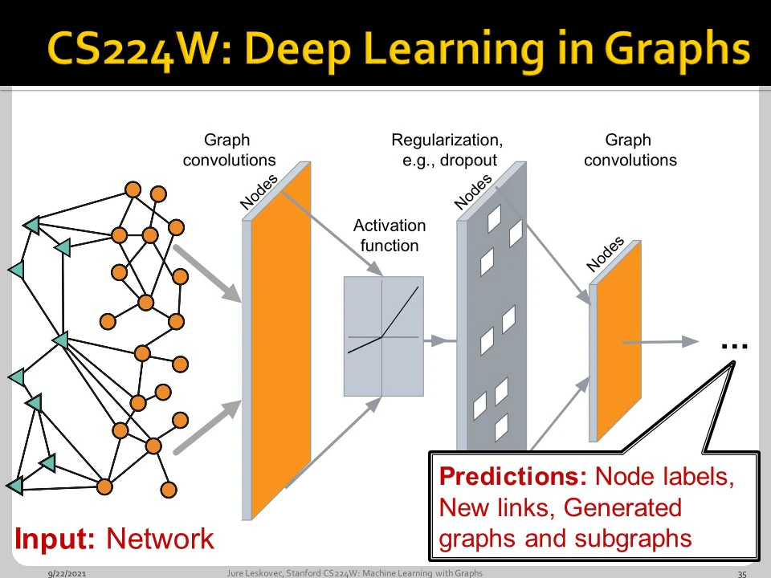
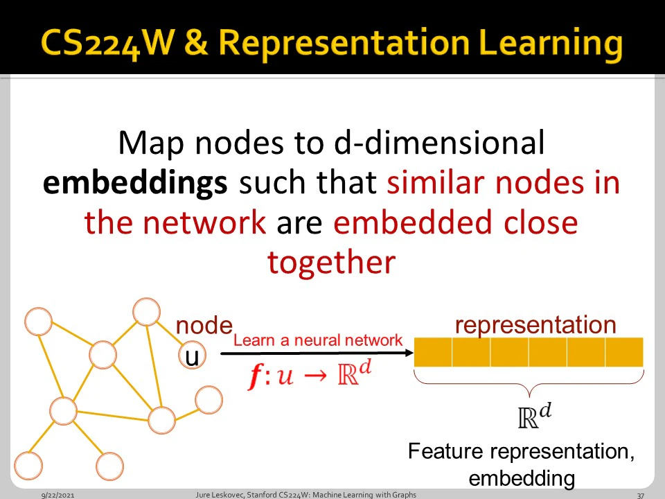
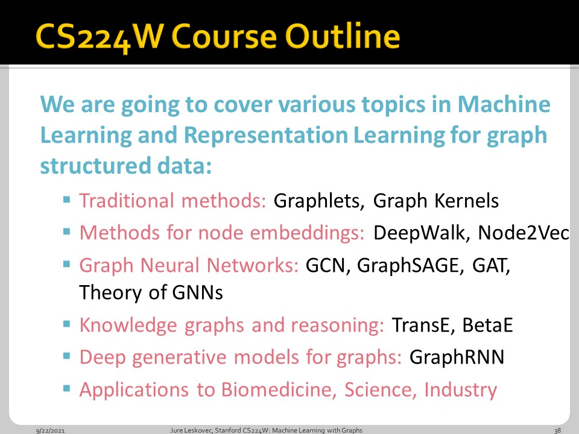
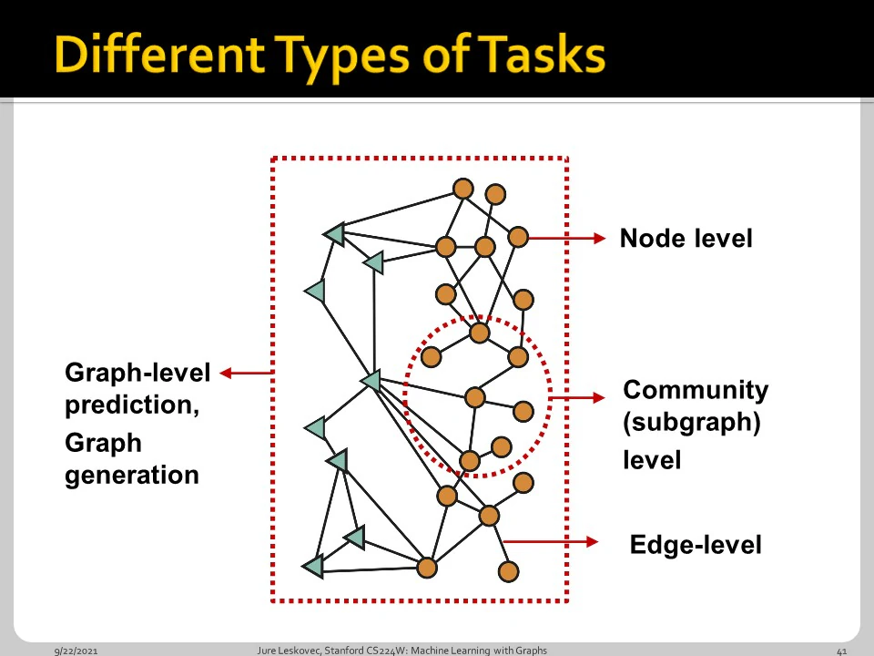
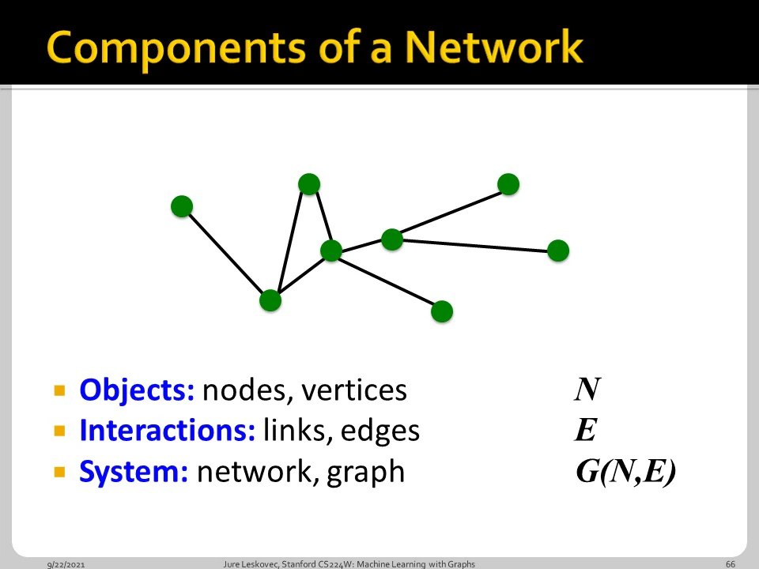
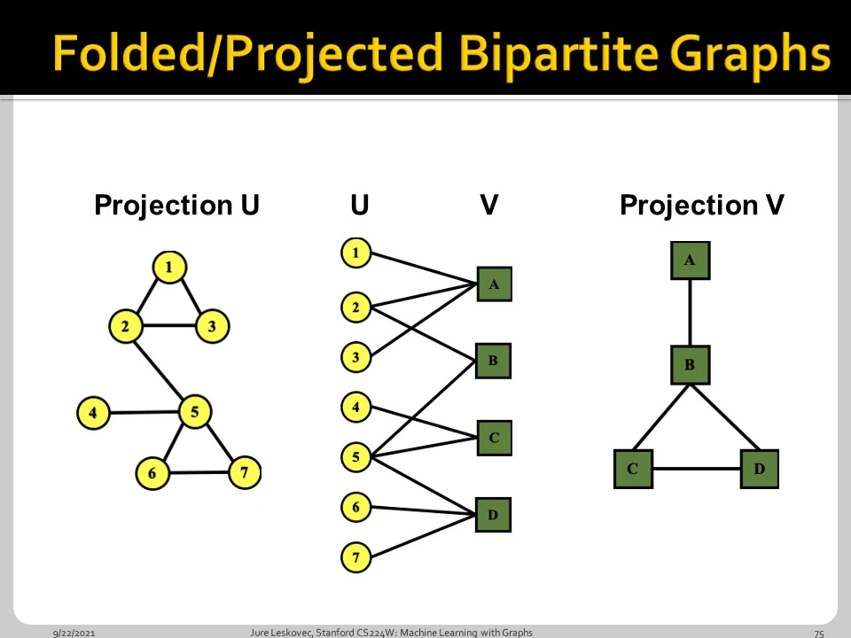
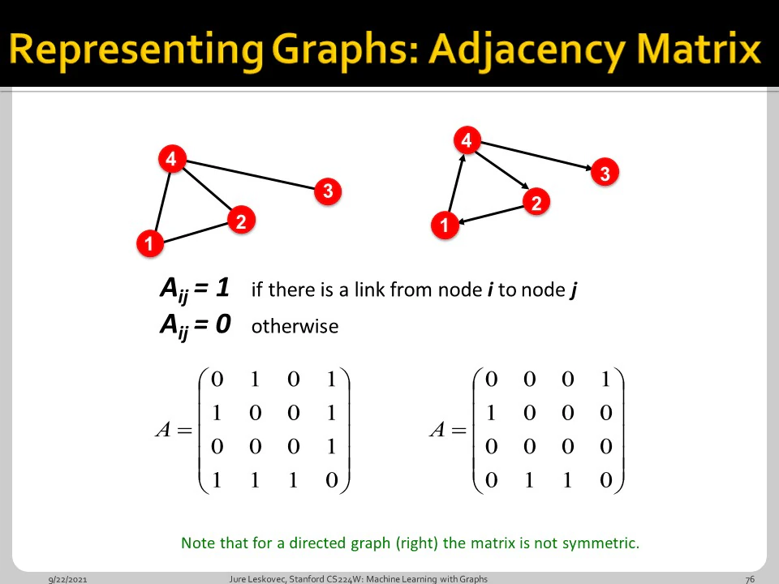
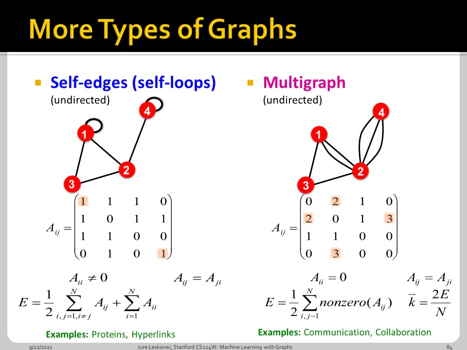
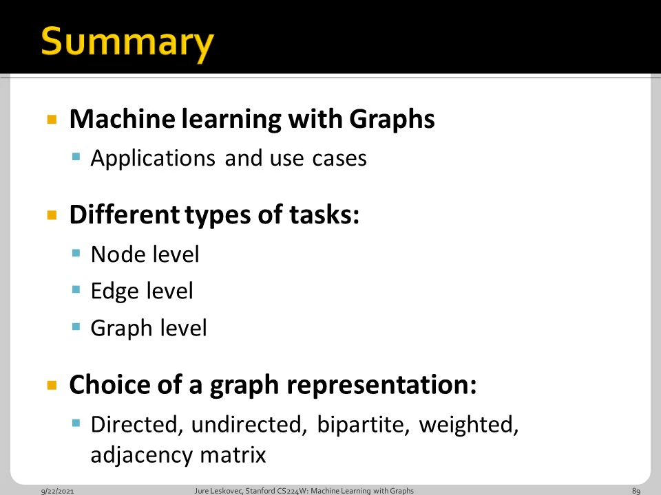

본 글은 graph neural network를 다룬 CS224w 수업 [제1강](https://www.youtube.com/watch?v=JAB_plj2rbA&list=PLoROMvodv4rPLKxIpqhjhPgdQy7imNkDn&index=1)의 요약입니다. 너무 일반적인 이야기는 제외하였습니다.

{: width="960" height="720" }

흔히 등장하는 Graph Deep Learning이 필요한 이유입니다. 이미지는 격자형으로 정형화, 텍스트는 단어 순서대로 정형화되어있습니다. 이에 반해 네트워크 데이터는 격자나 연속된 하나의 흐름으로 만들 수 없는 경우가 많습니다. Fixed size 데이터가 아닌 것이고, graph에서는 image에서 상하좌우가 의미를 갖는 것처럼 위치 정보가 의미를 갖지도 않습니다. 이런 이유에서 그래프를 위한 러닝 프레임워크인 Graph Neural Network(GNN)이 필요합니다.

소셜 네트워크처럼 정보 그 자체가 그래프인 Natural Graph와 정보 연결을 나타내는 Information Graph로도 그래프를 분류할 수 있습니다. Edge에도 다양한 정보가 포함된 knowledge graph도 있습니다.

{: width="960" height="720" }

GNN에서 학습하고자 하는 정보는 여러가지가 있습니다. 그래프와 연관된 특성을 뽑아내는 것은 다 한다고 보시면 됩니다. 대표적으로 node label, link prediction, graph generation 등의 task들이 있습니다. 그래프를 이용하여 약물의 효과를 확인하기도 하고, 단백질의 구조를 파악하기도 합니다.

{: width="960" height="720" }

Node embedding은 node를 d-dimension의 representation vector로 표현하는 것입니다. 가장 기본적인 방향성에 해당하여, 앞으로 자주 나올 내용입니다. GNN의 중요 포인트 중 하나가 사람이 직접 feature를 설계하는 feature engineering 없이, graph data에서 유용한 feature(representation)를 자동으로 학습해준다는 것입니다.

{: width="960" height="720" }

그래프와 연관된 representation learning에는 여러가지가 있습니다. 수학적 방법론을 동원하는 traditional methods, node embedding 방법, GNN 등이 있습니다. 각 방법론은 그래프 형태의 데이터를 벡터화시키고자 합니다.

{: width="960" height="720" }

Feature vector로 만드는 작업을 여러 위계에서 진행 가능합니다. Graph 전체 level의 prediction task를 위해 feature vector를 만들수도 있고, node level, sub graph level에서 feature vector를 만들 수도 있습니다.

{: width="960" height="720" }

그래프의 notation은 위와 같습니다. Nodes와 vertices를 흔히 N으로 나타내고, Links와 Edges를 E로 나타냅니다. G(N,E)는 그래프 자체를 의미합니다. Directed Graph와 Undirected Graph 두 가지로 구분 지어집니다. Undirected Graph는 symmetrical, 혹은 reciprocal 하다고 이야기합니다.

{: width="960" height="720" }

U와 V의 그래프는 같은 집단 사이에서는 연결성이 없는 그래프이고 이런 그래프를 Bipartite 그래프라고 합니다. 이를 U에 대해서 projection 하면 왼쪽, V에 대해 projection하면 오른쪽과 같은 결과를 얻을 수 있습니다.

{: width="960" height="720" }

Adjacency matrix는 node 사이의 연결성을 나타내는 행렬이며, 가중치가 없는(unweighted) adjacency matrix는 연결되어있으면 1, 아니면 0입니다. Weighted graph는 중요도에 따라서 edge weight에 다른 값이 들어갑니다.

{: width="960" height="720" }

Self-loop의 포함 여부에 따라서 전체 edge 계산법은 달라집니다. 왼쪽의 E를 구하는 수식은 self-loop의 경우는 나누기 2를 해주지 않는다는 이야기이고, 오른쪽 multigraph(두 node 사이에 edge가 여러 개 있을 수 있는 graph)의 E를 구하는 수식은 0이 아닌 행렬 원소의 수를 세어서 2로 나누겠다는 뜻입니다. k는 평균 degree를 의미합니다.

{: width="960" height="720" }

요약하자면, GNN은 task에 따라서도 여러 가지로 나눌 수 있으며, graph를 어떻게 표현하느냐에 따라서도 나누어질 수 있습니다.
