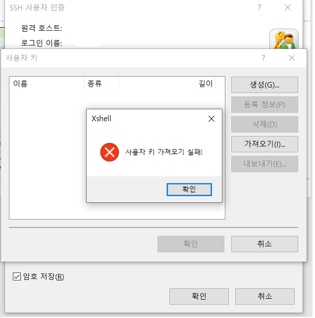
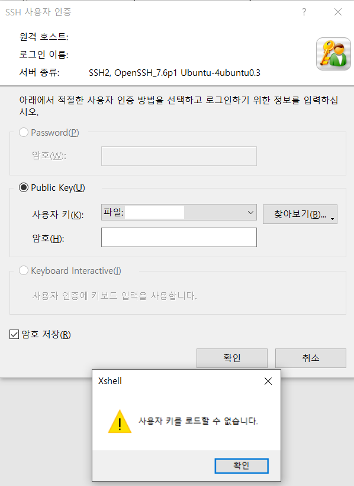
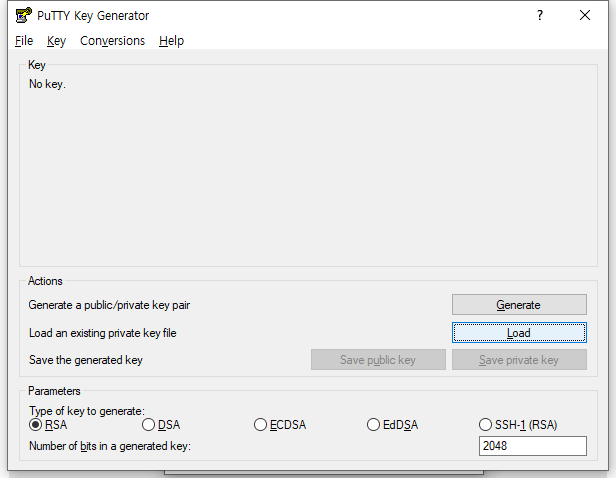
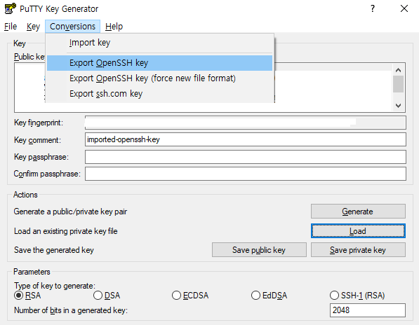

## XShell 사용자 키 가져오기 실패

XShell 사용 중 맥 환경에서 생성한 개인 키가 인식되지 않는 문제가 발생했습니다. 키 가져오기 기능과 파일 불러오기 기능 모두에서 에러가 발생함을 확인했습니다.

기존에 불러오고자 했던 파일은 ppk 파일인데, 위 에러는 아래와 같이 해결 가능합니다.

### 해결 방법

1. PuTTY 설치

2. PuTTYgen (PuTTY keygen) 실행

3. Key Load

4. Load 이후 Conversion에서 Export OpenSSH key 선택

5. 위의 key 파일을 XShell에서 불러오기

이상의 방법으로 해결됩니다. 권한 관련 방법도 등장했지만, 저는 위와 같은 방법을 써서 해결했습니다.

### 출처
- http://hpwc3po.blogspot.com/2018/11/import-ssh-private-key-file-to-xshell.html
- https://blogger.pe.kr/860