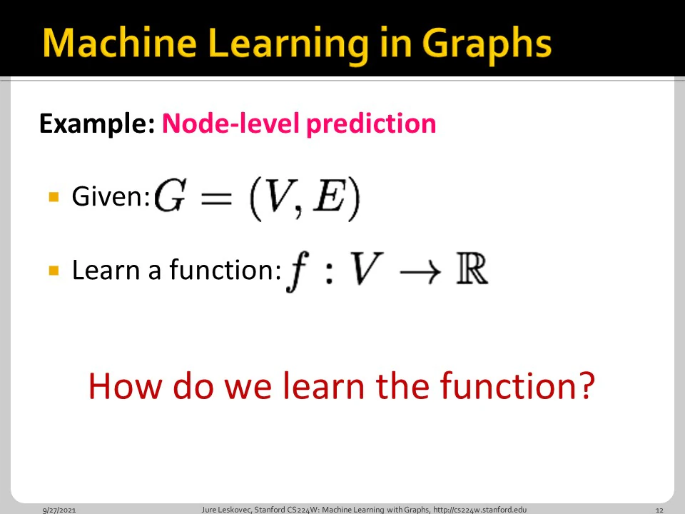{: width="960" height="720" }
_슬라이드 12_

인트로에서 말했던 것처럼, GNN에는 여러 task가 있습니다. Node-level prediction을 예시로 든다면 node V가 왔을 때 이를 실수 공간 R로 mapping하는 function을 찾고 싶은 것입니다. 과연 과거의 전통적 방법론들은 어떤 접근을 했을까요?

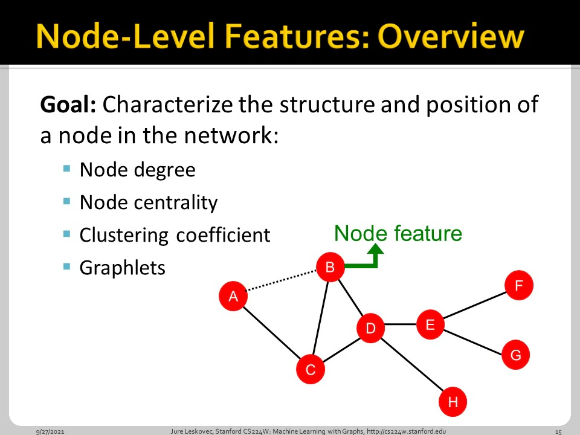{: width="960" height="720" }

여기서 소개된 Node-level feature에는 네가지가 있습니다. Node degree, node centrality, clustering coefficient, graphlets이 그것입니다.

Degree는 특정 node에 연결된 edge의 개수입니다. Degree는 각 node의 중요성을 고려하여 정해지는 인자는 아닙니다. 하지만 node centrality는 node의 importance를 고려합니다. Centrality를 구하는 대표적인 방법으로 Eigenvector centrality, Betweenness centrality, Closeness centrality 등이 있습니다.

## Centrality 구하기 1: Eigenvector Centrality

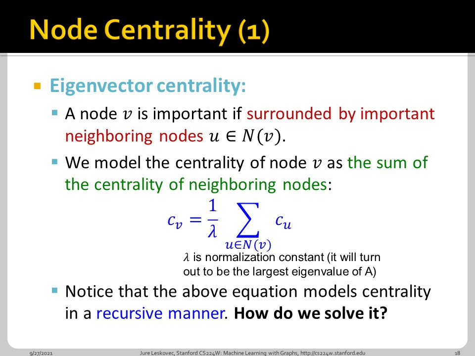{: width="960" height="720" }

첫 번째로, eigenvector centrality가 있습니다. node v는 important한 node에 둘러싸여 있으면 그 자체도 important하다고 봅니다. $$\lambda$$는 행렬 A (adjacency matrix)의 eigenvalue 중 가장 큰 값입니다.

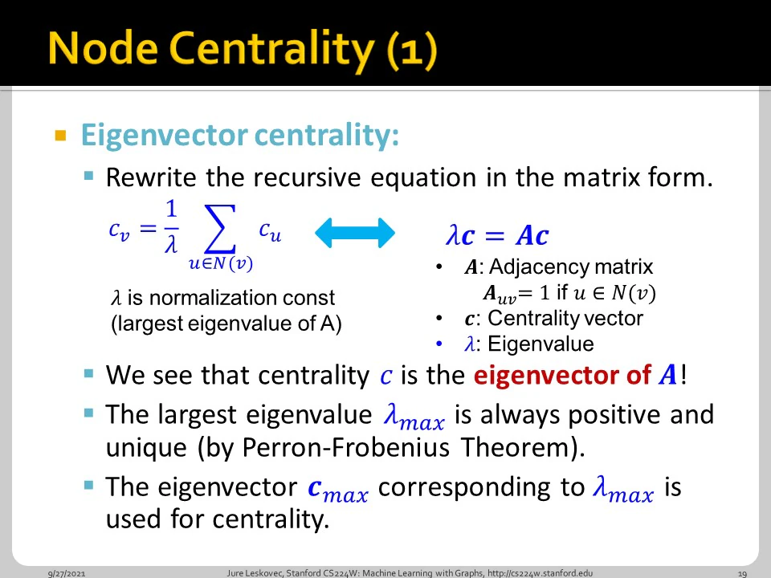{: width="960" height="720" }

위의 행렬 형태로 쓴 식을 보면 이 centrality가 왜 eigenvector centrality인지 알 수 있습니다. $$\lambda\mathbf{c}=\mathbf{A}\mathbf{c}$$에서 쉽게 확인 가능합니다. $$\lambda_{max}$$에 해당하는 eigenvector $$\mathbf{c}_{max}$$ 자체가 centrality로 사용됩니다.

## Centrality 구하기 2: Betweenness Centrality

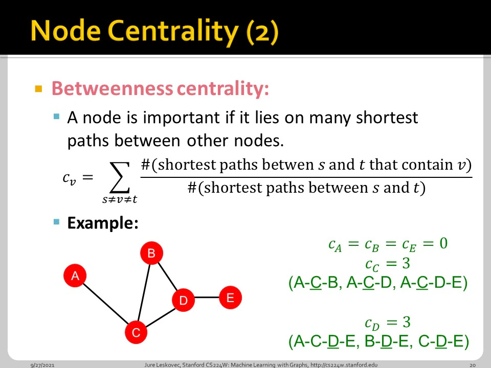{: width="960" height="720" }

v를 제외한 모든 node 쌍 (s, t)에 대해, s와 t 사이의 shortest path 중 node v를 지나는 shortest path의 비율을 모두 더한 값이 betweenness centrality 입니다.

## Centrality 구하기 3: Closeness Centrality

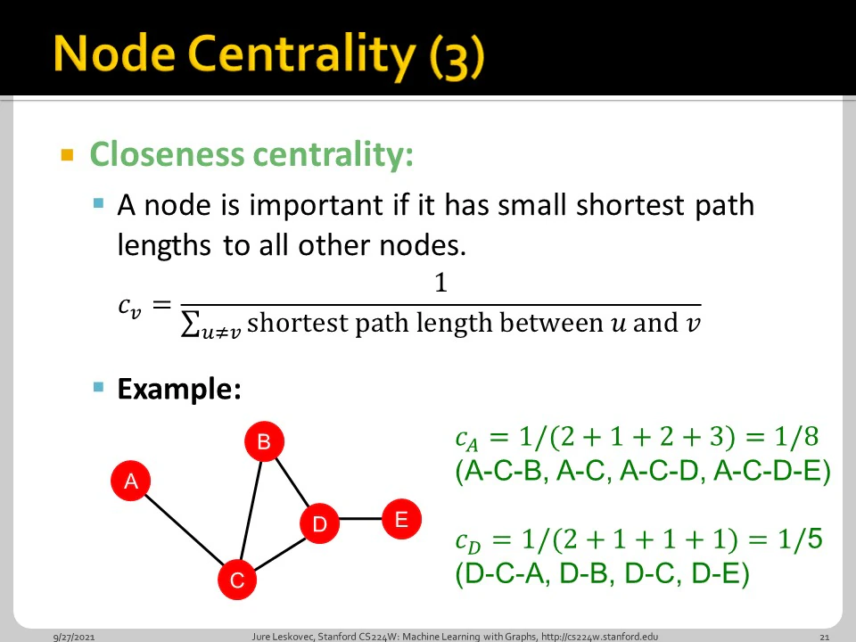{: width="960" height="720" }

나에게 오는 최단 경로의 길이의 합의 역수로 closeness centrality를 구합니다. $$\mathbf{c}_{A}$$보다 $$\mathbf{c}_{D}$$의 centrality가 더 큰 것을 알 수 있습니다. 실제로 D가 A에 비해 좀 더 중심에 위치해있기도 합니다.

## Clustering Coefficient 구하기

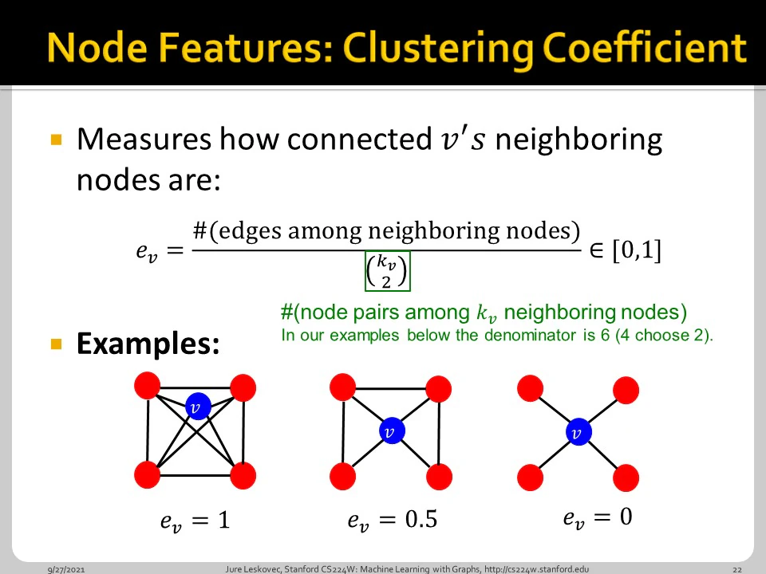{: width="960" height="720" }

내가 연결되어 있는 node들이 서로 얼마나 cluster를 이루고 있는지에 대한 coefficient입니다. 가능한 최대 edge 개수로 실제 edge 개수를 나누어 줍니다. 이 외에도 Graphlets (특정 node 개수에 대해서 가능한 graph의 조합)으로도 node feature를 정의할 수도 있습니다.

지금까지 이야기한 node feature를 구하는 방법은 node의 importance를 고려하면서 node feature를 추출하는 importance-based features와 구조만을 고려하는 structure-based feature로 나눌 수 있습니다. 하지만 지금까지 나온 feature들 중 centrality 계열(eigenvector, betweenness, closeness centrality)은 전체 graph의 구조를 파악하고 있어야지만 얻을 수 있습니다.

## Link Level Feature: Link Prediction Task

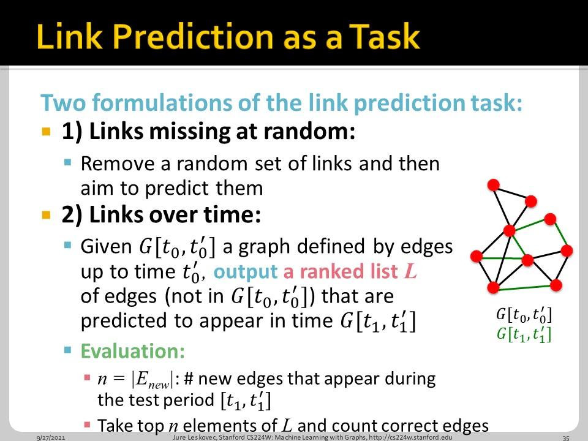{: width="960" height="720" }

Link prediction task는 특정 link를 지우고, 해당 링크를 예상하게 하는 문제와 시간에 따라 존재하는 link를 예측하는 문제 등으로 세분화할 수 있습니다. 두 node 사이의 관계성이 높으면 해당 node 사이에 링크가 있었다는 식으로도 예측 가능합니다.

## Link Level Feature

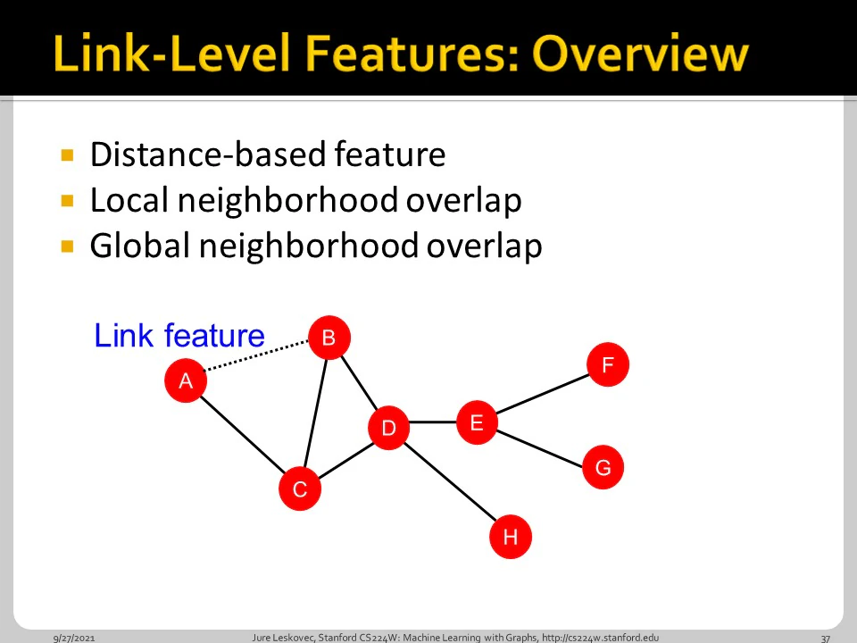{: width="960" height="720" }

Link level feature를 구하는 것은 크게 distance-based feature, local neighborhood overlap, global neighborhood overlap으로 나눌 수 있습니다. Distance-based feature는 두 node 사이 거리를 feature로 사용합니다. 하지만 이 feature는 두 node 사이에 얼마나 많은 공통 neighborhood가 있는지 파악하지 못합니다. 그래서 local neighborhood overlap의 index들이 사용됩니다.

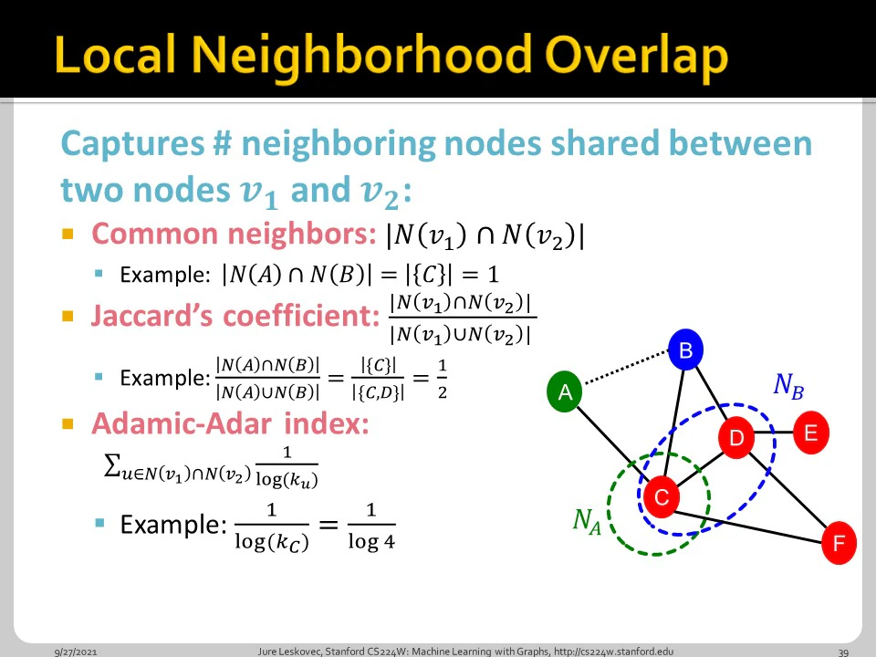{: width="960" height="720" }

위는 local neighborhood index의 예시입니다. 하지만 이러한 local neighborhood index는 두 node 사이에 공통 neighbor가 있을 때만 값을 가지게 됩니다. 공통 neighbor가 없으면(예: 3 hop 이상 떨어진 node) 앞으로 연결될 가능성이 있더라도 값이 항상 0이 되어 아무런 관계성을 가지지 못합니다. 이 때문에 Global neighborhood overlap이 사용됩니다.

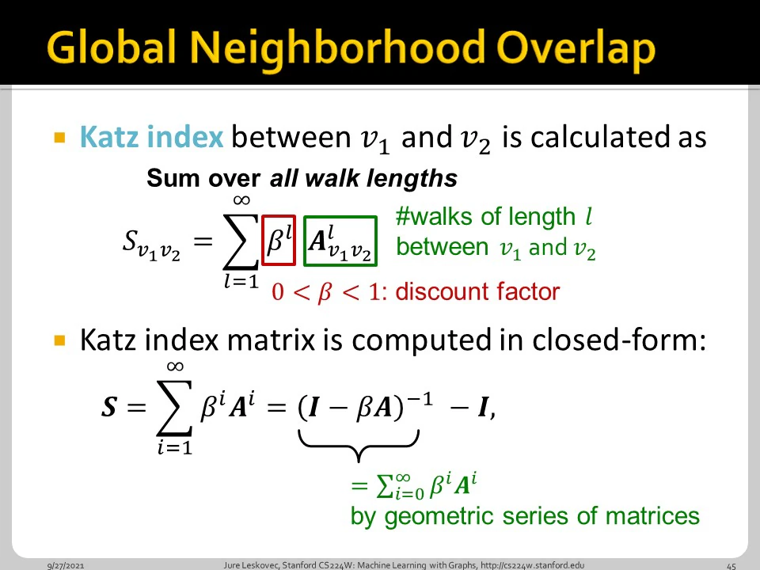{: width="960" height="720" }

Katz index는 $$v_1$$과 $$v_2$$ 사이의 길이 $$l$$인 walk의 수에 discount factor $$\beta^l$$ ($$0 < \beta < 1$$)을 곱해서 모든 길이 $$l$$에 대해 합합니다. 그리고 Katz index는 closed form으로 구해지기도 합니다. 위 슬라이드 아래쪽의 식은 등비급수 합 공식의 행렬 버전으로 생각하시면 됩니다.

## Graph Level Features: Graph Kernels

기계학습을 보다보면 커널이라는 단어가 자주 등장하는데, 저도 정확하게 이해하고 있지는 않습니다. 일단 식으로 나타내면 아래와 같습니다.

$$\mathbf{K}(x,z)=\Phi (x)^{T}\Phi (z)$$

이때 $$\Phi$$는 feature representation을 뜻하는데, 가끔 이 $$\Phi$$를 계산하기 어려운 경우들이 있습니다. 그럴때 $$\mathbf{K}(x,z)$$가 $$\Phi (x)^{T}\Phi (z)$$를 쉽게 계산해주면 좋겠죠? 이런 $$\mathbf{K}$$를 Kernel이라고 합니다. [https://xavierbourretsicotte.github.io/Kernel\_feature\_map.html](https://xavierbourretsicotte.github.io/Kernel_feature_map.html)에 아주 훌륭한 설명이 있으니 확인해보셔도 좋겠습니다. 어쨌든, 그래프에서 정의되는 kernel을 찾아서 graph level feature를 표현하겠다는 의도로 보시면 됩니다.

그래프 커널의 종류에는 여러가지가 있는데, Graphlet kernel, Weisfeiler-Lehman kernel, random-walk kernel, shortest-path kernel 등등이 있습니다. 이 커널들 중 Bag-of-Words 기법을 사용하는 커널들이 있습니다. Bag-of-Words는 단순히 document 속 단어를 counting 하는 방법입니다.

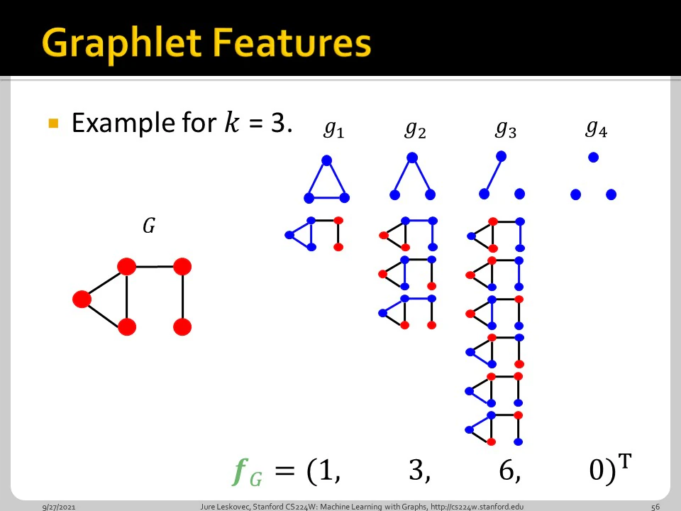{: width="960" height="720" }

위처럼 graphlet(가능한 graph의 집합)에 해당하는 원소의 개수를 카운팅한다고 보시면 되겠습니다. 이런 식으로 graphlet kernel을 구해서 그래프 사이의 연산을 합니다.

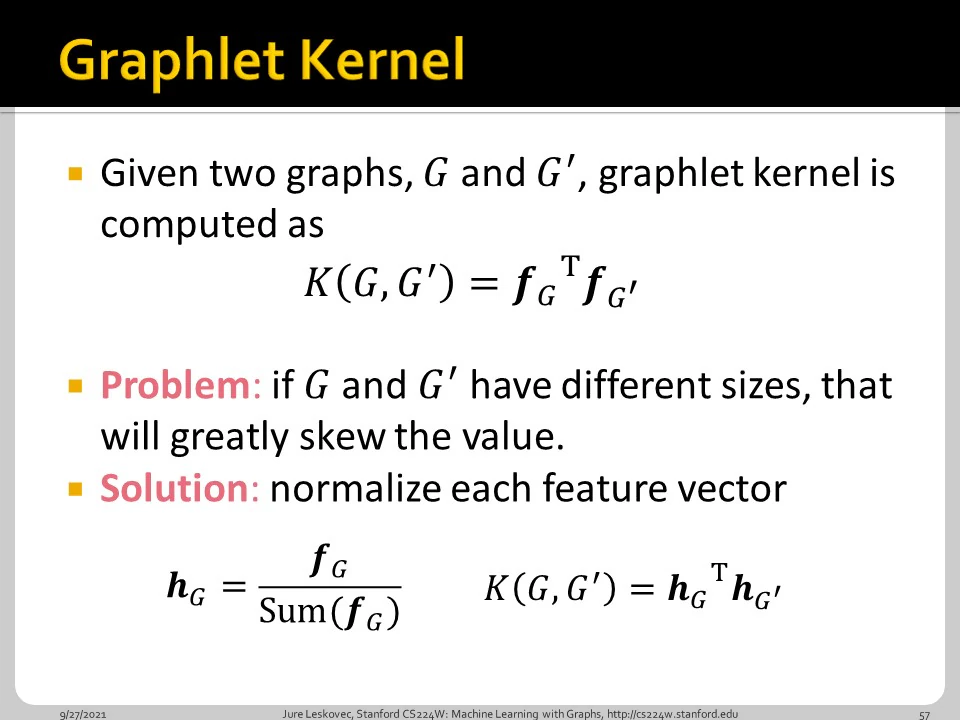{: width="960" height="720" }

하지만 예상할 수 있듯이 이 방법은 computational cost가 너무 큽니다. 그래서 hash 함수의 성질을 활용한 color refinement 방법론이 적용된 Weisfeiler-Lehman kernel이 등장합니다.

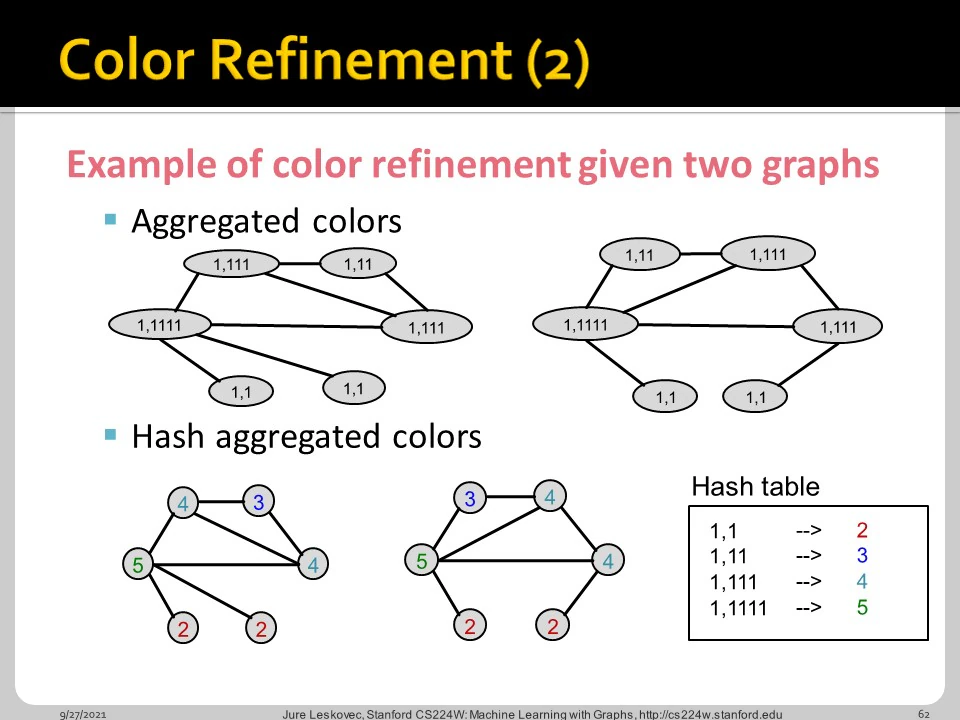{: width="960" height="720" }

해시 함수는 input에 따라서 고유한 값을 내뱉는 함수입니다. 위의 단계를 k번 거치면 k-hop neighborhood에 대한 graph structure를 얻을 수 있습니다. 색들이 안정될 때 까지 반복합니다.

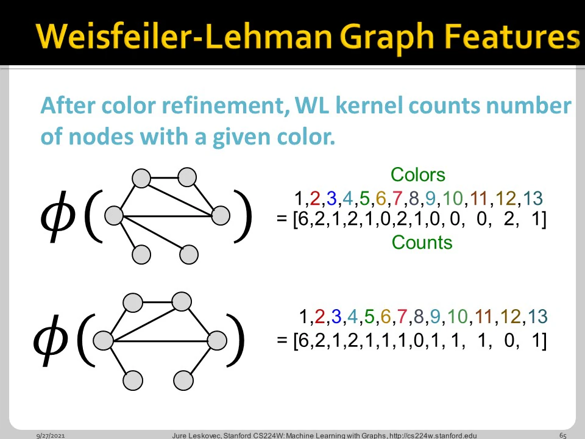{: width="960" height="720" }

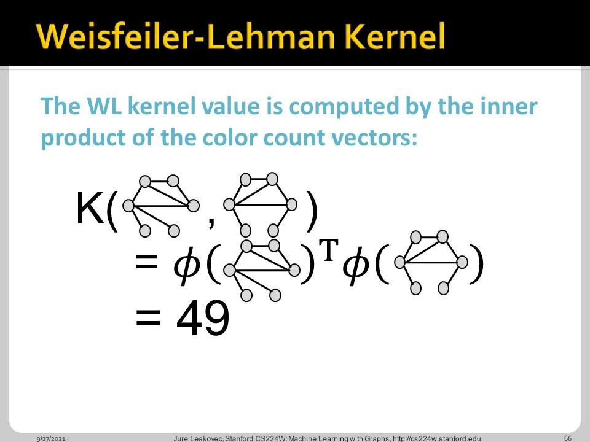{: width="960" height="720" }

그리고 그 색으로 이루어진 BoW vector를 내적하여서 두 그래프 사이의 관계를 의미하는 scalar 값을 얻습니다.

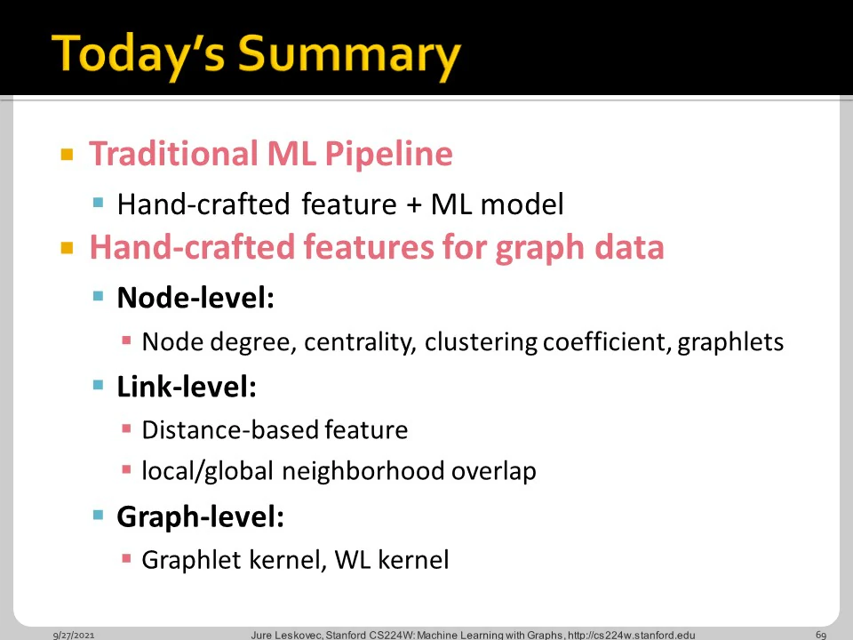{: width="960" height="720" }

이렇게 하여서 node-level, link-level, graph-level의 feature들을 확인해볼 수 있었습니다.
