## Node Embeddings: Encoder and Decoder

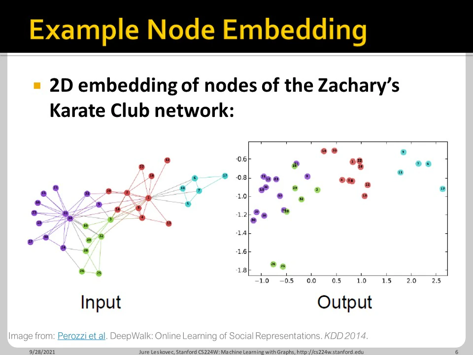{: width="960" height="720" }

Node Embedding은 그래프 내의 node들을 특정한 embedding space로 옮기는 과정입니다. 위 예시에서 embedding space는 2D가 되겠습니다.

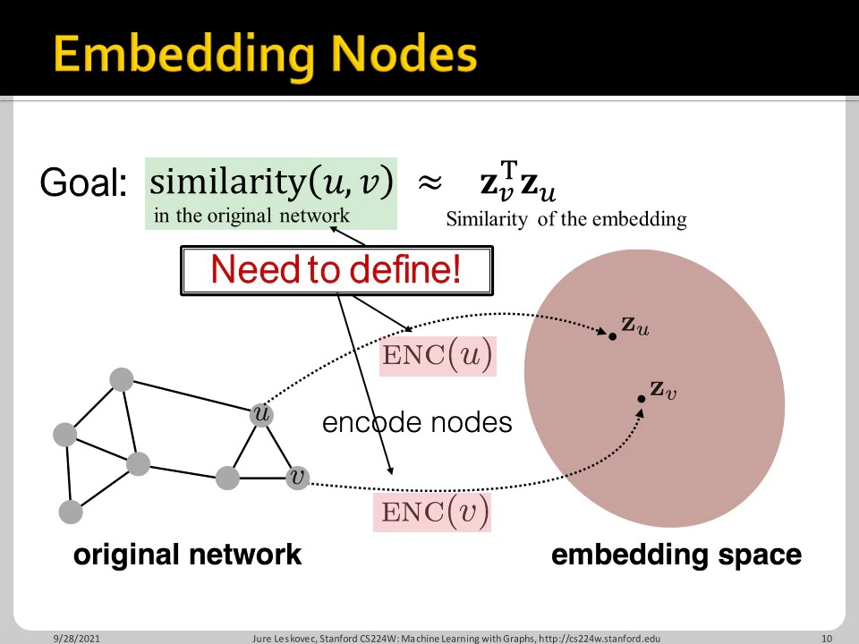{: width="960" height="720" }

Embedding은 encoder와 decoder로 나뉘어집니다. Encoder는 original network에서 embedding space로 node embedding을 보내려 합니다. ENC가 encoder에 해당합니다. 그리고 실제 네트워크에서의 유사도와 embedding space에서의 유사도가 흡사하기를 바랍니다. Embedding space에서의 유사도는 벡터간 내적으로 구하면 되는데, original network에서의 유사도는 어떻게 구할까요?

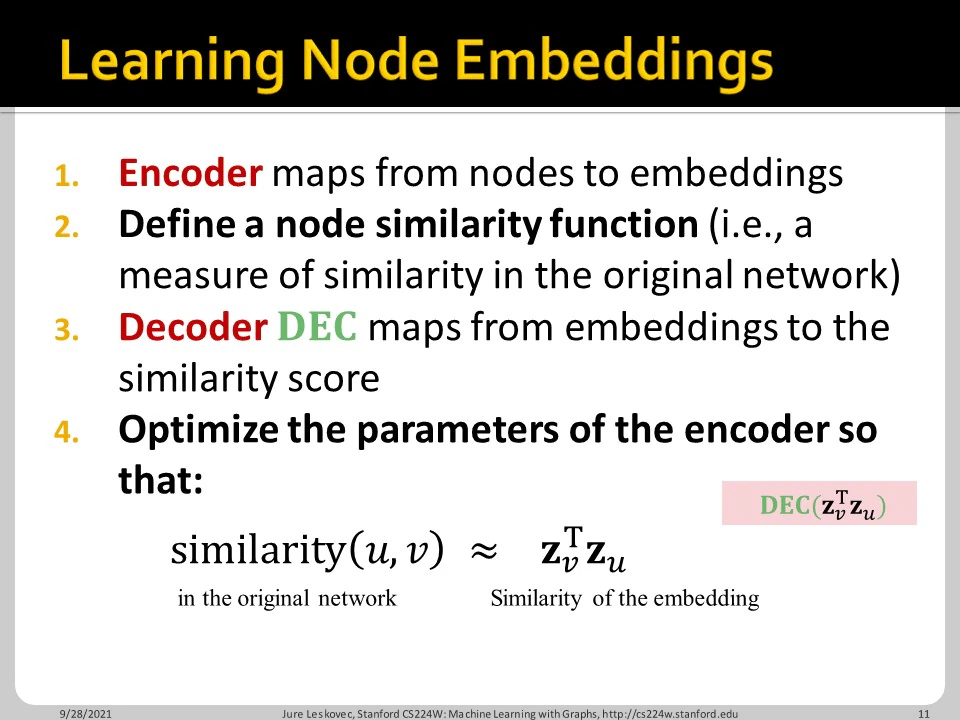{: width="960" height="720" }

역할을 나누면 위와 같습니다. Encoder는 네트워크에서 embedding space로 mapping을 합니다. Similarity function이 정의가 된다면, Decoder가 similarity score로 embedding을 다시 mapping합니다. 결국 두 결과가 비슷하면 그만입니다.

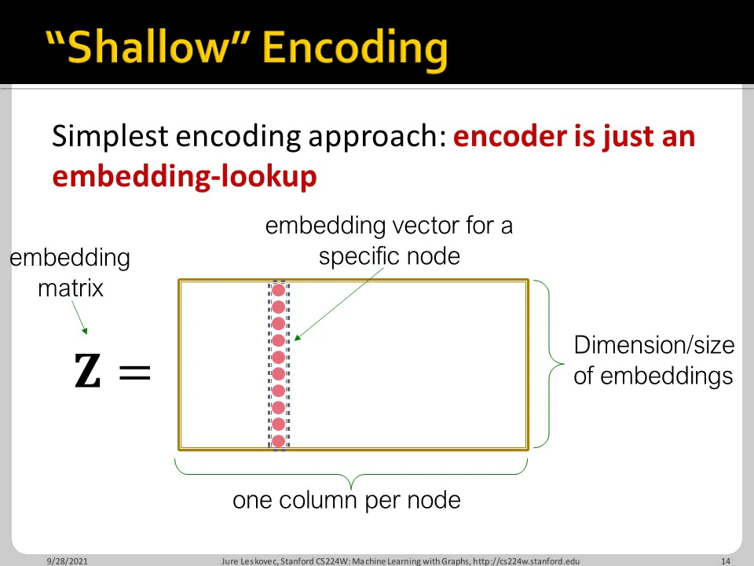{: width="960" height="720" }

가장 간단한 형식의 Encoding은 shallow encoding입니다. Encoding이라고 부르기도 좀 민망한데, embedding matrix에서 node u에 해당하는 column을 그냥 읽어오는 것입니다. 이때 embedding matrix에서 긁어오는 거니까, embedding의 최적화는 encoder의 최적화가 아닌 embedding matrix 자체의 최적화가 됩니다. DeepWalk, node2vec 등이 이러한 shallow encoding을 사용하는 대표적인 방법입니다.

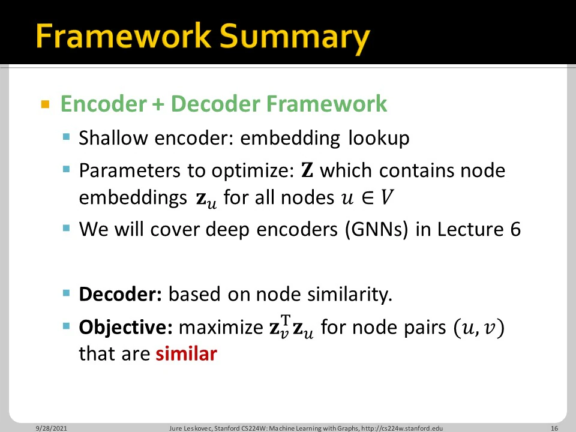{: width="960" height="720" }

요약하면, 방금 다룬 shallow encoder는 embedding matrix에서 숫자를 긁어오는 수준의 encoder입니다. 다른 encoder는 뒤에 차차 알아볼 예정입니다. Decoder는 두 node u와 v가 실제 네트워크에서의 node similarity를 기반으로 그 내적값이 maximize 되기를 바랍니다.

아까 말한 것 처럼 이 similarity를 어떻게 정할까요? 두 node가 연결되면 크게 할까요, 공통 neighbor가 있으면 크게 할까요, 아니면 구조적 역할이 비슷하면 크게 할까요? 여기서 우리는 node label과 feature를 사용하지 않고 network structure만을 활용한 un-supervised way에 대해서 고민합니다.

## Random Walk Approaches for Node Embeddings

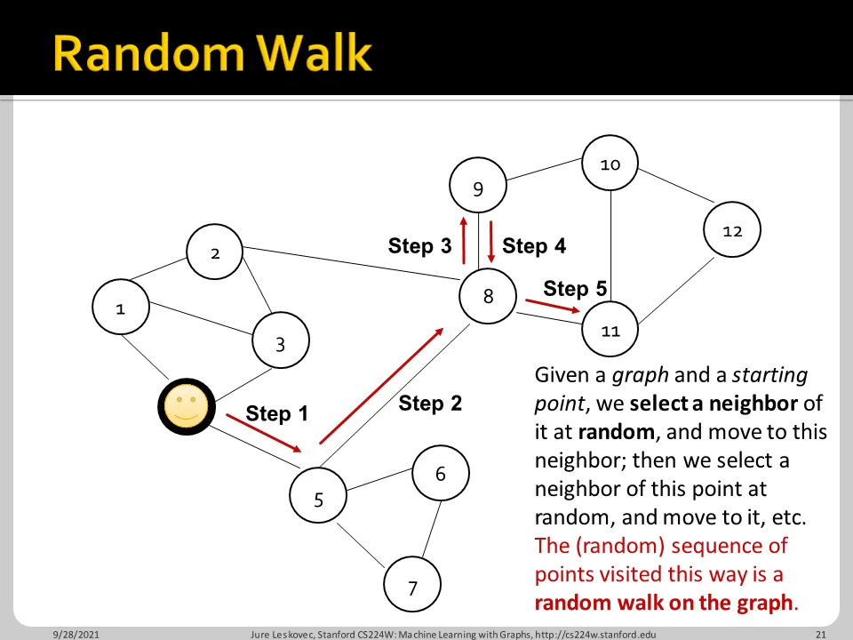{: width="960" height="720" }

Random walk는 말 그대로 특정 node를 출발점으로 하여 random 하게 움직이는 일련의 sequence를 말합니다. 그리고 만약 이 random walk에 두 node가 포함되어 있으면 서로 유사하다고 볼 수 있겠습니다.

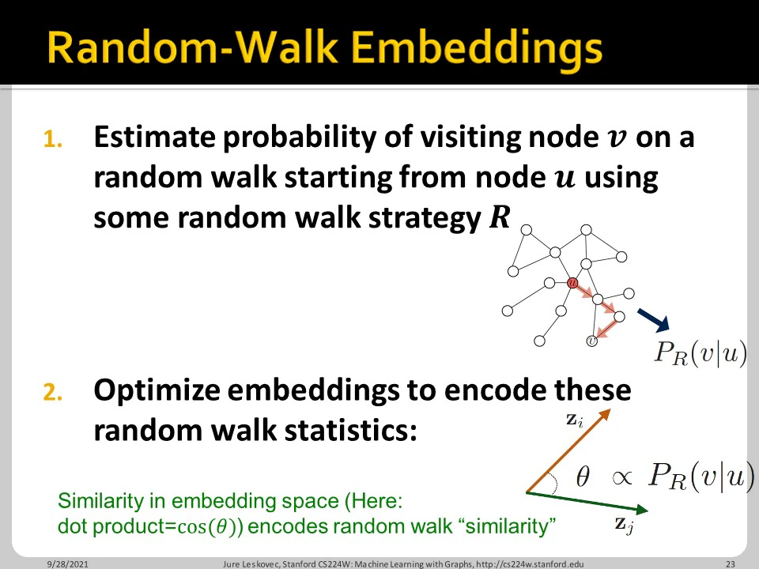{: width="960" height="720" }

$$P_{R}(v\vert u)$$는 node u에서 출발한 random walk R에서 node v를 만날 확률인데, 그 확률이 높을수록 embedding vector $$\mathbf{z}_{u}$$와 $$\mathbf{z}_{v}$$가 유사하도록 만들자는 이야기입니다. (위의 i와 j는 오타입니다.)

Random walk는 expressivity가 높고(high-order multi-hop information도 반영 가능) efficiency 또한 높습니다(random walk pair만 고려하여 계산).

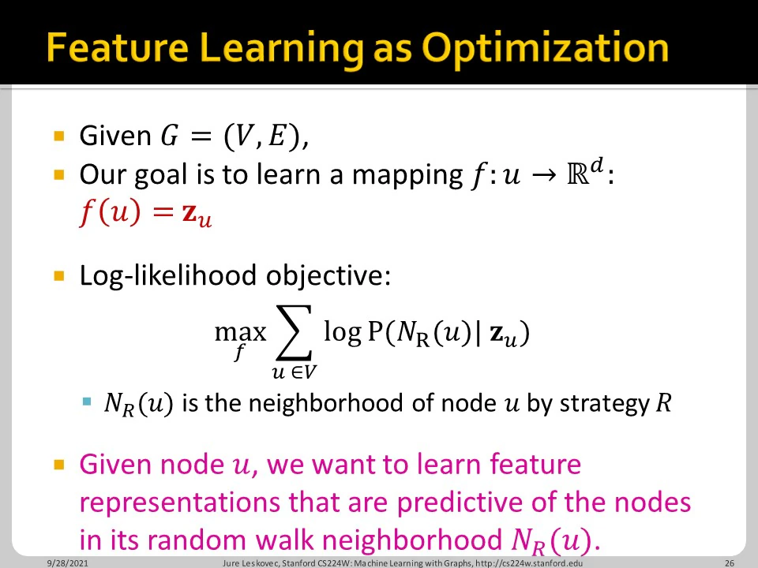{: width="960" height="720" }

그렇다면 우리가 embedding을 시키는 방법은 위와 같이 정의할 수 있습니다. $$\mathbf{z}_{u}$$라는 vector를 부여 받았을 때, u에서 출발한 random walk의 node들을 잘 예측한다면 $$\mathbf(z)_{u}$$가 잘 정의되었다고 할 수 있겠습니다.

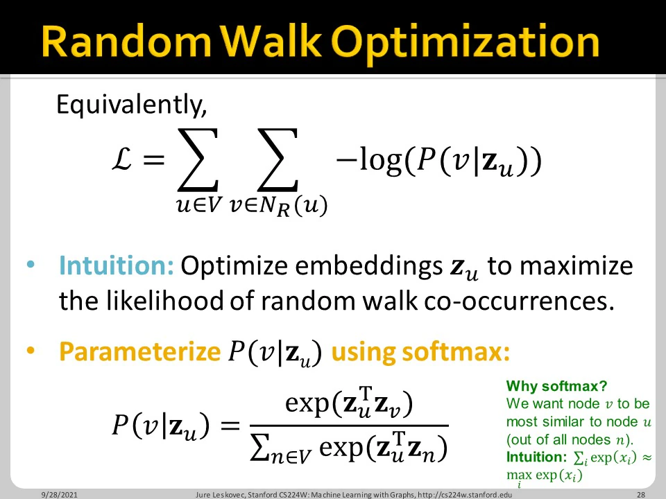{: width="960" height="720" }

위의 intuition을 가지고 와서 정리하면 위와 같습니다. 그래프 전체의 node들에 대하여, $$\mathbf{z}_{u}$$가 주어졌을 때 u에서 출발한 random walk속 node v들을 예측할 확률을 높이면 됩니다. 위의 loss function을 minimize한다고 하는데, 사실 log likelihood maximization입니다.

이제 여기서 한가지를 좀 바꾸는데, $$P(v\vert \mathbf{z}_{u})$$ 대신에 softmax를 넣어줍니다. 다른 모든 vector embedding과의 내적 합 대비, 나로부터 시작한 random walk에 포함된 vector embedding과의 내적이 컸으면 좋겠다는 이야기입니다. Straightforward합니다.

하지만 이게 상당히 cost expensive한데, 일단 그래프 속 모든 node들에 대해서 모두 연산을 해줘야 합니다. 그러한 연산이 $$\sum_{u\in V}$$에서 한번, $$\sum_{n\in V}exp(\mathbf{z}_{u}^{T}\mathbf{z}_{n})$$에서 또 한번 발생합니다. 그래서 실제로 구현할 때에는 negative sampling을 진행합니다. Negative sampling은 NLP에서 주로 사용하는데, 단어 space가 너무 크다보니까 단어의 embedding vector를 학습 시킬 때, 그 단어와 연관이 있는 단어들은 따로 선별해서 true, 혹은 비슷한 값을 갖도록 학습을 시킵니다. 연관이 없는 단어야 아주 많으니 false, 혹은 0인 sample은 그냥 random하게 k개 추출하고 거기에 label을 false로 두는 것입니다.

결국 위의 softmax식에서 분모 부분에 해당하는 파트를 적절히 sampling 하겠다는 것이고, 보통 5~20 정도 한다고 합니다. 너무 많이 sampling 하면 $$P(v\vert \mathbf{z}_{u})$$의 절댓값이 너무 작아져 학습이 잘 안되는 문제가 발생하지 않을까 싶습니다.

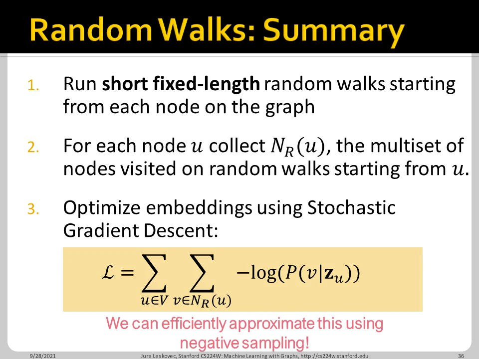{: width="960" height="720" }

요약하자면 u로부터 시작한 적절히 짧은 random walk를 해서 $$N_{R}(u)$$를 모으고, (이때 $$N_{R}(u)$$는 multi-set입니다. 중복을 허용한다는 이야기입니다.) SGD로 위의 식을 최소화 시켜주면 적절하게 embedding vector $$\mathbf{z}_{u}$$를 얻을 수 있습니다.

## Node2vec

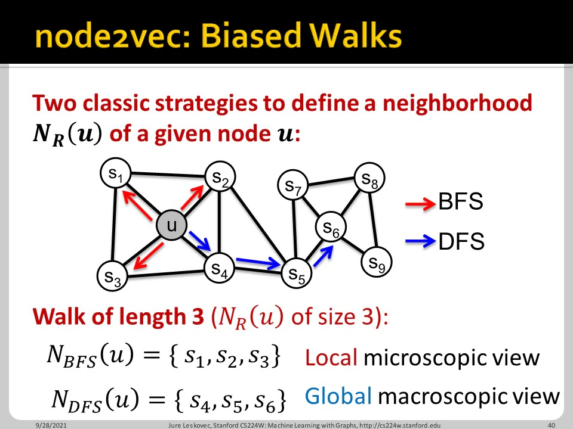{: width="960" height="720" }

Word2vec은 특정 단어의 embedding vector와 앞뒤 단어들의 embedding vector를 비교하면서 기존의 embedding을 개선합니다. node2vec도 마찬가지인데, random walk가 아닌 biased walk를 사용합니다. 이때 walk가 BFS 같은 탐색과 DFS 같은 탐색 중 어느 쪽으로 더 biased될지를 조절할 수 있습니다. BFS는 local microscopic view, DFS는 global macroscopic view를 제공합니다.

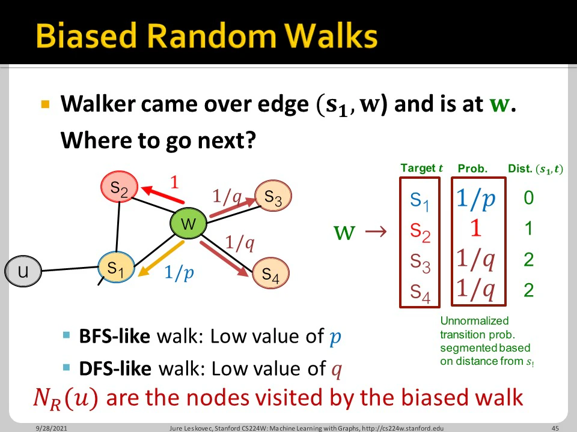{: width="960" height="720" }

그리고 그 bias의 정도는 p와 q라는 hyperparameter로 정해집니다. 전 node $$s_1$$에서 1 떨어진 w로 왔습니다. 여기서 동등하게 $$s_1$$로부터 1 떨어진 $$s_2$$로 갈 확률을 1, 다시 $$s_1$$로 돌아갈 확률을 1/p, 보다 먼 $$s_3$$나 $$s_4$$로 갈 확률이 1/q라고 보는 것입니다. 아직 normalize는 하지 않은 상황의 probability를 적색 상자 안에서 확인할 수 있습니다.

node2vec의 알고리즘을 정리하면 다음과 같습니다.

1. 주어진 p와 q로 random walk의 전이 확률 계산 (Compute random walk probabilities)
2. u에서 길이 l의 random walk r회 시행 (Simulate r random walks of length l starting from each node u)
3. SGD로 node2vec 최적화 (Optimize the node2vec objective using SGD)

괄호 안은 원문이고 한글은 제가 나름대로 해석한 것인데, 1번의 경우 의미가 다를수도 있습니다. 어찌되었든, 이 알고리즘은 선형 time complexity를 갖고, 위의 세 step은 각각 병렬화될 수 있다고 합니다.

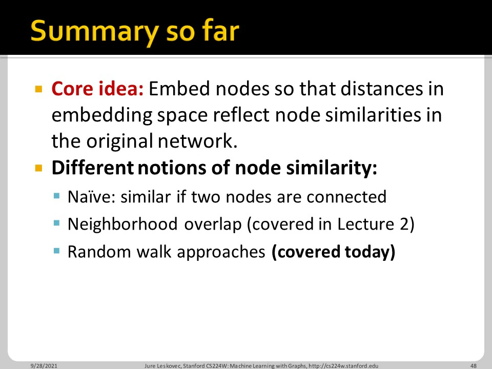{: width="960" height="720" }

이렇게 해서 original network와 embedding space의 distance가 비슷하도록 하는 방법을 알아보았습니다. 그리고 node similarity를 정의하는 새로운 random walk 기반 방법론도 배웠습니다.

## Embedding Entire Graphs

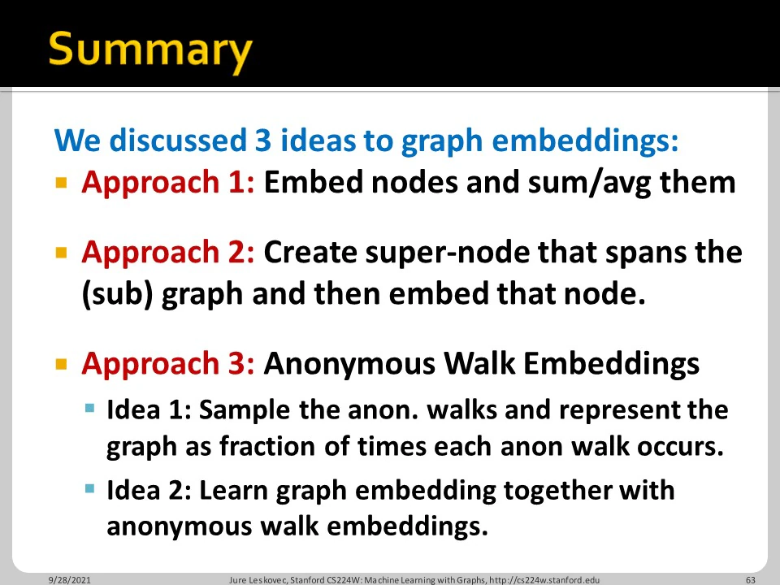{: width="960" height="720" }

위 파트에서는 그래프 전체를 embedding하는 방법을 다룹니다. 방법은 세가지로 분류할 수 있습니다.

1. 그냥 node embedding 다 더하기
2. 원래 그래프(또는 sub graph)의 모든 node와 연결된 가상의 node(super-node)를 하나 추가하고 그 node의 embedding 구해서 그 embedding 값을 graph의 embedding으로 사용하기
3. 그래프 embedding을 학습시키는 방법. Window size 정해두고 그 window size 만큼의 anonymous walk(방문한 node를 처음 방문한 순서의 index로 바꿔 쓴 walk)와 학습중인 graph embedding 넣었을 때 그 다음 anonymous walk 잘 예측하게 하기

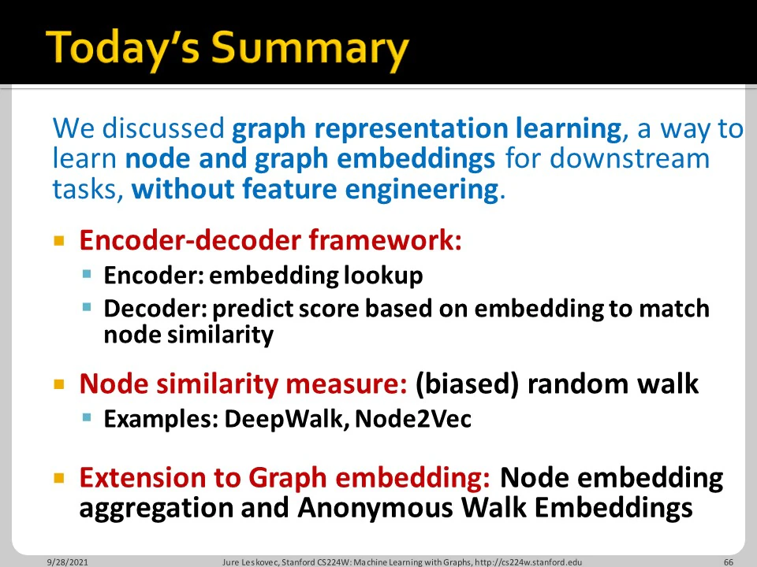{: width="960" height="720" }

이렇게 해서 encoder-decoder framework, node similarity measure, graph embedding에 대한 학습이 끝났습니다.
