이번 node classification 문제를 주위 node에서 message(label 또는 class 확률)를 전달 받는 message passing scheme으로 풀게 됩니다. 몇몇 node에 ground truth가 있어야 다른 node들이 message를 전달 받을 수 있습니다. 따라서 일부 node의 label을 안 상태에서 다른 node의 label을 확인하는 semi-supervised node classification 문제로 접근합니다. 일부 node만 알고 있다면 어떻게 접근할 수 있을까요? 우리는 아래 세 가지 방법을 통해서 위 문제를 해결할 것 입니다.

- Relational classification
- Iterative classification
- Correct & Smooth

비슷한 성질을 지니고 있는 node는 서로 가까울 확률이 높습니다. 이를 homophily라고 합니다. 혹은 가까이 있다보면 node의 성질이 비슷해질 수도 있습니다. 이건 influence라고 합니다.

## Relational Classification

Relational classifier는 node label을 network를 따라서 propagate 시킵니다. label 되어있지 않은 node는 0.5로 initialize 되어있고, 주위 label을 참조하여 update합니다.

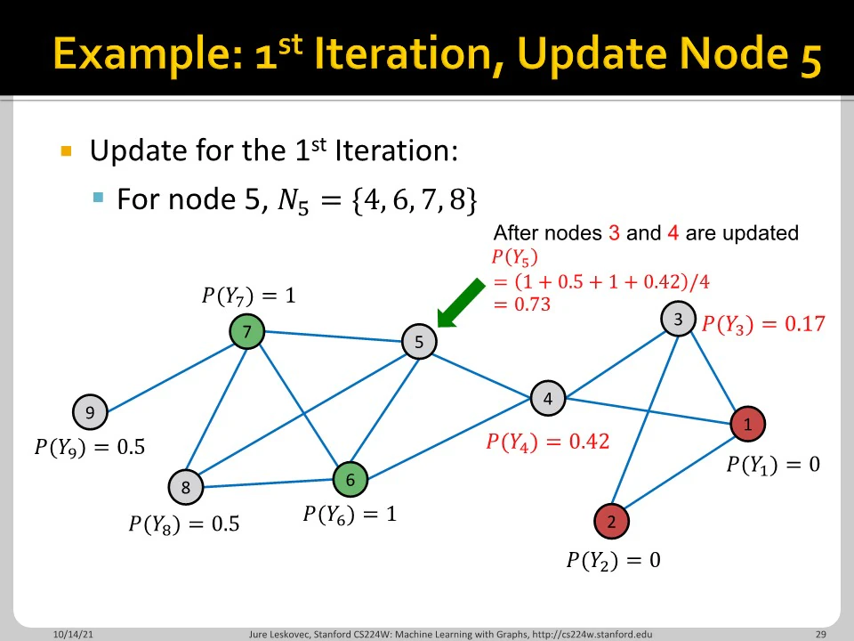{: width="960" height="720" }

이 슬라이드를 보면 직관적으로 이해가 가능합니다. 5번 node를 update할 때는 4번 node를 update한 이후에 그 update한 값을 활용합니다. 이 방법은 수렴이 보장되지 않고, feature information을 사용할 수 없다는 단점이 있습니다.

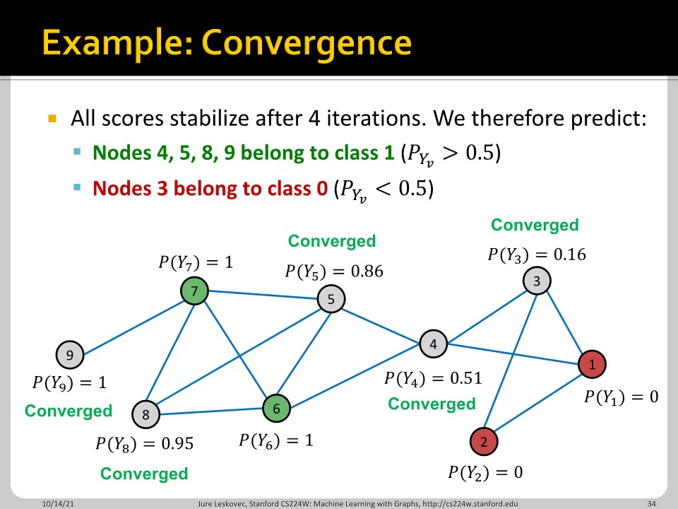{: width="960" height="720" }

값이 일정 이상으로 변하지 않으면 converge로 판단합니다. 그리고 0.5를 기준으로 label을 진행합니다.

## Iterative Classification

Iterative classifier는 node attributes를 활용할 수 있다는 장점이 있습니다. Attributes와 Neighbor set의 label을 활용합니다.

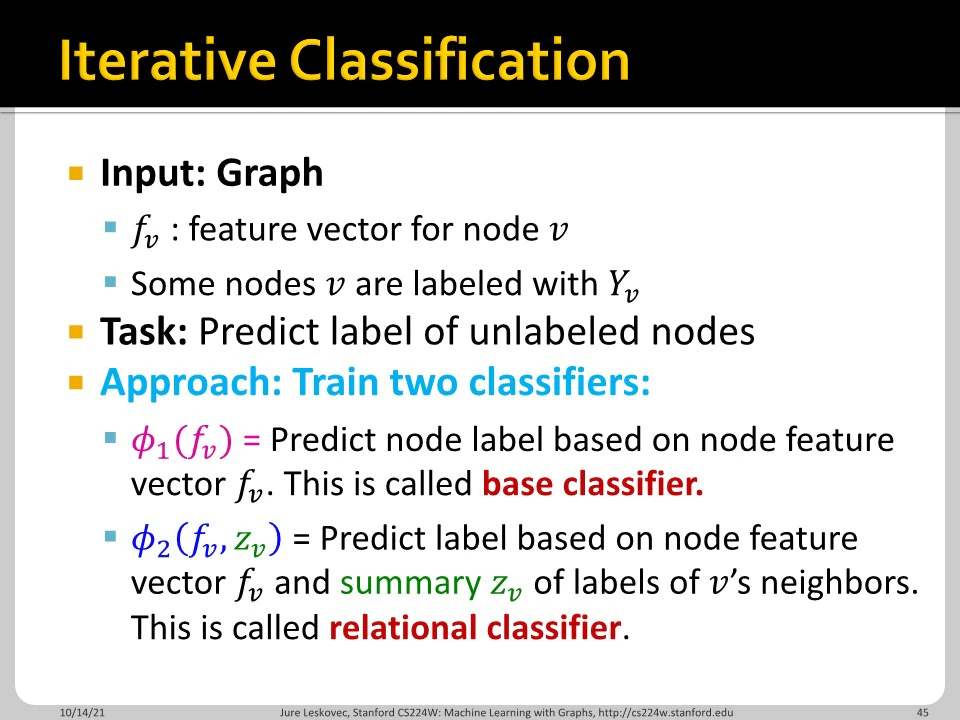{: width="960" height="720" }

$$\Phi_{1}(f_{v})$$와 $$\Phi_{2}(f_{v}, z_{v})$$라는 두 가지 함수를 활용하게 됩니다. $$\Phi_{1}(f_{v})$$는 base classifier라고 불리며 node feature를 기반으로 node label을 prediction 합니다. $$\Phi_{2}(f_{v}, z_{v})$$는 relational classifier라고 불리고, node feature vector $$f_{v}$$와 $$v$$의 neighbor labels로 이루어진 summary $$z_{v}$$를 가지고 label prediction을 진행합니다.

$$z_{v}$$는 여러가지가 가능한데, neighbor label의 histogram일 수도 있고, 가장 common한 label일 수도 있습니다.

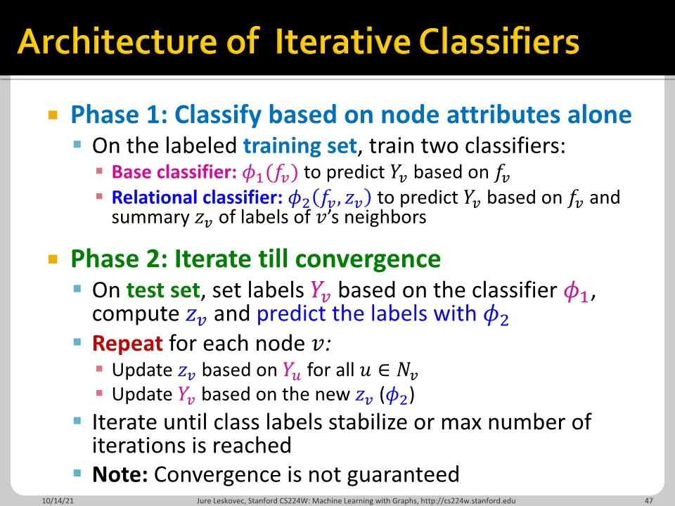{: width="960" height="720" }

Iterative classifier는 두 단계로 나뉘어져 작동합니다.

\- 1 단계  
\- 1. Base classifier : $$f_{v}$$를 활용하여 $$Y_{v}$$를 예측  
\- 2. Relational classifier : $$f_{v}$$, $$z_{v}$$를 활용하여 $$Y_{v}$$를 예측

\- 2 단계 (Iterative on test set)  
\- 1. Base classifier : $$f_{v}$$를 활용하여 $$Y_{v}$$를 결정  
\- 2. Relational classifier : $$f_{v}$$, $$z_{v}$$를 활용하여 $$Y_{v}$$를 예측  
\- Iterate for each node $$v$$  
\- node $$v$$의 neighbor $$u \in N_{v}$$의 label $$Y_{u}$$로 $$z_{v}$$ 갱신  
\- 새로운 $$z_{v}$$로 $$Y_{v}$$ 갱신  
\- 모든 label이 안정되거나 특정 iteration 수에 도달할 때 까지 반복

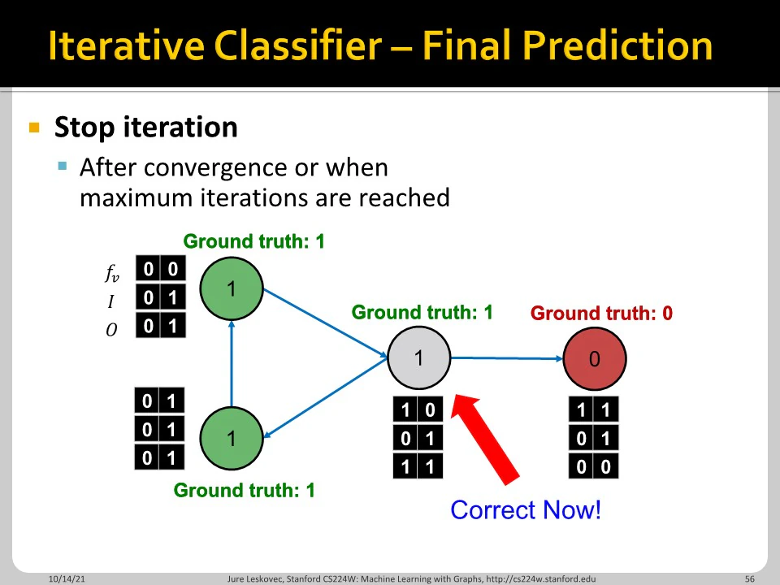{: width="960" height="720" }

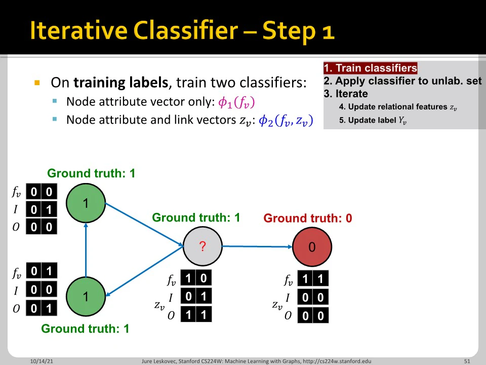{: width="960" height="720" }

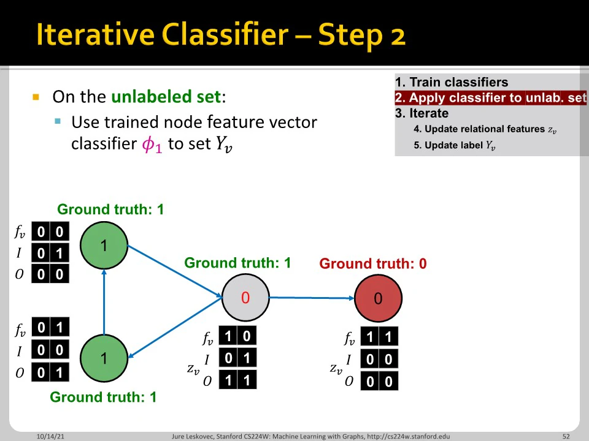{: width="960" height="720" }

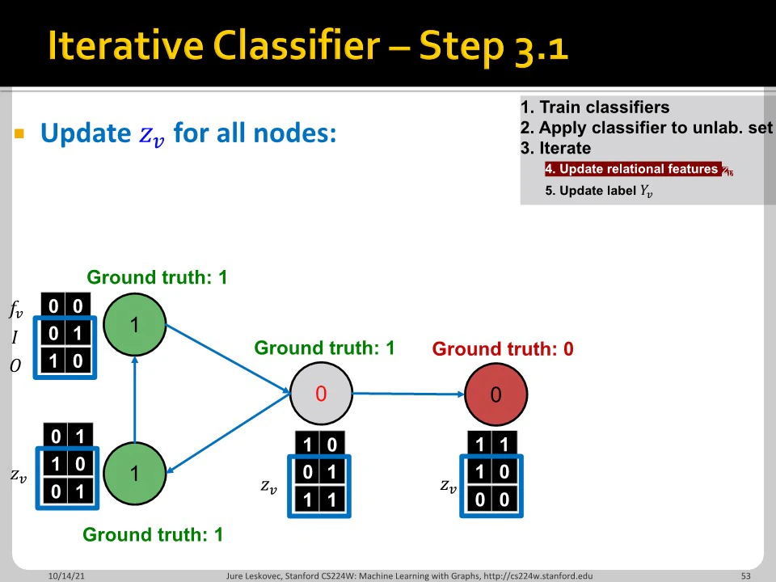{: width="960" height="720" }

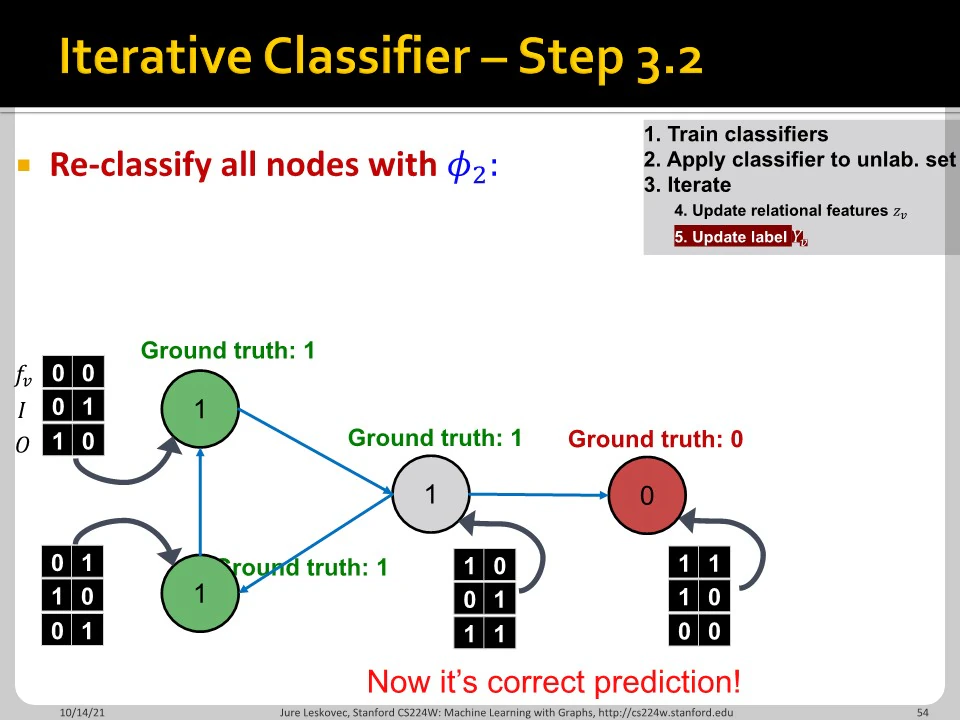{: width="960" height="720" }

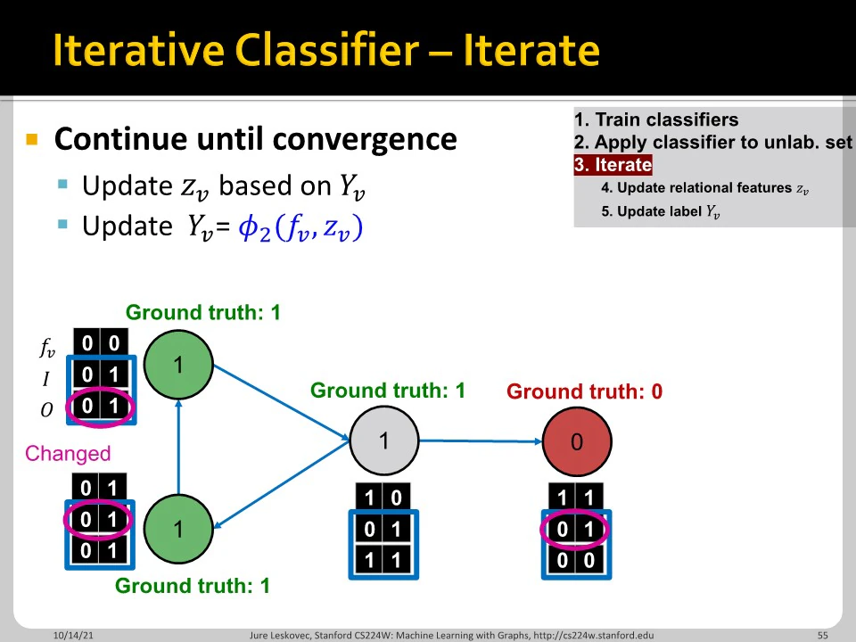{: width="960" height="720" }

위의 슬라이드들은 이 과정을 정리한 내용입니다.

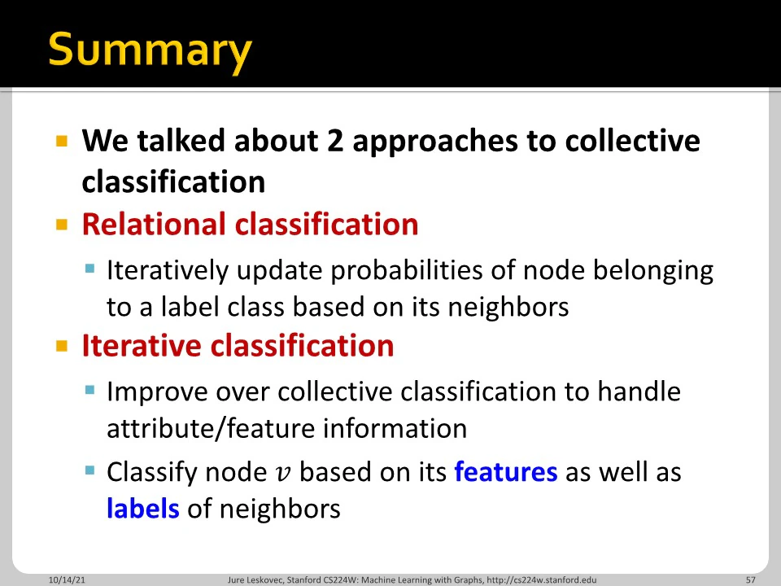{: width="960" height="720" }

이렇게 해서 relational classification과 iterative classification에 대해서 확인해보았습니다.

## Collective Classification : Correct & Smooth

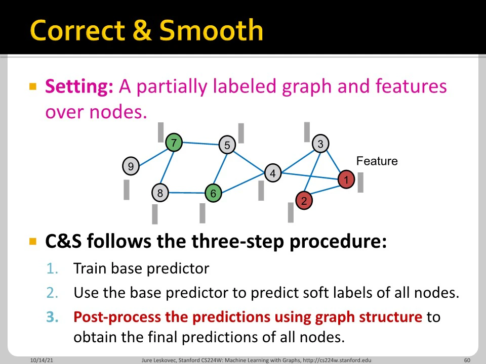{: width="960" height="720" }

Correct & smooth는 마치 teacher network로 만들어진 soft label로 knowledge distillation을 하는 것과 유사합니다. 2021년 10월 OGB leaderboard의 많은 알고리즘들이 correct & smooth를 기반으로 합니다. 위의 과정에서 중요한 것은 3에 해당하는 post-process로 correct step과 smooth step으로 구성됩니다.

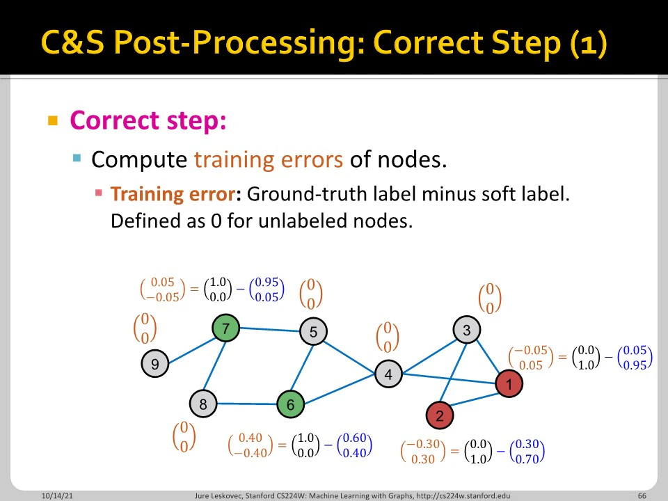{: width="960" height="720" }

먼저 ground-truth label과 soft label의 차이로 training error를 찾습니다. Unlabeled node에 대해서는 진행하지 않습니다.

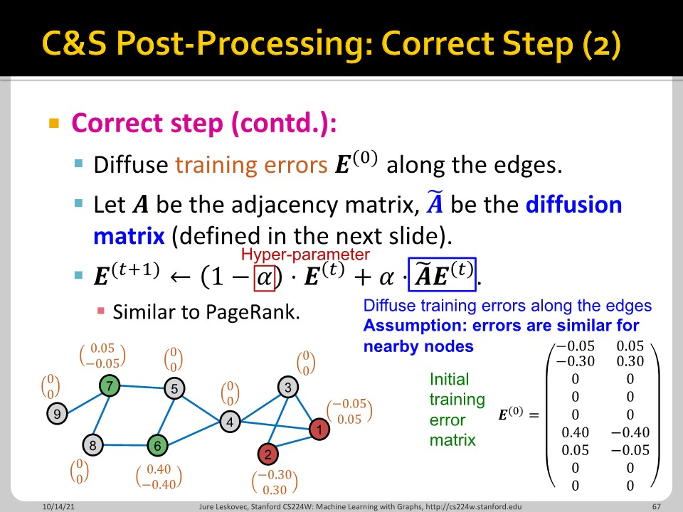{: width="960" height="720" }

Edge에 대하여 error를 확산(diffuse) 시킵니다. 이때 $$\widetilde{A}=D^{-1/2}(A+I)D^{-1/2}$$로, 정규화된 $$A$$를 의미합니다. ($$D$$는 $$(A+I)$$의 degree matrix로 diagonal 성분만 존재합니다.)

이때 $$\widetilde{A}$$의 모든 eigenvalue는 [-1, 1] 범위에 포함되며, eigenvalue 1에 대응되는 eigenvector는 $$D^{1/2}\mathbf{1}$$입니다($$\mathbf{1}$$은 모든 성분이 1인 벡터). Eigenvector의 정의에서 출발하면 쉽게 보일 수 있습니다. 또한 $$\widetilde{A}$$는 몇 번을 거듭제곱해도 값이 발산하지 않고 안정적입니다(well-behaved). 그 거듭제곱의 eigenvalue도 [-1, 1] 범위에 놓이며 가장 큰 eigenvalue는 1로 유지된다고 합니다.

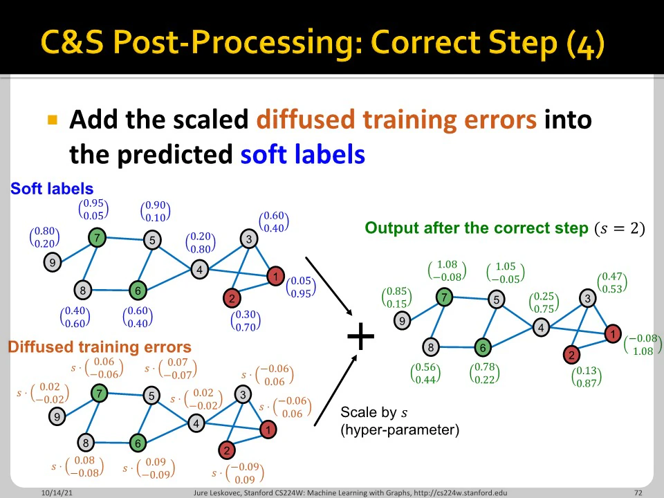{: width="960" height="720" }

Soft label과 Diffused training error의 합이 correct step의 결과물이 됩니다. 이때 scale s는 hyper-parameter가 됩니다.

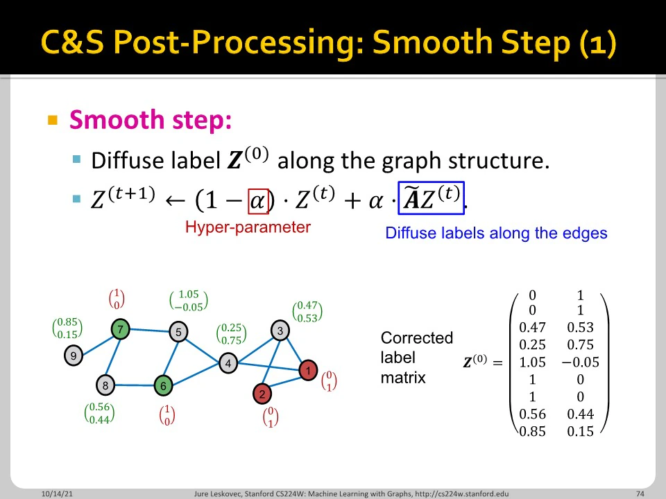{: width="960" height="720" }

Smooth step에서는 training label들을 hard label로 대체합니다. 그 다음 다시 한 번 diffusion을 진행합니다. 위 간단한 과정으로 성능이 크게 향상된다고 합니다. 근처에 있는 node들은 비슷한 형태의 error를 가질 것이라고 생각하여 error를 전파한 것이 효과가 있는 것입니다.

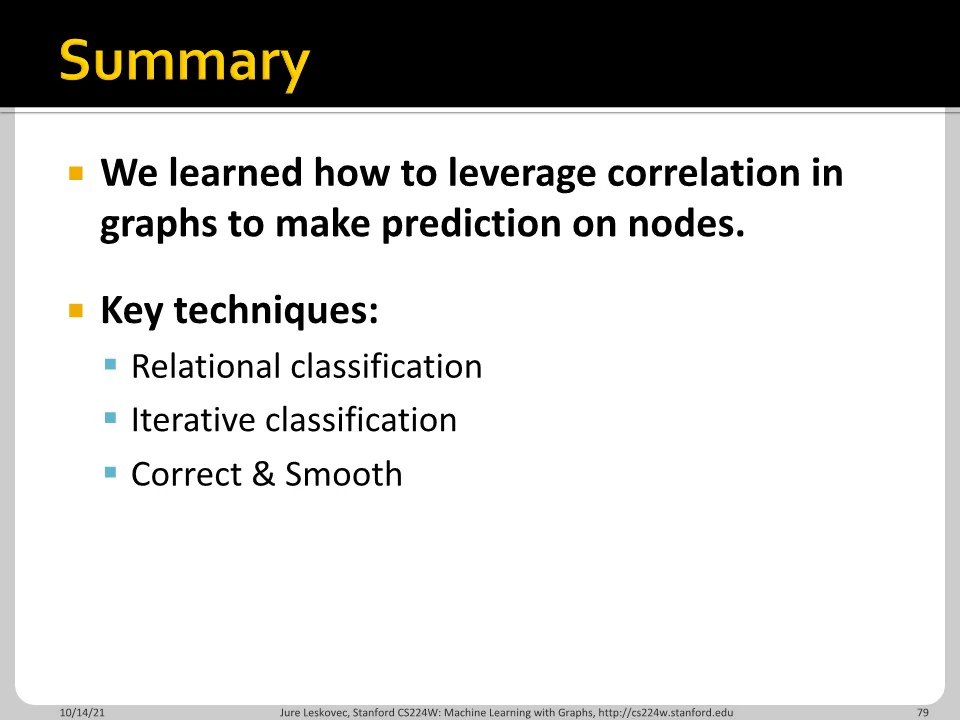{: width="960" height="720" }

이번 장에서는 Relational classification, iterative classification, correct & smooth에 대해서 확인해보았습니다.
