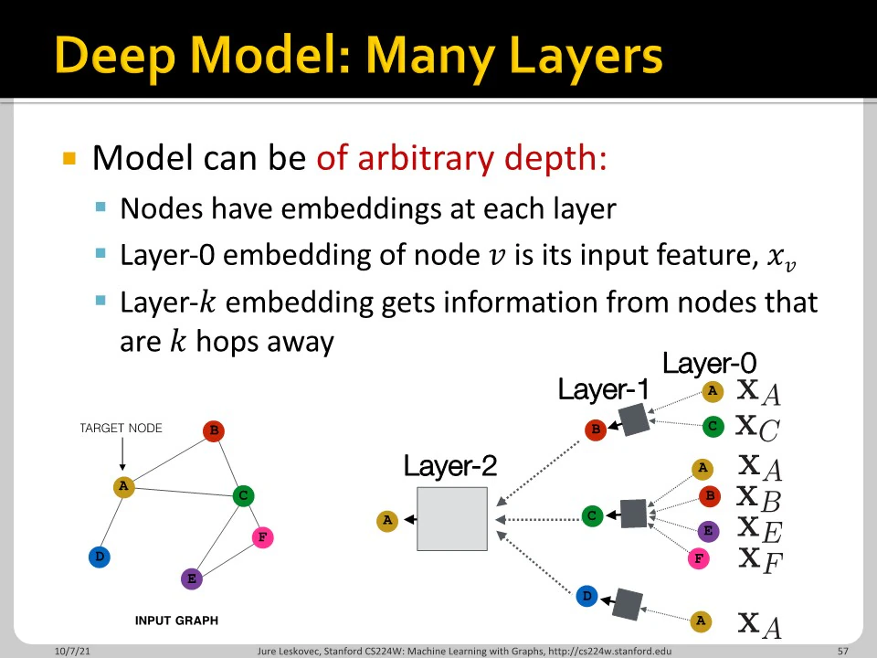
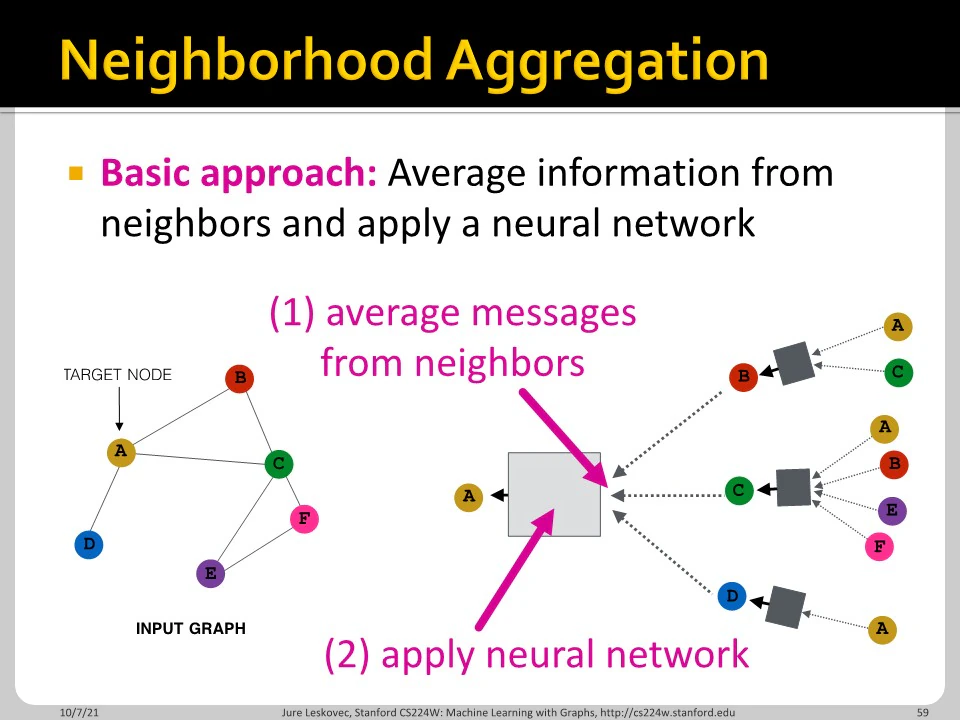
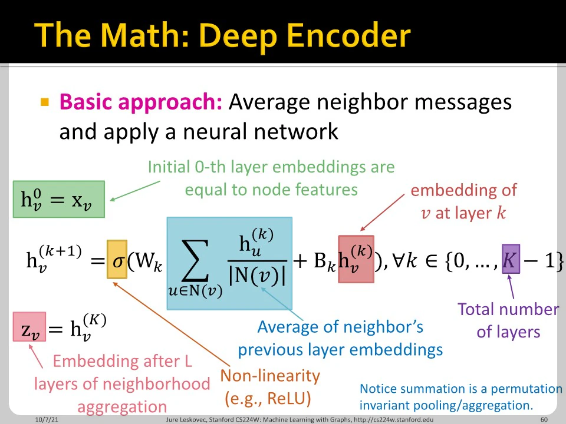
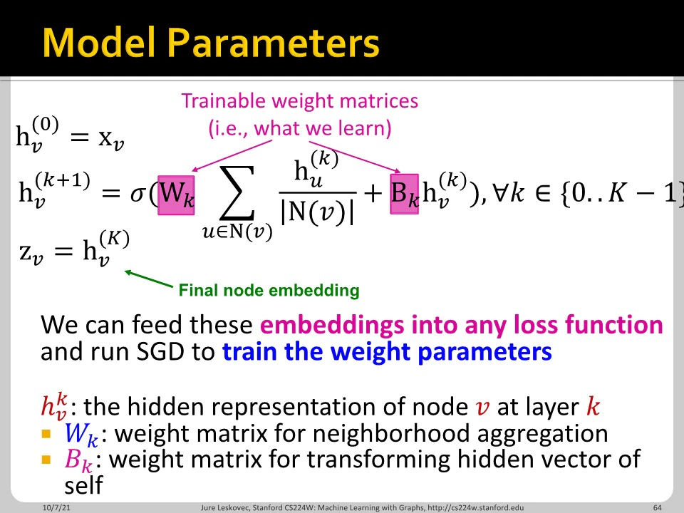
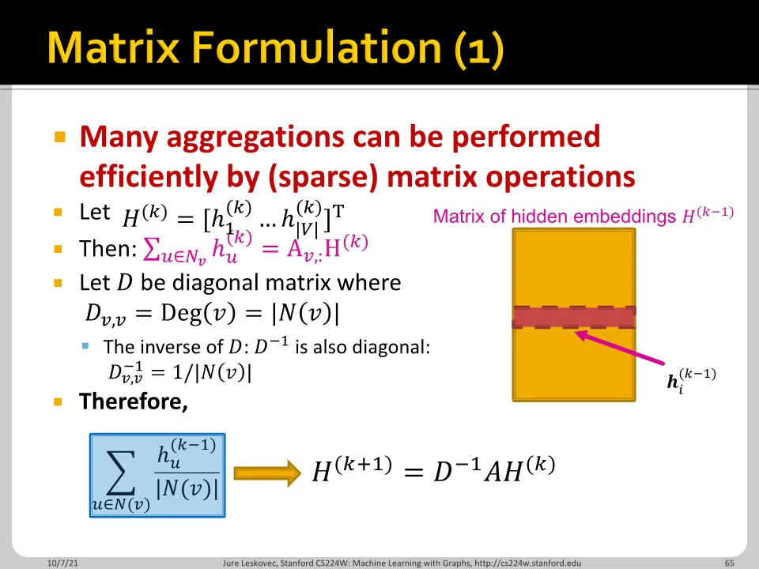
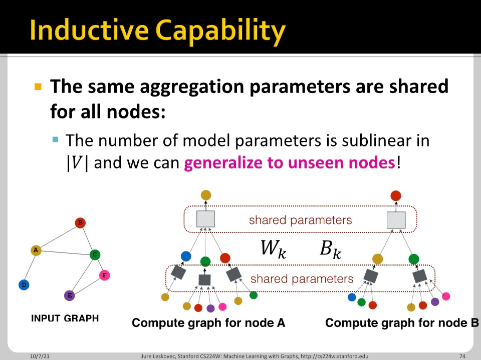
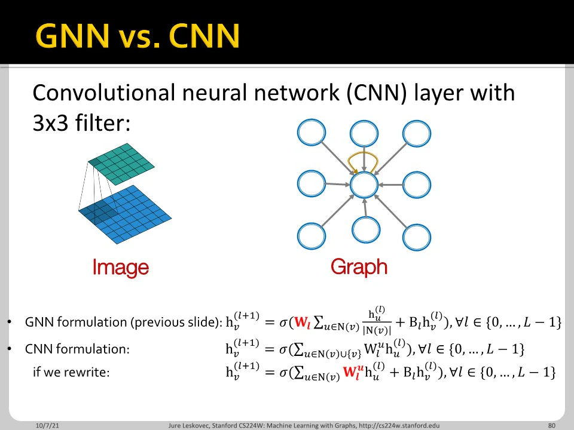
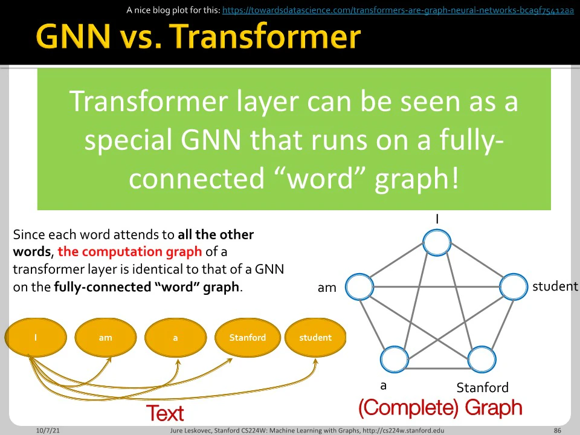
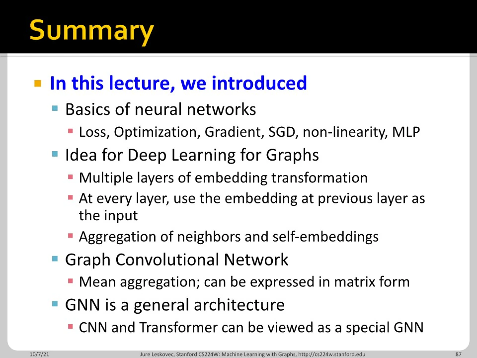

## Graph Convolutional Network

{: width="960" height="720" }

Computation graph는 node의 neighbor를 연결한 것을 recursive한 manner로 나타낸 것입니다. k개의 layer를 만들면 k-hop 거리에 있는 node feature도 반영할 수 있습니다.

{: width="960" height="720" }

Aggregation function은 permutation invariant한 것을 활용하면 어떤 것을 쓰든 괜찮습니다. Average는 확실히 permutation invariant한 function입니다.

{: width="960" height="720" }

위 두 슬라이드의 수학적 표현입니다. 식이 복잡해 보이지만, node $$v$$ 근처 neighbor의 layer k에서의 embedding 평균낸 값에 $$W_{k}$$ 곱해주고 자기 자신의 embedding에도 $$B_{k}$$ 곱해서 더한 다음에 non-linear function 통과시키겠다는 말입니다.

{: width="960" height="720" }

위의 식과 같은 내용인데 학습하는 model parameter가 무엇인지 명확하게 보여서 가지고 왔습니다. $$W_{k}$$와 $$B_{k}$$를 학습합니다.

{: width="960" height="720" }

Aggregation function은 쉽게 나타내질 수 있습니다. Aggregation function으로 average를 사용하고 싶으면 adjacency matrix와 k-layer embedding과의 곱에 degree matrix의 역행렬을 곱해주면 됩니다.

{: width="960" height="720" }

Layer 별 $$W_{k}$$와 $$B_{k}$$를 모든 node가 공유하기 때문에 GNN은 다른 그래프에도 활용할 수 있는 inductive한 성질을 갖습니다.

## GNNs Subsume CNNs and Transformers

이번 파트에서는 GNN과 CNN, Transformer의 관계에 대해 이야기 합니다. Subsume은 포함한다는 뜻인데, 제 생각으로는 GNN이 CNN을 완전히 포함하지는 못하는 듯 합니다. 이유는 아래 나와있습니다.

{: width="960" height="720" }

이렇게 보면 오히려 GNN이 더 harsh한 조건입니다. CNN은 filter(혹은 kernel)를 통해 각 node에 다른 weight를 곱할 수 있지만, GNN은 aggregation된 값에 단일한 weight를 곱합니다. CNN의 kernel 속 weight가 모두 동일하고, GNN의 모든 node의 neighbor 수가 9개로 동일하다면 (CNN window size가 3이라는 전제 하에) GNN과 CNN은 같은 모델입니다.

{: width="960" height="720" }

Transformer의 self-attention은 fully connected graph와 같게 볼 수 있습니다.

{: width="960" height="720" }

이번 장의 요약입니다. 내용 중에서 Basics of neural networks는 다들 아실 것으로 봐서 다루지 않았습니다.
