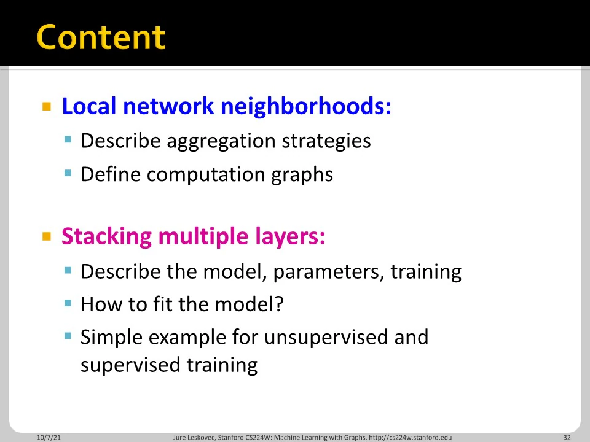
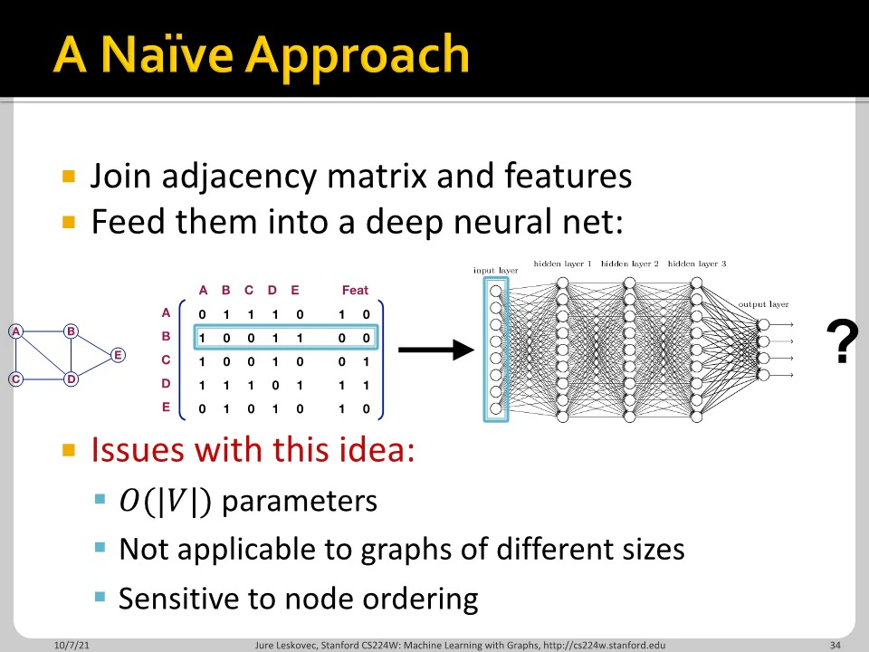
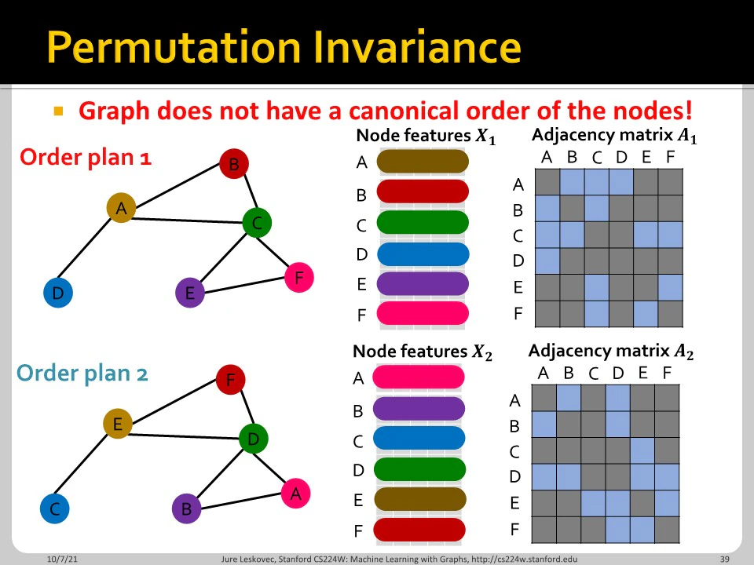
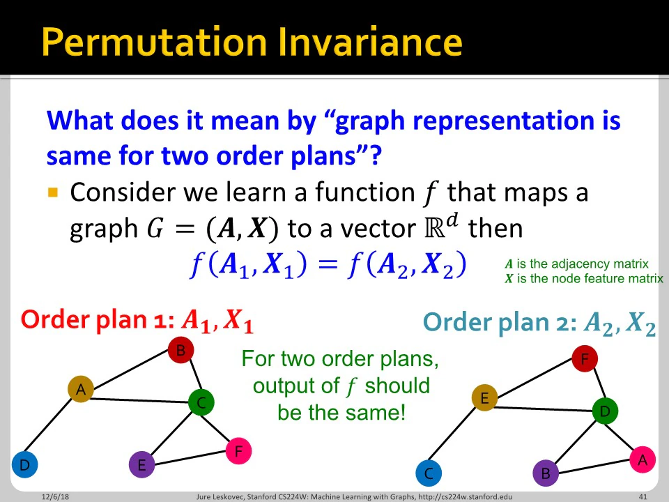
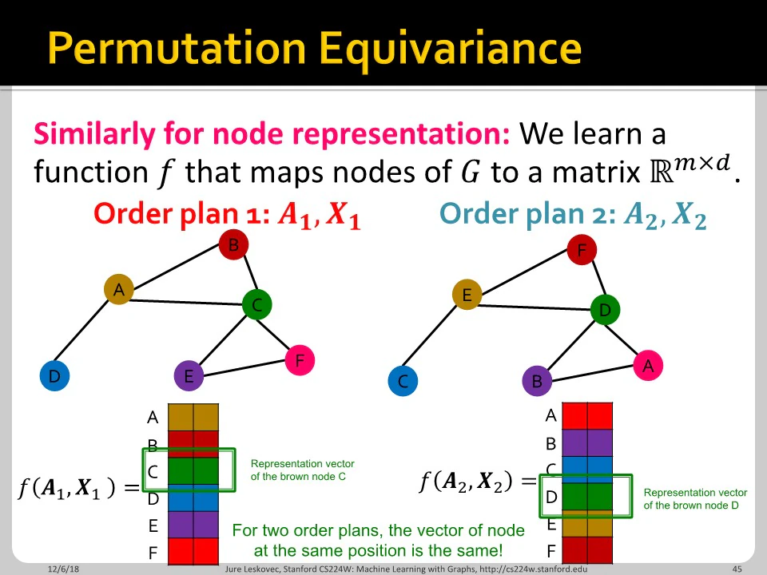
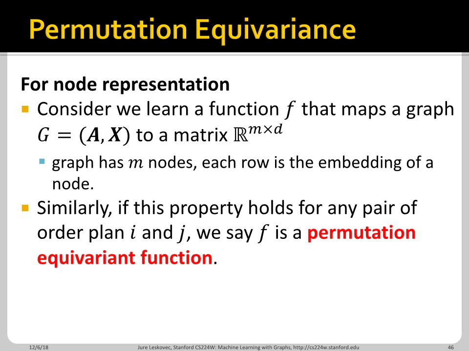
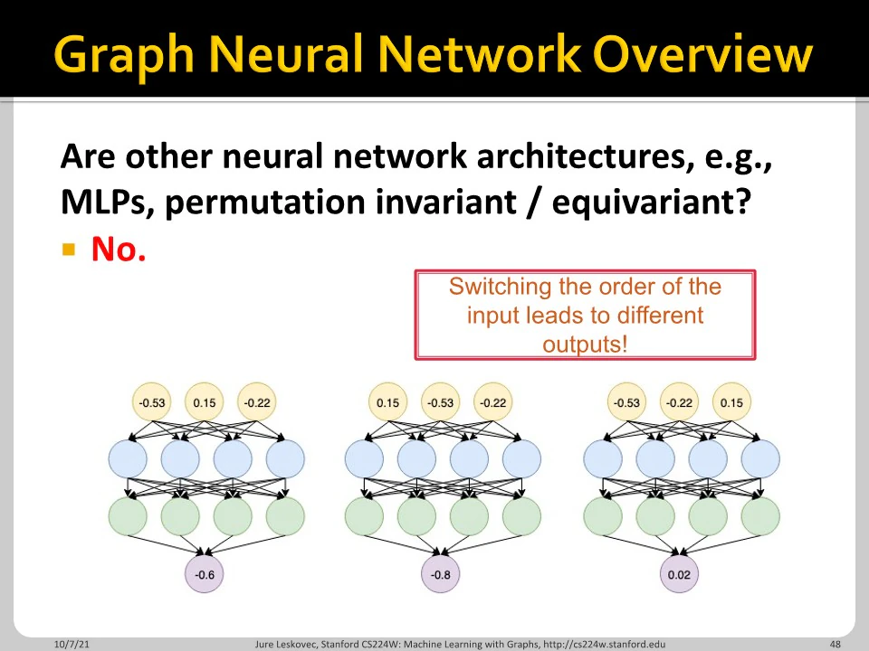

시작하기 전, 과거 자료에서 다루었던 shallow encoder에 대해서 논의 해봅시다. 실제 네트워크에서 가까이 있는 node끼리는 encoding된 embedding vector 내적의 크기가 커야 합니다. (Embedding vector의 내적을 보통 decoding 과정이라고 이야기 합니다.) Shallow encoder의 경우 encoding은 embedding vector에서 다 되어있다고 생각하고 그저 embedding matrix에서 값을 읽어올 뿐이었습니다. 이 때문에 여러 limitation이 있습니다.

첫 번째 limitation은 parameter를 share하지 않아 $$O(\vert V\vert )$$개의 parameter가 필요하다는 것입니다. 두 번째는 transductive하다는 것(inductive의 반대말)입니다. 새로 들어온 데이터에는 전혀 대응을 하지 못한다는 의미입니다. 마지막으로, node feature를 활용하지 못합니다. 이런 단점을 극복하기 위해, GNN encoder가 등장하였고, 이번 장에서는 그 GNN에 대해 배워보려 합니다. Deep learning에 대한 기본 개념은 있다고 가정하여 deep learning에 대한 개괄적 내용은 건너 뛰었습니다.

## Deep Learning for Graphs

{: width="960" height="720" }

그래프에서의 딥 러닝은 두 가지만 정의하면 됩니다. Aggregation function과 computation graph가 그것입니다. 앞으로 $$V$$는 vertex set, $$\mathbf{A}$$는 adjacency matrix (인접 행렬), $$\mathbf{X}$$는 $$m$$개의 node feature로 구성된 feature matrix로 정의합니다.

{: width="960" height="720" }

Naive하게 생각하면 adjacency matrix와 node feature를 이어 붙인 $$[A, X]$$를 그대로 MLP에 넣는 것을 GNN이라고 생각할 수 있습니다. 하지만 이 경우 node 수에 비례하는 parameter가 필요하고, 다른 크기의 그래프에는 적용이 불가능하다는 단점이 있습니다. 그리고 node의 순서가 달라지면 원래 모델을 사용할 수 없습니다.

Naive한 approach 대신 convolutional neural network의 kernel을 사용한다고 할 수도 있지만, 애초에 euclidean space에서 정의가 어렵기 때문에 sliding window kernel은 옳은 방법이 되지 못합니다.

위에서 이야기한 것처럼 node 순서가 바뀌어도 모델(function)이 제 역할을 할 수 있는지와 관련하여, permutation invariance와 permutation equivariance 성질을 이야기 합니다.

{: width="960" height="720" }

{: width="960" height="720" }

함수 $$f$$가 permutation invariant 하다는 것은, input element의 순서와 상관 없이 함수의 output이 같은 값을 가진다는 뜻 입니다. $$A_{1}, X_{1}$$으로 대입하나 $$A_{2}, X_{2}$$로 대입하나 함수값의 차이가 없습니다. 임의의 permutation $$\sigma$$에 대해 permutation invariant는 다음과 같이 나타낼 수 있습니다.

$$f(\sigma \star A) = f(A)$$

{: width="960" height="720" }

{: width="960" height="720" }

함수 $$f$$가 permutation equivariant 하다는 것은, 임의의 permutation $$\sigma$$에 대해 $$\sigma$$와 $$f$$가 commutative하다는 뜻 입니다. 식으로는 아래와 같이 나타낼 수 있습니다.

$$f(\sigma \star A) = \sigma \star f(A)$$

{: width="960" height="720" }

보다시피, MLP는 permutation invariant/equivariant 하지 않습니다. 따라서 naive approach는 node 순서에 따라 다양한 $$A, X$$ 조합이 가능한 그래프에는 통하지 않습니다.
