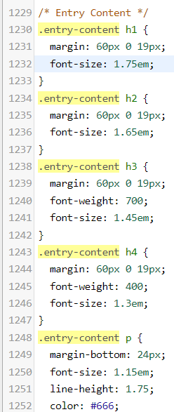
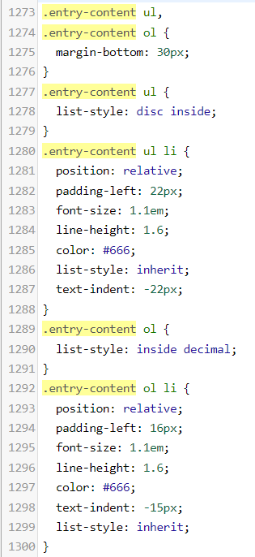

티스토리에는 여러가지 스킨이 존재합니다. 이 중에서 북클럽 스킨의 폰트 크기 변경에 대해서 확인해보겠습니다.

먼저 스킨 편집 - CSS에 들어갑니다. 그 다음 CSS에 커서를 놓고 Ctrl+F에서 \".entry-content\"를 검색합니다.

{: width="248" height="587" }

아마 이런 식으로 검색 결과가 등장할텐데, 저 .entry-content 뒤에 있는 각 키워드가 글에서의 위계를 나타냅니다. 정확하지는 않은데, h1, h2, h3, h4까지는 제목 위계인 것 같고, 본문 위계의 경우 p 하나로 다 관리됩니다. 본문1, 본문2, 본문3은 저 p의 값에 따라서 비율로 글씨 크기가 변하는 듯 합니다.

h에 속하는 margin은 전부 60px 0 19px로 되어있는데, 60px 0 19px을 50px 0 19px로 바꾸었더니 제목 위계에 항상 포함되던 과도한 여백이 줄었습니다. 60px이 상단 여백, 0이 좌우 여백, 19px이 하단 여백입니다.

{: width="315" height="686" }

내리다보면 이런 다른 내용들도 보입니다. .entry-content p만 변경하면 list형 내용의 글씨 크기는 변화가 없습니다. list형 내용에 속하는 위계에는 점 위계, 번호 위계 등이 있습니다. (추측입니다.) 점 위계에 속하는 내용의 글씨 크기는 \".entry-content ul li\", 번호 위계에 속하는 내용의 글씨는 \".entry-content ol li\"의 항목을 수정하면 바꿀 수 있습니다. (아마 ul이 unordered list, ol이 ordered list인 듯 합니다.)

글 작성하면서 점 위계와 번호 위계 아래의 margin이 너무 커서 별로 맘에 안들었는데 원래 50px로 되어있던 1273번째 줄의 \".entry-content ul, .entry-content ol\"의 margin을 30px로 바꾸어주었습니다.

## Reference

- [https://icelaser.tistory.com/192](https://icelaser.tistory.com/192)
