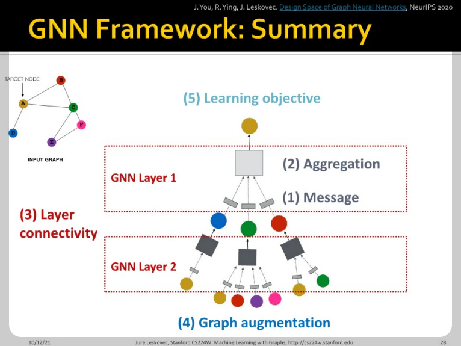
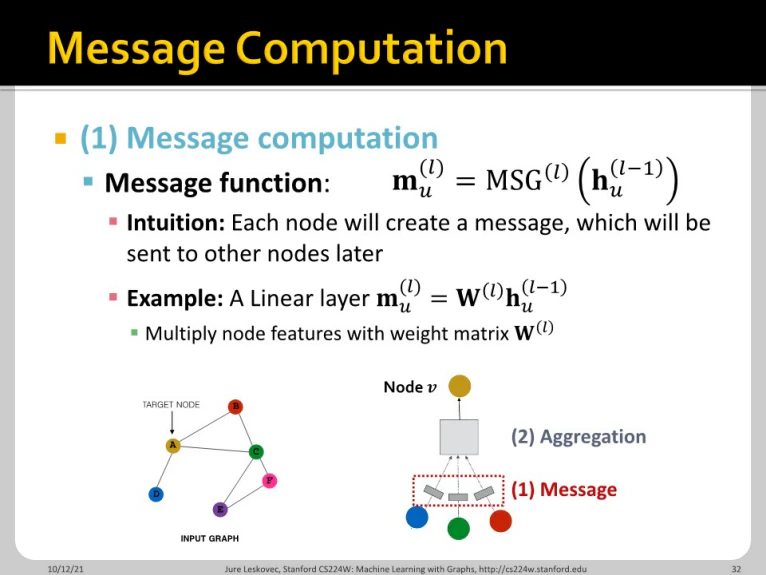
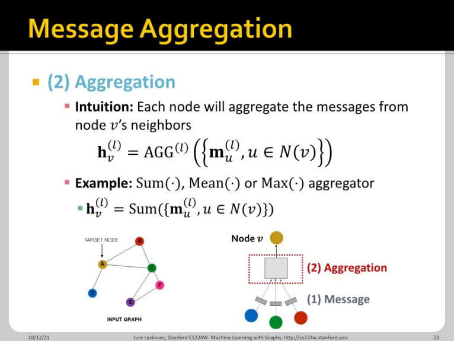
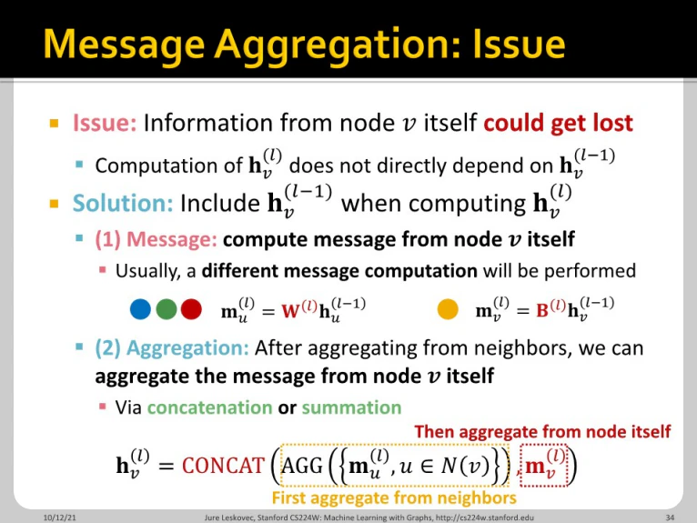
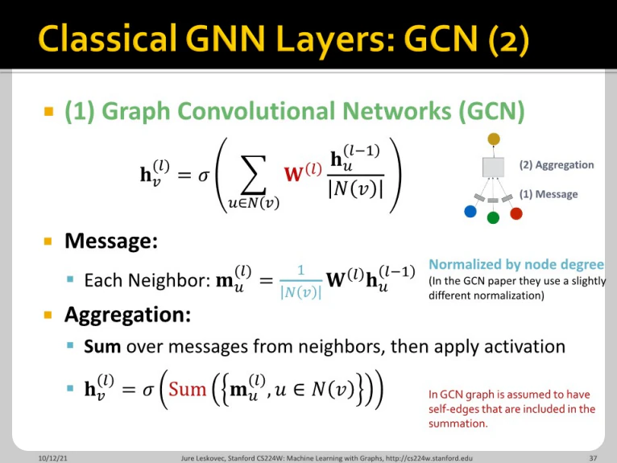
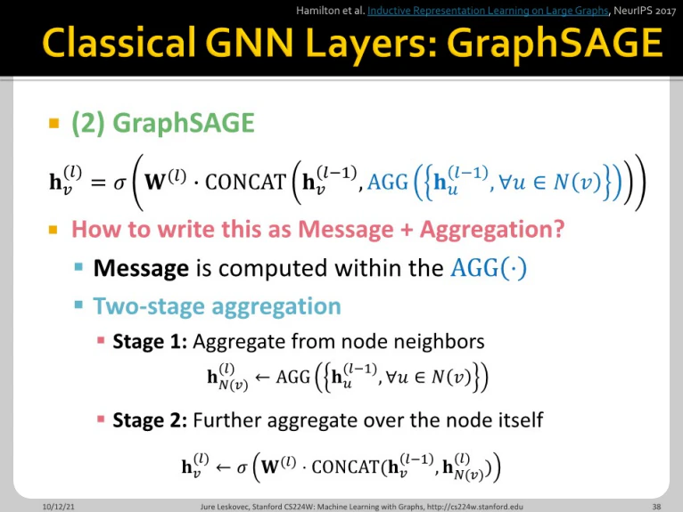
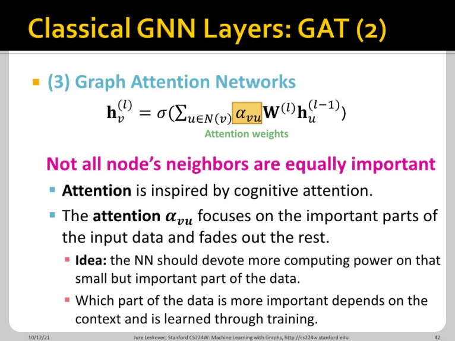
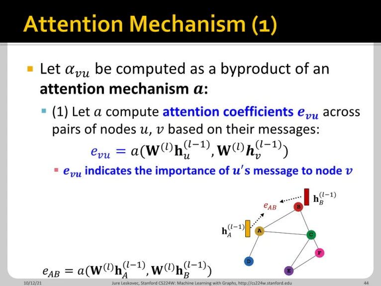
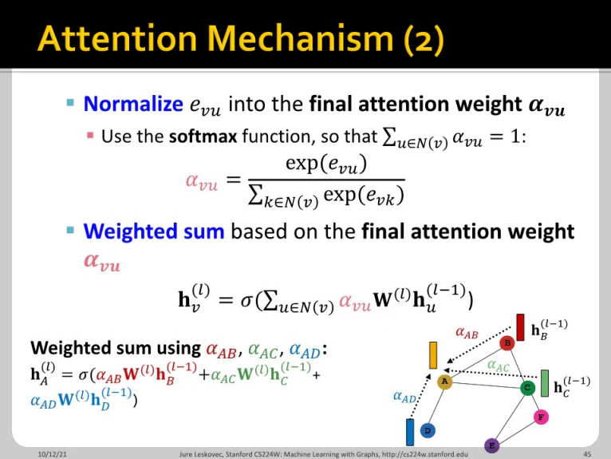
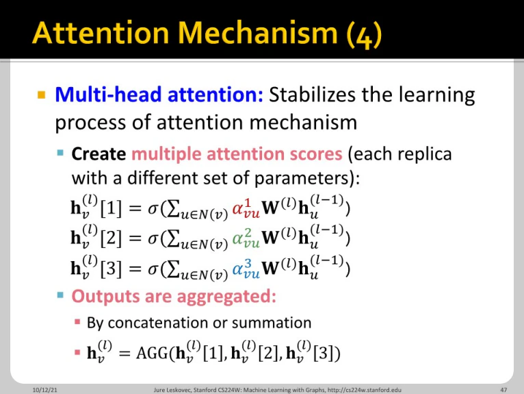

{: width="766" height="575" }

GNN의 개략적인 학습 과정은 위와 같습니다. 각 node에서 message를 받고, 이것을 aggregation하는 것이 코어입니다. Computation graph를 통해서 layer connectivity가 반영되며, graph augmentation이 활용 되기도 합니다. 마지막으로 Learning objective를 적절히 설정하면 GNN의 전체 학습 scheme이 정의됩니다.

## A Single Layer of a GNN

{: width="766" height="575" }

두 단계로 이루어지는 single layer GNN에서, 첫 번째 단계인 message computation에 대한 내용입니다. Message function은 각 node $$u$$가 자신의 이전 layer embedding $$h_u^{(l-1)}$$을 이용해 이웃 node로 보낼 message $$m_u^{(l)}$$을 만듭니다. Matrix $$W^{(l)}$$과의 곱도 message function이 될 수 있습니다.

{: width="766" height="575" }

그 다음 이 메시지들을 aggregate하여 $$h_{v}^{(l)}$$을 만들게 됩니다. Sum, mean, max 등의 단순하지만 강력한 aggregator들이 존재합니다.

{: width="766" height="575" }

하지만 이때 원래 node $$v$$가 갖고 있던 정보가 유실된다는 단점이 있습니다. 이는 $$h_v^{(l-1)}$$을 계산에 포함시키고, aggregation 이후 메시지를 기존 노드의 message와 concatenate하여 해결 할 수 있습니다.

{: width="766" height="575" }

GCN의 경우 sum을 aggregation function으로 활용합니다. 그 다음 activation function을 적용합니다.

{: width="766" height="575" }

GraphSAGE에서 node $$v$$의 이웃 node와 그 자체를 같이 concatenate하여 새로운 vector $$h_{v}^{(l)}$$을 얻어냅니다. 이때 aggregation function으로 mean을 취할 수도 있지만, MLP나 LSTM layer를 사용하기도 합니다.

{: width="766" height="575" }

GCN과 GraphSAGE에서는 $$\alpha_{vu}$$는 $$\frac{1}{\vert N_{v}\vert }$$로 정의 됩니다. 따라서 모든 node가 equal한 중요도를 갖습니다. 하지만 이는 모델의 성능에 안 좋은 영향을 미칠 수 있습니다. 제 생각에 attention이 적용된 GNN은 GNN의 weight를 CNN kernel처럼 만드는 효과가 있다고 봅니다. Kernel 속 각 weight가 서로 다른 값을 갖는 것과 동등한 작용을 하는 것으로 보입니다.

{: width="766" height="575" }

먼저 함수 $$a$$를 통하여 node $$v$$가 느끼는 $$u$$의 중요도 $$e_{vu}$$를 계산합니다.

{: width="766" height="575" }

그 다음 각 중요도 $$e$$를 softmax 함수를 통해 attention weight $$\alpha_{vu}$$로 변환합니다. 마지막 Weighted sum 식을 잘 보면 CNN의 kernel 속 weight 별 합과 비슷하다는 사실을 알 수 있습니다. 위에서 이야기한 함수 $$a$$는 MLP의 간단한 형태로 얻을 수도 있습니다. 학습되는 framework 안에 포함만 되면 어떤 방식이든 큰 영향이 없을 것으로 예상합니다.

{: width="766" height="575" }

이 multi-head attention을 통해 GNN이 기존의 단순성에서 벗어나고 더 복잡한 feature를 얻을 수 있게 되었다고 생각합니다. CNN의 multi-channel과 같은 개념으로 보고 있습니다. 이 attention 메커니즘은 병렬화가 쉬워 computational efficiency가 높고, storage 측면에서도 강점이 있다고 합니다. Global graph structure에 영향 받지 않아 inductive하며 localized 되어 있기도 합니다.
