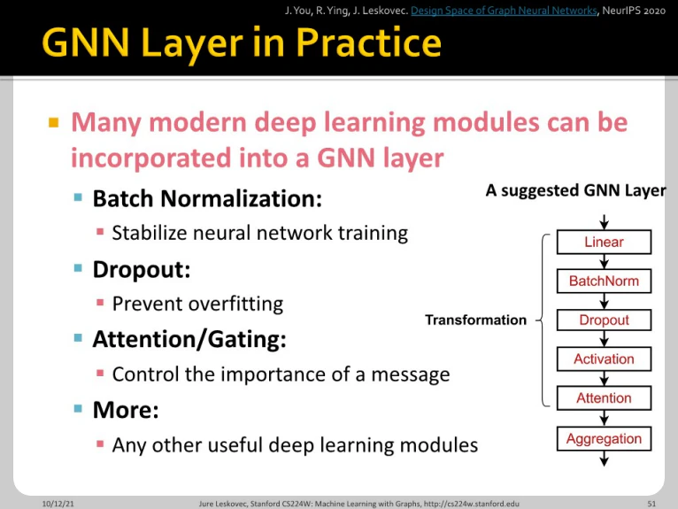
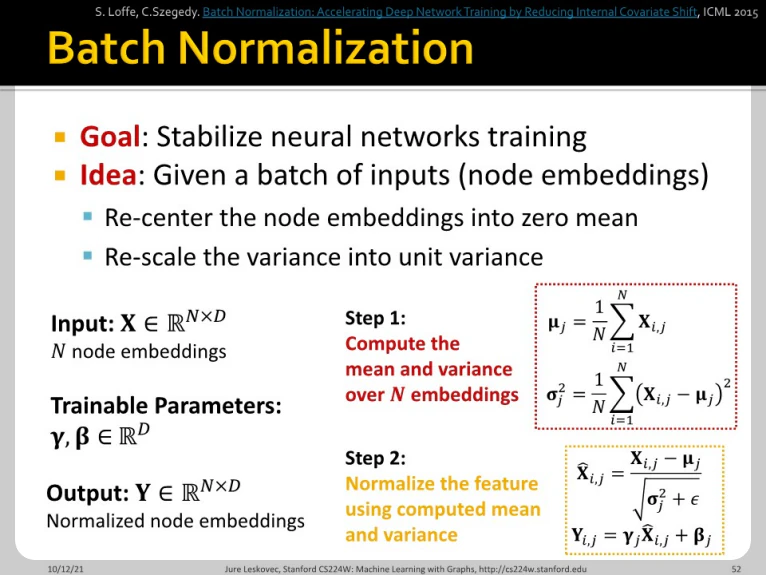
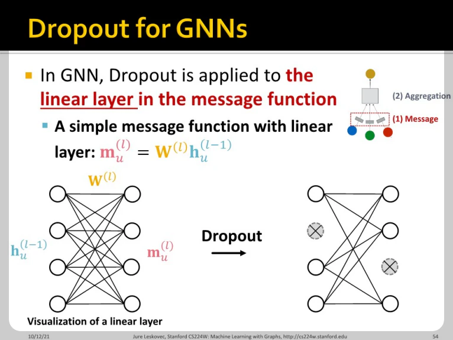
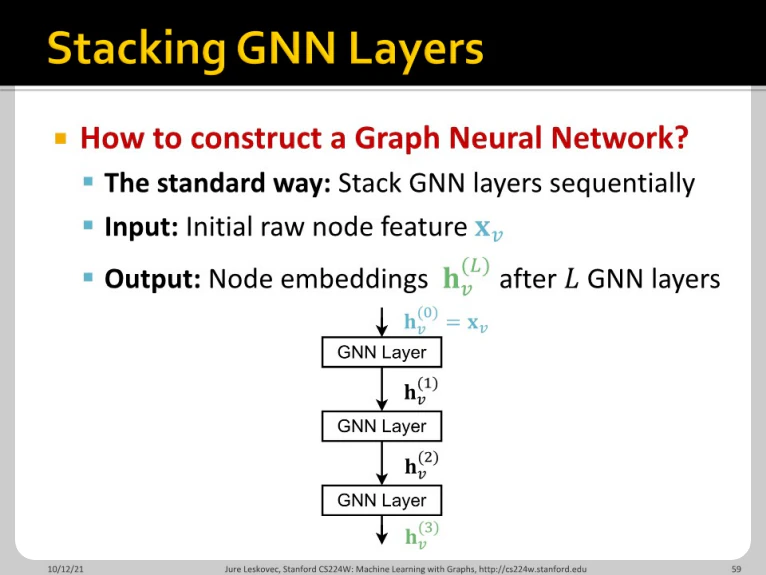
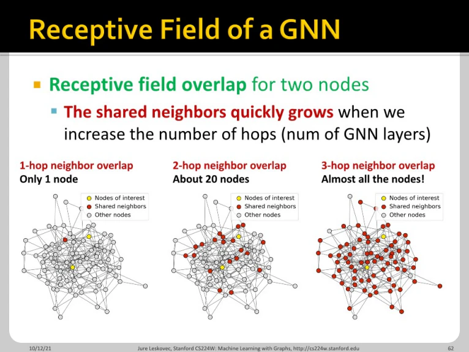
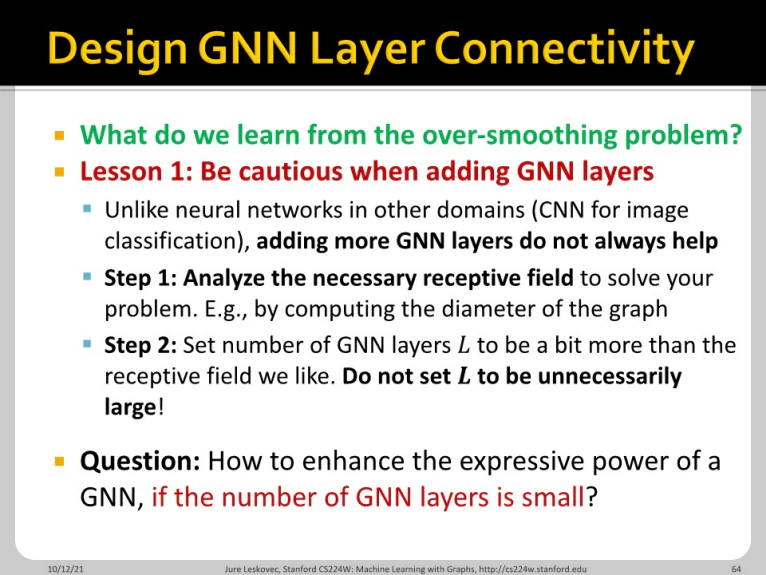
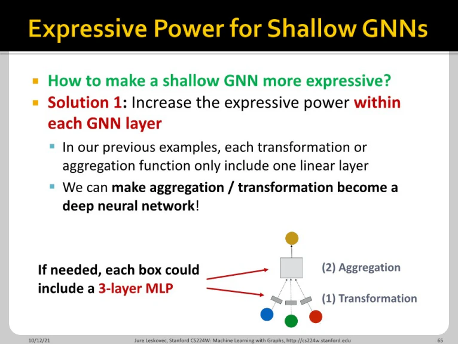
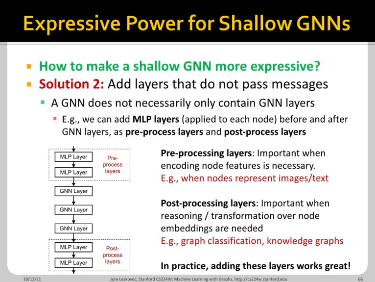
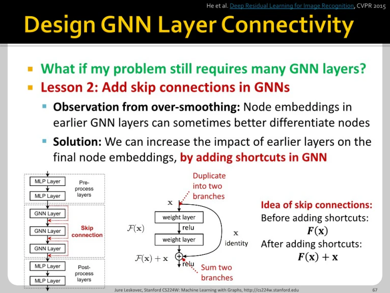
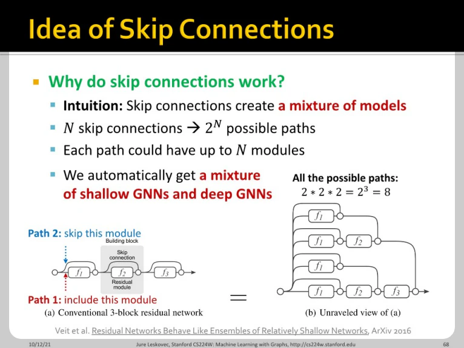

## GNN Layers in Practice

{: width="766" height="575" }

기존 deep learning에서 쓰이는 layer들을 함께 활용하여 높은 성능의 GNN layer를 얻을 수 있습니다. Batch normalization, dropout 등의 전통적 딥 러닝 레이어들이 어떻게 활용되는지 확인해봅시다.

{: width="766" height="575" }

GNN의 batch normalization은 node feature 단에서 이루어집니다. 과정 자체는 우리가 알고 있던 normalization과 차이가 없고, batch input 별로 zero mean, unit variance로 만들어줘 학습을 안정화 시킨다는 목적도 같습니다.

{: width="766" height="575" }

기존의 dropout은 message function의 linear layer에서 학습 중 일부 neuron을 무작위로 0으로 만드는 식으로 활용할 수 있습니다. Activation function (Non-linear function)도 활용 방법은 같습니다.

## Stacking Layers of a GNN

{: width="766" height="575" }

Layer stacking은 직관적으로 전 layer의 embedding을 다음 layer의 input으로 넣어서 진행할 수 있습니다. 그런데 이때 layer가 깊어질수록 모든 node embedding이 유사한 값으로 수렴하는 over-smoothing problem이 발생합니다. 앞선 글에서도 설명했던 것 같은데, k-layer GNN은 k-hop을 모두 표현할 수 있고, 보통 그래프가 아무리 커져도 max shortest path length k는 log scale로 증가하여 GNN layer는 많을 필요가 없습니다.

{: width="766" height="575" }

위 그림처럼 두 개의 서로 다른 node를 표현하기 위해서 쓰이는 node가 모두 같다면 두 node의 embedding은 비슷해질 수밖에 없습니다. (제가 몸담고 있는 교통 분야에서는 network 구조를 이루는 격자가 매우 regular하여 graph 크기 대비 보다 깊은 k layer를 써도 되긴 할 것입니다.)

{: width="766" height="575" }

이 문제를 해결하기 위해서는, problem specific한 접근이 필요합니다. 내 문제에서 어느 정도의 receptive field가 필요한지 분석하고, 그에 맞는 layer 수를 산정해야 합니다.

{: width="766" height="575" }

그리고 각 GNN layer 자체를 deep 하게 만들면 receptive field가 너무 커지는 것을 막으면서 representation을 잘 학습하게 유도할 수 있습니다.

{: width="766" height="575" }

또한 layer 앞뒤에 MLP layer를 추가하여, message passing scheme이 없이 pre, post processing이 가능하도록 유도합니다.

{: width="766" height="575" }

Skip connection도 좋은 방법입니다. Layer를 하나 건너뛰어 앞쪽 layer embedding의 영향이 커지도록 만들 수 있습니다.

{: width="766" height="575" }

Skip connection 한 개는 2개의 서로 다른 learning route를 제공함을 의미합니다. 따라서 skip connection을 추가할 때마다 learning route는 기하급수적으로 증가하여 shallow한 GNN과 deep한 GNN이 자동으로 mixing되는 효과를 얻을 수 있습니다. Directly하게 last layer로 skip하여 모든 stage의 node embedding을 두고 학습하는 방법도 있습니다. (교통 네트워크 같이 격자가 일정한 그래프에서는 뭐가 제일 좋을까요?)
