## Graph Augmentation for GNNs

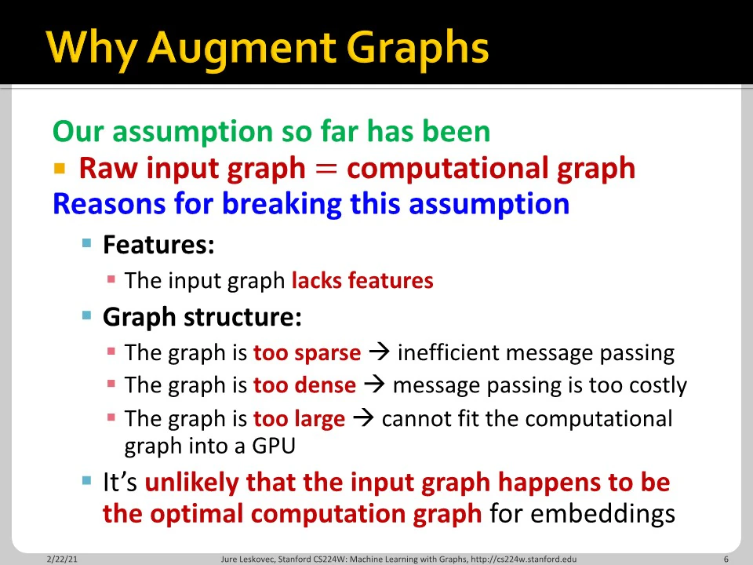{: width="960" height="720" }

이미지 같은 데이터에 적용되는 augmentation은 흔히 봤을 것입니다. 하지만 그래프의 augmentation은 생소합니다. 언제 augmentation이 필요할까요? Feature가 너무 부족하거나, graph가 너무 sparse/dense/large한 경우 기존 그래프로 computational graph를 그리면 비효율적인 경우가 발생하게 됩니다.

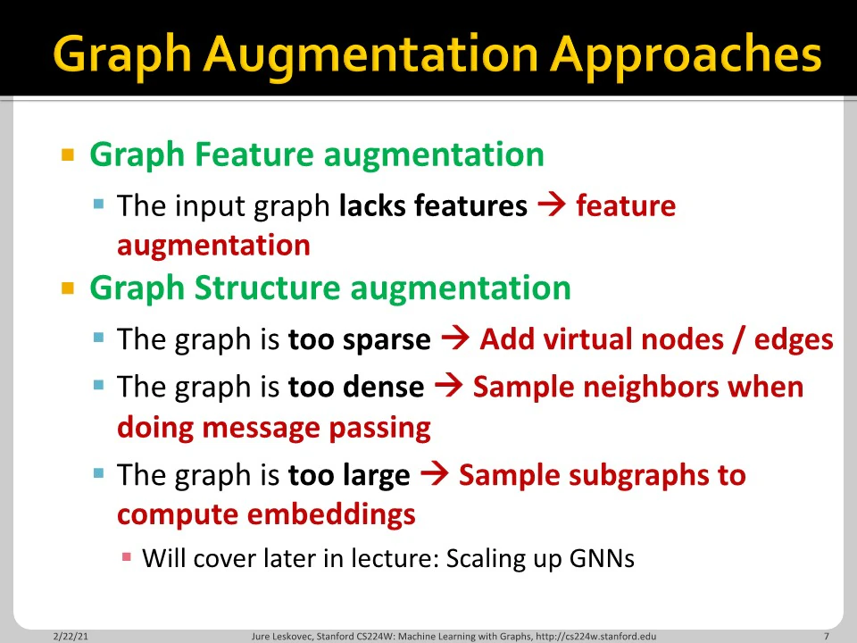{: width="960" height="720" }

각 문제의 경우마다 서로 다른 방향의 augmentation이 가능합니다. Sparse해서 문제라면 edge를 추가하면 되고, 너무 dense하다면 반대로 sampling 하면 될 것입니다.

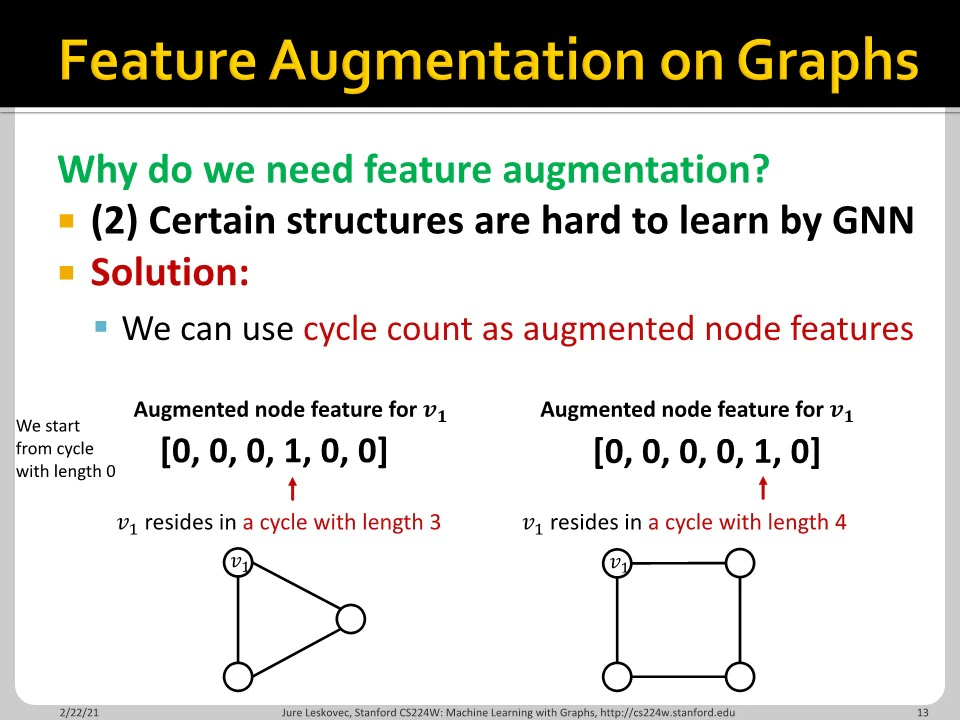{: width="960" height="720" }

Adjacency matrix만 있는 경우, node에 constant value를 assign하거나, one-hot vector를 assign 합니다. one-hot은 expressive power는 높습니다. 하지만 inductive 하지 못합니다. 그리고 computational cost가 높습니다. constant value로 채우는 경우는 그 반대입니다. 연산량이 비교적 작으면서 transductive해도 아쉽지 않을 때 one-hot을 사용합니다.

One-hot vector를 잘 활용하면 graph가 어떤 길이의 cycle을 갖는지 파악하게 할 수도 있습니다. 이게 중요한 이유는 computational graph를 그렸을 때, 위 슬라이드의 두 $$v_1$$은 서로 구분되지 못하기 때문입니다. Augmented된 one-hot vector로는 구분 가능합니다. 이 외에도 clustering coefficient, pagerank 등의 lecture 2에서 배운 feature를 추가할 수도 있습니다.

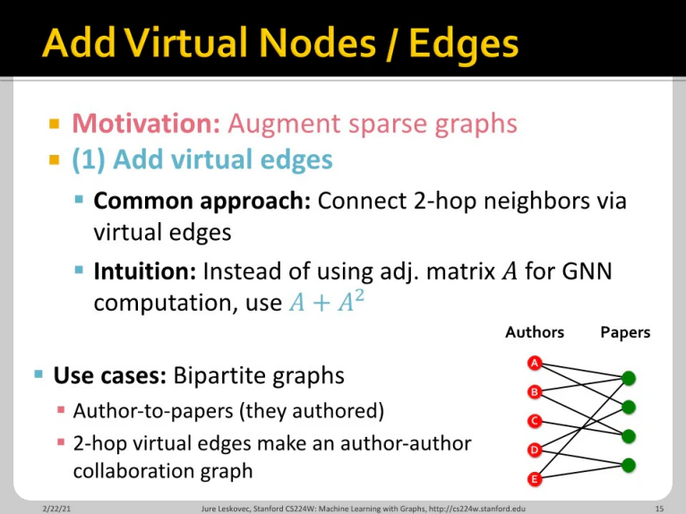{: width="766" height="574" }

Edge와 node를 추가하는 방법은 어떤 효과를 가질까요? 먼저 bipartite graph의 경우 adjacency matrix로 $$A$$가 아닌 $$A+A^2$$를 넣어주면, 서로 연결되지 않았던 node group(위 슬라이드에서는 authors) 사이의 연결성이 확보됩니다.

Edge가 부족하여 node간 shortest path가 먼 경우에는, 모든 node와 연결된 virtual node 하나만 추가해주면 shortest path가 비약적으로 감소합니다. Message passing을 훨씬 더 효율적으로 할 수 있게 되는 장점이 존재합니다. 교통 네트워크도 너무 regular하여 sparse한 특징이 있는데, node를 add 해주면 message passing에 도움이 될 것으로 보입니다.

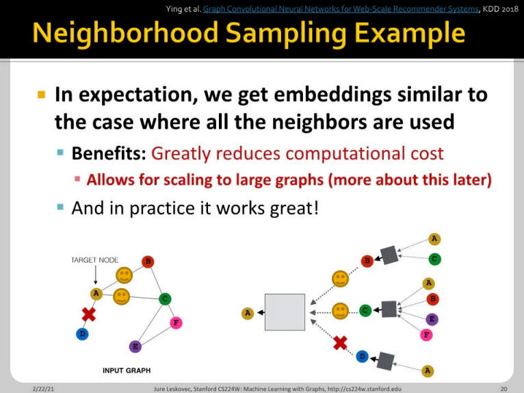{: width="766" height="574" }

너무 dense하게 퍼져있는 node의 문제를 해결하기 위해 neighborhood를 sampling하면 어떤 효과를 가질까요? Neighborhood를 sampling하는 경우와 하지 않는 경우 사실 embedding의 기댓값은 큰 차이가 없습니다. Computational cost를 낮출 수 있는 장점은 확보하면서 full graph와 비슷한 값을 얻을 수 있으므로, 훌륭한 방법입니다. 다만 이 그래프가 정말 dense한지는 여러 statistics를 통해서 파악해야 할 것 입니다.

## Prediction with GNNs

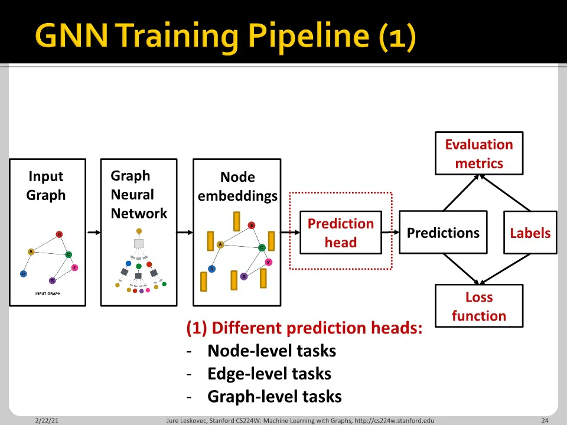{: width="960" height="720" }

지금까지 살펴본 내용은 그래프 입력의 node embedding을 구하고, augmentation하는 내용이었습니다. 이제는 얻어진 feature로 어떤 계층에서 task를 진행할지를 논의해봅시다. 여기서는 prediction head라는 말로 표현되어있는데, prediction task를 진행할 위계로 이해하면 쉬울 것 같습니다.

Prediction heads는 task의 종류에 따라 크게 세 가지로 나눌 수 있고 각각 **node-level, edge-level, graph-level**에 해당합니다.

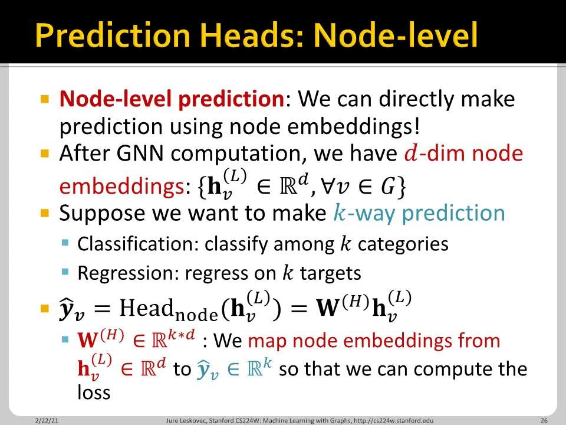{: width="960" height="720" }

**Node-level prediction**은 node embedding에서 바로 진행될 수도 있습니다. d-dimension embedding을 k개의 class를 분류하는 문제에 적용하고 싶다면 단순히 $$k*d$$의 행렬을 곱해주면 됩니다.

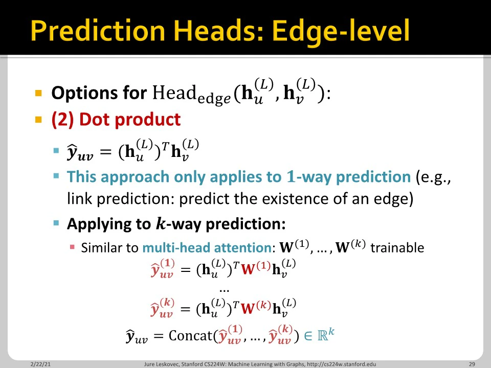{: width="960" height="720" }

**Edge-level** **prediction**은 node-level prediction과 크게 다르지 않습니다. 다만 node $$u$$와 $$v$$의 embedding을 같이 사용한다는 점에서 차이가 납니다. 단순히 concatenation한 다음 MLP를 통과 시킬수도 있지만, 이러면 permutation invariant한 성질을 유지하기 어렵습니다. 그래서 두 embedding을 dot product하는 식으로 문제를 피할 수 있습니다. 다만 dot product는 link prediction 같은 1-way prediction에만 바로 쓸 수 있습니다.

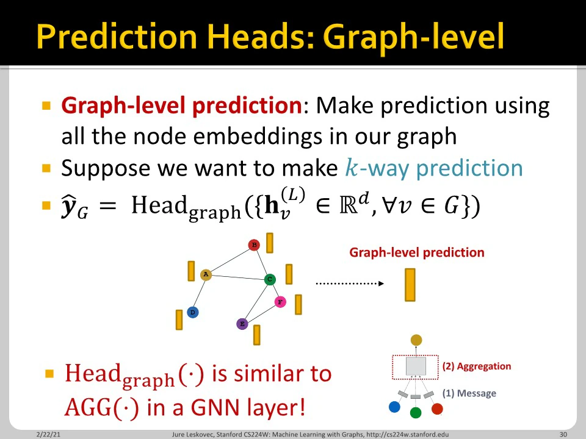{: width="960" height="720" }

**Graph-level prediction**을 진행할 때는 그래프를 구성하는 node embedding을 활용합니다. 마치 aggregation function과도 흡사한데, node embedding중 평균을 도출할 수도 있고, max를 얻을 수도 있고, sum을 할 수도 있습니다. 하지만 mean/max/sum pooling은 작은 그래프에서만 잘 작용한다고 합니다.

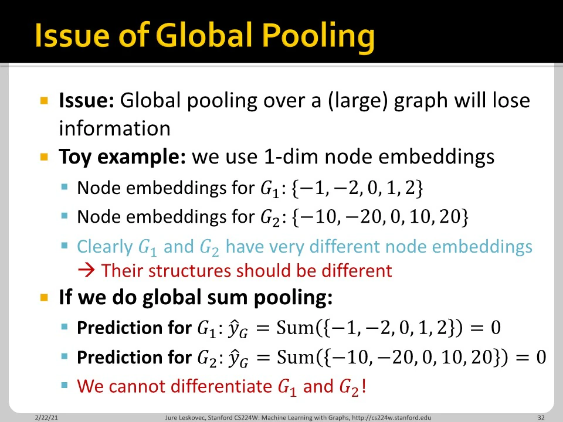{: width="960" height="720" }

위 슬라이드는 문제가 드러나는 예시입니다. $$G_{1}=\left\{ -1, -2, 0, 1, 2 \right\}$$와 $$G_{2}=\left\{ -10, -20, 0, 10, 20 \right\}$$은 분명 다른 node embedding으로 구성된 두 그래프 입니다. 하지만 sum pooling 결과 두 그래프 모두 0이라는 하나의 (원소가 1개인) 벡터가 되는 것을 볼 수 있습니다.

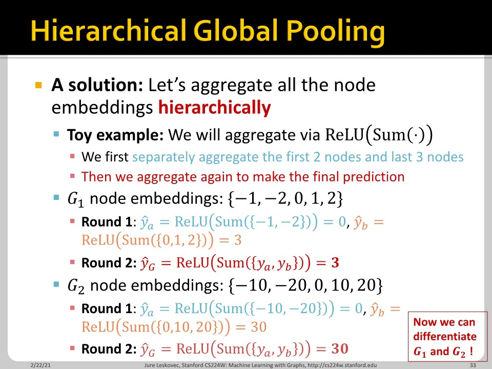{: width="960" height="720" }

이런 문제를 방지하기 위해 **hierarchical global pooling**을 시행합니다. Node 5개를 2개와 3개로 구분하여서 각각 ReLU(Sum)을 취해주면 $$G_1$$과 $$G_2$$는 3과 30으로 서로 다른 graph embedding을 갖습니다. 이런 아이디어를 기반으로 하여 DiffPool이 등장하기도 했습니다. 예전에 제가 커버했던 MinCutPool과도 연관이 있는 내용입니다.
