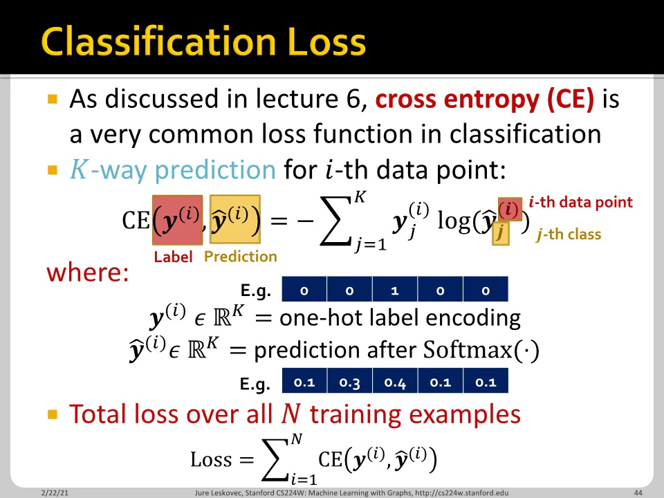
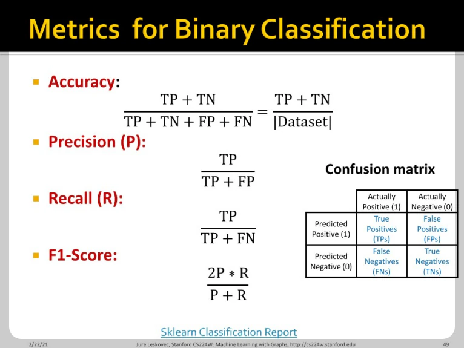
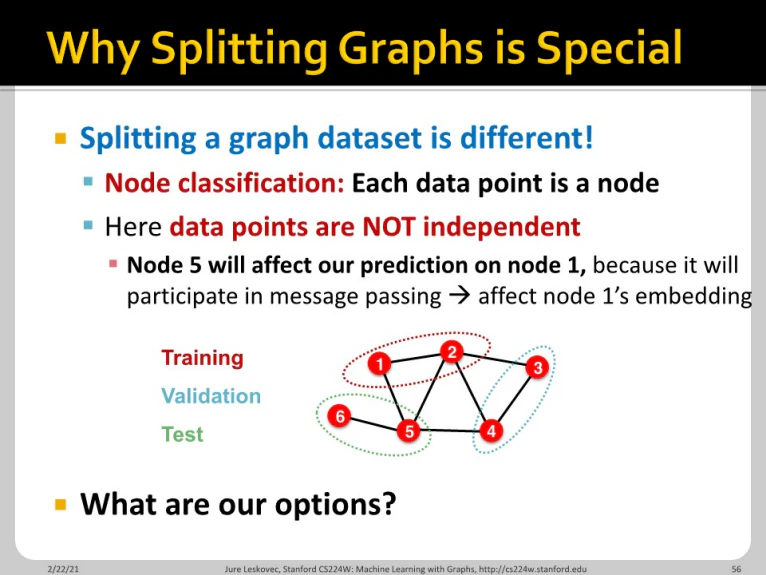
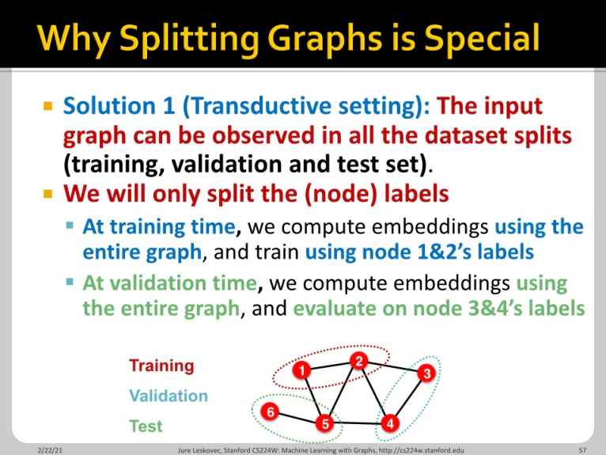
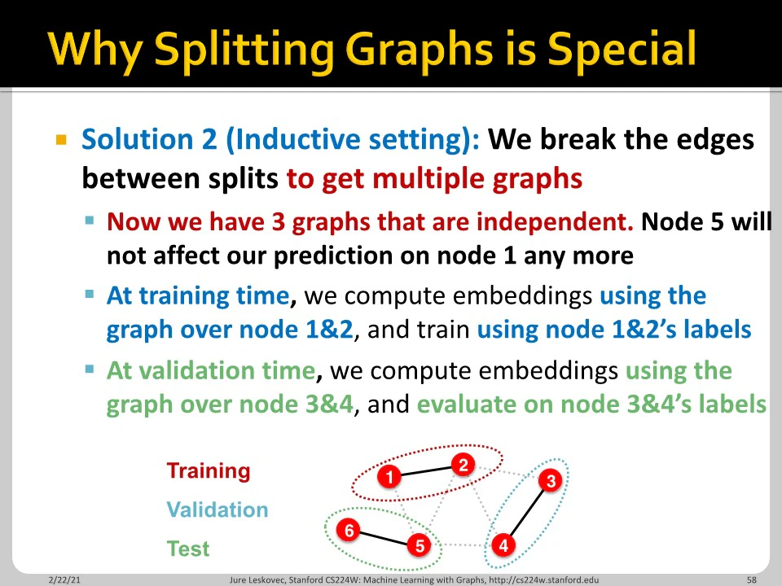
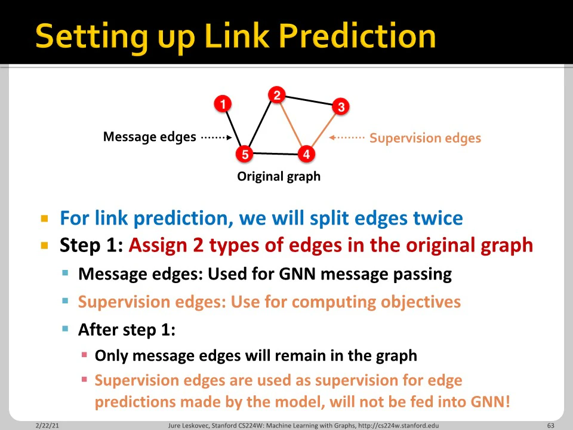
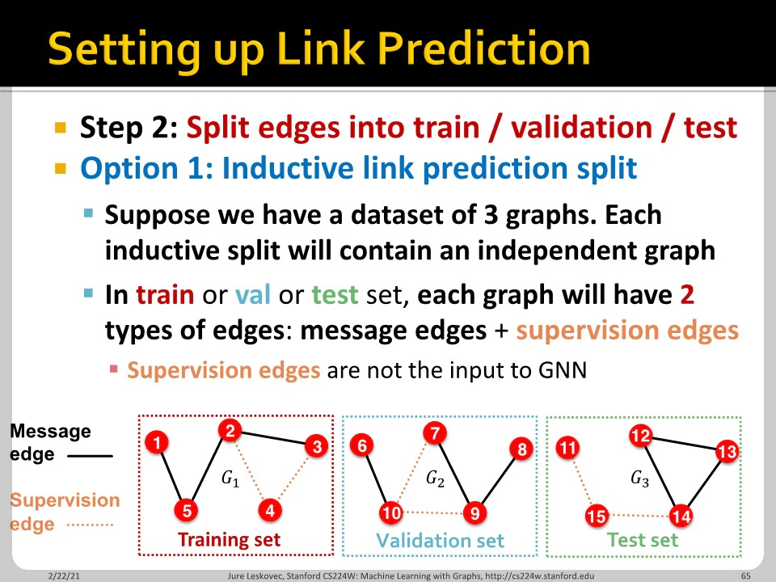
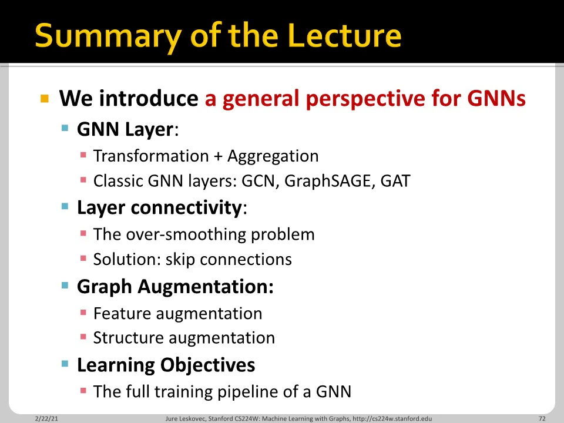

## Training Graph Neural Networks

다른 머신 러닝과 마찬가지로 GNN에서도 task를 supervised, unsupervised(self-supervised), 그리고 semi-supervised task로 구분할 수 있습니다. 보통 $$\hat{y}$$은 prediction 결과, $$y$$는 실제 label을 의미합니다. 그리고 ground truth label $$y$$는 classification/regression task에 따라 discrete/continuous한 값을 가지게 됩니다. 이에 따라 loss function과 evaluation metric도 달라집니다.

{: width="960" height="720" }

일반적으로 classification에서는 cross entropy loss가 사용됩니다. 전체 loss는 CE loss를 모든 sample에 대해서 더해주면 됩니다. Regression에는 차이의 제곱의 평균인 mean squared error가 사용됩니다.

{: width="766" height="575" }

Binary classification의 경우 accuracy, precision, recall, 그리고 F1-score 등의 metric으로 평가할 수 있습니다. 그리고 ROC Curve의 curve 아래 면적을 통해서도 평가가 가능합니다. True positive rate와 false positive rate가 일치한다면 해당 classifier는 random classifier와 같은 성능을 갖습니다. 적절한 classifier라면 positive instance의 positive 확률을 negative instance보다 높게 측정할 것입니다.

## Setting-up GNN Prediction Tasks

{: width="766" height="575" }

그래프 데이터를 training/validation/test로 분리하는 것은 이미지 데이터를 분리할 때와는 다릅니다. 각 node가 데이터라고 한다면, node 5는 node 1에 message passing을 함으로써 영향을 미칩니다.

{: width="766" height="575" }

Ground-truth label을 분리할 때, graph structure 자체는 전부 활용합니다. 다만 node를 선택적으로 나누어 training/validation/test node로 분리할 수 있습니다. 전체 그래프의 구조는 train/validation/test와 관계 없이 모든 경우에서 다 보여집니다. Node/edge prediction task에서만 활용 가능합니다.

{: width="960" height="720" }

이와는 다르게, 그래프 자체를 분리하는 방법도 있습니다. Subgraph로 나눈 상황에서 각 그래프에 대한 학습을 진행해, 보다 inductive한 manner로 문제를 해결할 수 있습니다. Train 단계에서 학습한 모델이 unseen graph에도 잘 generalize 해주지 않겠냐는 믿음으로 위의 학습을 시행합니다. Node/edge/graph task에서 모두 활용 가능한 방법입니다.

{: width="960" height="720" }

하나의 예시로, link prediction을 하는 상황을 생각해봅시다. 먼저 두 가지 종류의 edge를 설정합니다. Message edge와 supervision edge인데, message edge만 prediction에 활용됩니다. Supervision edge의 존재는 GNN에 전달되지 않습니다.

{: width="960" height="720" }

위 그림처럼 세 종류의 그래프가 있다고 하면, 각 그래프마다 supervision edge를 설정하여 줍니다. 그리고 각 graph가 training/validation/test 과정에서 서로 섞이지 않도록 나눕니다. 위는 inductive한 설정입니다. 한 그래프의 일부 edge를 training에 사용하고, 나머지 edge들을 validation, test에 사용할 수도 있는데, 이는 transductive한 설정입니다.

{: width="960" height="720" }

이번 8장에서는 feature transformation, aggregation, skip-connection, augmentation 등에 대해서 학습하였습니다.
