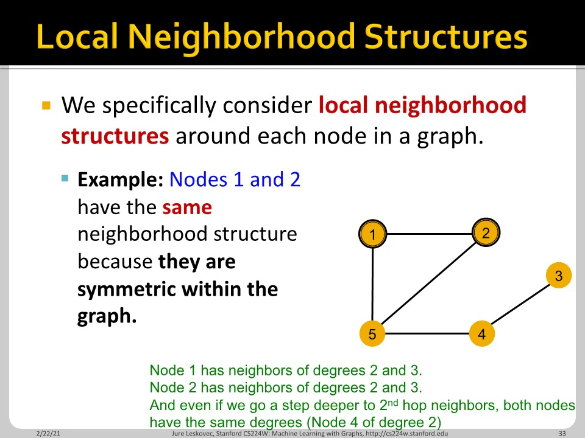
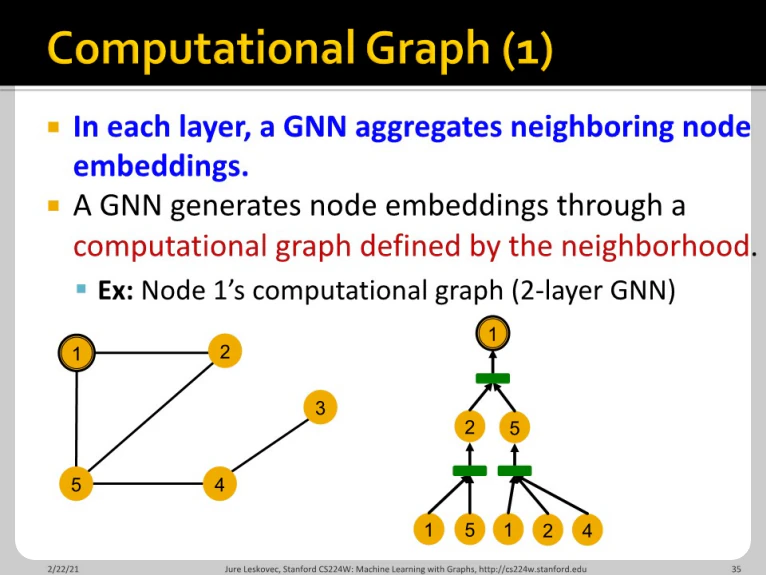
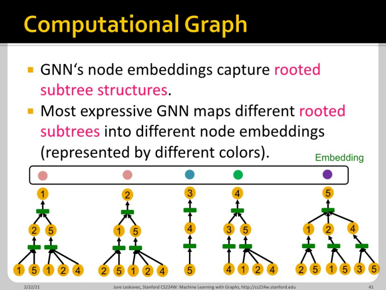
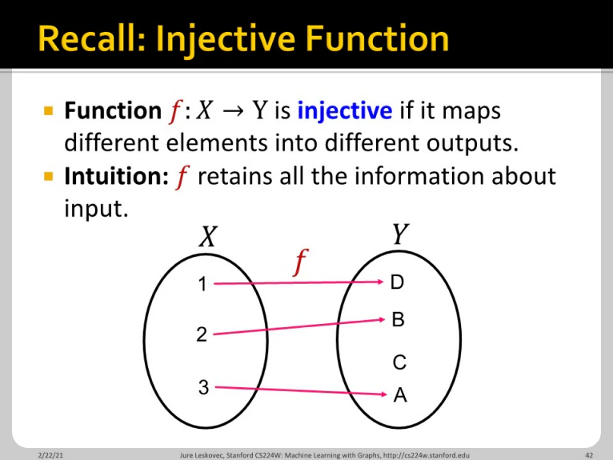
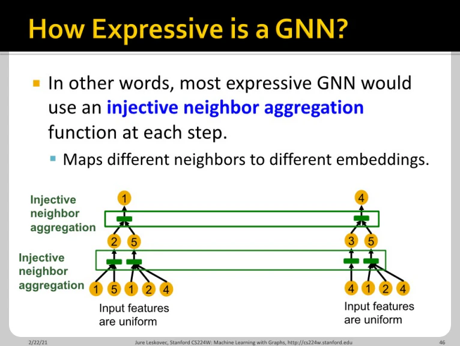

## How Expressive are Graph Neural Networks?

강의 시작하기 앞서서 팁을 먼저 주시는 Jure Leskovec 교수님이십니다. 그래프 러닝을 진행할 때 필요한 사항들인데, 딥러닝 공부를 해보신 분이면 한 번씩은 들어보셨을 내용입니다.

- Normalization 적용
- ADAM 활용
- ReLU 혹은 LeakyReLU/SWISH/rational activation 활용하고 마지막 output layer에서는 activation 제외
- 모든 layer에 bias 추가
- 32, 64, 128로 embedding하는 것이 적절
- 학습 안되면 zero\_grad 빠졌나 확인해보고, hyperparameter 수정 및 initialization 신경쓰기
- 작은 데이터에도 overfit 발생하지 않으면 뭔가 문제가 있는 것
- Loss function과 visualization 신경쓰기

{: width="960" height="720" }

GNN도 분명한 한계가 있습니다. 예를 들어 위 그래프에서 node 1번과 2번은 서로 같은 degree를 갖고 있으며, 각자의 이웃의 degree도 같습니다. Degree를 기반으로 node를 분류하고자 할 때 구분이 안되는 dataset이 발견된 셈입니다. Symmetric하다고 할 수 있고, isomorphic하다고 할 수도 있겠습니다.

과연 GNN은 node의 local neighborhood structure를 구분할 수 있을까요? 안된다면 언제 GNN이 실패할까요? 우리는 먼저 GNN이 computational graph를 통해 그래프의 구조를 학습한다는 사실을 상기해야 합니다.

{: width="766" height="575" }

위와 같은 그래프 형태의 computational graph를 구하는 경우를 생각해봅시다. 1번은 2번, 5번 node와, 2번과 5번은 각각 1번 5번, 그리고 1번, 2번, 4번 node와 연결되어 있습니다. 연결에 대한 위와 같은 사실은 computational graph로 표현할 수 있습니다.

{: width="766" height="575" }

그런데 잘 보면 1번과 2번 node는 computational graph 상에서 구분이 안된다는 것을 알 수 있습니다. 번호가 다르게 명시되어있는 것은 label을 아는 우리 입장이고, GNN 입장에서는 구조에 기반한 embedding을 할 경우 두 node의 embedding이 같을 수 밖에 없습니다. 이는 embedding function이 injective하지 않아서가 아니라 두 node의 computational graph(rooted subtree)가 같기 때문입니다. 가장 expressive한 GNN은 서로 다른 rooted subtree를 서로 다른 embedding으로 대응시키는(injective) GNN이며, 이런 GNN도 1번과 2번 node에는 같은 embedding을 줍니다.

{: width="766" height="575" }

서로 다른 $$X$$의 원소가 다른 $$Y$$의 원소에 대응된다면 우리는 그런 함수를 단사(injective) 성질이 있다고 하지만 모든 GNN이 그렇지는 못합니다.

{: width="766" height="575" }

Computational graph를 구성하는 aggregation function이 injective하다면 GNN 자체도 injective할 수 있을 것입니다. 하지만 우리가 흔히 사용하는 average는 그렇지 못하다는 문제가 있습니다.
