## Designing the Most Powerful Graph Neural Network

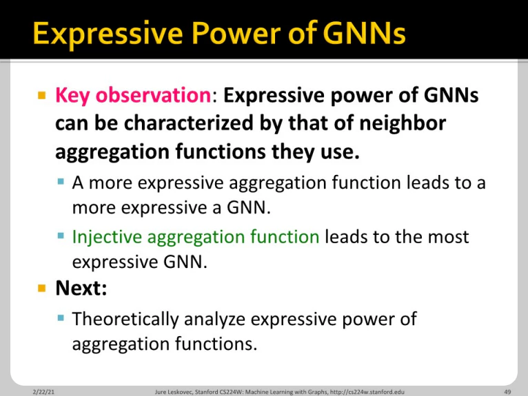{: width="766" height="575" }

Injective aggregation function을 기반으로 구축된 GNN은 서로 다른 computational graph마다 서로 다른 embedding을 제시할 수 있을 것입니다.

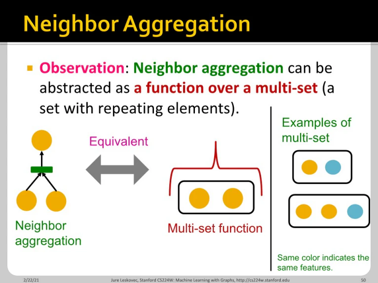{: width="766" height="575" }

Neighbor aggregation function은 원소의 중복이 허용되는 집합인 multi-set의 function과 동등한 위계에 있습니다. 우리는 이 aggregation function에서 mean(GCN)이나 max(GraphSAGE)를 활용해왔습니다.

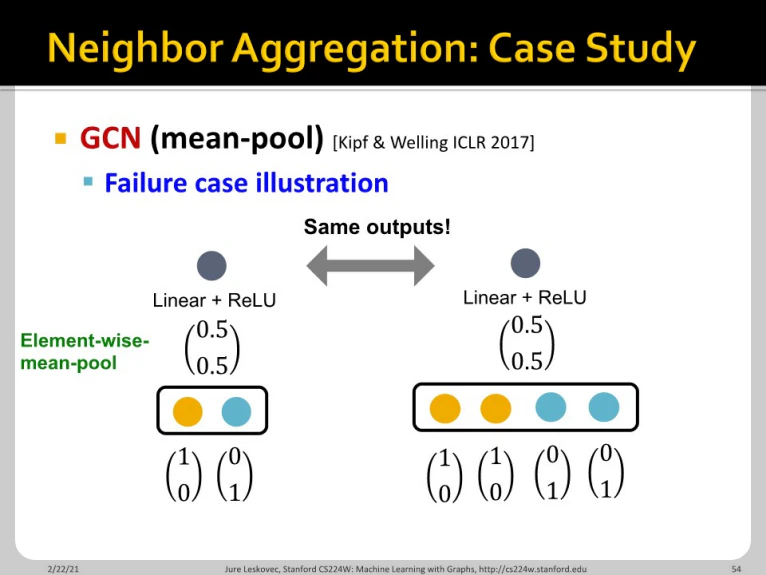{: width="766" height="575" }

하지만 GCN의 mean-pool은 명확하게 injective하지 않습니다. Mean pool은 왼쪽의 예시처럼 황색/청색 원소가 각각 1개 있는 경우와 2개 있는 경우를 구분하지 못합니다.

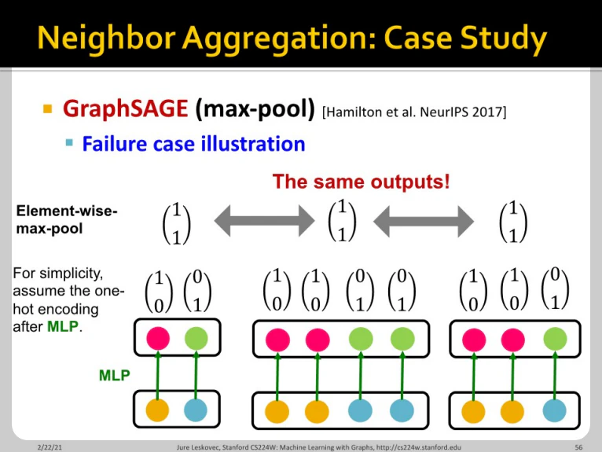{: width="766" height="575" }

이 문제는 max-pool을 활용하는 GraphSAGE에서도 발생합니다. 여기서도 마찬가지로 원소의 차원별 (축별) max를 추출하면 서로 다른 multi-set에 대해 같은 output이 나오는 것을 볼 수 있습니다.

여기까지 보면 알 수 있듯, GCN과 GraphSAGE는 most expressive한 GNN이 아닙니다. 어떤 aggregation function을 활용해야 expressive power가 높은 GNN을 만들 수 있을까요?

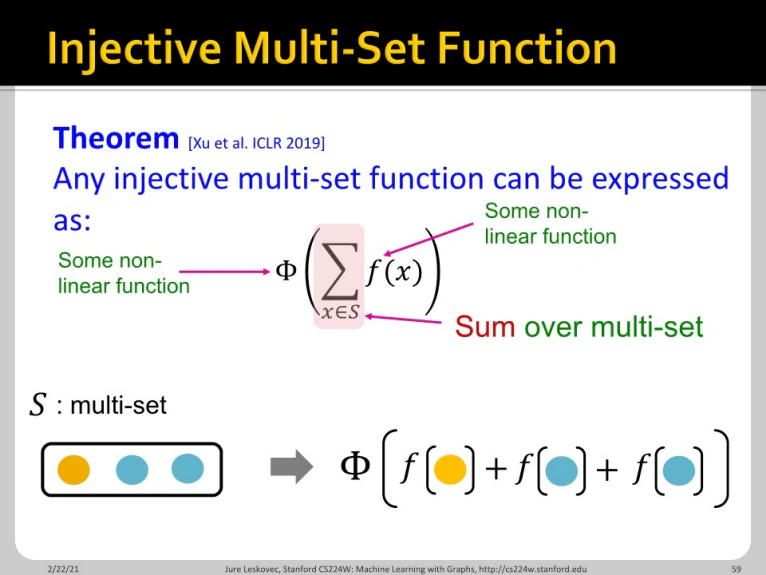{: width="766" height="575" }

Injective multi-set function은 위와 같은 두 단계의 function으로 구성되어 있습니다. Message를 non-linear function $$f$$를 거치게 한 후, sum한 값을 $$\Phi$$에 넣어 다음 layer의 node embedding을 얻게 됩니다.

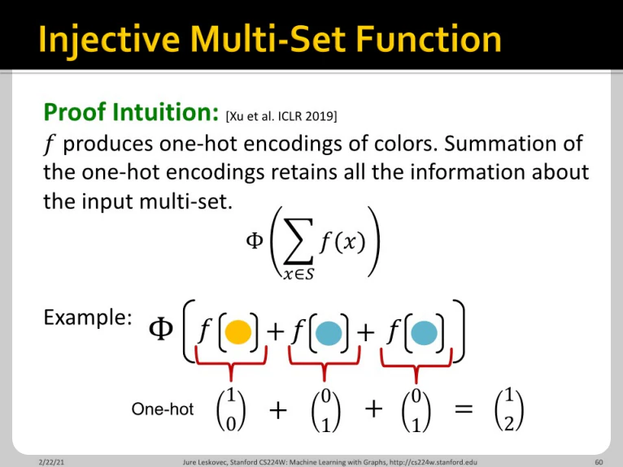{: width="766" height="575" }

만약 우리가 각 node를 one-hot으로 구분할 수 있다면, 그리고 각 one-hot의 원소 개수를 세는 것으로 function을 바꾼다면, 해당 function은 max나 mean보다는 expressive power가 높을 것입니다.

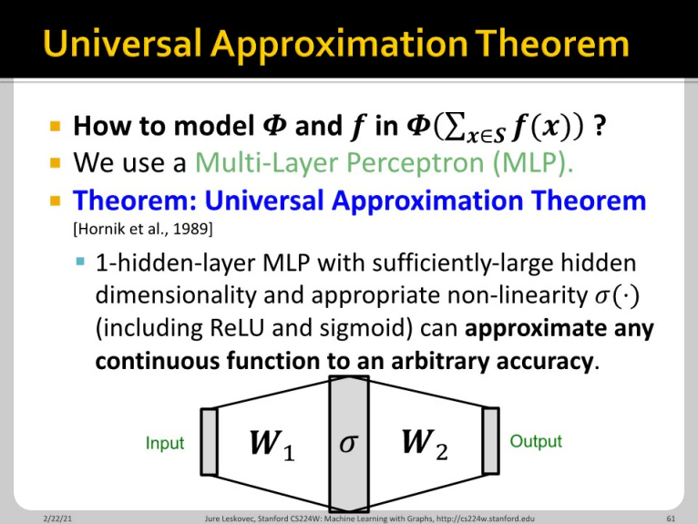{: width="766" height="575" }

우리는 모든 종류의 함수들을 직접 parametric하게 만들 수는 없습니다. 따라서 이런 함수들을 근사하기 위하여 MLP를 활용하게 됩니다. 1개의 hidden-layer가 있는 MLP도 dimension만 충분히 크다면 그 어떠한 연속 함수도 원하는 정확도로 근사할 수 있음이 증명되었기 때문입니다. (Universal Approximation Theorem) Practical한 관점에서 100~500 정도의 hidden dimension만 있으면 충분하다고 합니다.

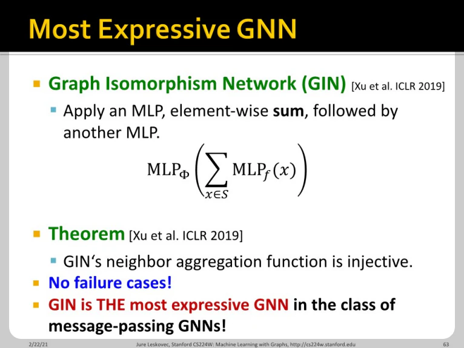{: width="766" height="575" }

GIN은 \"MLP - element-wise sum - MLP\"를 시행하는 GNN 모델입니다. 해당 논문에서는 GIN의 aggregation function이 injective함을 보였습니다. 따라서 message-passing GNN 중에서는 가장 expressive한 GNN이 됩니다. 중복되거나 유사한 값이 많은 교통 문제에서도 GIN이 역할을 할 수 있을까요? WL graph kernel과 함께 엮어서 논의해보도록 하겠습니다.

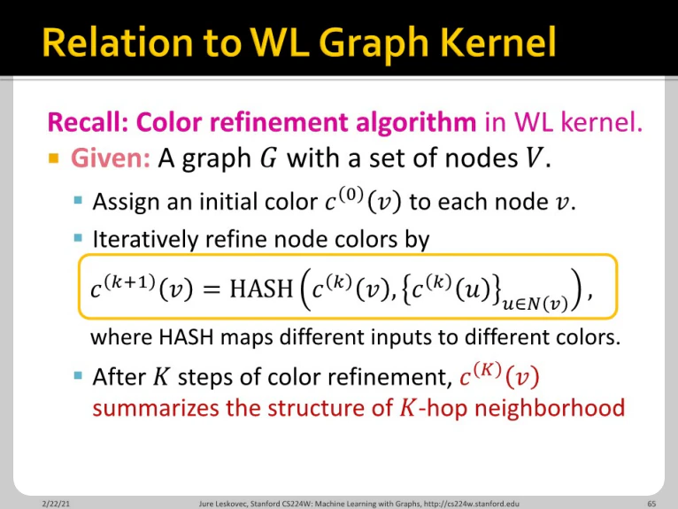{: width="766" height="575" }

우리는 예전에 [2강에서](/posts/CS224w-02-Traditional-Methods-for-Machine-Learning-in-Graphs/) Weisfeiler-Lehman kernel에 대해서 학습했습니다. Weisfeiler-lehman kernel은 hash 함수를 기반으로 서로 다른 neighbor node에 대해 서로 다른 색을 부여하여 graph가 isomorphic한지 검사하는 알고리즘이었습니다. 다만 색 분포가 다르면 두 graph는 확실히 isomorphic하지 않지만, 같다고 해서 isomorphic이 보장되지는 않습니다.

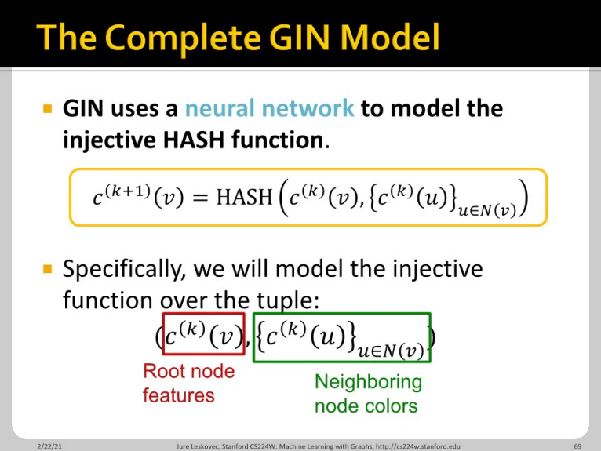{: width="766" height="575" }

GIN은 neural network를 활용하여 injective한 hash 함수를 생성합니다. 좀 더 자세히 이야기하면 tuple set에 대한 function을 활용합니다.

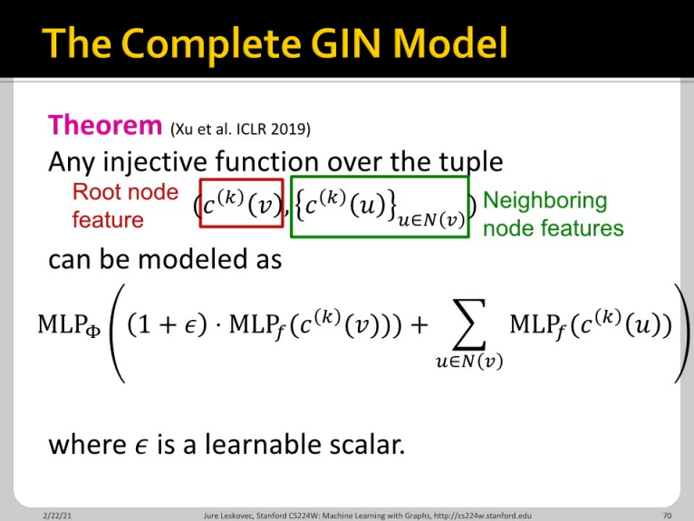{: width="766" height="575" }

[Xu et al. ICLR 2019](https://arxiv.org/abs/1810.00826)에서 최종 제시된 식은 위와 같습니다. MLP를 활용한 근사가 이루어졌고, 각 layer를 지남에 따라 동일한 function을 계속 통과하도록 만들었습니다. 각 function이 injective하기 때문에 위의 모델은 data를 injective하게 분석할 수 있습니다. 이때 root node 자신의 feature에 $$(1+\epsilon)$$을 곱해 이웃 node feature의 합과 구분되도록 함으로써, (root node feature, 이웃 node feature의 multi-set) tuple에 대한 함수가 injective하도록 설계했습니다. $$\epsilon$$은 학습 가능한(learnable) scalar입니다.

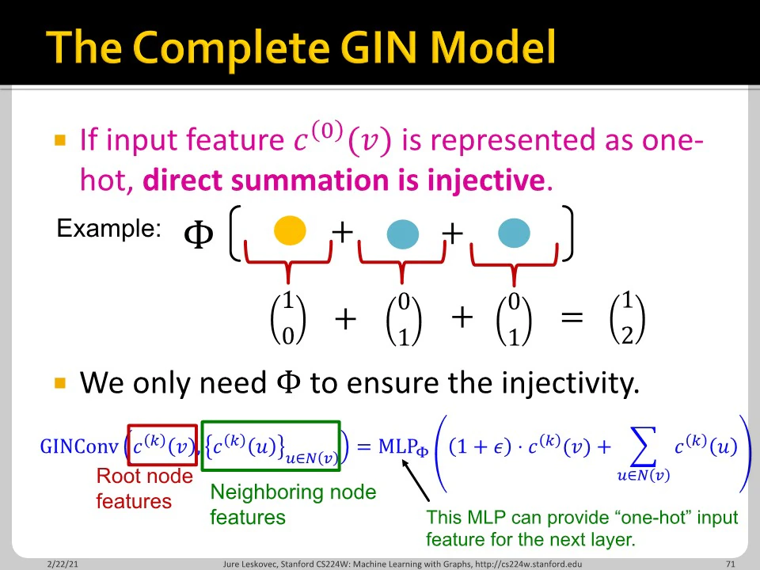{: width="960" height="720" }

만약 node feature가 one-hot이라면 direct summation도 injective합니다. One-hot인 경우 $$\Phi$$가 injective하기만 하면 됩니다.

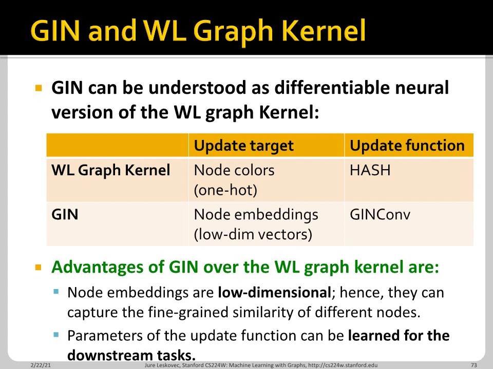{: width="960" height="720" }

GIN은 WL graph kernel의 differentiable한 version으로 볼 수 있다고 합니다. WL graph kernel은 one-hot인 node color를 update하는 반면, GIN은 low-dimensional한 node embedding을 update합니다. 따라서, 서로 다른 node의 미세한 유사성을 확인할 수 있습니다.

두 모델이 update하는 target과 update function이 유사하기 때문에 정확히 같은 expressive power를 가집니다. 따라서 다른 GNN으로 구분되지 않는 그래프가 있더라도 WL graph kernel로 구분된다면, GIN을 활용하면 됩니다. 그리고 그 핵심은 mean/max-pooling이 아닌 element-wise-sum pooling을 진행하는 것입니다.

이상으로 9장의 내용이 마무리되었습니다.
