지금까지 저희는 단일한 종류의 edge로 이루어진 graph만을 다루었습니다. 그런데 만약 여러 종류의 edge가 있다면 어떻게 해야 할까요?

## Heterogeneous Graphs and Relational GCN (RGCN)

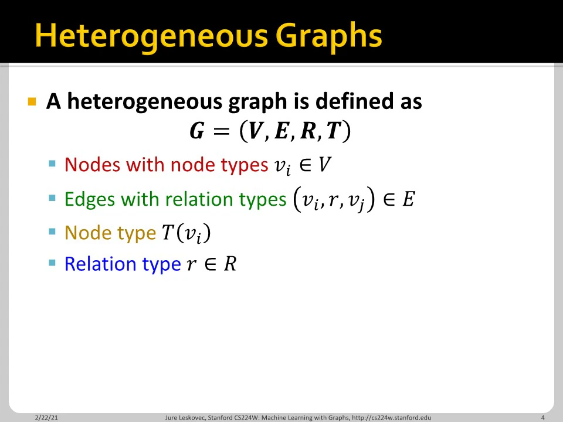{: width="960" height="720" }

일단 정의부터 다시 시작해야 합니다. 기존에 그래프를 $$G=(V, E)$$로 정의하던 것을 넘어, $$G=(V, E, R, T)$$로 정의하게 됩니다. $$R$$은 edge의 type, $$T$$는 node의 type이 되겠습니다.

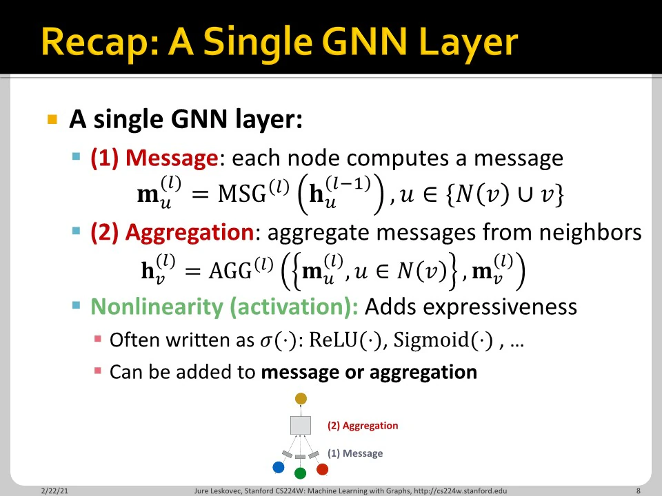{: width="960" height="720" }

RGCN에 대해 이야기 하기 전 우리가 기존 GNN을 어떻게 접근했는지 확인해봅시다. 각 node는 $$l$$번째 layer에서 message $$m_{u}^{(l)}$$을 생산하는데 이는 전 단계의 message aggregation의 결과인 $$h_{u}^{(l-1)}$$에 의해서 결정됩니다. 이렇게 생산된 message $$m_{u}^{(l)}$$는 다른 neighbor node와의 aggregation을 통해 $$h_{v}^{(l)}$$이 됩니다. 그 다음 상황에 맞게 non-linear function이 활용됩니다.

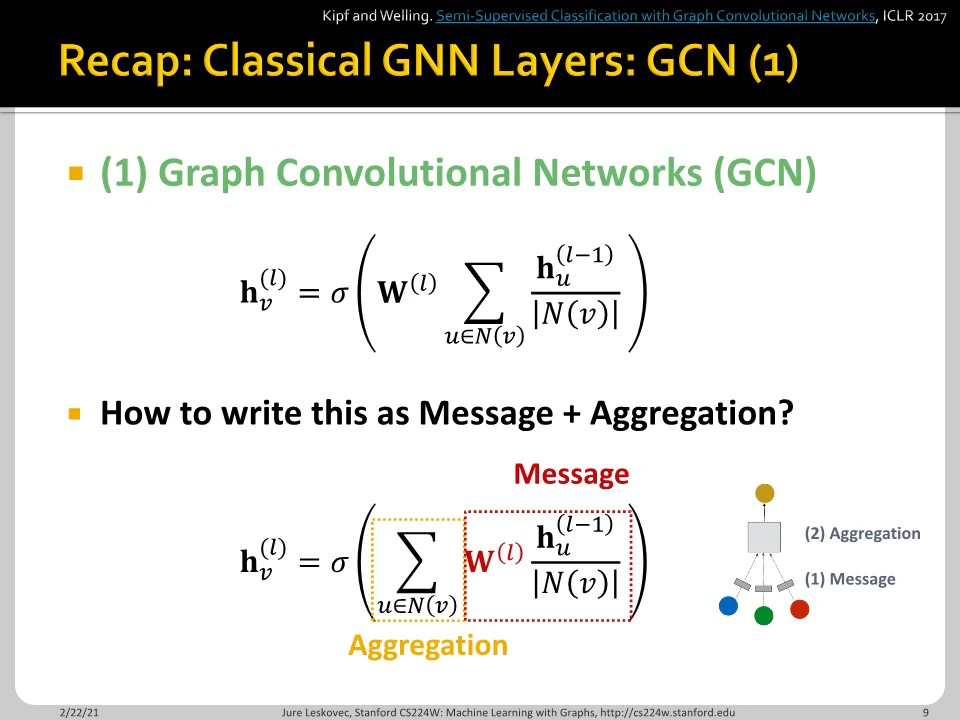{: width="960" height="720" }

GCN의 경우는 $$\frac{\mathbf{W}^{(l)}}{\vert N(v)\vert }$$를 곱하는 것이 $$MSG^{(l)}$$ 함수이며, $$\sum_{u\in N(v)}$$가 aggregation function이 됩니다.

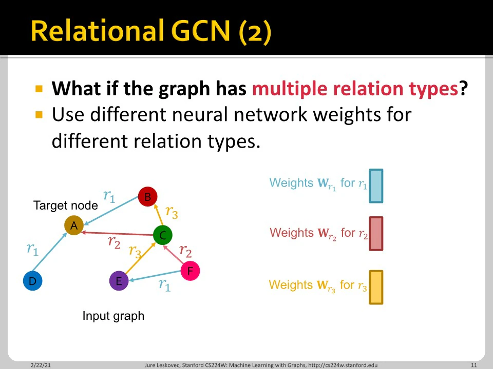{: width="960" height="720" }

만약 여러개의 관계를 가진 Graph가 있다면 어떻게 될까요? 각 relation type별로 서로 다른 neural network를 적용해야 할 것입니다. $$\frac{\mathbf{W}^{(l)}}{\vert N(v)\vert }$$에서 $$\mathbf{W}^{(l)}$$가 relation 별로 생성된다고 볼 수도 있습니다. 교통에서도 좌회전/우회전/직진 별로 서로 다른 relation을 부여할 수도 있겠습니다.

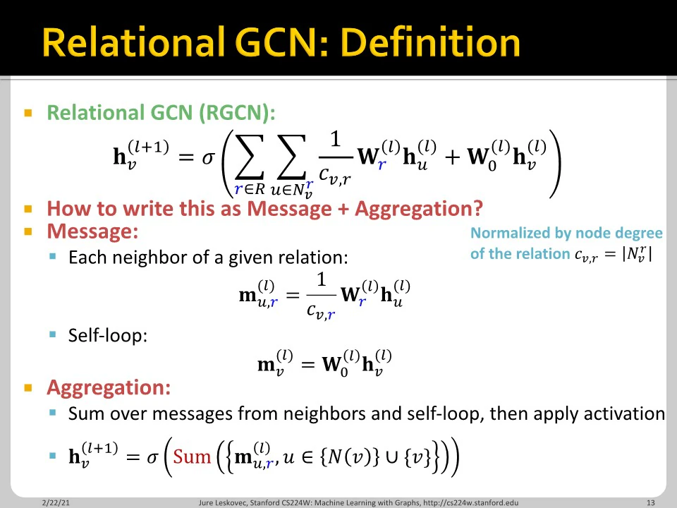{: width="960" height="720" }

GCN과 식은 거의 비슷합니다. 관계의 종류별로 서로 다른 weight matrix를 곱하고, 그에 맞는 degree $$c_{v,r}$$로 normalize한다는 점이 다릅니다. Self-loop도 추가되어 있습니다. Aggregation function은 동일하게 sum을 활용했습니다. 저기서 summation에 $$\mathbf{m}_{u,r}^{(l)}$$이 포함되는데, 아마 relation별로 더하는 것은 아닐테고, 전체 다 sum을 할 것으로 예상합니다.

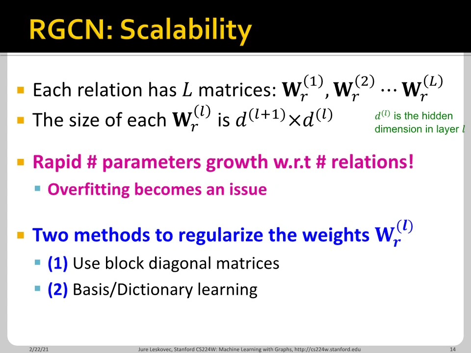{: width="960" height="720" }

그런데 이런 식으로 관계별로 무작정 matrix를 생성하면 parameter의 개수가 너무 늘어나는 이슈가 발생합니다. 이 문제를 해결하기 위해 (1) block diagonal matrices와 (2) basis/dictionary learning이라는 서로 다른 방법이 적용될 수 있습니다.

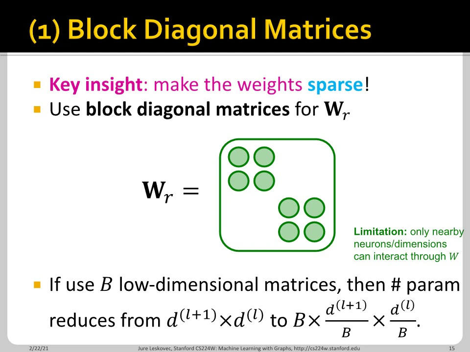{: width="960" height="720" }

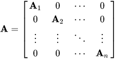{: width="235" height="118" }

Block diagonal matrices는 parameter의 수를 $$B$$배 만큼 줄여줍니다. 각 weight block은 행과 열의 차원이 각각 $$B$$배 줄어 $$B^2$$배 만큼 이익을 보고, block이 $$B$$개라 $$B$$배 만큼 손해이니 결국 $$B$$배 이득입니다.

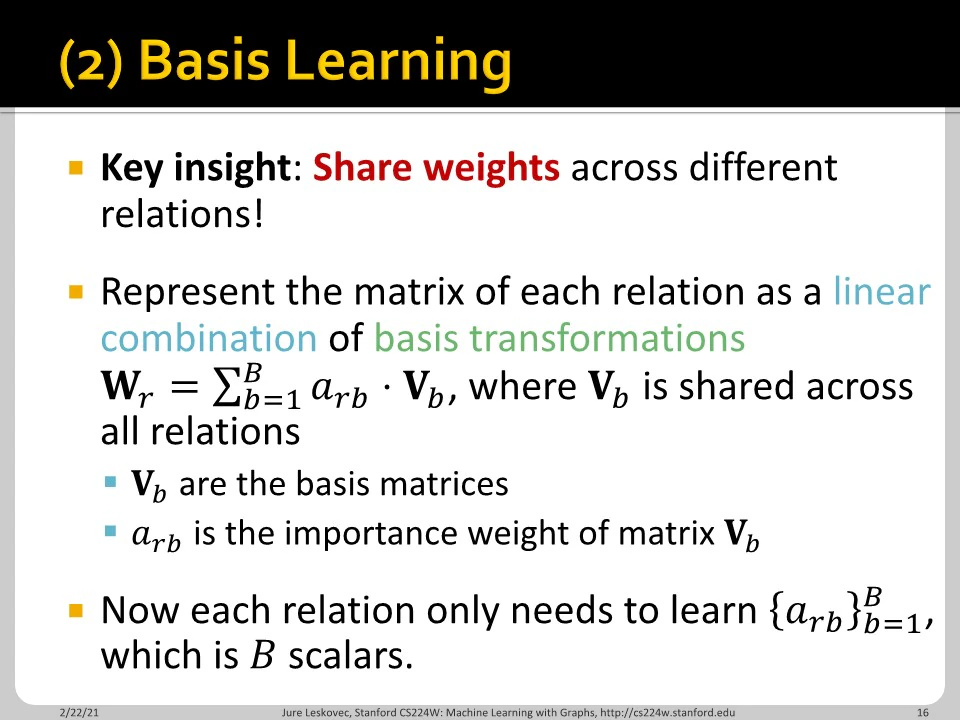{: width="960" height="720" }

Basis learning은 서로 다른 relation에 맞는 basis matrix를 계산해 문제를 해결합니다. 각 relation에 활용되는 기저 행렬을 만들어 공통으로 활용해 parameter의 수를 급격히 줄이는 것입니다.

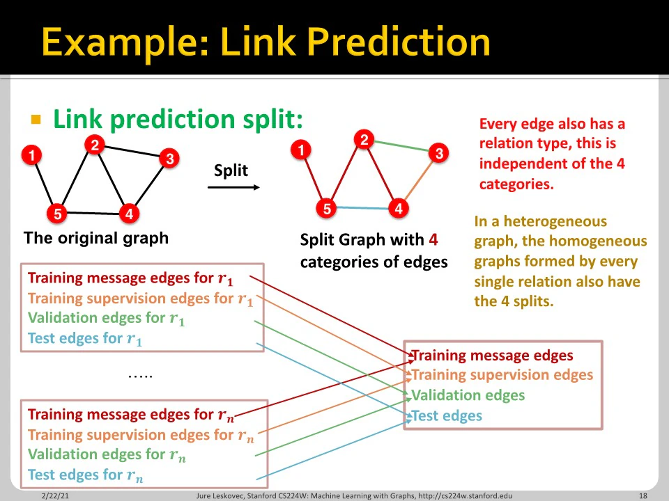{: width="960" height="720" }

RGCN의 link prediction task는 네 가지 종류의 edge로 구성된 문제로 정의할 수 있습니다. 각각 training message edge, training supervision edge, validation edge, test edge입니다. 다른 edge type은 우리가 흔히 학습하는 edge와 같은데 training supervision edge는 message passing에는 쓰이지 않고 모델이 맞혀야 할 정답(positive) edge이며, negative edge도 이 edge를 교란해서 만듭니다.

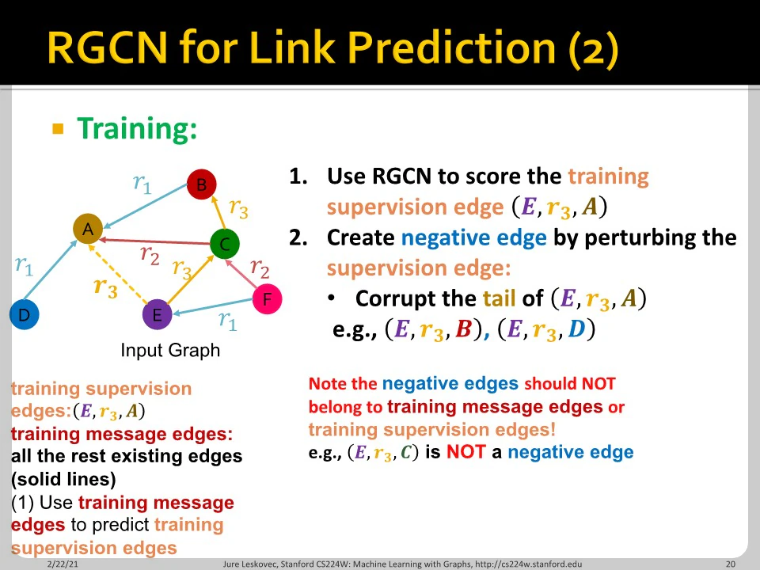{: width="960" height="720" }

Training 단계에서 supervision edge를 perturb(교란)하여 거짓의 정보가 담긴 negative edge로 만듭니다. 그 다음 얼마나 negative edge를 잘 detect 하는지 loss를 기반으로 확인합니다.

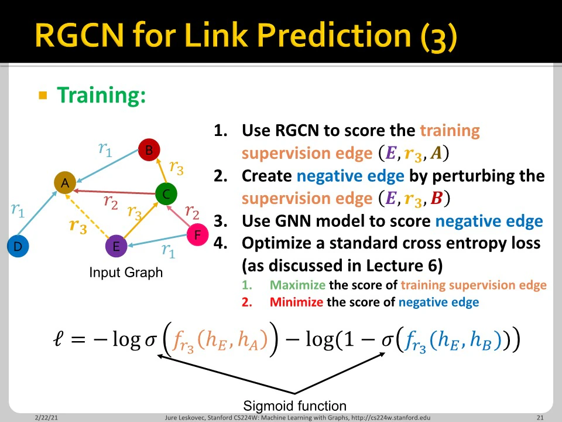{: width="960" height="720" }

Negative edge에 대한 score는 minimize하고 정상 edge(training supervision edge)에 대한 score는 maximize하므로, 결국 정상 edge를 잘 측정하는 문제가 될 것입니다. 교통 네트워크에서도 속도 데이터가 있을 때 network 구조를 잘 파악하는 model이 있다면 저런 negative edge로 모델의 robustness를 올릴 수 있겠습니다.

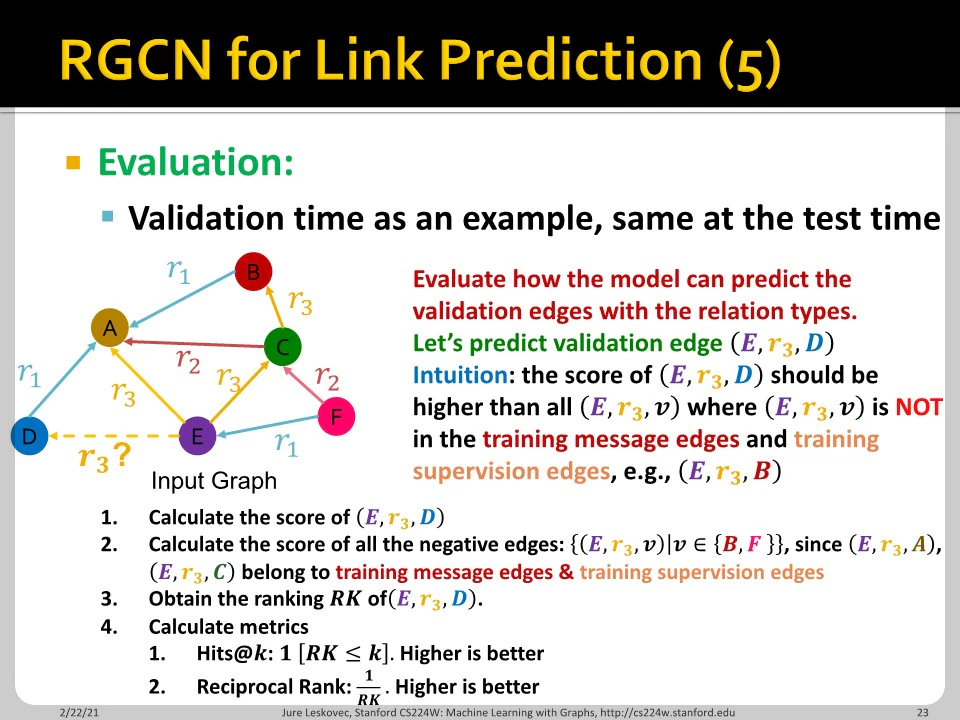{: width="960" height="720" }

$$(E, r_3, D)$$는 실제 있는 연결입니다. 따라서 이 연결에 대한 score는 실제로 존재하지 않는 연결들 ex) $$(E, r_3, B)$$보다 높은 score를 가져야 합니다. 그리하여 score대로 순서를 매긴 RK가 1위에 가깝기를 바라게 됩니다.

## Knowledge Graphs: KG Completion with Embeddings

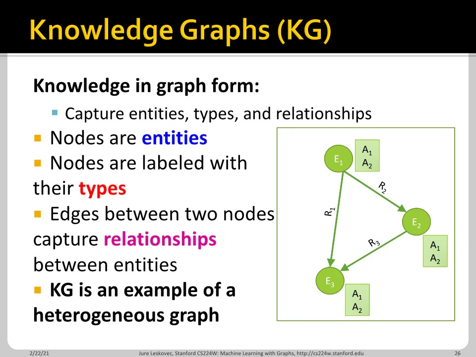{: width="960" height="720" }

Knowledge Graph (KG)는 heterogeneous graph의 한 종류입니다. KG 또한 Entities와 type으로 이루어져있습니다.

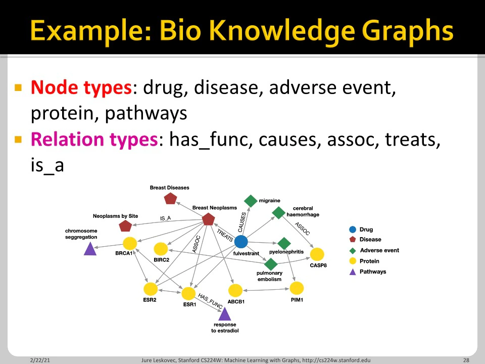{: width="960" height="720" }

Bio KG를 생각해보면 약물, 질병, 단백질 등이 node가 될 것이고 그 사이의 관계가 edge로 나타날 것입니다. 이러한 bio 분야 외에도 구글, 아마존, 페이스북 등의 다양한 회사들에서 생산하는 데이터들은 KG로 정의될 수 있습니다. KG는 query에 대한 답변 등의 분야에 활용됩니다.

KG 데이터는 여러 특징이 있는데, 그 중 많은 수의 node로 이루어졌다는 massive한 특징과, true edge가 유실되어있다는 incomplete한 특징이 있습니다. 따라서 이 missing edge를 잘 예상하는 것은 KG에 도움이 됩니다. 단적인 예로 한 서비스인 Freebase에는 수많은 인물(person) entity가 있는데, 그중 93.8%는 출생지(place of birth) 정보가 빠져 있다고 합니다. Node는 그대로 있고 node 사이의 관계(edge)가 유실된 것입니다.
