## Knowledge Graph Completion: TransE, TransR, DistMult, ComplEx

기존의 link prediction 문제에서는 일부 edge가 주어진 그래프에서 빠진 edge를 예측해야 했습니다. 여기서 변형하여, KG에서 특정 node와 다른 node가 특정 relation을 갖고 있는지 없는지를 맞추는 문제로 바꿀 수 있습니다.

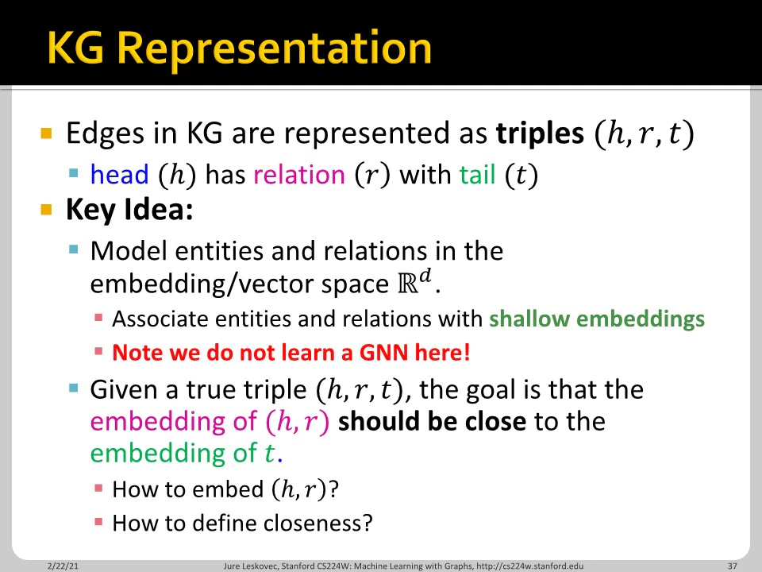{: width="960" height="720" }

이 작업은 node의 embedding vector가 필요합니다. 그냥 embedding vector는 아니고 triple의 embedding vector입니다. Head와 relation과 tail의 embedding vector가 필요한 상황입니다.

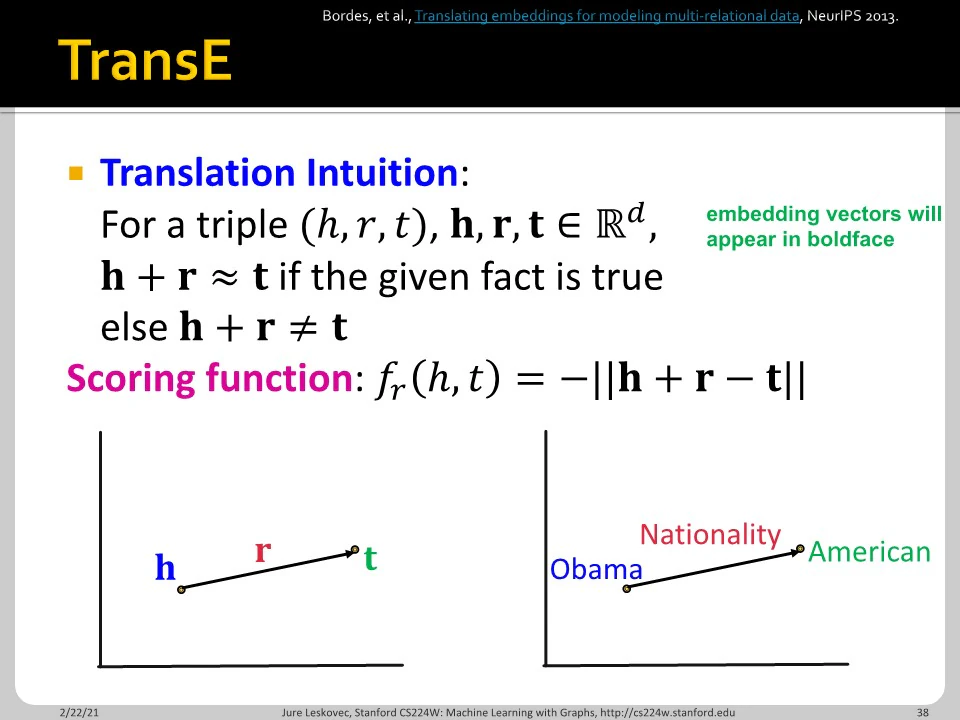{: width="960" height="720" }

TransE의 경우 마치 node2vec과 같은 vector embedding을 추구합니다. Obama라는 head embedding에서 nationality라는 relation edge embedding을 더하면 American이라는 tail embedding으로 가기를 바라는 것입니다. Scoring은 단순하게 정답과 예측치의 euclidean distance를 보면 됩니다.

TransE를 학습시킬 때에도 corrupted triplet이라 부르는 negative sample을 활용합니다. 해당 triplet이 확실하게 없다고 할 수 있다면 좋은 모델일 것입니다.

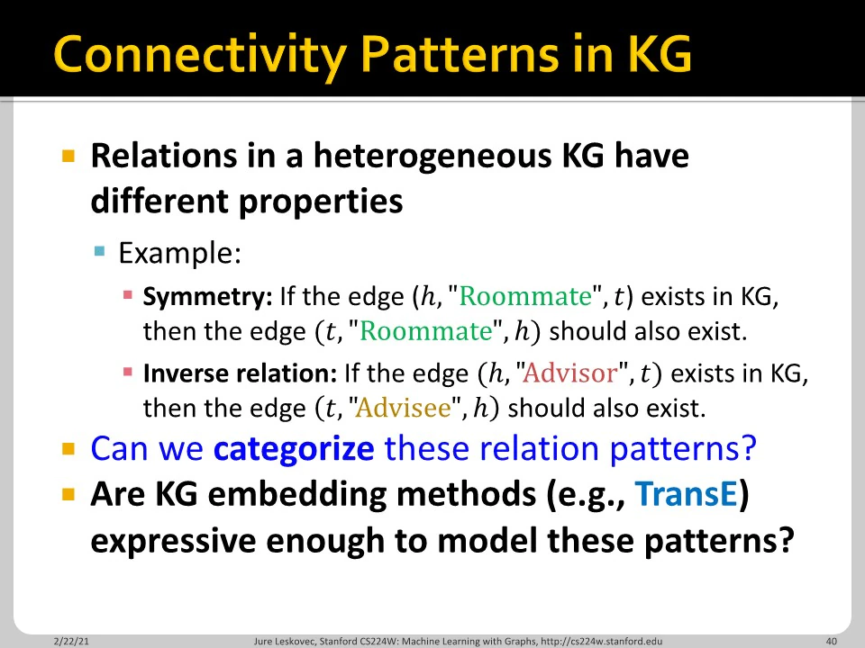{: width="960" height="720" }

그럼 TransE는 reciprocal relation도 표현할 수 있을까요? 예를 들어 특정 인물 A가 B와 roommate 관계라면 B도 A와 roommate여야 맞습니다.

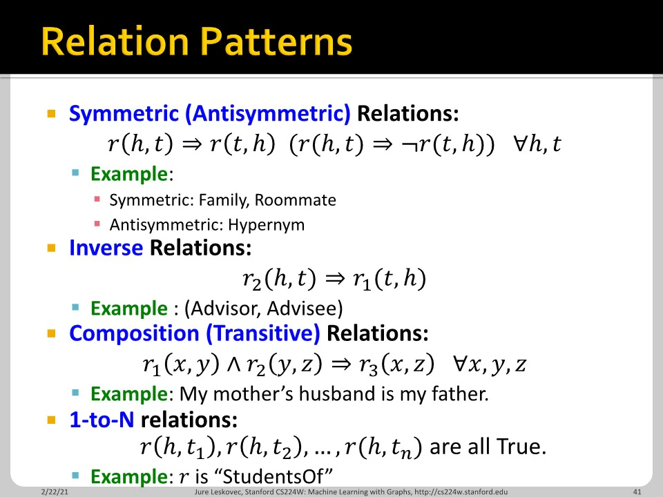{: width="960" height="720" }

여러 relation pattern이 있겠지만, symmetric, inverse, composition, 1-to-N으로 유형화 시킬 수 있습니다. Composition(transitive) relation의 경우 저와 엄마의 관계, 엄마와 아빠의 관계를 합하면 저와 아빠의 관계라는 자식과 부모간의 관계를 보이는 것을 말합니다.

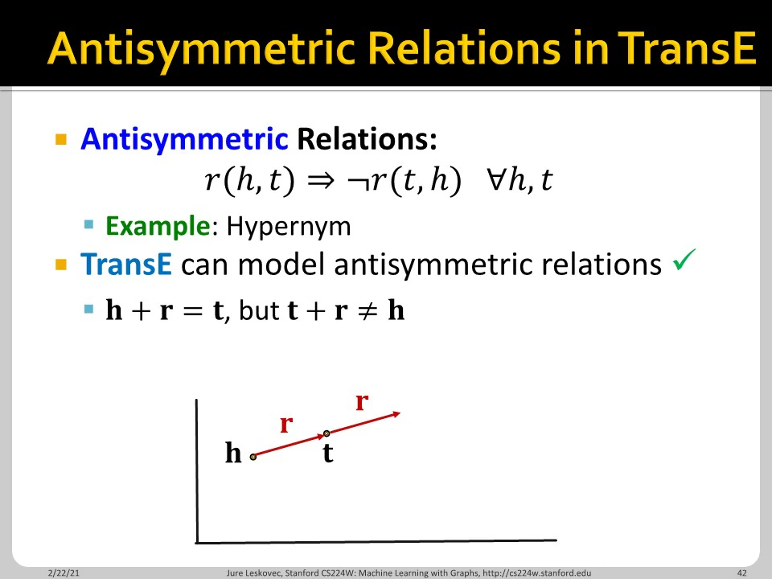{: width="960" height="720" }

일단 TransE는 antisymmetric한 관계는 찾을 수 있습니다. Violet의 hypernym은 purple입니다. Purple의 hypernym은 color입니다. 이런 관계는 TransE에서 보일 수 있습니다. 그리고 inverse도 보일 수 있습니다. 단순 벡터합으로 보이기 쉬운 부분입니다.

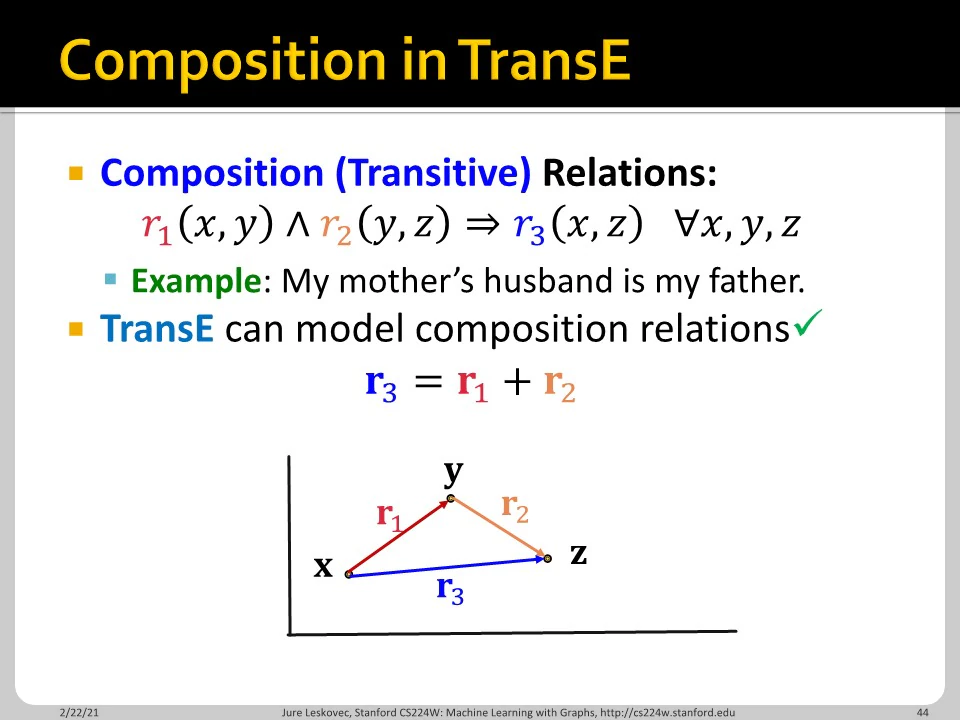{: width="960" height="720" }

Composition relation도 보일 수 있습니다. 이것도 마찬가지로 벡터합으로 보일 수 있습니다.

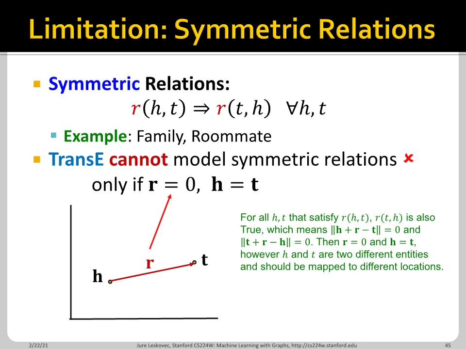{: width="960" height="720" }

하지만 symmetric한 relation은 보일 수 없습니다. Symmetric한 relation이 표현되려면 r=0이어야 하고 h=t여야 합니다. 유사한 문제로 TransE는 1-to-N 문제도 표현할 수 없습니다.

이런 문제를 해결하기 위해서 TransR이 등장합니다.

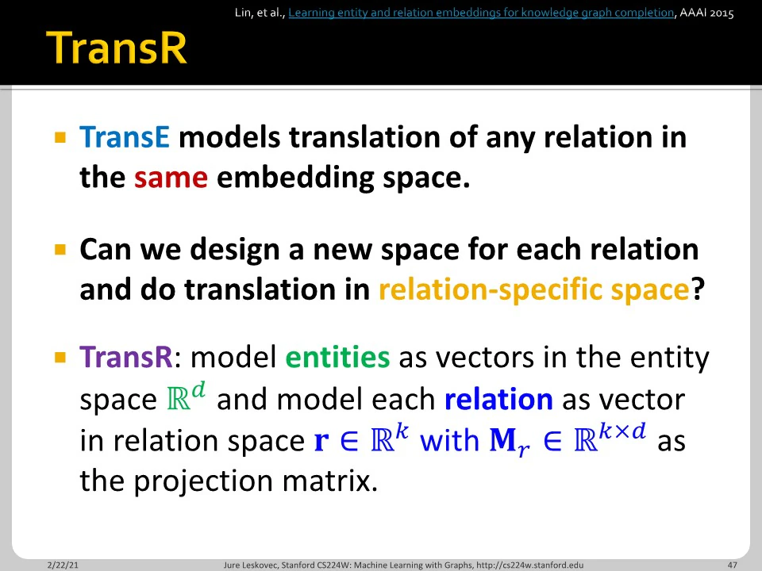{: width="960" height="720" }

지금까지는 node와 relation이 같은 space에서 embedding 되었습니다. 이 상황에서 relation을 위한 relation-specific space를 따로 정의해서 풀 수 없을까요?

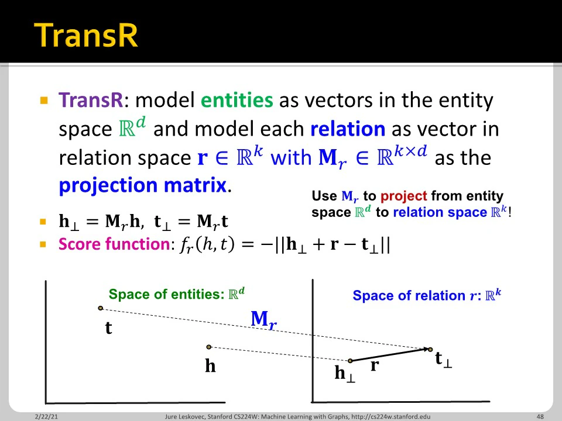{: width="960" height="720" }

TransR은 entity를 $$\mathbb{R}^{d}$$에, relation을 $$\mathbb{R}^{k}$$의 space에 embedding합니다. 그렇다면 projection 혹은 mapping matrix는 $$\mathbb{R}^{k\times d}$$가 됩니다. $$h_{\bot}$$와 $$t_{\bot}$$는 각각 $$h$$와 $$t$$가 relation space에 embedding된 결과입니다.

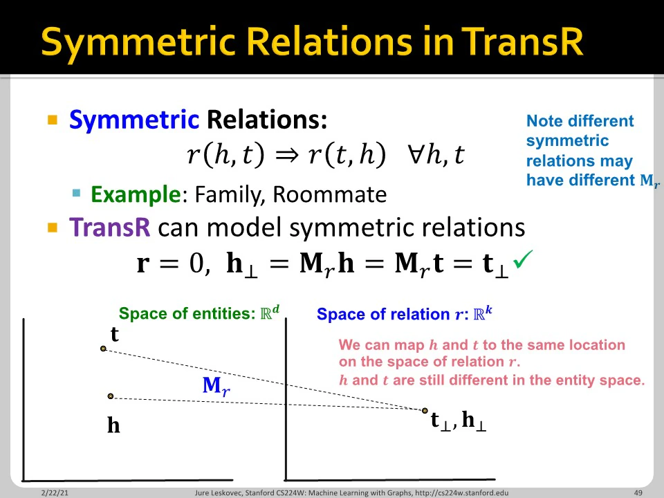{: width="960" height="720" }

그럼 이제 symmetric relation을 표현할 수 있게 됩니다. 왜냐면 relation space에서 $$h_{\bot}$$와 $$t_{\bot}$$는 정말 같은 point가 되어 $$r$$이 0-벡터가 되기 때문입니다. 유사하게, antisymmetric relation도 표현할 수 있습니다.

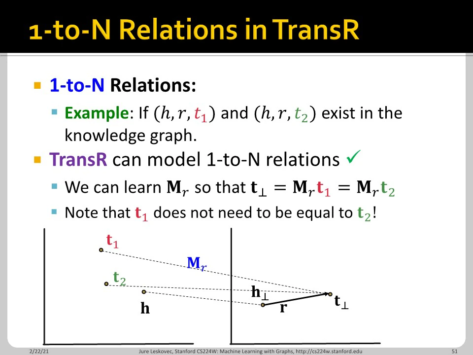{: width="960" height="720" }

1-to-N도 표현 가능합니다. 서로 다른 여러 tail을 relation space의 같은 point로 projection할 수 있기 때문입니다.

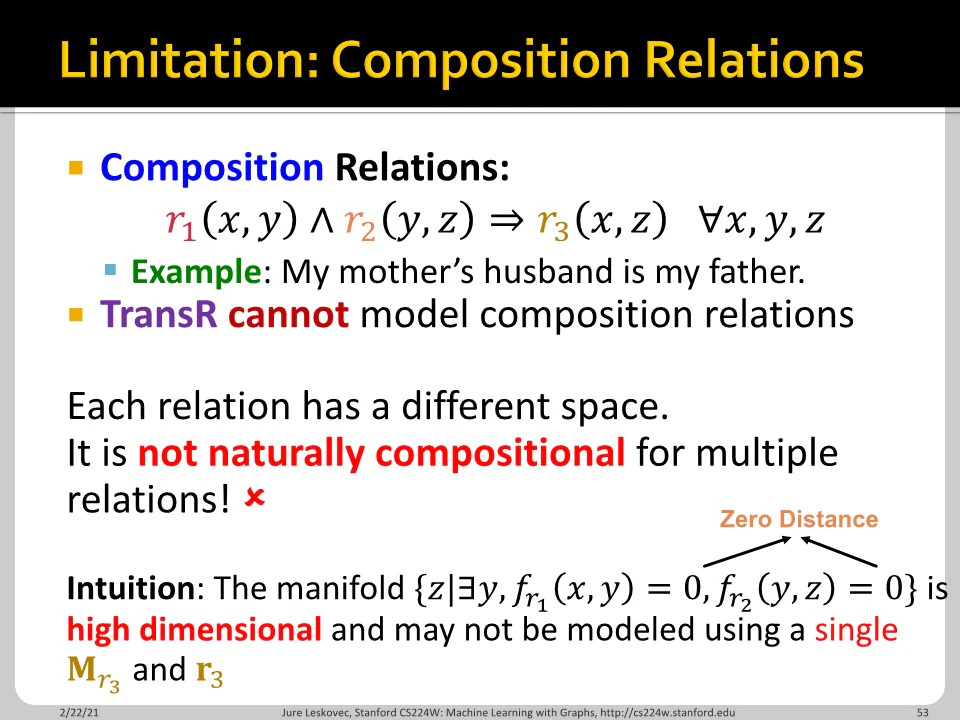{: width="960" height="720" }

하지만 TransR도 무적은 아닙니다. Composition relation에서 문제가 생깁니다.

## Bilinear Modeling

그래서 새로 방법론이 나타납니다. Bilinear한 모델링을 적용하는 것입니다.

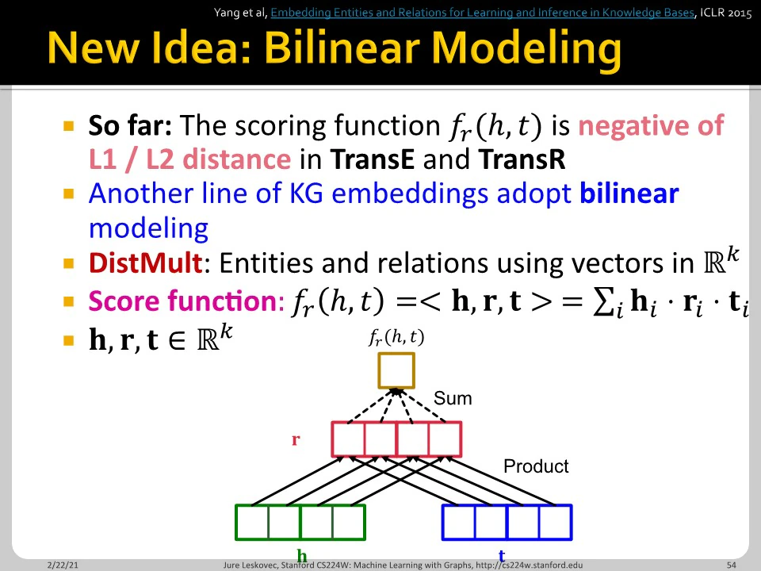{: width="960" height="720" }

Head, relation, tail로 이루어진 triple의 score를 정할 때 element-wise multiplication의 summation으로 점수를 정할 수 있습니다. 각각이 올바른 embedding일 때만 높은 점수가 나오게 됩니다. Score function을 cosine similarity를 나타내는 새로운 function으로 볼 수 있습니다. 내적과 마찬가지인 score function은 $$h$$와 $$r$$의 element-wise 곱과 $$t$$가 비슷하면 같은 방향을 나타낼 것이며, 그게 아니면 역방향을 나타낼 것입니다.

자세한 내용은 생략하겠지만, 이런 bilinear model인 DistMult는 symmetric한 경우와 1-to-N만 나타낼 수 있습니다.

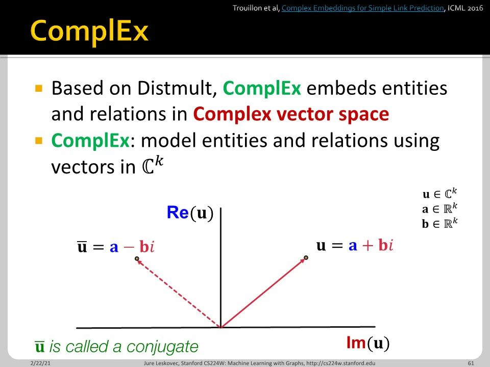{: width="960" height="720" }

여기서 한 단계 더 나아가면, ComplEx는 embedding vector에 실수부와 허수부가 있는 complex number를 활용합니다.

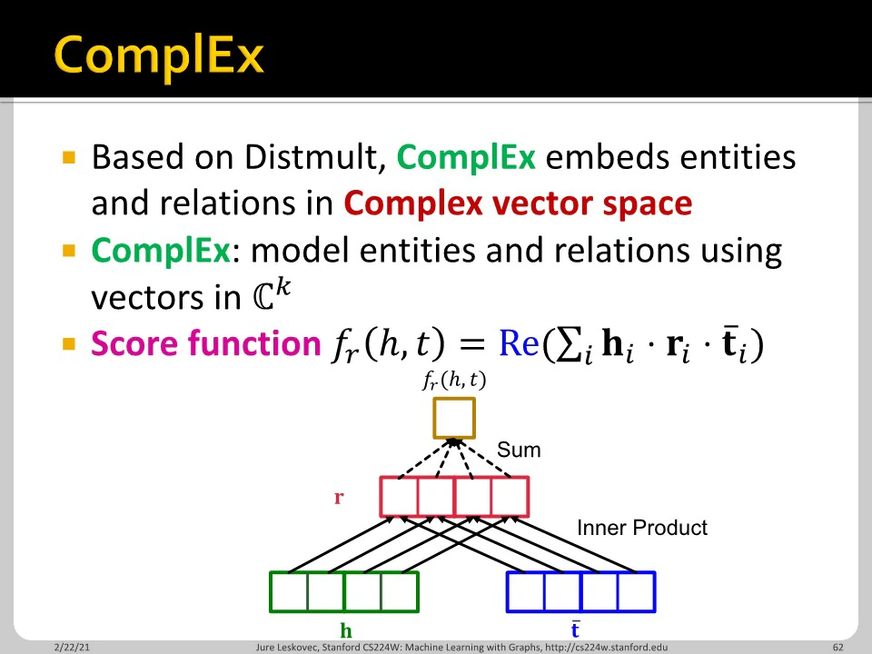{: width="960" height="720" }

Score function은 DistMult와 거의 비슷한데 tail embedding의 켤레복소수 $$\bar{t}$$를 곱한 뒤 실수부만 뽑는다는 특징이 있습니다.

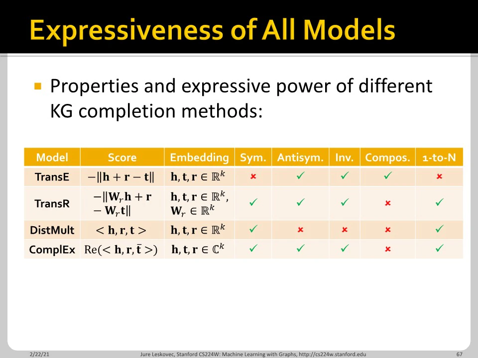{: width="960" height="720" }

각 모델의 관계 표현 가능 여부를 정리하면 위와 같습니다.

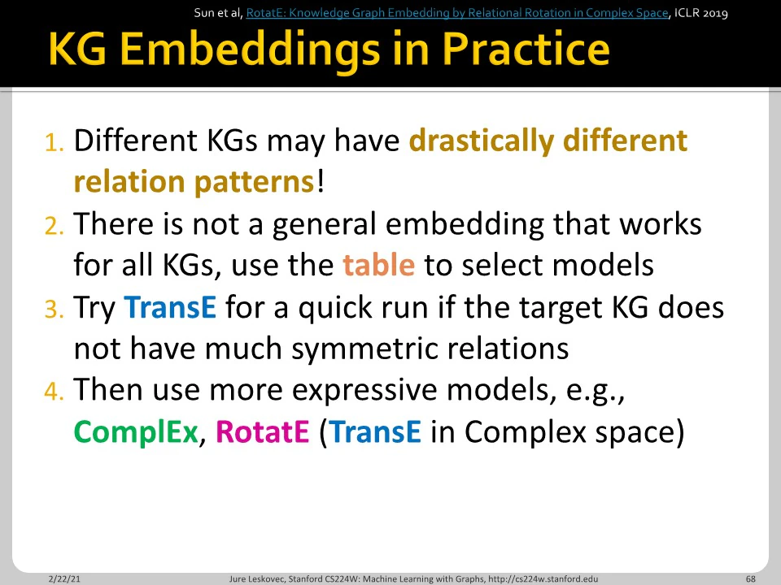{: width="960" height="720" }

정리하면 위와 같습니다.
