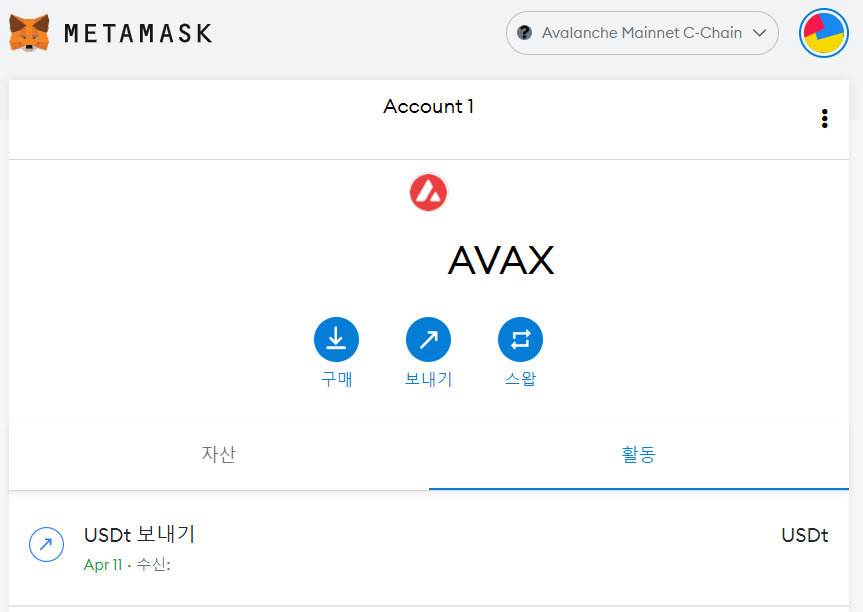
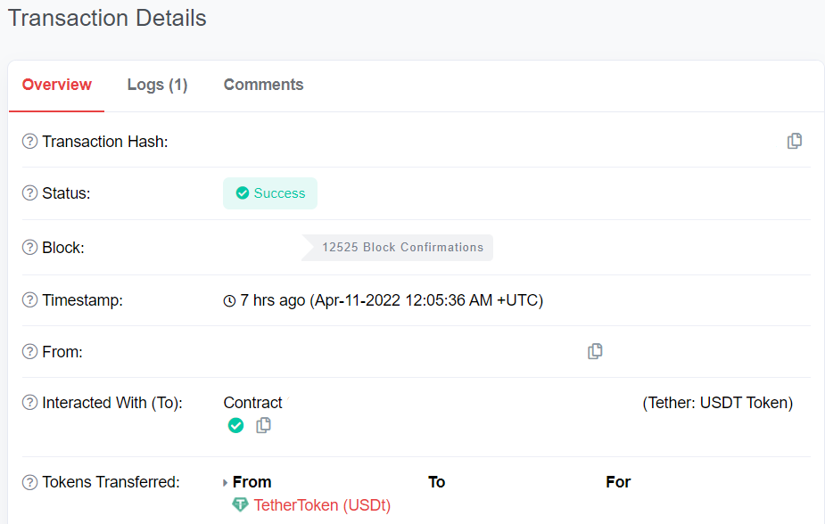
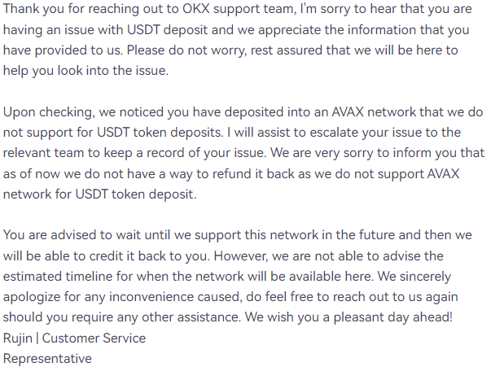

평소에는 꼼꼼하게 확인하고는 하는데, 오늘 송금 과정에서 큰 실수가 있었습니다.

{: width="863" height="612" }

Avalanche Mainnet C-Chain에서 타 거래소 계좌로 USDt를 보내려는 상황이었습니다. 제가 사용하는 거래소의 USDt는 TRC20, ERC20, Polygon등을 지원하는데 안타깝게도 Avalanche C-Chain은 지원하지 않았습니다.

아무 생각 없이 USDT-ERC20 주소로 송금을 눌렀고 transaction 자체는 성공하였으나 제 USDt는 거래소에서 지원하지 않는 가상의 공간으로 간 셈입니다.

{: width="925" height="588" }

성공은 했으나 제 거래소에서는 확인되지 않았습니다.

원래는 어떻게 했어야 할까요? 그냥 그 USDt로 Avalanche를 사서 거래소의 Avalanche 주소로 보냈어야 합니다. 아니면 좀 덜 효율적이지만 USDt를 USDT.e로 스왑한 뒤 Avalanche Bridge를 통해서 옮겼어야 합니다.

[https://bridge.avax.network/](https://bridge.avax.network/)

> **[Avalanche Bridge: Transfer Assets To and From Ethereum](https://bridge.avax.network/)**  
> The Avalanche Bridge (AB) connects directly to your MetaMask wallet for fast, cheap, & secure transfers of Ethereum assets to and from Avalanche. Try the AB & Earn AVAX!  
> <small>bridge.avax.network</small>

여기서 Avalanche에서 ethereum(ERC20)으로 옮기고 보냈어야 하는데 제 실책입니다.

일단 거래소에 트랜잭션 주소 남겨서 문의는 넣었는데 아래와 같은 답이 왔습니다.

{: width="603" height="451" }

음..\. OKX USDt가 AVAX 네트워크를 지원할 때 까지 기다려야하는 것으로 보입니다. 언제 열릴지는..\. 알 수 없겠습니다.
