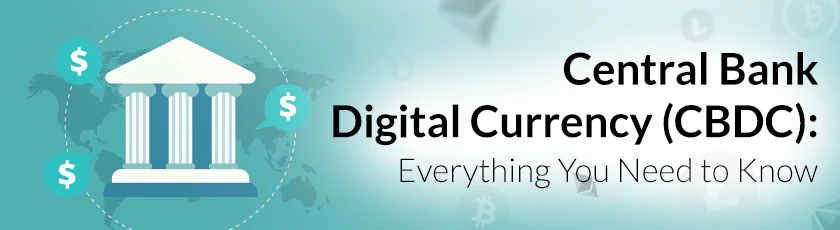
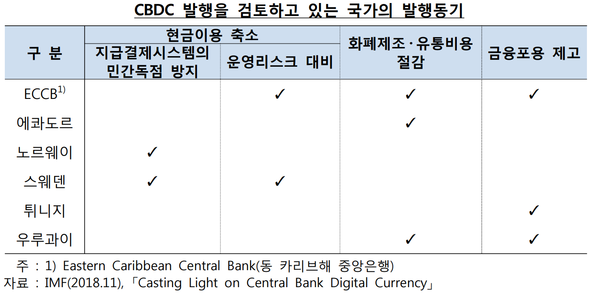
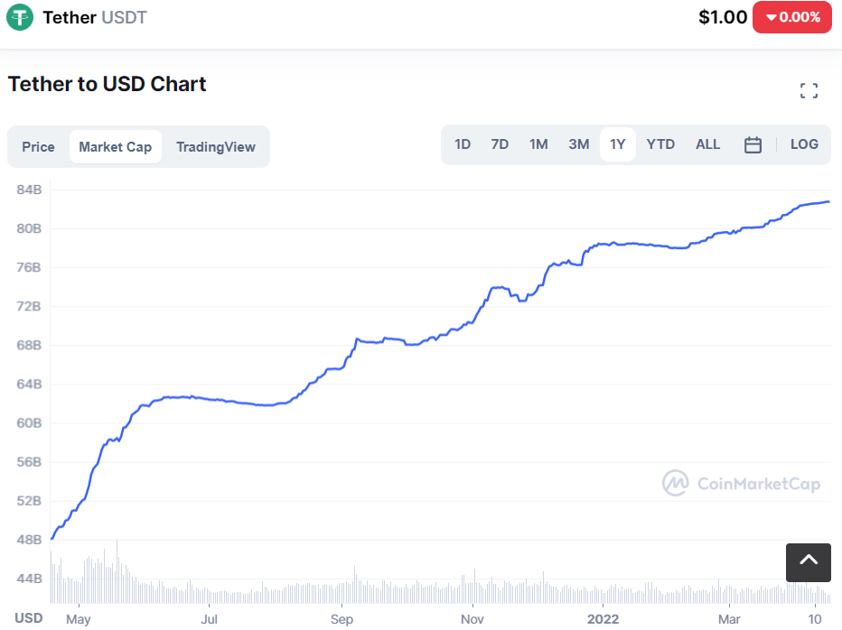
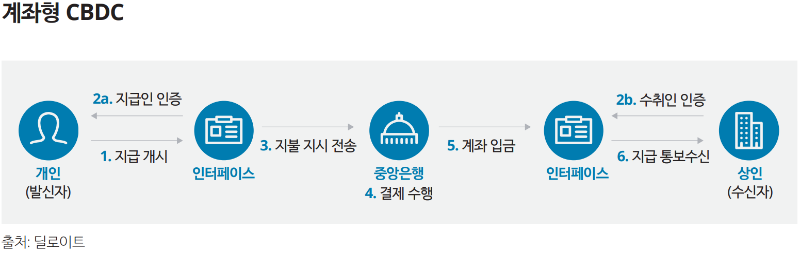
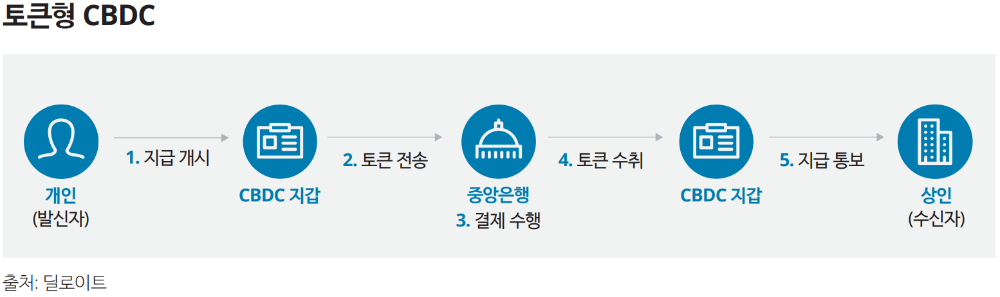
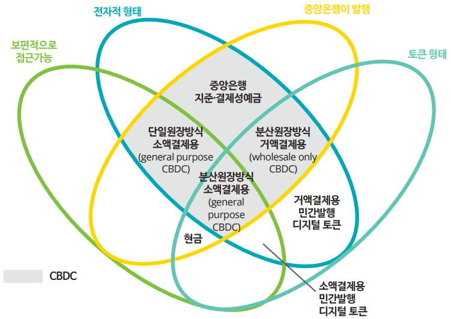
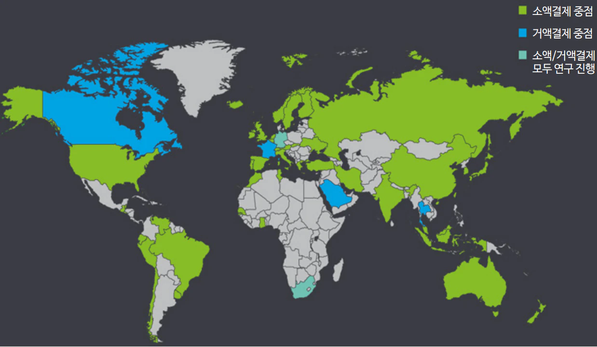

{: width="840" height="230" }
_https://www.bitira.com/central-bank-digital-currency-cbdc/_

## 중앙은행 디지털화폐(Central Bank Digital Currency, CBDC)의 논의 배경

비트코인과 이더리움 등 암호화폐가 태동한 초창기에 중앙은행은 암호화폐를 크게 신경쓰지 않았습니다. 투기 자산으로 취급하며 투자자들의 투기 과열을 경고하는 정도에서 그쳤을 뿐, 암호화폐를 자신들의 거버넌스에 도전할 세력이나 화폐의 대체재로 생각하지 않았습니다. 하지만 최근 수많은 종류의 암호화폐가 등장하여 중앙은행의 화폐 발행 독점에 도전하고 있습니다. 2021년까지 발행된 암호화폐 종류는 수천개가 넘습니다. 암호화 자산의 시가총액은 2013년 말 미화 약 100억 달러에서 2020년 8월에는 3,700억 달러로 증가했습니다. 이에 따라 중앙은행에서도 암호화폐라는 새로운 시스템을 보다 진지하게 살펴보기 시작했습니다.

일부 중앙은행은 암호화폐를 본인들이 지배하던 거버넌스에 대항하는 경쟁자로 보지만, 다른 한편에서는 암호화폐를 본인들의 필요에 의한 대체재로 여기고 있습니다. 인구가 적고 현금 이용 감소에 따른 부작용 발생 우려가 있는 국가들, 금융 시스템 수준이 낮은 일부 국가에게 암호화폐 시스템은 현재의 문제를 타개할 수 있는 좋은 대체재로 손꼽힙니다.

- 스웨덴: 현금 이용이 크게 감소하여, 기존의 현금의 역할을 해줄 수 있는 신뢰성 있는 화폐가 필요한 상황입니다. 또한 일부 민간 결제 시스템에 대한 의존도가 심화되어 결제 서비스 시장의 독점 문제가 대두되었습니다.
- 우루과이, 튀니지 등: 지급결제 인프라 자체가 구축되지 못하여 국민의 금융 서비스에 대한 접근이 제약되는 상황입니다.

{: width="1352" height="677" }
_중앙은행 디지털화폐 (한국은행, 2019)_

위와 같은 국가들에게 암호화폐 기반 국가 통화가 문제의 해결책이 될 수 있습니다.

## CBDC의 정의 및 특성

현재 디지털 화폐에는 크게 2가지 형태가 있습니다. 중앙은행 계좌 보관형 법정화폐(fiat money, 현재 우리가 사용 중인 화폐 시스템)와 암호화 형태의 법정화폐입니다. 후자의 형태가 우리가 오늘 다뤄볼 CBDC입니다. **CBDC란 블록체인(분산원장) 같은 기술로도 구현할 수 있는, 중앙은행이 직접 발행하는 전자 화폐**입니다. 쉽게 이야기하면 한국은행이 만든 코인이 CBDC입니다. 하지만 기존 코인과 다르게 CBDC는 **중앙은행의 직접적인 채무**이며, **현금 등 법화와 일대일 교환이 보장**된다는 점에서 내재가치를 규정하기 어려운 민간 암호자산과는 구분됩니다.

CBDC는 지금보다 투명한 금융 거래를 가능하게 합니다. CBDC는 전자적 방식으로 구현됨에 따라 현금과 달리 관련 **거래의 익명성을 제한**할 수 있습니다. 그리고 정책 목적에 따라 **이자 지급, 보유 한도 설정, 이용 시간의 조절도 가능**합니다.

이용 목적에 따라 모든 경제 주체들의 일반적인 거래에 사용되는 소액결제용(General-purpose) CBDC와 은행 등 금융기관간 거래에 사용되는 거액결제용(Wholesale only) CBDC로 구분 가능합니다. 거액결제용 CBDC는 우리의 생활과는 큰 연관이 없을 것으로 보이며, 소액결제용 CBDC가 이용자가 광범위하고 사회/경제적 영향이 클 것으로 보입니다.

## Stable Coin

중앙은행에서 발행하는 일정 가치의 코인이 CBDC라면, 민간에서 개발한 가치 고정 화폐도 있습니다. 기존의 암호화폐가 갖고 있던 과도한 변동성을 방지하기 위해 등장한 것이 스테이블 코인(stablecoin)입니다. JP모간이 개발한 ‘JPM코인’도 그러한 사례 중 하나입니다. 이 코인의 가격은 등락이 심하지 않은 다른 자산과 연동되어 있기 때문에, 급격한 변동성을 보이지 않는 것이 특징입니다.

스테이블 코인은 크게 세 가지 종류로 나눌 수 있습니다. **법정화폐 담보, 암호화폐 담보, 알고리즘 기반** 스테이블 코인이 그것입니다. **법정화폐 담보 스테이블 코인** 중 대표적인 코인은 Tether(테더, USDT라고 불림)입니다. 마치 금본위제처럼, USDT와 달러를 1대 1로 교환해주는 것인데, 과거에 미국이 겪었던 문제처럼 발행된 테더만큼의 달러가 실제로 있는지는 불확실합니다. 때문에 해당 이슈로 수차례 회계 감사가 시행되었다 중단되는 등의 이슈가 있었습니다. 결국 미국의 FSS라는 회사에서 유통되는 총 테더와 테더사에 예치되어있는 달러 금액이 일치한다는 내용의 보고서가 발간되며 논란은 일단락되는 듯했습니다(다만 이 보고서는 회계 감사가 아니었고, 2021년 뉴욕주 검찰과 미국 상품선물거래위원회는 테더가 늘 달러로 완전히 담보되어 있지는 않았다며 테더사를 제재했습니다). 하지만 이러한 문제가 다시 발생하지 않는다는 보장이 없으며, 2022년 현재 820억 달러가 넘는 양이 유통되고 있는데, 그만한 달러가 있는지는 확실하지 않습니다.

{: width="932" height="698" }
_Tether의 시가총액 (https://coinmarketcap.com/currencies/tether/)_

**암호화폐 담보 스테이블 코인**은 일정 암호화폐를 담보로, 고정된 비율에 따라 스테이블 코인을 빌려 쓰는 것입니다. 메이커다오라는 조직이 운영하는 DAI 코인은 이더리움을 비롯한 여러 암호화폐로 담보된 스테이블 코인입니다. 하지만 예상할 수 있듯이 암호화폐 시장이 변동성을 가지기 때문에 스테이블 코인에 대한 담보 가치가 변동될 수 있다는 문제가 있습니다. 아브라 같은 암호화폐 담보 스테이블 코인은 내재된 알고리즘을 기반으로 이런 위험성을 헤지합니다.

**알고리즘 기반 스테이블 코인**은 수요에 따라 공급량을 조정하여 가격을 일정하게 유지하는 암호화폐입니다. Basis(베이시스)라는 프로젝트가 있었으며(2018년 규제 문제로 중단), 사실상 담보가 없기 때문에 시스템 자체에 대한 신뢰가 깨지면 전체 시스템이 무너질 수 있는 위험성이 있습니다. 베이시스는 본인들의 알고리즘이 신뢰성의 기반이라고 주장했습니다.

이상으로 스테이블 코인에 대한 짧은 글을 마무리하고, 다시 CBDC로 넘어가 보겠습니다.

## CBDC 구현 방식

CBDC는 **계좌형**(account-based, 계좌방식, 단일원장방식)과 **토큰형**(token-based, 분산원장방식)으로 나눌 수 있습니다. **계좌형 CBDC**는 발신자 개인(originator)의 인증 후 중앙은행의 결제(settlement) 절차를 거쳐 인증된 수신자(beneficiary)에게 입금이 이뤄집니다. 모든 사용자는 중앙은행 계정을 만들어야 하고, 중앙은행은 디지털 신원확인시스템을 구축해야 한다. 분산화와는 거리가 먼 중앙화된 시스템에 가깝습니다.

{: width="1551" height="493" }

**토큰형 CBDC**는 인증 절차 없이 발신자가 무형의 지갑(CBDC wallet)을 통해 토큰을 보내면 중앙은행 승인을 통해 수신자의 지갑에 토큰이 전달되는 방식으로 현금과 유사하다고 볼 수 있습니다. **계좌형 CBDC**는 금전거래가 사용자의 신원 확인에 의해 이루어지며, 발신자와 수신자의 청구 행위에 의해 CBDC가 계좌에서 계좌로 이동합니다. 따라서 모든 거래는 신원이 증명된 계좌를 통해서만 가능합니다. 반면 **토큰형 CBDC**는 공개키와 개인키 한 쌍 및 디지털 서명을 가진 누구나 거래를 할 수 있습니다. 마치 중앙은행이 기존 비트코인의 검증 노드의 역할을 수행한다고 할 수 있습니다. 이를 통해 익명성이 보장된 금전거래가 가능하나, 자금세탁의 가능성을 배제할 수 없습니다. 하지만 계좌형과 마찬가지로 중앙화된 시스템을 보유하고 있습니다.

{: width="1554" height="463" }

CBDC는 전자적 형태, 중앙은행 발행 여부, 토큰 형태, 접근성에 따라 아래와 같은 구분이 가능합니다. 거액결제용 CBDC는 주로 은행 간 거래에 활용되며, 국가 내 소액결제용 CBDC가 없는 경우에도 개인이 CBDC 생태계에 간접적으로 참여가 가능하도록 합니다.

{: width="751" height="531" }
_BIS, Central Bank Digital Currencies (2018)_

## CBDC가 은행에 미칠 영향

CBDC가 도입될 경우 현재의 청산기관 등 소액결제시스템 운영기관의 필요성이 크게 약화될 것으로 보입니다. 이러한 가운데 지급카드의 경우 직불형 카드는 이용규모가 축소되겠지만, 신용카드는 외상구매라는 특성으로 인해 일정 수준의 경쟁력을 유지할 것으로 보입니다.

CBDC가 공급량 조절(helicopter money) 등을 통해 민간의 구매력에 직접 영향을 미칠 수 있습니다. 따라서 기존의 금리조절·양적완화정책에 더해 새로운 정책수단으로 활용될 가능성이 있습니다. 한편 CBDC 발행 시 CBDC와 예금 사이의 거래가 활발하게 일어나, 지급준비율 수준을 재조정할 필요가 있습니다.

CBDC는 분산원장방식에서 비거주자에게도 CBDC 보유를 허용하는 경우 P2P(Peer-to-Peer) 방식에 의한 거래당사자간 CBDC 이전이 가능해 기존의 감시·감독체계로는 관리·통제에 어려움이 발생할 수 있습니다. 특히 금융불안시 CBDC의 국제통화(international currency)로의 전환이 보다 용이해져 국내 자본시장 및 외환시장의 변동성 확대 요인으로 작용할 수 있습니다.

## CBDC 개발 현황

세계 주요국 중 CBDC 분야에서 가장 앞서가고 있는 국가는 중국입니다. 중국 인민은행은 2014년부터 CBDC 개발, 도입을 위한 연구를 시작했습니다. 선전, 베이징 등 5개 지역에서 CBDC 시범 사업을 시작했고, 2022년 4월에는 시범 지역을 23곳으로 넓혔습니다. CBDC는 소액결제 위주로 사용될 예정이며, 장기적으로는 국경 간 지급 및 결제에도 활용하는 것을 목표로 합니다. 중국은 CBDC 사용자의 정보공개 수준에 따라 거래한도를 차등화하여, CBDC가 돈세탁 목적으로 악용되는 것을 방지하는 정책을 수립했습니다. 중국의 경우 CBDC를 통해 위안화의 국제화를 촉진하여 미국의 달러 패권에 도전하려는 의도도 포함되었다는 시각이 있습니다.

미국의 경우 상대적으로 CBDC에 대한 방향성이 확정되지 않은 상황입니다. 민간 주도의 암호화폐가 제도권으로 편입되면 CBDC는 통용되지 못한 채 힘을 잃을 것이라는 주장이 있는 반면, 미국 연방준비은행이 CBDC 를 발행한다면 스테이블 코인을 비롯한 민간 암호화폐가 필요 없어질 것이라는 의견이 충돌하면서 구체적인 정책 드라이브를 걸지 못하고 있는 형국입니다. 한편, 미국 연방준비제도는 소액결제용 CBDC에 대한 수요는 크지 않을 것이며, 블록체인 기술을 활용한 거액결제용 디지털 토큰 개발 및 도입 가능성 연구에 중점을 둘 것이라는 입장을 2018년 무렵 밝힌 바 있습니다. 하지만 2022년 1월에는 일반 대중용 CBDC의 장단점을 다룬 보고서를 내고 의견 수렴을 시작했으며, 의회와 행정부의 지지 없이는 CBDC를 발행하지 않을 것 이라는 입장을 밝혔습니다.

유럽중앙은행(ECB)은 소액결제 및 거액결제 CBDC 에 대해 모두 연구하고 있으며 일본은행(BOJ), 영란은행(BOE), 스위스국립은행(SNB), 캐나다중앙은행(BOC), 국제결제은행(BIS) 등과의 협업 연구를 활발히 진행 중입니다. 유럽 주요 개별국의 입장 차이를 살펴보면, 프랑스는 CBDC 연구 및 도입에 대해 매우 적극적이나 독일은 다소 부정적인 의견을 제시하고 있습니다. 또한 화폐 발행 권한을 가진 유럽중앙은행이 CBDC를 법정 화폐로 인정할 것인지에 대한 법적 논의가 진행중입니다. 한국은행은 2018년 1월 CBDC 연구 및 도입에 관한 공동연구를 시작했습니다. 이후 2020년 4월 CBDC 시범 발행 계획을 발표했으며, 2022년 6월경 CBDC 시범 테스트에 대한 연구 결과를 발표할 예정입니다.

신흥국들은 소액결제용 CBDC 위주로 연구가 진행중인데, 이는 지하경제가 여전히 만연해 있기 때문으로 분석됩니다. 반면 주요 선진국들은 소액결제용 CBDC는 물론이고 거액결제용 CBDC 활성화 모델도 구축하고 있습니다.

{: width="1238" height="720" }
_중앙은행 디지털화폐(CBDC)와 돈의 미래 (Deloitte Global, 2021)_

## CBDC 도입을 위한 해결과제

CBDC 도입 및 활성화에 앞서 여러가지 위험요소를 고려해야 합니다. **첫번째는 개인정보보호 측면의 위험입니다.** 소액결제용 CBDC의 경우 대량의 데이터가 중앙화 된 시스템에 저장되는데, 이러한 시스템은 언제나 데이터 유출의 위험을 수반합니다. 또한 CBDC가 특정 그룹의 소비 패턴을 추적하고 감시하는 도구로 악용될 수도 있습니다.

**두번째로 고려할 사항은 불법자금세탁 방지(anti-money laundering, AML)와 테러자금조성 방지(combating the financing of terrorism, CFT) 입니다.** CBDC와 같은 새로운 금융 혁신이 등장하면 새로운 금융 리스크가 수반되기 때문에, 각종 제재의 이행 방식도 수정해야 할 것입니다.

**세번째 위험은 결제 시스템 공격 이슈입니다.** 최근 몇년 간 사이버 공격 사례가 급증한 만큼, 보안이 CBDC 시스템의 핵심 요소가 돼야 합니다. 소액결제용 CBDC 시스템의 경우, 자금의 이동 과정에서 많은 주체가 관여하기 때문에, 사이버 공격 대상 접점이 더 늘어날 수 있는 점에 대비해야 합니다.

**네번째, 중앙은행의 신용거래 중앙 집권화를 방지해야 합니다.** 중앙은행이 일반 개인들에게 CBDC를 발행하면, 상업은행의 예금이 줄어들고 이에 따라 대출 가능액도 감소합니다. 이는 자유경쟁, 개방형 시장 경제 기조에 역행하는 것입니다.

**마지막으로, CBDC 시스템을 도입하는 과정에서 기존의 지급/결제 운영에 영향을 줄 수 있습니다.** 금융 운영 시스템이 조금만 바뀌어도 지급/결제 시스템의 신뢰성과 효용성은 크게 저해될 수 있습니다. CBDC 도입 추진의 근본적인 목적이 신속하고 안전한 지급/결제를 위한 것인데, 이와 상충될 수 있는 운영 상 위험요소는 없는지 확인해야 할 것입니다.

## 맺음말

CBDC는 개인 UX 측면에서는 크게 다르지 않을 수 있습니다. 특히 한국처럼 이미 현금 사용 정도가 낮고, 금융 서비스의 디지털화가 충분히 이루어진 경우에는 더 그럴 것입니다. 하지만 아직 금융 시스템이 충분히 갖추어지지 않은 개발도상국에서 느끼는 효용은 우리보다 훨씬 클 것으로 예상됩니다. 그리고 그러한 동기로 인해 CBDC를 활용하는 국가가 많아지면 어느새 우리의 삶 속에 CBDC가 들어올 수도 있습니다.

CBDC는 세계의 금융을 더욱 공고하게 연결할 것입니다. 모두에게 적용되는 신용 리스크, 금리 등이 동조화된다는 단점이 있지만, 그 만큼 하나의 집단으로 경제 위기에 대응할 수 있을지도 모릅니다. 또한 CBDC 도입은 미국 달러화가 지배적인 국제 무역 질서에서 볼 때 새로운 패러다임이 될 수 있습니다. 언젠가 CBDC는 우리의 공통적인 결제 수단이 되겠지만, 그전까지 신중한 연구와 검토를 통해 사용자 경험을 파괴하지 않는 신기술의 도입이 이루어져야 할 것입니다.

## 출처

- 중앙은행 디지털화폐(CBDC)와 돈의 미래 (Deloitte Global, 2021)
- 중앙은행 디지털화폐(CBDC)의 의의, 영향 및 시사점 (이승호, 자본시장연구원, 2021)
- [https://academy.binance.com/ko/articles/central-bank-digital-currencies-cbdc-explained](https://academy.binance.com/ko/articles/central-bank-digital-currencies-cbdc-explained)
- 중앙은행 디지털화폐 (한국은행, 2019)
- [http://wiki.hash.kr/index.php/%EC%8A%A4%ED%85%8C%EC%9D%B4%EB%B8%94%EC%BD%94%EC%9D%B8#cite\_note-6](http://wiki.hash.kr/index.php/%EC%8A%A4%ED%85%8C%EC%9D%B4%EB%B8%94%EC%BD%94%EC%9D%B8#cite_note-6)
