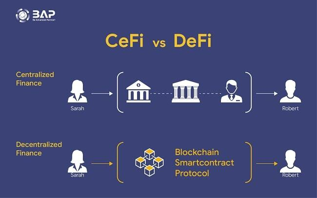
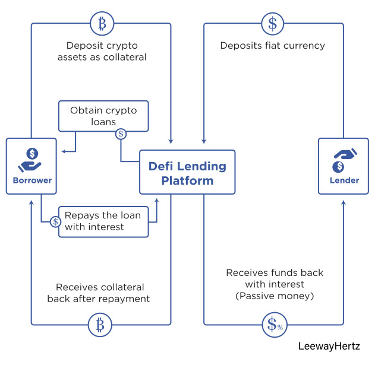
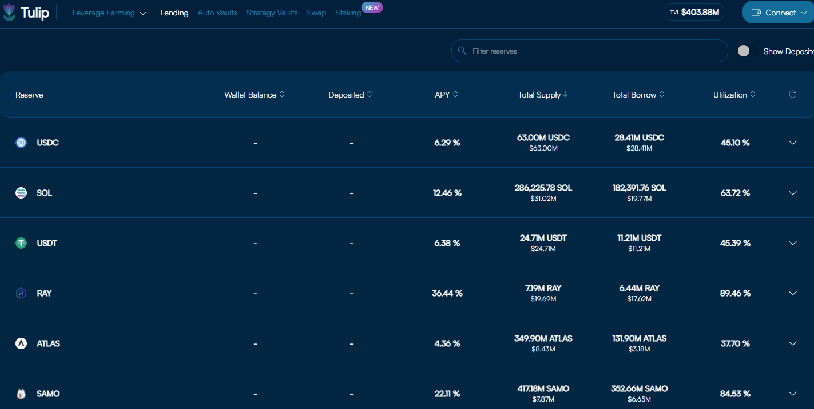
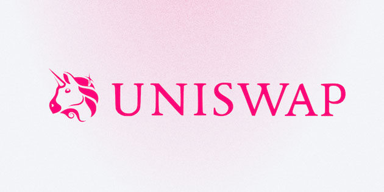
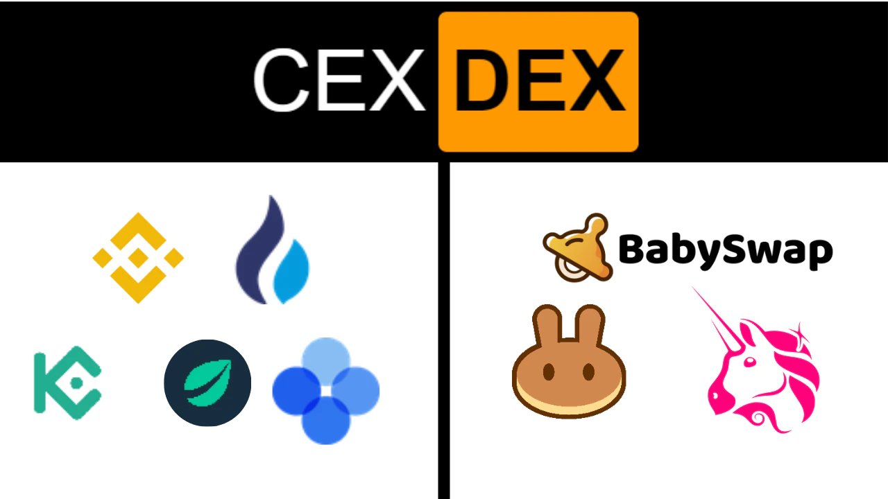
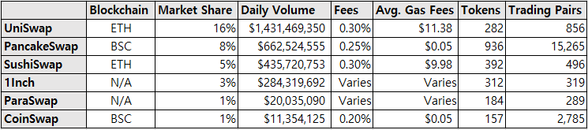
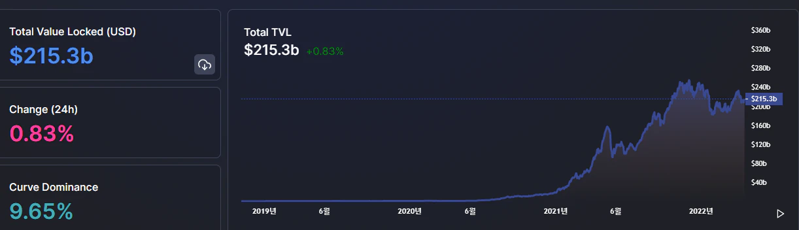
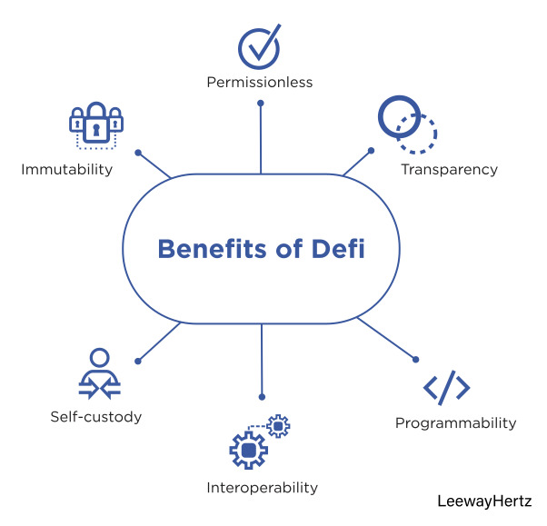

DeFi는 Decentralized Finance의 약어로, 은행 등 금융기관이 막강한 권한을 가진 현재의 Centralized Finance에 대비되는 개념입니다. Centralized Finance에서는 우리가 돈을 빌리거나, 거래할 때 은행의 확인을 받습니다. 그들은 우리의 거래를 확인할 수 있을 뿐만 아니라 아예 금융 거래를 하지 못하게 막을 수도 있습니다. 뉴스에서 심심치 않게 일어나는 계좌 동결 등의 사례를 우리는 여러 차례 봐왔습니다. (물론 보통 사람은 그럴만한 잘못을 저지르지는 않겠지만, 은행의 권력이 강하다는 것은 사실입니다.) 그리고 은행은 우리의 돈을 낮은 이자율로 빌리고, 더 높은 이자율로 대출해주는 예대 마진으로 필요 이상의 수익을 내고 있습니다. 이런 불공정함을 타파하고자 블록체인 기술을 활용한 금융 시스템을 제시한 것이 DeFi입니다.

{: width="650" height="406" }
_https://bap-software.net/en/knowledge/defi-finance/_

DeFi에서 기존 중개인들은 모두 **소프트웨어(블록체인)**로 대체됩니다. 은행과 증권거래소에서 거래하여 거래의 신뢰성을 보장 받는 대신, \'**Smart Contract**\'로 시장이 형성되고 작동합니다. 블록체인의 스마트 컨트랙트를 통해서 모두가 신뢰할 수 있는 시스템을 만들 수 있는 것입니다. 위와 같은 스마트 컨트랙트 기반의 금융은 기존 금융 시스템을 지배하던 관료주의와 규제를 없애고, **암호 기술에 기반한** 공정한 코드로만 거래가 된다는 장점이 있습니다. Cryptography, Blockchain, Smart contract가 DeFi를 가능케 하는 핵심 기술입니다.

DeFi 서비스는 Dapps (Decentralized Apps)로 작동합니다. 현재 디앱의 대부분은 이더리움 블록체인 위에서 동작합니다. 기존의 은행과 다르게 디앱에서는 계좌를 만들기 위한 본인 인증 과정을 거칠 필요가 없습니다. 예를 들어서 [메타 마스크](https://metamask.io/)나 [팬텀](https://chrome.google.com/webstore/detail/phantom/bfnaelmomeimhlpmgjnjophhpkkoljpa?hl=ko) 같은 블록체인 지갑을 만드는 과정에서 개인 정보를 아예 제공할 필요가 없습니다.

## DeFi의 근간 : Stable Coin

스테이블 코인은 보통의 암호화폐와 다르게 고정된 가치를 갖는 암호화폐를 말합니다. 현재 Tether, DAI, USDC 등의 많은 스테이블 코인이 존재합니다. (스테이블 코인에 대한 자세한 설명은 [여기](/posts/Central-Bank-Digital-Currency-CBDC와-Stable-Coin/)에 서술하였습니다.) 우리는 이미 법정화폐라는 시스템을 통해 안정적인 물가를 유지하고 있습니다. 스테이블 코인은 암호화폐계의 법정화폐로 암호화폐 시장에 팽배한 과도한 변동성을 감소시킵니다.

그렇다면 왜 법정화폐를 바로 사용하지 않을까요? 법정화폐를 암호화폐 거래의 근간으로 활용하기에는 국가간 환전 문제, 수수료 문제 등이 존재합니다. 따라서 스테이블 코인이라는 새로운 수단이 등장했습니다. 스테이블 코인의 등장은 마치 화폐라는 수단이 등장한 후의 문명과 같습니다. 모두가 신뢰할 수 있는 화폐 시스템 아래에서 거래가 더욱 융성하는 것과 마찬가지 입니다.

## DeFi의 활용 예시

### 1. Lending and Borrowing

{: width="631" height="615" }
_https://www.leewayhertz.com/how-defi-lending-works/_

DeFi 생태계에서는 암호화폐를 이용하여 대출을 해주기도 하고, 반대로 차입을 하기도 합니다. 위 그림에서는 Lender가 Fiat currency(원, 달러, 엔 등의 법정화폐)만 렌딩하는 것으로 되어있지만, 실제로는 훨씬 다양한 종류의 암호화폐를 대출해줄 수 있습니다. 예를 들어 DeFi 플랫폼 중 하나인 Tulip을 살펴보면 lending 가능한 암호화폐의 종류가 30가지가 넘습니다.

{: width="1423" height="717" }
_https://tulip.garden/lend_

Lender가 암호화폐를 넣어놓으면, borrower가 담보로 자신의 암호화폐를 넣어두고 다른 암호화폐를 받아갑니다. 그리고 이 작업은 우리가 일반적으로 은행에서 하는 거래보다 훨씬 간편하게 일어납니다. 서류를 채울 필요도 없고, 본인 확인 절차도 없습니다. 모든 거래는 블록체인 내부의 smart contract에 의해 진행됩니다.

보통의 암호화폐 borrowing이 이루어지는 양상은 이더리움 같은 비교적 변동성이 적으면서 성장 가능성이 있는 암호 화폐를 넣어두고, USDT 등의 스테이블 코인을 빌려가는 것입니다. (그리고 그 스테이블 코인으로 또 다른 암호화폐를 구매하여 다시 담보로 잡고 USDT를 다시 빌리기도 하는데, 리스크를 가중시키는 행위이므로 추천하지 않습니다. 리먼 사태 때 CDO와 유사한 형태로 보입니다.)

이러한 거래는 모두 Smart Contract를 기반으로 이루어집니다. 하지만 각 거래소별로 보유하고 있는 암호화폐의 수량과 종류가 다른 문제가 있습니다. 암호화폐의 lending에 대한 이자율은 당연히 borrower의 수요에 따라서 정해집니다. 따라서 거래소가 많다면 거래소별로 상이한 이자율을 갖는 문제가 발생합니다. 이런 문제는 근본적으로 모든 거래소가 합쳐지지 않으면 해결되지 않지만, 소비자 입장에서 가장 높은 이자율을 얻을 수 있는 거래소에 lending하는 yearn finance라는 서비스도 생겼습니다.

### 2. Decentralized Exchanges (DeX)

위의 Lending-Borrowing보다도 DeFi 서비스를 더욱 크게 만든 것이 Decentralized Exchanges (DeX, 덱스) 입니다. 간단히 말하면 환전을 담당하는 사무소인데 환전 가능한 암호화폐의 종류가 매우 다양하며, 환전이 자동으로 이루어질 수 있는 메커니즘을 도입했습니다.

{: width="630" height="315" }
_DeX의 고속 성장을 이루어낸 UNISWAP (https://uniswap.org/)_

보통 우리가 달러를 구매할 때 1.50~1.75% 수준의 환전 수수료를 지불합니다. 하지만 UNISWAP에서는 0.3% 수준의 낮은 수수료를 기반으로 합니다. (하지만 이 수수료가 문제가 아니라 노드 검증자들에게 들어가는 gas fee가 어마무시하기 때문에, 생태계가 어떻게 구성되어있는지와는 별개로 소비자가 느끼는 수수료는 이보다 훨씬 높습니다.) 그리고 이 수수료는 UNISWAP의 환전을 가능하게 한 투자자들에게 돌아갑니다. 제가 UNISWAP의 생태계를 믿어서 여기에 UNISWAP의 환전 리스트에 포함되는 암호화폐를 예치한다면, 수수료를 받을 수 있는 것입니다.

해외 거래소인 Coinbase는 중앙화된 거래소입니다. 업비트도 마찬가지입니다. Coinbase와 업비트도 환전 서비스를 제공하지만 그 서비스들은 탈중앙화되어있지 않습니다. 법적 규제를 받고, 제도권의 결정에 따라서 특정 암호화폐를 상장 폐지시키기도 합니다. 하지만 UNISWAP에서는 그렇지 않습니다. 현재 UNISWAP에서는 1,000개 이상의 암호화폐 환전이 가능합니다. 그리고 덱스의 운용 방향성도 UNISWAP에서 발행하는 거버넌스 토큰(투표권을 토큰 형태로 바꿨다고 보시면 됩니다.)을 가진 사람들의 의사 합치로 결정됩니다.

UNISWAP외에도 다양한 덱스들이 존재합니다. 팬케이크 스왑, 스시 스왑 등의 서비스가 있습니다. 각 서비스별로 스왑할 때 지급해야하는 fee와 거래 인증 과정에서 소요되는 gas fee가 다릅니다.

{: width="1280" height="720" }
_https://medium.com/@timcheah/difference-between-centralized-exchange-cex-and-decentralized-exchange-dex-206be2a42d81_

{: width="745" height="165" }
_다양한 DeX의 지표들 (글 작성일 2021년 6월 9일, https://thedefiant.io/dex-fees/)_

각 DeX들은 거버넌스 결정 방식, 토큰 개수, 블록체인 종류 등에 따라서 많은 차이가 있습니다. 위의 표에서 BSC는 블록체인이긴 하지만 노드 검증자가 되는 것이 사실상 불가능하여 중앙화된 블록체인에 가깝습니다. 좀 더 중앙화되었더라도 저렴한 BSC를 사용할 것이냐, 아니면 비싸더라도 가치관에 따라 유니스왑을 이용할 것인지는 사용자의 판단입니다.

### 3. Insurance

지금까지는 사용처와 예시들이 실물 경제와는 상관 없는, 사이버 세계의 돈 놓고 돈 먹기 수준이었습니다. 하지만 DeFi와 실물 자산을 연결시키는 서비스가 등장합니다. DeFi Oracle이라고 하는 이 서비스는 블록체인에서의 거래와 실물 자산을 연결시킵니다. Smart contract가 포함된 블록체인에 실시간 자산 및 정보에 대한 접근성을 부여하는 것입니다. 그 실시간 자산 정보는 원유 가격일 수도 있고, 쿠팡에서 결제한 결제 내역일 수도 있습니다.

위 DeFi Oracle이 제대로 동작한다는 전제하에, 이제 DeFi는 보험으로도 영역을 확장할 수 있습니다. 옥수수를 키우는 농부가 비가 너무 안와서 옥수수가 다 죽을 것을 대비해 생산량에 따라 보험금을 받는 보험을 계획할 수도 있습니다. 혹은 유사한 형태로 선물 헤지가 가능합니다.

### 4. Margin Trading

마지막으로, DeFi는 마진 거래를 원활하게 해줍니다. (레버리지의 위험성이 있어 개인에게 장점과 단점 중 어디에 속하는지 애매하지만, 일단 기능적으로 사람들의 접근성을 높인 것이므로 포함시켰습니다.) 기존의 Margin trading에서 선물 거래 전 계좌에 넣어둬야 하는 기본예탁금도 없이, 내 계좌에 있는 돈 전체를 증거금으로 삼아 포지션을 잡을 수 있습니다. 마진 트레이딩과 마찬가지로 숏과 롱에 모두 베팅할 수 있고, 거래소마다 배율이 상이하나 일부 거래소는 1,000배까지 지원하기도 합니다. (암호화폐의 변동성을 생각하면 1,000배는 물론이고 10배도 1주 정도 들고 있으면 십중팔구 청산당하는 레버리지이니 부디 시도하지 마시길 바랍니다.)

## DeFi의 규모

우리가 흔히 DeFi의 규모를 따질 때에는 Total Value Locked(TVL)라는 말을 사용하게 됩니다. 모든 DeFi 서비스에 예치되어 있는 금액을 합한 값으로 [2022년 3월 현재 2021년 12월에 비하여 16%가량 감소하였습니다](https://techcrunch.com/2022/03/23/despite-declines-the-value-of-crypto-assets-in-defi-protocols-is-up-3x-from-a-year-ago/#:~:text=Total%20value%20locked%2C%20or%20TVL,and%20has%20room%20to%20grow.). 올해 초에 있었던 금리 인상 예고와 함께 암호화폐 자체의 유동량이 감소하면서 함께 줄어든 것으로 보입니다. 2022년 4월 20일 현재의 TVL은 215.43 billion USD로 한화 265조 9,279억 원에 해당합니다. 이 정도면 2021년 은행 총 예치금과 비교하였을 때 12위에 해당합니다. 다만 골드만삭스(약 3,640억 달러)나 모건스탠리(약 3,480억 달러)의 2021년 말 예금보다는 적은 금액입니다.

{: width="1222" height="352" }
_https://defillama.com/_

## DeFi의 장점과 단점

{: width="602" height="579" }
_https://www.leewayhertz.com/how-defi-lending-works/_

DeFi는 기존 금융권과 비교하여 여러 장점이 있는데, 직관적으로 나열하면 다음과 같습니다.

- **개방성**: 모두에게 열려있는 금융 서비스를 제공합니다.
- **보안성**: 금융 서비스를 활용함에 있어서 개인 정보가 전혀 필요하지 않습니다.
- **유연성**: 자산을 시간/금액 제한 없이 이동시킬 수 있습니다. (로펌에서 PE를 도우며 수천억 단위의 돈을 옮기는 경우에 그 행정 서류량은 어마어마 합니다.)
- **수익성**: 일반적으로, 기존 금융권에 비해 더 높은 이자율을 제공합니다. (하지만 지금은 점점 그 메리트가 사라지고 있습니다.)
- **투명성**: 모두가 거래 내역을 확인할 수 있고, (이론적으로) 거짓 거래가 일어나지 않습니다.

하지만 이에 상응하는 단점(위험성)도 분명 내포하고 있습니다.

- **약하다 못해 없는 규제**: DeFi에서 예금자 보호 따위는 없습니다. 담보로 잡힌 내 암호화폐의 가치가 떨어진다고 해서 그 누구도 보호해주지 않습니다.
- **변동성**: 지금은 좀 덜해졌지만, 한창 광풍이 불 때는 하루 100% 상승은 우스웠고, 마찬가지로 하루에 1/5 토막이 나는 경우도 많았습니다. 이런 변동성 높은 자산을 거래해야 합니다.
- **도박 심리를 자극하는 거래들**: 높은 변동성은 방향을 잘 맞추면 높은 수익으로 이어집니다. 다만 본인이 그 운 좋은 사람이 될지는 모릅니다.
- **스테이블 코인의 위험성(Backing의 불확실성)**: DeFi의 근간을 이루는 스테이블 코인이 스테이블한가에 대한 논란이 있습니다.
- **가스비**: DeFi 서비스의 수수료가 낮아 싸다고 생각하면 오산입니다. 수수료보다 더 비싼 가스비가 존재합니다. (건당 지불이기 때문에 거액을 거래하는 경우에는 괜찮습니다.)

## 맺음말

분명 언젠가 DeFi가 기존의 금융권을 대체하는 때가 올 수 있습니다. 무인으로 운영되며 모두에게 열려있고, 공정한 코드 기반의 거래만 이루어진다는 것은 분명 장점입니다. 하지만 현재 Crypto 전반에 퍼져있는 일확천금의 풍조 때문에 DeFi 서비스 자체도 그런 식으로 변질된 모습이 보입니다. 차후 거품이 가라앉은 뒤에 진정한 의미의 DeFi 서비스가 더 등장할 것이라고 생각합니다.

## 출처

- https://www.youtube.com/watch?v=17QRFlml4pA
- [https://www.nytimes.com/interactive/2022/03/18/technology/what-is-defi-cryptocurrency.html#:~:text=DeFi%20(pronounced%20dee%2Dfye),traditional%20intermediaries%20and%20trust%20mechanisms.](<https://www.nytimes.com/interactive/2022/03/18/technology/what-is-defi-cryptocurrency.html#:~:text=DeFi%20(pronounced%20dee%2Dfye),traditional%20intermediaries%20and%20trust%20mechanisms.>)
- [https://www.cnbc.com/2021/12/14/common-defi-crypto-related-scams-and-how-to-protect-your-wallet.html](https://www.cnbc.com/2021/12/14/common-defi-crypto-related-scams-and-how-to-protect-your-wallet.html)
- [https://cointelegraph.com/explained/defi-oracles-explained](https://cointelegraph.com/explained/defi-oracles-explained)
