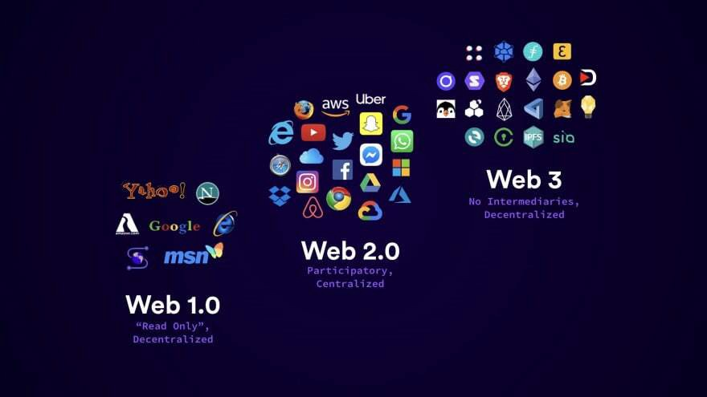
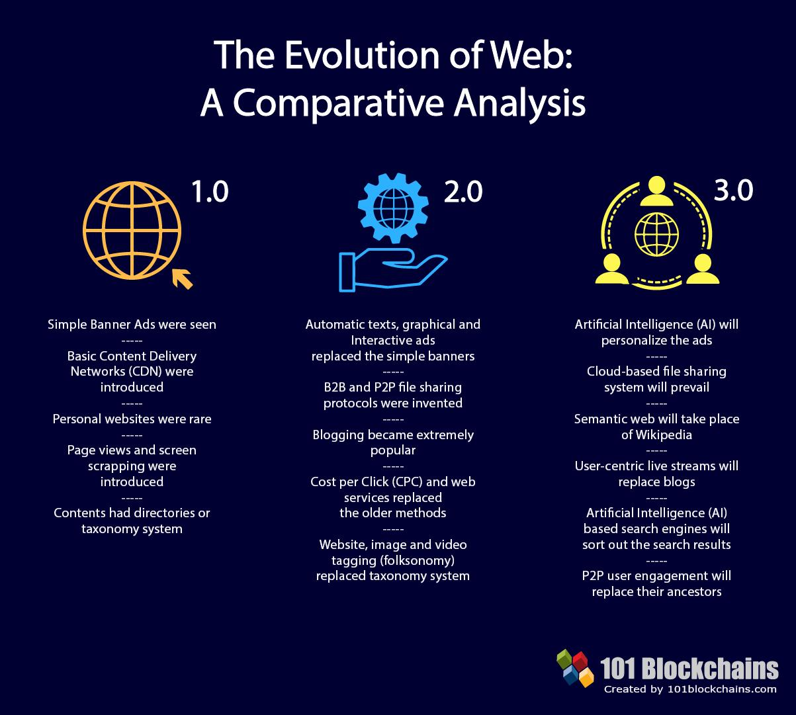
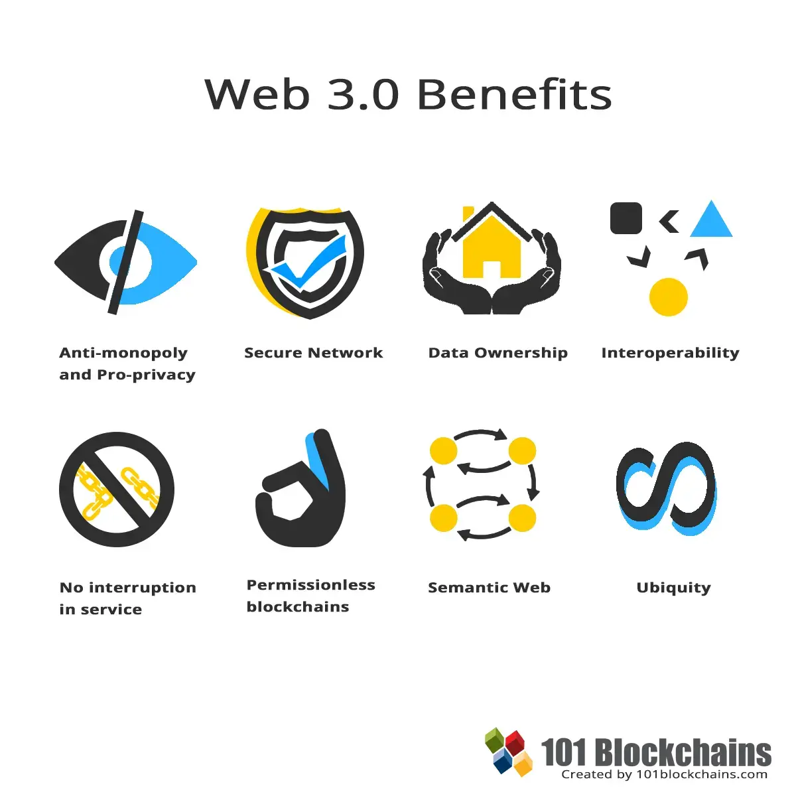
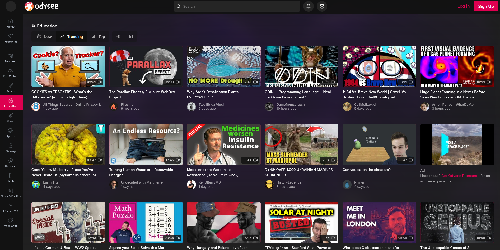

Web 3.0은 최근 많은 매체에서 회자되는 키워드입니다. 이러한 Web 3.0에 대해 파악하기 이전, Web 1.0과 Web 2.0은 무엇인지 먼저 짚고 가보겠습니다.

{: width="880" height="495" }
_Web 2.0에 우리가 사용하는 많은 서비스가 있으며, Web 3.0에는 블록체인 관련 서비스들이 보입니다. (https://enlear.academy/web-1-0-vs-web-2-0-vs-web-3-0-e428cfe09dde.)_

## Web 1.0

웹이라는 개념은 [팀 버너스 리(Tim Berners-Lee)](https://en.wikipedia.org/wiki/Tim_Berners-Lee)에 의해서 처음 등장하였습니다. Web이라는 기술을 개발할 당시 그는 유럽 입자 물리 연구소인 CERN의 컴퓨터 과학자로 일하고 있었습니다. 버너스 리는 1990년 10월에 웹의 기본이 될 세 가지 기술을 완성하였는데, HTML, URL(혹은 URI), HTTP가 그것입니다. **HTML(HyperText Markup Language)은 웹 페이지를 구조화**할 수 있는 mark up 언어입니다. **URL(Uniform Resource Locator)은 웹의 주소 역할**을 하는 고유한 식별자입니다. **HTTP(HyperText Transfer Protocol)는 웹 브라우저와 웹 서버가 웹 페이지 같은 자원을 주고받는 방식**에 대한 규약입니다. 세 가지 요소 모두 현재 우리가 사용하는 웹의 근간이며, 매일같이 사용하고 있습니다. 우리는 \"www.google.com\"과 같이 특정 URL을 입력하여 HTML을 토대로 작성된 웹 페이지에 접속하고, 그 페이지 안에서 HTTP를 기반으로 다른 웹 페이지로 이동하고는 합니다.

1990년대 중반까지 넷스케이프 내비게이터 같은 웹 브라우저들이 다수 등장하였습니다. 이 시기의 웹 페이지는 정적인 웹 페이지(static web page)로, 서버로부터 받은 정보를 사용자에게 표출해주는 정도에서 그 기능을 다하였습니다. 이 때문에 Read only라고 불리기도 했습니다. 로그인 기능도 없었고, 댓글을 작성할 수도 없었고 정말 웹 페이지가 보여주는 정보를 읽는 정도에 그쳤습니다. 점점 user interactive 한 기능들이 추가되기는 했지만, 아직 미약한 수준이었습니다.

당시 인터넷 사용자들은 실시간 뉴스 서비스에 매료되었습니다. 그리고 온라인 은행 업무 및 자산 거래 서비스도 등장하기 시작했습니다. 하지만 그 당시 콘텐츠의 다양성은 지금과 비교할 바가 되지 못할 정도로 미미했기에 사용자들은 interactive한 환경에 놓일 기회가 거의 없었습니다. 수동적으로 정보를 받는 것에서 사용 경험이 종료되었습니다. Web 1.0은 대체로 1991년부터 2004년까지를 지칭합니다. 그리고 이 시기 이후 contents producer들이 등장하기 시작하는 Web 2.0의 시대가 열렸습니다.

## Web 2.0

{: width="1000" height="500" }
_https://www.facebook.com/Redes.Sociales.HerramientasWeb/photos/a.217291532527684/217291512527686_

Web 2.0은 participative web 혹은 social web이라고 부르기도 합니다. Web 2.0의 사용자 참여적인 속성을 잘 나타낸 단어라고 생각합니다. Web 2.0은 우리가 현재 활용하고 있는 인터넷 환경을 지칭합니다. Web 2.0이라는 단어는 [Darcy DiNucci](https://en.wikipedia.org/wiki/Darcy_DiNucci)가 1999년에 처음 사용하였습니다. 다만 이 이름이 널리 퍼진 것은 2004년에 닷컴 버블 붕괴 이후 살아남은 기업들의 공통점을 묶어 Web 2.0이라고 부르기 시작하면서부터입니다. 그리고 2004년에 있었던 Web 2.0 컨퍼런스에서는 John Battelle과 Tim O\'Reilly가 \"Web as Platform\"이라는 개념을 Web 2.0의 핵심으로 제시하여 플랫폼 기업과 Web 2.0을 연결시켰습니다. 어쩌면 1999년의 Darcy DiNucci는 닷컴 버블 이후 살아남은 기업들이 플랫폼 기반으로 인터넷 업계의 주류가 될 것을 예견했는지도 모르겠습니다.

2000년대 초반부터 서서히 등장하기 시작한 interactive한 웹 페이지가 기존의 정적인 웹 페이지를 모두 대체하는데에는 오랜 시간이 걸리지 않았습니다. Web 2.0에서는 다양한 서비스가 등장하였습니다. 일단 Web 2.0에서는 전 세계에 분포하는 다양한 창작자들이 본인의 고유한 콘텐츠를 웹에 게시할 수 있었습니다. Web 2.0의 서비스를 통해 창작자들은 자신의 콘텐츠를 모든 인터넷 사용자들에게 공유할 수 있게 되었습니다. 그리고 플랫폼 회사들은 사용자들이 생성한 정보와 그들의 web 내에서의 활동 로그들을 모으기 시작했습니다. Data의 축적이 일어난 것입니다.

Web 1.0과 Web 2.0의 차이는 브리태니커 백과사전과 위키피디아의 차이로도 비유할 수 있습니다. 브리태니커 백과사전은 출판사에서 고용된 인원들이 내용을 작성하고, 중앙에서 모든 집필과 수정을 관리합니다. 위키피디아는 서버가 중앙 관리되기는 하지만, 그 내용이 다수의 익명 집필자들에 의해 채워집니다. 집필자들은 일부 경우를 제외하면 자신의 학력, 직업 등을 공개할 필요가 없습니다. 이러한 집단지성은 풍부한 콘텐츠를 가진 백과사전의 등장이라는 장점을 가지지만, 동시에 트롤링, vandalism에 취약하다는 단점도 있습니다. 우리는 신뢰할 수 없는 상대방이 우리의 위키피디아를 해치지 않을 것을 기대하면서, 그리고 해쳐지더라도 다른 선한 사람이 그 시스템을 복구해주길 기대하면서 위키피디아를 사용하게 됩니다.

Web 2.0의 주요한 기능은 아래와 같이 정리될 수 있습니다.

- Folksonomy (폭소노미) : 인터넷에서 검색한 정보를 표준 분류체계가 아닌 자신의 키워드에 따라 정리할 수 있습니다. 우리가 인스타그램에 다는 tag들이 모두 폭소노미의 결과물입니다.
- 풍부한 사용자 경험 (UX) : 사용자의 행동에 따라서 콘텐츠가 반응하며, 그 반응에 의해 사용자 경험이 증진됩니다. 예를 들어 우리는 이미지를 확대하기 위해 클릭을 하고 게시글을 추천하기 위해 화면을 터치합니다.
- 사용자 참여 : 서버에서 클라이언트에게 단방향으로 흐르던 Web 1.0의 정보와는 달리, 서버와 클라이언트가 서로 유기적으로 정보를 주고 받습니다. 클라이언트는 서버로부터 받은 정보에 코멘트를 남기기도 합니다.
- SaaS (Software as a Service) : Web 2.0 서비스들은 외부에서 기능과 데이터를 쓸 수 있도록 웹 API (Application Programming Interface)를 공개하기 시작했습니다. 온라인 포토샵 페이지 같은 web app이 등장합니다.
- 참여자 증대 : Web 2.0이 등장하며 소수의 전문가와 애호가를 넘어 일반 대중이 대거 web에 참여하게 되었습니다.

이러한 Web 2.0은 교육, 비즈니스, 여가, SNS 등 광범위한 분야에 영향을 미쳤습니다. Google, Amazon, Airbnb, Meta, Netflix 등 수많은 인터넷 거대 기업들은 모두 Web 2.0을 기반으로 성장할 수 있었습니다. 이 거대 기업들은 온라인에서만 가능한 여러 종류의 니치 마켓 서비스를 운영하며 많은 사용자를 끌어모았습니다. 오프라인 매장은 대중(Mass)이 원하는 제품을 전시할 수밖에 없지만, 온라인 매장은 니즈가 작은 제품들도 창고에 보관하다 온라인 주문이 들어오면 바로 배송해줄 수 있습니다.

Web 2.0은 targeted advertisement의 시대라고도 불립니다. 그만큼 많은 유저 데이터를 기반으로 사람들이 구매할 확률이 높은 광고를 노출시킬 수 있고, 이 기술로 빅 테크 기업들이 어마어마한 이윤을 만들었기 때문입니다. 이제 광고는 일방적으로 제공되던 매스 미디어의 광고에서 벗어나 사용자 타겟팅 광고로 완전히 전환되었습니다. 현재는 빅 테크 기업들의 생태계에 포함된 콘텐츠 생산자들도 단순 취미 이상의 일들을 하고 있습니다. 콘텐츠 기반 비즈니스 모델로 생계를 이어가는 것입니다.

{: width="1203" height="1081" }
_https://twitter.com/ingliguori/status/1141593305836400640/photo/1_

## Web 3.0

World Wide Web의 발명자인 팀 버너스 리는 방대한 정보가 파편화되어 있는 Web 2.0에 아쉬움을 느꼈습니다(다만 semantic web 구상 자체는 Web 2.0이라는 말이 퍼지기 전인 1990년대 말에 이미 발표되었습니다). 그는 Web 2.0에서 한 단계 발전된 형태를 생각했는데, data가 서로 의미를 갖고 연결된 web을 원했습니다. 그리고 의미를 갖고 연결되며 내부 데이터의 관계가 반영된 web을 semantic web이라고 칭했습니다. 팀 버너스 리가 2006년 인터뷰에서 \"[Web 3.0이 있다면 semantic web의 특성을 가질 것이다](https://www.nytimes.com/2006/05/23/technology/23iht-web.html)\" 라고 언급하였는데, 과연 그가 그 당시에 현재 Web 3.0을 정의할 때 빠지지 않는 블록체인과 연관된 개념을 떠올렸을지는 미지수입니다.

팀 버너스 리가 어떻게 정의했는지와는 별개로 현재의 Web 3.0은 semantic web 뿐만 아니라 다양한 개념들을 포함합니다. 아직 제대로 정의가 되지 않은 개념이기 때문에 많은 글에서 서로 다른 정의를 이야기 합니다. 여기서는 공통적으로 회자되는 Web 3.0의 특성을 정리해보겠습니다.

- Semantic Web : 데이터 사이의 의미가 반영된 web입니다. Web에 있는 단어들이 단순한 단어를 넘어, 그 의미가 반영된 (임베딩된) web을 의미합니다.
- Artificial Intelligence : 여기저기 붙는 단어여서 애매한 감이 없지 않지만, semantic web이라는 것 자체가 이미 AI가 없으면 반쪽짜리인 시스템입니다. AI 없이는 semantic할 수 없습니다. AI가 없다면 단어는 텍스트 데이터 이상의 의미를 가질 수 없기 때문입니다.
- Decentralized : Web 3.0에서 데이터는 분산되어 저장됩니다. 이용자 중 일부는 서버의 유지관리에 참여하며, ownership을 가집니다. 중앙화되지 않은 특성 때문에 개인이 web 전체의 헤게모니를 장악할 수 없습니다. (예외가 있을 수 있지만, 지금은 그 예외에 대해서는 다루지 않겠습니다.)
- Blockchain : Decentralization을 가능하게 하는 기술입니다. 이용자의 거래 기록은 전자서명과 해시로 위·변조하기 어렵게 처리되며, 분산된 원장에 저장됩니다.
- Anti-monopoly and Pro-Privacy : 사용자를 특정하여 데이터를 수집하고 광고하던 Web 2.0 때와는 다르게, Web 3.0에서는 우리의 행적이 실명과 바로 연결되어 추적되지는 않습니다. 최소한, 익명화된 개인으로 추적됩니다.

이 외에도 3D Graphics, Ubiquity, Edge Computing과 같은 특성이 제시되었습니다만, 제 기준에서 위 특성들은 Web 2.0과 그다지 유의미한 차이를 보이지 않기 때문에 제외하였습니다.

{: width="1200" height="1200" }
_https://101blockchains.com/web-3-0-examples/#prettyPhoto/1/_

위의 리스팅된 성질보다 더 중요한 핵심 개념은, 사용자들이 해당 web의 주인이 된다는 점입니다. 예를 들어보겠습니다. [Odysee](https://odysee.com/)는 유튜브의 blockchain version으로 비디오 업로더들은 LBRY 블록체인의 토큰인 LBC(LBRY Credits)를 제공받습니다. 사용자들이 Odysee 플랫폼에 접근하도록 유도한 것에 대한 보상입니다. 특이한 점은, Odysee에서 한번 업로드된 영상은 Odysee가 자사 사이트에서 차단할 수는 있어도 LBRY 블록체인에 기록된 정보까지 지울 수는 없다는 점입니다. Youtube의 다양한 영상들이 각종 제한 정책에 의해 삭제되는 것과는 반대의 양상입니다. 영상을 보고 싶은 다른 이용자는 그 영상을 다운로드하고, 다른 사용자들에게 배포할 수도 있습니다. 마치 토렌트와 같은 느낌입니다.

이런 경우 사용자에게 불쾌감을 주는 콘텐츠들이 판칠수도 있습니다. 하지만 그마저도 해당 Odysee 콘텐츠 제공자들과 사용자들의 재량에 맡겨집니다. 그들의 선택에 따라 불쾌감을 주는 콘텐츠는 감소할 수 있는데, 이에 대한 내용은 다른 글에서 다루도록 하겠습니다.

Web 3.0에서는 모든 기업이 DAO (Decentralized Autonomous Organization) 라고 하는 형태로 운영될 것이라고 합니다. DAO는 우리말로 흔히 탈중앙화 자율 조직이라고 옮기는데, 탈중앙화, 자동화된 그룹으로 모든 의사결정이 블록체인 기반으로 이루어지고, 저장되는 그룹을 의미합니다. 회사를 세울 때 미리 그 회사의 정관을 블록체인 시스템상에 올려두면 (예를 들어 주주의 2/3이 찬성해야 특정 안건이 통과된다) 그 시스템에 따라서 추가적인 인력 투입 없이도 의사결정들이 이루어지는 것입니다. DAO에서는 CEO도 없고 모든 의사결정이 token의 share에 따라 (즉, 주식 지분에 따라) 이루어집니다. [DAO에 대한 더 자세한 설명은 뒤에 나올 다른 글에서 다루어보도록 하겠습니다](/posts/DAO-Decentralized-Autonomous-Organization/).

## Web 3.0에서 진행중인 서비스들

현재 Web 3.0에서도 미약하지만 많은 서비스가 개발되고 있습니다. 소셜 네트워크, 코인간 환전 (Exchange Services), Messaging, 저장, 보험, 스트리밍, 원격 근무, 브라우저의 카테고리로 나누어서 각 서비스를 살펴보도록 하겠습니다.

- Social Networks : Web 3.0의 소셜 네트워크에는 데이터를 독식하는 중앙화된 시스템이 없습니다. 모든 유저에게 규칙에 기반한 적절한 보상을 제공할 수 있습니다. 그리고 소셜 네트워크 상에서의 이용자의 privacy를 보장합니다. [Sapien](https://www.sapien.network/), [Steemit](https://steemit.com/) 등에서 이러한 일들을 수행하고 있습니다.
- Exchange Services : 은행과 같은 중앙 시스템 없이 코인 간의 환전을 가능하게 하는 서비스 입니다. 저렴한 수수료와 빠른 거래를 제공하며, decentralized된 환경이 주는 보안성을 보장 받습니다. [IDEX](https://idex.io/)가 대표적이며 기존에 exchange service를 제공하던 EOSFinex는 현재 서비스를 종료했습니다.
- Messaging : 다른 Web 3.0과 마찬가지로 보안성에 대한 장점이 있습니다. 하지만 현재 블록체인 기술로는 중앙화된 시스템 보다는 느린 처리를 보여줍니다. [ySign](https://ysign.app/)이 대표적입니다. 기존에 서비스를 하던 e-Chat과 Obsidian은 서비스를 종료했습니다.
- Storage : 서로 다른 블록체인 플랫폼에 공통적으로 적용될 수 있습니다. 탈중앙화된 저장으로 보안성과 안정성을 높였습니다. [Storj](https://www.storj.io/), [Sia](https://sia.tech/), [Filecoin](https://filecoin.io/)등의 서비스가 있습니다.
- Insurance and Banking : 스마트 컨트랙트를 기반으로 하는 보험과 은행 시스템은 사기를 치기 굉장히 어려운 환경이며, 자동화된 회계 시스템을 제공하여 회계에 투입되는 추가 인력에 대한 부담을 줄여줍니다. [Everledger](https://everledger.io/), [Cashaa](https://cashaa.com/) 같은 서비스가 존재하며 AiGang과 Safe Share는 서비스를 종료했습니다.
- Streaming (Video and Music) : 콘텐츠 생산자들이 본인의 몫을 투명하게 가져갈 수 있는 시스템입니다. 또한 스마트 컨트랙트 기반으로 운영되기 때문에 저작권에 대한 문제가 거의 없으며 중앙 집권적 콘텐츠 억압에 대한 위험이 적습니다. 위에도 이야기 했던 [LBRY](https://lbry.com/)외에도 [LivePeer](https://livepeer.org/ko)가 있고, UjoMusic은 서비스를 종료했습니다.
- Remote Job : COVID-19 이후 더 활발해지는 원격 업무에 따라서 프리랜스 시장도 함께 성장하고 있습니다. 재택 근무 상황이나 프리랜서를 위한 플랫폼이 필요한 상황을 블록체인 기술로 해결하고자 하는 서비스들이 있습니다. 이들은 월급 또한 암호화폐로 지급합니다. [Ethlance](https://ethlance.com/), [Atlas.Work](https://www.atlas.work/), [CryptoTask](https://www.cryptotask.org/)가 대표적입니다.
- Browser : 브라우저 또한 다른 Web 3.0 서비스들의 공통된 장점인 암호화와 privacy를 보장합니다. [Brave](https://brave.com/ko/?ref=xwv588)와 [Beaker Browser](https://beakerbrowser.com/)라는 서비스가 있습니다.

{: width="1893" height="948" }
_Web 3.0 영상 플랫폼 Odysee_

서술된 내용을 보다보면 느끼시겠지만, 망한 서비스가 엄청 많습니다. 애초에 Web 3.0이라는 개념도 확립해가는 상황인데 그 위에 있는 서비스가 안정적이기 힘들 것입니다. 그렇기 때문에 이런 Web 3.0 투자는 기술과 팀원을 충분히 이해한 상황에서 VC로 대부분 이루어집니다. 한국에 여러 Web 3.0 투자 VC가 있는데 그중 20대 후반의 VC들이 모인 [Philosophia Capital](https://www.philosophiacap.com/)이라는 곳도 있습니다.

아직은 위험성이 매우 높은, 전형적인 high risk high return 시장입니다. 중앙화된 현재의 시스템이 정말 불만인지 스스로 물어봐야 하고, 그 시스템에서 블록체인 시스템이 꼭 도입되어야 하는지도 잘 생각해봐야 합니다. 블록체인 시스템을 도입하기 위한 모든 난관을 (node 제공자 모집, 개발, 토큰 이코노미와 거버넌스 설계, 트랜잭션 속도 보완 등) 다 거쳐야만 하는 이유에 대해 사업 운영자와 투자자 모두가 심사숙고해봐야 할 것입니다.

## 출처

- [https://www.investopedia.com/web-20-web-30-5208698](https://www.investopedia.com/web-20-web-30-5208698)
- [https://en.wikipedia.org/wiki/Web3](https://en.wikipedia.org/wiki/Web3)
- [https://en.wikipedia.org/wiki/Web\_2.0](https://en.wikipedia.org/wiki/Web_2.0)
- [http://wiki.hash.kr/index.php/%EC%9B%B9\_3.0](http://wiki.hash.kr/index.php/%EC%9B%B9_3.0)
- [http://wiki.hash.kr/index.php/%EC%9B%B9\_2.0](http://wiki.hash.kr/index.php/%EC%9B%B9_2.0)​
- [https://www.expert.ai/blog/web-3-0/](https://www.expert.ai/blog/web-3-0/)
- [https://101blockchains.com/web-3-0-examples/](https://101blockchains.com/web-3-0-examples/)
- https://www.youtube.com/watch?v=nHhAEkG1y2U
- [https://101blockchains.com/web-3-0-examples/#prettyPhoto](https://101blockchains.com/web-3-0-examples/#prettyPhoto)
