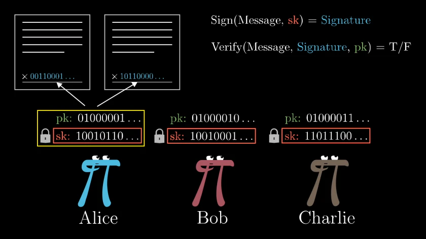
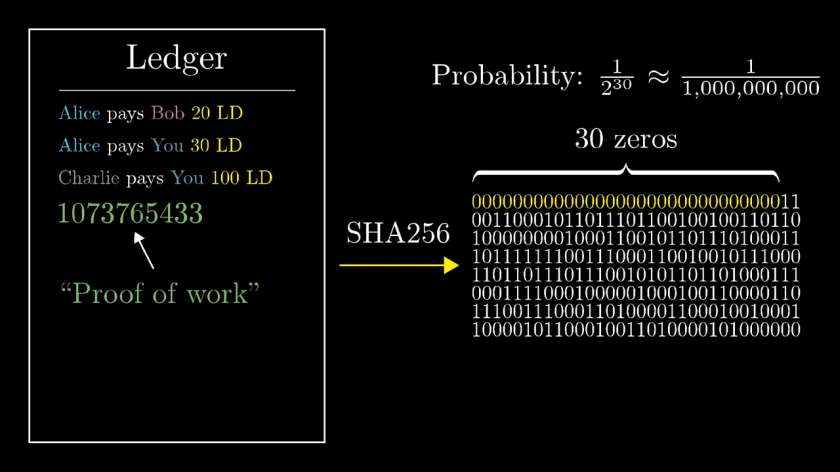
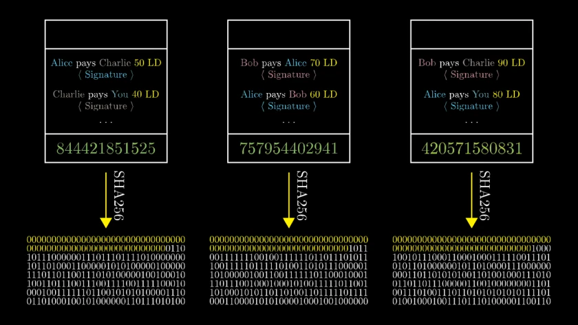
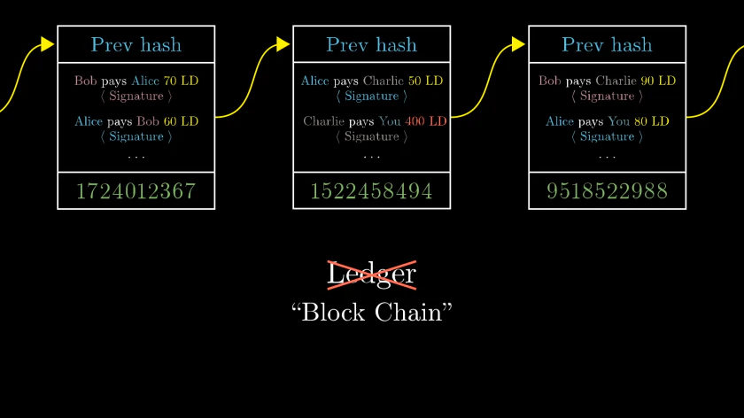
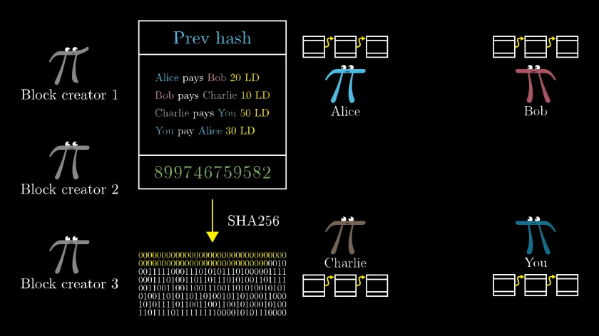
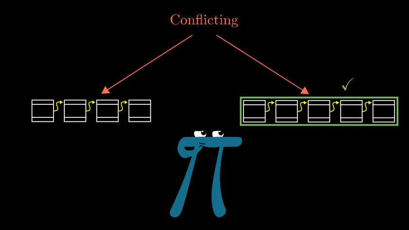

본 글은 \"[But how does bitcoin actually work?](https://www.youtube.com/watch?v=bBC-nXj3Ng4)\" 영상을 요약한 것입니다. 글 내용이 많지만, 글을 다 읽으시면 블록체인(비트코인)이 어떻게 작동하는지 파악하실 수 있을 겁니다. 영어가 편하신 분들은 영상을 바로 보셔도 좋고, 이 글로 감을 잡고 영상 시청을 하셔도 좋습니다.

내용 진행에 앞서, 보편적인 정의를 먼저 말해보겠습니다. <u markdown="span">**블록체인은 공동으로 거래 정보를 확인하고 암호화 처리하여 기록하는 기술입니다.**</u> 살을 붙여서 풀어쓰면, <u markdown="span">**블록체인**</u>은 네트워크의 구성원이 **<u markdown="span">공동으로 거래 정보를 확인하고</u>** 해시 함수를 기반으로 <u markdown="span">**거래 정보를 위·변조하기 어렵게 처리**</u>하여 <u markdown="span">**기록**</u><u markdown="span">**,**</u> <u markdown="span">**보관**</u>하는 기술입니다.

다르게 이야기 해보겠습니다. <u markdown="span">**블록체인은 공인 중개자 없는 분산원장 기술입니다.**</u> 이것도 풀어서 이야기하면, <u markdown="span">**공인된 중개자 없이**</u>도 무결성 및 신뢰성을 담보하는 P2P 기반 <u markdown="span">**분산원장 기술**</u>(Distributed Ledger Technology)을 말합니다.

저도 이렇게만 들으면 무슨 말인지 잘 모르겠는데요, 뜻을 자세하게 이해하려면 먼저 블록체인이 어떤 식으로 작동하는지를 파악해야 합니다. <u markdown="span">주의할 점은 앞으로의 설명이 블록체인 전체가 아닌 비트코인 작동 원리라는 것을 인지해야 한다는 것입니다</u><u markdown="span">.</u> 하지만 비트코인의 작동 원리만 자세히 이해해도, 다른 블록체인이 어떻게 돌아가는지는 대략 예상할 수 있습니다.

## 블록체인(비트코인)의 작동 원리

블록체인에 대해 이해하려면 거래 내역이 기록되는 <u markdown="span">**“장부”(Ledger)**</u>와 <u markdown="span">**“디지털 서명”(Digital signature)**</u>에 대해 알아야합니다. <u markdown="span">**장부**</u>에는 <u markdown="span">**거래 내역**</u>이 기록됩니다. 기존 금융권에서의 장부는 금융기관이 관리하여 중앙화 되어있지만 블록체인에서의 장부는 탈중앙화(Decentralized) 혹은 분산화(Distributed) 되어있습니다. 따라서 누구든지 장부에 기록을 할 수 있고, 그 과정에서 사기가 발생할 수도 있습니다. 제가 제 장부에 “나는 매달 10조원을 받는다”라는 거짓을 적었을 때, 시스템 상에서 저 말이 거짓인 것을 확인해야 합니다. 이때 진실된 거래 내역을 확인하게 해주는 것이 디지털 서명입니다.

가상의 인물 Alice를 상상해봅시다. Alice는 제게 돈을 보내는 수표 한 장을 쓰면서, 그 수표에 자신의 디지털 서명을 추가합니다. 제가 그 디지털 서명을 복제할 수 없기 때문에 수표는 신뢰성을 갖습니다. 그런데 디지털 서명은 어차피 데이터이니까 복사해서 쓰면 그만 아닌가 할 수 있는데, 서명은 메시지(거래 내용)마다 달라지기 때문에 복사한 서명을 다른 거래에 붙이면 검증을 통과하지 못합니다.

여기서 디지털 서명과 그 기반이 되는 해시 함수에 대한 이해가 필요합니다. 해시 함수는 어떤 문자열이 입력으로 들어오더라도 항상 같은 길이의, 하지만 전혀 다른 내용의 문자를 반환하는 함수입니다. 입력 문자열이 조금만 달라져도 결과는 완전히 달라집니다. [이 링크로](https://emn178.github.io/online-tools/sha256.html) 들어가서 직접 몇줄 쳐보시면 느낌이 오실 겁니다. 해시 함수의 특징 중 중요한 것은, 입력값을 알 때 출력값은 쉽게 구할 수 있지만, 출력값으로 입력값을 파악하는 것은 거의 불가능하다는 점입니다.

{: width="840" height="472" }

디지털 서명 시스템 상에서 <u markdown="span">개개인은 모두 공개키</u><u markdown="span">(Public key,</u> <u markdown="span">위 그림에서</u> <u markdown="span">pk)</u><u markdown="span">와 비공개키</u><u markdown="span">(Private key or Secret key,</u> <u markdown="span">위 그림에서</u> <u markdown="span">sk)</u>를 갖습니다. 공개키와 비공개키는 서로 짝을 이루고 있습니다. 비공개키는 사용자 본인만 알고 있는 키이고, 공개키는 상대방이 알아도 상관없습니다. 기본적으로, 키들은 모두 하나의 문자열입니다.

위 그림에서 <u markdown="span">Sign</u> <u markdown="span">함수는 메시지와 비공개키를 입력받는 서명 알고리즘(내부에서 메시지의 해시값을 사용)</u>으로 저를 특정할 수 있는 <u markdown="span">디지털 서명</u><u markdown="span">(</u><u markdown="span">위 그림에서</u> <u markdown="span">Signature)</u>을 만들어줍니다. Sign 함수는 보통 해시 함수가 그러하듯 <u markdown="span">입력되는 문서의 내용</u><u markdown="span">(</u><u markdown="span">위 그림에서</u> <u markdown="span">Message)</u>에 따라서 전혀 다른 내용의 디지털 서명을 만들게 됩니다. 디지털 서명은 보통 256개의 0과 1로 이루어져 있는데, 위조하려면 2의 256제곱 분의 1의 확률을 이겨내야 한다는 의미입니다. 천문학적으로 낮은 확률이어서 비공개키를 모르면 Sign 함수의 출력값을 위조하는 것이 불가능함을 이해하고 넘어가면 됩니다. Sign 함수는 입력값이 한 글자만 달라져도 출력값이 바뀌기 때문에, 거래 내역마다 다른 출력값을 갖습니다. 그리고 상대방은 내 비공개키를 모르기 때문에, 내가 하지 않은 거래(Message)를 내가 한 것처럼 만들 수 없습니다. 나만이 생성할 수 있는 Signature를 다른 사람은 만들 수 없는 것 입니다.

두 번째 함수인 <u markdown="span">Verify</u> <u markdown="span">함수는 디지털 서명</u><u markdown="span">(Signature)</u><u markdown="span">이 올바른</u> <u markdown="span">Sign</u> <u markdown="span">함수에서 만들어졌는지 체크합니</u>다. <u markdown="span">Verify</u> <u markdown="span">함수는 참과 거짓을 판별하는데</u><u markdown="span">,</u> <u markdown="span">거래 내역</u><u markdown="span">(Message),</u> <u markdown="span">디지털 서명</u><u markdown="span">(Signature),</u> <u markdown="span">공개키</u><u markdown="span">(pk)</u><u markdown="span">를 입력값으로 받아 디지털 서명이 올바른 비공개키에 의해 만들어졌는지의 여부를 출력</u>합니다. 올바른 비공개 키에 의해서 만들어졌으면 참을, 그렇지 않으면 거짓을 출력합니다. Verify 함수가 어떻게 Signature의 참, 거짓을 출력하는지 직관적으로 와닿지 않겠지만, 이 부분은 수학적인 내용이므로 (제가 잘 이해를 못했으므로) 넘어가도록 합시다. (아직 궁금합니다. 어떻게 verify 함수는 Message, Signature, pk만 가지고 참거짓을 알 수 있을까요?)

모든 거래 내역(Message)은 개별 ID를 갖습니다. 즉 같은 액수를 같은 시간에 같은 사람에게 보내는 거래라고 해도, 다른 거래 ID를 갖기 때문에 (예를 들어, 먼저 한 거래가 1번, 그 다음이 2번) 문자의 차이가 발생하고, 이 때문에 완전히 다른 디지털 서명을 출력하게 됩니다.

그럼 현실적인 관점에서 분산원장이 어떻게 작동할지 떠올려봅시다. 분산원장은 거래 내역이 적힌 원장을 모두가 공유받고, 각자 그 원장을 저장하여 신뢰성을 보장합니다. 그럼 모두가 각자의 분산원장을 갖고 있다면 세계 어딘가에서 일어난 1건의 송금을 기록하기 위해, 송금한 사람이 해당 내용을 본인의 원장에 적고 그 원장을 전세계 모두에게 전달할까요? 즉, 블록체인에 참여하는 전세계 모든 사람이 송금한 사람의 원장, 송금한 사람의 Signature, 송금한 사람의 공개키를 받아서 참과 거짓을 판별하고 내용을 기록할까요? 대충 봐도 너무 heavy한 task라는 느낌이 옵니다.

하지만 더 큰 문제는, 각자 전파받은 거래만으로는 다른 사람들도 같은 거래를 받아 같은 원장을 갖고 있는지 확신할 수 없다는 점입니다. 그래서 거래 내역들을 일정 단위로 모아서 신뢰성을 보장해주는 작업자가 존재합니다. 그리고 우리는 그 사람을 흔히 **<u markdown="span">채굴자</u>**라고 부릅니다. 그리고 비트코인에서는 이 신뢰성을 보장하기 위해 가장 열심히 일한 사람의 원장을 신뢰합니다. 이를 Proof-of-work (PoW) 방식이라고 합니다. PoW는 어떻게 작동할까요?

{: width="840" height="472" }

앞서 서술했듯, 해시 함수는 입력값이 하나만 달라지면 완전히 다른 값이 출력됩니다. 통신 시스템에서 일반적으로 사용되는 해시 함수는 SHA256인데, 지금은 SHA256이 어떤 Message가 왔을 때 256개의 0과 1을 출력한다는 것만 알면 됩니다. 따라서 여러 거래 내역들이 적힌 장부(위 그림의 Ledger)와 특정 숫자 (1, 2, 3, 4, ..\.)를 대입하면 그때마다 다른 256개의 0과 1의 나열이 출력됩니다. 이때 특정 거래 내역에 대해서 출력값의 맨 앞 30개 숫자가 모두 0이 나오게 하는 숫자는 어떻게 찾을 수 있을까요?

해시 함수는 출력값으로 입력값을 유추할 수 없습니다. 따라서 30개의 연속된 0이 나올 때까지 1부터 시작해서 숫자를 계속 대입할 수 밖에 없습니다. 30개의 숫자가 0이 나오길 바란다면 2의 30제곱이기 때문에 10억분의 1의 확률, 33개의 숫자가 0이 나오길 바란다면 2의 33제곱이므로 약 86억분의 1의 확률이 될 것입니다. 그러니까, 30개의 0이 나오게 하려면 평균적으로 10억번 정도 대입을 해야 한다는 것입니다. 우리는 그 숫자를 magic number라고 부르기로 합시다.

{: width="840" height="472" }

PoW는 magic number를 찾은 사람의 원장을 신뢰합니다. 즉, <u markdown="span">장부를 가진 모든 사람들은 가장 많은 계산 작업이 포함된 장부를 믿으면 되는 것</u>입니다. 위 그림에서처럼 거래 내역들은 일정 단위로 모이고, 이 거래 내역들의 묶음은 자체적인 magic number를 갖습니다. 개별 거래 내역은 Signature를 통해서 진위가 확인되고, 거래 내역의 묶음은 magic number를 통해서 진위가 확인됩니다. <u markdown="span">여기서 거래 내역의 묶음이 블록체인을 이루는 블록 하나입니다</u><u markdown="span">.</u> <u markdown="span">그리고 블록 하나는 원장(Ledger)의 한 부분이고, 블록들이 순서대로 이어진 전체가 원장이자 블록체인이 됩니다.</u>

{: width="840" height="472" }

여기에 한 요소만 더 추가해봅시다. 내 블록의 Magic number를 구할 때 내 앞 블록의 해시값(위 그림의 Prev hash: 앞 블록을 SHA256에 넣어 나온 출력값)을 추가하는 것입니다. 그러면 해시 함수의 성질에 의해서 내 뒤 블록이나 전전 블록의 해시값이 대신 포함되면 내 원래 magic number로는 30개의 연속된 0을 얻을 수 없습니다. 즉, 순서를 부여할 수 있는 것입니다. <u markdown="span">이것이 여러 개의 순서를 갖는 블록들</u><u markdown="span">,</u> <u markdown="span">블록체인입니다</u><u markdown="span">.</u>

{: width="840" height="472" }

블록체인 상에서 이루어지는 거래는 온라인 상으로 전파(Broadcasting) 됩니다. 이 전파된 거래 내역은 모여서 블록을 생성하고, 위 그림의 block creator들이 블록의 magic number를 찾습니다. 가장 먼저 magic number를 찾은 block creator는 그 블록의 정보를 다시 전파하여 일반 사용자들의 원장에 추가합니다.

블록의 magic number를 찾는 것은 엄청난 computational power를 요구하기 때문에, 고생한 것을 인정해주기 위해 새로 발행되는 비트코인(블록 보상)과 블록에 담긴 거래들의 수수료를 보상으로 제공합니다. <u markdown="span">이 수수료를 얻는 과정이 채굴입니다</u><u markdown="span">.</u> 그리고 이 채굴을 통해서만 비트코인의 전체 수량이 증가합니다. 비트코인은 우리가 아무리 업비트를 통해서 구매하더라도 새롭게 발생하지 않습니다. 블록체인 위에서 이루어진 송금 내역을 모아서 블록으로 인증한 사람에게 주어지는 수고비에서만 새로운 비트코인이 발생합니다.

채굴자 입장에서 magic number를 찾는 것은 하나하나가 로또에 가깝습니다. 노가다로 1부터 대입해서 찾는 것이 정석이겠지만, 정말 운 좋은 사람이라면 한 번에 찾을수도 있겠죠? Broadcasting된 정보가 모여 전 세계 스케일의 magic number 빨리 찾기 대회(로또)가 열리고, 그 대회의 우승자가 그 block의 수수료를 갖습니다. 우리는 채굴자 덕분에 전 세계의 모든 거래 내역을 파악할 필요가 없고 채굴자가 인증한 block만 파악하면 됩니다.

{: width="840" height="472" }

만약 블록의 내용이 서로 상충된다면 어떻게 할까요? 이럴 때 (비트코인은) 무조건 더 긴 블록체인을 신뢰합니다. 같은 길이의 블록체인을 전달 받았다면? 둘 중 한 블록체인이 다음 블록을 받아 더 긴 블록체인이 될 때까지 기다립니다. 앞서 서술한 <u markdown="span">장부를 가진 모든 사람들은 가장 많은 계산 작업이 포함된 장부를 믿으면 된다</u>는 말이 이 말입니다. 위 방법은 효율적으로 사기를 방지합니다. 만약 제가 이미 다른 곳에 쓴 1,000 비트코인을 Alice에게 또 보내고, Alice를 포함한 다른 사람들이 그 사실을 믿게 하려면 어떻게 할까요?

일단 Alice가 가진 블록체인에 제가 1,000 비트코인을 보냈다는 거래 내역을 포함하기 위해 저는 “내가 Alice에게 1,000 비트코인을 보냈다.”라는 내역이 들어간 block의 magic number를 열심히 풀어서 Alice에게만 전달합니다. 이 때부터는 마치 마피아 게임에서 대놓고 경찰 행세를 하는 마피아 마냥 Alice 한정으로 대놓고 거래를 공개하고 계속해서 거짓 거래를 하고, 그 거래를 위한 magic number를 또 찾습니다. 가장 긴 거래 내역이 인정받기 때문입니다. 이때 핵심은 거짓말(거짓 block의 magic number)을 그 누구보다도 빠르게 해야 한다는 것입니다. (빠르게 magic number를 찾아야 합니다.)

가장 긴 블록체인이 인정을 받으므로, 제가 허위로 만들어내는 블록체인이 Alice가 다른 채굴자로부터 전달받은 블록체인보다 길다면 제 블록을 믿을 것입니다. 문제는 이 블록 만들기 대회는 전 세계적으로 이루어지고 있기 때문에 가장 빨리 블록을 만들려면 제 computational power가 전 세계 채굴자들의 computational power의 50%보다 커야 한다는 것입니다. 전 세계에서 가장 좋은 채굴 기기를 가진 것으로는 부족합니다. 제가 전 세계 비트코인 채굴 연산력(해시레이트)의 과반을 보유해야 합니다.

일단 여기서 (비트코인처럼 큰 네트워크에서는) 사실상 불가능하다는 것을 눈치챌 수 있습니다. 따라서 우리는 블록체인으로 거래를 할 때 상대방이 누군지 모르고도, 중앙 시스템이 없이도 거래를 신뢰할 수 있습니다. 지금까지 말한 시스템은 사실 블록체인이라기 보다는, 비트코인의 시스템입니다. 그리고 각 코인들은 서로 다른 종류의 시스템을 갖고 있습니다. 이더리움과 비트코인은 유사한 시스템을 갖지만 전혀 다른 시스템을 갖는 코인도 있습니다.

원리를 정리하면서 든 생각은, 블록체인이 사람의 인센티브 체계를 잘 활용한, 탈중앙화된 거래 시스템을 실현하였다는 것입니다. 그리고 블록체인은 다양한 서비스 중에서 탈중앙화의 여지가 있는 서비스에는 모두 포함될 수 있습니다. 그래서 우리가 블록체인 산업에 대한 명확한 이해가 부족하다고 느껴지기도 합니다. 탈중앙화가 가능한 서비스는 굉장히 다양한데, 그런 서비스에 전부 적용 가능하여 범위를 제한하기가 애매하기 때문입니다.

그리고 블록체인이 인증하는 그 장부가, 채굴자들이 가져가는 코인 만큼의 실용적 가치가 있어야 합니다. 아이들이 골목에서 구슬치기 하는 것의 승패를 적으려고 한 번 기록하는데 전기 요금만 2,000만원이 드는 시스템을 활용할 수는 없습니다. 하지만 수백억이 오고가는 거래라면? 그럴 가치가 있을지도 모르겠습니다. 결국 어떤 분야에 활용되는지가 블록체인이 필요하냐 아니냐를 결정할 것입니다.
