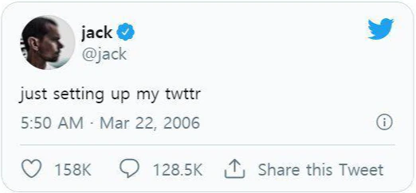
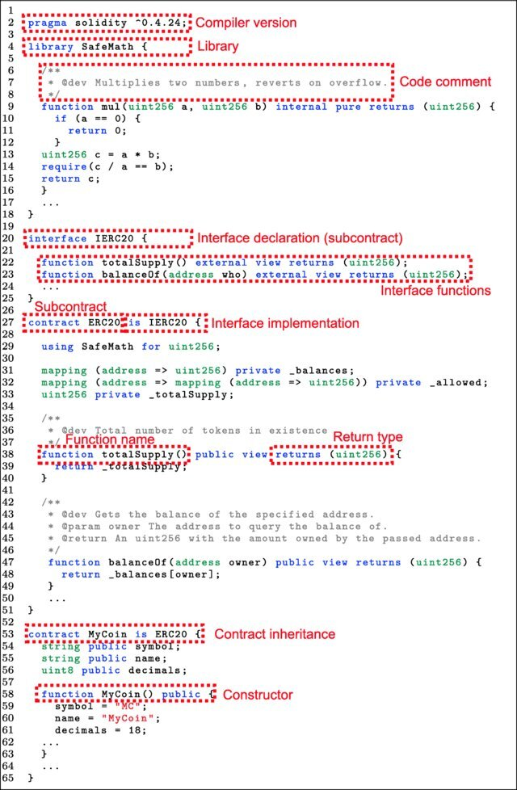
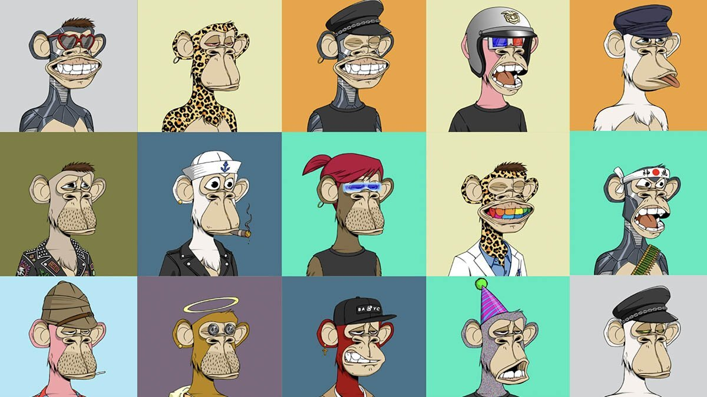

2022년 4월 셋째주 [슈카월드의 주제](https://www.youtube.com/watch?v=N9v1MU8G_O8) 중 하나가 NFT였습니다. 잭 도시의 첫 트윗 NFT가 35억원에 팔렸다가 그 다음 거래에서 1,000만원에 낙찰 될 위기에 놓인 것을 잘 설명해주는 영상이었습니다. 아마 이 글을 읽는 분들의 대부분은 NFT가 뭔지 대략적인 내용은 알고 계실 것입니다. 최근 인스타그램에 들어가도 NFT 광고가 한창입니다. 3D나 2D 그래픽으로 만들어진 작은 사진을 몇 억원 주고 사는 이 상황이 이해가 되지 않으실 겁니다. 그래서 이번 글에서는 NFT가 무엇인지 다루기보다, 진짜 NFT가 어떤 형태로 존재하는지, 그리고 어떤 NFT가 의미가 있을지에 대해서 다루어보고자 합니다.

{: width="522" height="243" }
_잭 도시의 첫 트윗_

NFT가 무엇인지는 한 문장으로 이야기하고 끝내겠습니다. NFT는 <u markdown="span">**블록체인을 통해 유일성을 증명할 수 있는 디지털 데이터**</u>입니다. 그래서 위의 잭 도시의 첫 트윗 사진을 복사 붙여넣기해도 소용이 없습니다. 그 복사 붙여넣기한 사진은 블록체인에 존재하지 않으니까요. 복사 붙여넣기한 사진을 블록체인에 올려도 소용 없습니다. 블록체인을 통해 그 사진이 복사본이라는 것을 알 수 있기 때문입니다. 더 이상 자세한 설명은 의미가 없습니다. 바로 다음 이야기로 넘어가겠습니다.

## NFT의 작동 원리

다른 감성적인 부분은 넘어가더라도 기술적인 부분은 간략하게 설명하겠습니다. <u markdown="span">**NFT는 블록체인상의 smart contract가 발행·관리하는 고유한 토큰**</u>입니다. 스마트 컨트랙트는 코드의 일종인데, 현 주인이 누구고, 전 주인은 누구였고, 언제 거래했고, 어떤 데이터를 담고 있고 등등의 정보가 담겨있습니다. 그 코드 안에 NFT의 파일이 있을까요? 있는 경우도 있지만 그렇게 하면 여러가지 단점이 많이 발생합니다. (실질적으로 NFT를 배포/거래 하기에 시간이 많이 걸리고 돈이 많이 듭니다.) 그래서 일반적으로는 그 파일이 저장되어있는 웹 상의 저장소 주소를 smart contract 안에 포함하고 있습니다.

그러니까 <u markdown="span">**NFT는 수표와 같은 것**</u>입니다. 이 수표를 가지고 서울 어디에 있는 A 은행에 가면 돈을 받을 수 있습니다. 하지만 그 돈을 우리가 실제로 들고 다니지는 않습니다. 그 돈이 바로 NFT의 가장 중요한 자산/데이터 (그림, 영상, 소리 파일 등) 입니다. 그런데 무작정 수표를 들고 갔다고 해서 A 은행에서 돈을 순순히 주지는 않을겁니다. 인증된 수표여야합니다. 그 인증을 해주는 것이 블록체인입니다.

아래는 smart contract 코드로 이 코드를 블록체인 상에 등록하면 코드 안에 있는 정보들은 NFT가 됩니다. 코드를 이해할 필요는 없습니다. 저도 smart contract 코드를 한 번도 짜본적이 없습니다. 그저 이것들이 모두 코드를 기반으로 움직인다는 것만 아시면 됩니다. 본인이 정말 smart contract 코드를 짜서 이더리움 메인넷에 올리고 싶다 하시는 분은 [여기를](https://ethereum.org/en/developers/tutorials/how-to-write-and-deploy-an-nft/) 따라하시면 됩니다. (가스비 때문에 몇십만 원까지 들 수도 있으니 이더리움을 미리 사고 시작하시길 바랍니다.)

{: width="640" height="978" }
_NFT 코드의 예시 (https://www.researchgate.net/publication/337603517\_An\_Exploratory\_Study\_of\_Smart\_Contracts\_in\_the\_Ethereum\_Blockchain\_Platform/figures?lo=1)_

## PFP NFT의 속성

BAYC는 얼마에 팔렸고, Pudgy Penguins 창립자가 러그풀을 하려고 했고, CryptoKitties는 새끼를 만들 수 있고, Beeple의 새 작품이 얼마에 낙찰되었다 등등..\. 의 이야기는 별로 중요하지 않습니다. 우리는 이 NFT들이 그럴만한 가치가 있는지만 보면 됩니다. 그 전에 흔히 BAYC, CryptoPunks, Cool Cats 등으로 대표되는 Profile Picture NFT(PFP NFT)의 생리를 간단히 알아봅시다.

{: width="1200" height="675" }
_BAYC의 예시_

PFP NFT는 기본적으로 유사한 디자인의 그림들이 몇천~1만 장 (주로 1만 장) 생성됩니다. 프로젝트에 따라 그림에 등급이 있는 경우도 있습니다. 그러면 그 PFP NFT를 만든 사람들은 자신들의 NFT 가격을 높이기 위해서 여러 일들을 합니다. 주로 디스코드(카카오톡 같은 메신저) 방을 하나 만들고 거기서 구성원들에게 다양한 혜택을 주기 위해 노력합니다. (원래는 이런 디스코드 방도 없었습니다. NFT가 너무 우후죽순 생기니까 차별점을 두려고 하기 시작한 것입니다.) 그리고..\. 그게 끝입니다. 자 그럼 NFT의 가치를 어떻게 평가할지 알아봅시다.

## NFT의 가치 평가

NFT에 대한 [Whiteboard Crypto의 영상](https://www.youtube.com/watch?v=4dkl5O9LOKg)에 핵심 내용이 잘 담겨 있습니다. 핵심 판단 기준은 5가지 입니다.

- 실제 세계에서의 역할이 있는가?
- 희소한가?
- 최초인가?
- 이 NFT의 보유자들이 대단한 사람인가? 혹은 과거에 보유했던 자들이 대단한 사람인가?
- 이 NFT 프로젝트를 진행중인 팀이 대단한 팀인가?

위 항목들 중에서 가치투자와 연관이 있는 항목은 \'실제 세계에서의 역할이 있는가?\' 하나 밖에 없습니다. 예를 들어봅시다. 아이유는 매해 팬카페 회원 중 일부에게 유료 회원권을 판매합니다. 보통 2~3만원 정도 하는 회원권인데, 그 회원권을 사면 아이유의 포토북이나 아이유 팬카페 에코백, 비누 등을 주고 아이유가 콘서트를 하면 먼저 예매할 수 있는 권리도 줍니다. 실제 세계에서의 역할이 있죠? 이 정도면 2~3만원 정도 내겠다는 사람은 수두룩합니다. 이런 관점에서 \"아이유 2022년도 회원권 NFT\"는 2~3만원 정도 가치는 분명히 있습니다. 그런데 이 NFT가 10억이 되려면 어떤 혜택이 추가로 주어져야 할까요?

만약 \"아이유 2022년도 회원권 NFT\"가 원래 3만개 정도 판매가 되는데, 올해 갑자기 판매 개수를 500개로 줄였다고 해봅시다. 그러면 가격이 엄청나게 뛸 것입니다. 그 해의 아이유 포토북은 전세계 사람 중에서 500명 밖에 받지 못할 것이니까요. 이 정도면 몇백만 원 정도를 내는 사람도 나올 것입니다. 하지만 아직까지 10억은 가지 못합니다.

그런데 갑자기 이러한 문화가 가요계 전체로 퍼진다고 칩시다. BTS도 회원권을 NFT로 판매하고, 블랙핑크도 NFT로 회원권을 판매하는 것입니다. 그러면 이 분야를 처음 선두로 이끌었던 \"아이유 2022년 회원권 NFT\"의 가치는 상승할 것입니다. 실물 가치가 상승하는 것은 아니지만, 그래도 처음이니까 좋지 않을까요? 위의 상황에 최초의 역할이 더해지면 아이유 회원권 NFT는 이제 몇천만 원 정도를 주고 사는 사람도 나올 수 있습니다.

여기에 하나 가정을 더해봅시다. 알고보니 \"아이유 2021년도 회원권 NFT\"는 포브스가 선정한 3,000대 부호들에게만 지급되었다고 해봅시다. 그리고 그 NFT를 갖고 있는 사람들의 커뮤니티가 굉장히 private하면서 끈끈하게 유지되고 있다고 생각해봅시다. 그래서 2022년 현재에도 2021년도 NFT를 웃돈을 주고 사는 사람들이 많다고 가정합시다. 이제 우리가 지불하는 돈은 단순 현실 유틸리티를 넘어 그 커뮤니티 안에 들어가기 위함입니다. 2021년도에도 대단한 사람들이 몰렸던 만큼 2022년에도 굉장한 사람들에게만 몰리게 되겠죠? 여기까지 겹치면, 1억 원 정도 내는 사람이 나올 것 같습니다.

그리고 알고보니 이 NFT를 리딩하는 팀의 헤드는 세르게이 브린이고, 그 아래에서 마케팅 하는 사람은 마크 저커버그고, 디스코드 방에서 이벤트 게시물 올리는 사람이 제프 베조스라고 하면, 그러면 10억을 내는 사람이 나올 겁니다. 왜냐면 이렇게 훌륭한 팀이 이끄는 NFT의 가치는 더 올라갈 가능성이 크니까요. 왜냐하면 그들이 대단한 사람인 만큼 더 대단한 현실세계 유틸리티와 대단한 커뮤니티를 만들 가능성이 높기 때문입니다.

위의 이야기에서 특전들을 더 좋게 하면 할수록 가격은 올라갑니다. 만약 실제 세계에서의 역할이 포토북이나 콘서트 예매 우선권 같은게 아니라 **한 달간 주 3회, 회당 2시간씩 아이유에게 보컬 트레이닝**을 받을 수 있는 것이라면 가격이 올라갈 것입니다. **500개가 아니라 100개**가 되면 가격이 더 뛸 것이고, 사실 알고보니 아이유 회원권 NFT가 최초의 가수 회원권 형식의 NFT가 아니라 그냥 **전 세계에서 최초로 smart contract에 등록된 NFT**라면 가격이 더 올라갈 것입니다. 이 NFT의 소유자들이 포브스 3,000대 부호가 아니라 **역대 G10 대통령들과 전 세계 시총 20위 내 기업의 CEO들**이라면 이야기가 달라질 것입니다.

그러니까 여러분이 NFT를 살 때, 위에서 말한 다섯 가지 조건을 따져보면 됩니다. 그리고 그 조건을 따졌을 때 지금 저평가다, 하면 사시면 됩니다. 그게 아니면, 좀 더 고민해보시는 것이 좋습니다.

## P2E 게임, 그리고 NFT

NFT에 이어서 우리나라 게임 주식들을 크게 흔들었던 키워드가 또 있습니다. 바로 P2E (Play To Earn) 게임입니다. 게임해서 돈 벌라는 이야기이고 무한돌파삼국지나 엑시인피니티가 대표적인 예시입니다. 이미 초등학교 때부터 방학마다 메이플 메소 모아서 아이템 매니아에 팔고 쏠쏠한 수입을 올리던 우리들은 갑자기 이제와서 뭔 P2E냐 할 수 있습니다. 제가 보기에도 우리가 즐겨 쓰던 아이템 매니아와 그렇게 다르지 않습니다. 그 시스템이 블록체인 위에서 돌아간다고 하니 화제가 되는 것입니다.

{: width="1280" height="853" }
_https://www.japantimes.co.jp/news/2022/02/16/asia-pacific/axie-infinity-philippines-poor-earn/_

P2E 게임과 NFT는 왜 계속 같은 키워드로 묶이는 것일까요? 왜냐하면 진정한 P2E 게임을 블록체인 기반으로 만들 생각이라면 모든 아이템은 NFT화 해야하기 때문입니다. 블록체인 게임이라는 것은 중앙 운영서버 없이 자발적으로 참여하는 노드 검증자들에 의해서 돌아가야 합니다. 당연히 그 위에 있는 데이터들은 블록체인 메인넷에 올라가야 하고, 아이템도 NFT화 될 수 밖에 없습니다.

하지만 위에서 이야기했던 것처럼 우리는 본질적인 가치에 집중할 필요가 있습니다. P2E 게임의 NFT 아이템의 가치가 높으려면 게임이 재밌어야 합니다. 누가 재미없는 게임에 몰려와서 돈을 쓰겠습니까? 엑시 인피니티는 재미보다도 수익성 때문에 화제가 되었지만 결국 이 수익성도 사람들이 몰리면서 대부분의 유저들이 \'엑시 인피니티 코인을 팔고 현금을 챙기면서\' 급격하게 떨어졌습니다. 결과가 뻔히 보이는 수요와 공급 문제입니다.

만약 어떤 게임이 블록체인 위에 올라갔다면, 정말 그 게임을 블록체인 위에 올려야만 했는지, 게임 개발사들은 어떤 생각으로 막대한 개발 비용을 지출하고, 그보다 더 험난한 토큰 이코노미 설계를 감수해가면서 본인들의 프로젝트를 블록체인 게임으로 만들었는지 고민해봐야 합니다. 그리고 무엇보다도 재미가 있는지도 확인해봐야합니다. 다들 아시겠지만, 재미 없는 게임은 한계가 명확하기 때문입니다.
