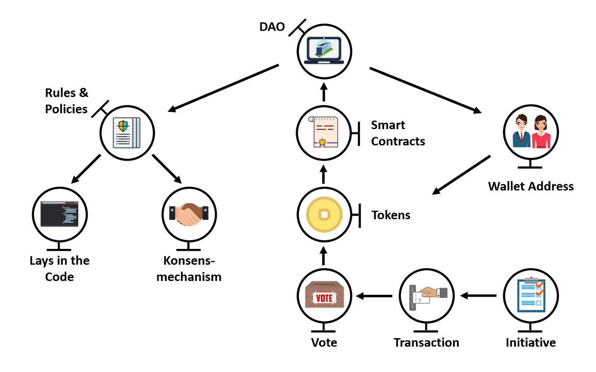

NFT와 더불어 최근 많이 언급되는 키워드가 <u markdown="span">**DAO (Decentralized Autonomous Organization)**</u>일 것입니다. 직역하면 탈중앙화된 자율 조직이라는 뜻을 갖고 있는데, 학과 학생회를 예시로 들어서 설명하겠습니다.

매년 12월 즈음 차기 학생회가 선발되면 신임 학생회는 새내기 맞이, 각종 과 행사 주최, 과 점퍼 만들기 등으로 분주합니다. 가끔 내부 회칙에 대한 어젠다가 등장할 때도 있습니다. <u markdown="span">**DAO에서는 이런 모든 행사, 행사별 책임자, 행사별 규칙들이 미리 smart contract 형태로 블록체인 시스템에 올라갑니다.**</u> Smart contract 상에 올라간 이 규칙들은 어겼을 때 대신 벌 주는 사람이 있는 것이 아니라 정말 그 코드를 기반으로 작동하기 때문에 위반 행위에 대한 벌까지 포함되어야 합니다. 코드가 절대적인 권력을 갖고 있는 시스템인 것입니다.

코드가 어떤 방식으로 상과 벌을 줄지에 대해서 고민을 해보면, 결국 토큰 형태로 줄 수 밖에 없습니다. 좋은 행동을 한 사람에게는 토큰을 부여해야하고, 좋지 못한 행동을 한 사람에게는 토큰을 주지 말아야 합니다. 즉 <u markdown="span">**DAO 내부의 토큰 이코노미를 설정해야 합니다.**</u> 이때 그 토큰은 실질적인 가치를 가져야 합니다. 사람들이 단체에 대한 충분한 애정을 갖고 자발적으로 활동할 수 있게 하는 요인으로 작용해야지만 토큰의 의미가 있습니다.

토큰이 중요한 이유가 한 가지 더 있는데, <u markdown="span">**DAO의 운영 방식을 결정할 때 그 결정권을 토큰과 연관시킬 수 밖에 없기 때문입니다.**</u> (이는 초기 smart contract를 어떻게 짜느냐에 달려 있습니다. 비례제, 1인 1표 등 다양한 투표 방식을 어떻게 할지는 처음 smart contract에 포함됩니다.) 지금까지 말씀드린 3요소가 DAO의 대부분입니다.

- DAO의 모든 규칙은 smart contract 형태로 작성된다.
- DAO는 토큰을 통하여 인센티브를 제공한다.
- 토큰은 DAO의 운영 방식(거버넌스)을 결정할 때에 사용된다.

{: width="1280" height="801" }
_https://nirolution.com/decentralized-autonomous-organization/_

## DAO의 실현 가능성

DAO는 과연 실현될 수 있을까요? DAO가 잘 작동할 수 있는 특정 케이스가 분명 있다고 봅니다. 하지만 현실속의 DAO를 실현하는 것은 그렇게 쉬워 보이지 않습니다. 분명 인간이 개입해야 하는 부분이 있기 때문입니다. 예를 들어 한 학생이 학과 학생회에서 과 점퍼를 디자인했는데, smart contract의 규칙에 따라 그 학생이 보상을 받아야 하는 경우를 생각해봅시다. Smart contract 상에 AI가 포함되어 디자인의 미적 수준을 평가할 수 있다면 모를까, 그게 아니라면 학생은 최대한 디자인을 대충 하려 할 것입니다. 학생회 회의 때마다 과열되는 분위기를 막아 일의 진행을 수월하게 도와준 학생은 그에 맞는 보상을 받을 수 있을까요? 이 또한 판단하기 애매할 것입니다. 사람이 개입해야하는 부분이 있는 DAO는 그 부분에 취약점을 가질 수 밖에 없습니다.

최근 많은 NFT 프로젝트들이 자신들을 DAO 시스템으로 돌아가게 하려고 시도하고 있습니다. 하지만 이는 토큰 이코노미를 정말 세밀하게 설계하지 않는 이상 제대로 이루어질 수 없습니다. 모든 만약의 경우에 대비해야 하고, 그 만약의 경우가 발생했을 때 수월하게 smart contract가 수정될 수 있는 거버넌스도 설계해야 합니다. 절대 쉬운 일이 아니라고 봅니다. 애초에 랜덤한 9,999명의 사람이 참여하는 단체가 목적 지향적으로 잘 돌아갈 것이라고 생각하는 것이 naive해 보이기도 합니다. 사람의 본성을 전혀 고려하지 않은 drive로 보입니다.

오히려 DAO 자체의 활동을 확실하게 제한한 단체는 가능성이 있어보입니다. 예를 들어 Uniswap은 자체 DAO 토큰을 갖고 있습니다. 출시 때 과거 이용자와 유동성 공급자에게 에어드롭과 유동성 채굴로 배포된 이 토큰(UNI)은 제한적인 DAO의 역할 덕분에 토큰으로서의 역할을 잘 하고 있습니다. Uniswap DAO가 DAO 참여자에게 제공하는 것은 딱 1가지입니다. 돈 넣어두면, 토큰을 줍니다. 다른 사용자에게는 DEX로서 작용합니다. DAO의 범위를 확실하게 제한한 DAO는 DAO로 작동할 수 있다고 봅니다.

## 미래 DAO에 바라는 점

DAO를 보고 있으면 비트코인을 처음 제시했던 사토시 나카모토의 이상적 금융 시스템에 대한 갈망이 보입니다. 한 조직이 권력의 편재 없이 순수한 토큰 이코노미로 돌아가는 것, 사회의 근본적인 작동 원리를 이상적으로 바꿔보겠다는 시도로 보입니다. 어쩌면 미래 자본주의 시스템에는 DAO가 포함될 수도 있고, DAO가 결합된 새로운 형태의 사회 체제가 나올수도 있습니다. 다만 사회에 제대로 된 효용을 전달하는 DAO가 등장하려면, 그만큼 많은 고민을 담아서 시스템을 꾸려야 할 것입니다.

자본주의가 인간의 이기심을 적절히 활용하여 현대의 주도적인 시스템이 된 것처럼, DAO 또한 사람의 본성을 잘 이용하면서 사회적 효용을 높일 수 있는 시스템을 고민해야할 것으로 보입니다. 제도권 금융 회사들의 횡포에 못이겨 만들어진 블록체인 시스템이 오히려 양극화를 부추기는 코인판으로 바뀐 현 상황이 안타깝습니다. 모두가 더 온전한 삶을 살도록 유도하는 것, 그러한 습관을 만드는 방책으로 블록체인이 아예 가능성 없는 도구로 보이지는 않습니다. 부디 올바른 방향으로 기술이 쓰였으면 하는 바람입니다.

## 출처

- [https://nirolution.com/decentralized-autonomous-organization/](https://nirolution.com/decentralized-autonomous-organization/)
- [https://ethereum.org/en/dao/](https://ethereum.org/en/dao/)
