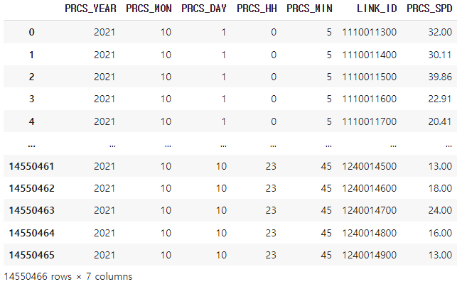
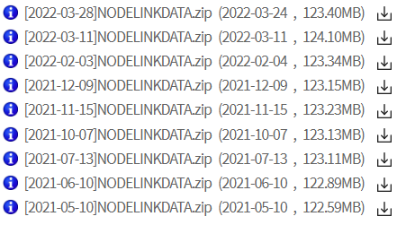
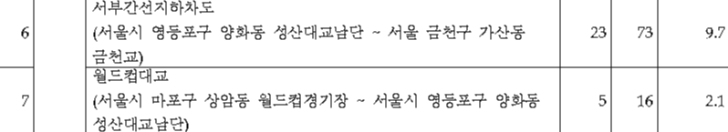
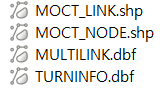
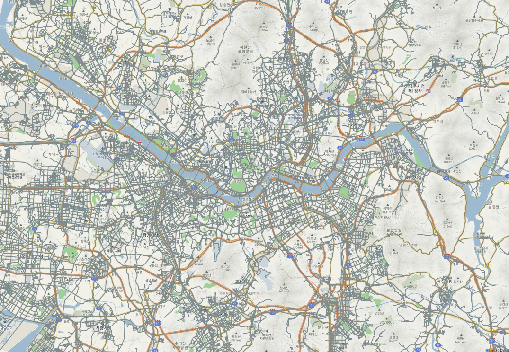
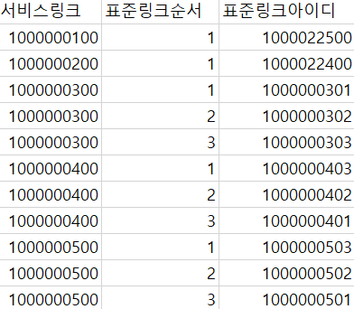
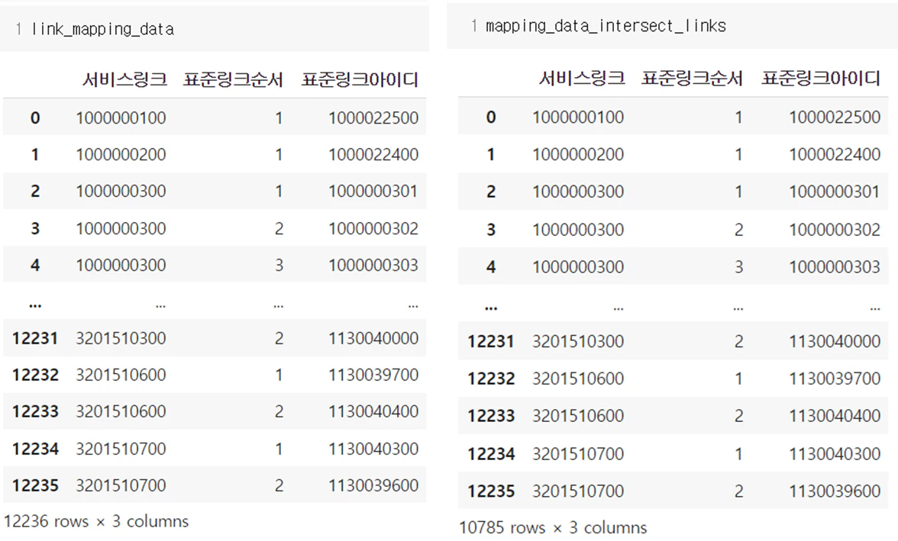
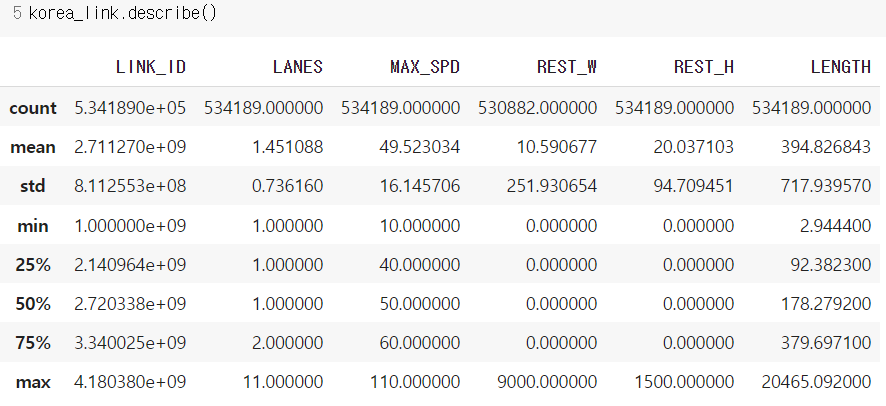
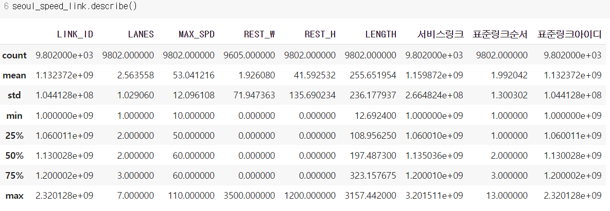
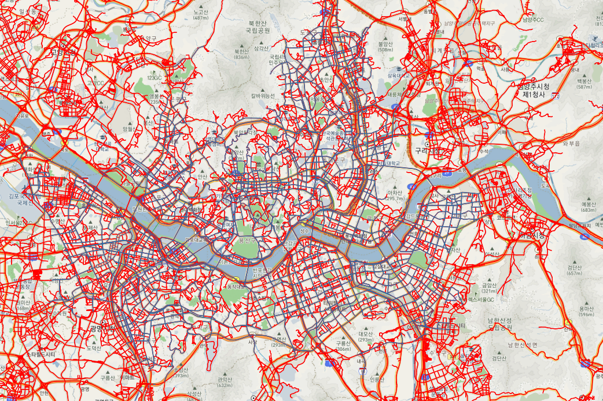

## 서울시 교통정보 시스템 데이터 확인

[서울시 교통정보 시스템](https://topis.seoul.go.kr/)에서는 서울특별시 내부의 [주요 도로에 대한 속도 정보](https://topis.seoul.go.kr/refRoom/openRefRoom_1.do)를 제공합니다. 해당 데이터를 얻어서 열어보면 아래와 같은 LINK\_ID 컬럼을 볼 수 있습니다.

{: width="650" height="407" }

하지만 표로 보면 지리적으로 어떤 도로를 의미하고 있는지 알 길이 없으니 QGIS로 시각화를 해야합니다. [국가교통정보센터](https://www.its.go.kr/)에서 제공하는 [전국표준노드링크](https://www.its.go.kr/nodelink/nodelinkRef)를 다운 받으면 QGIS에서 시각화 가능한 shp 파일이 제공됩니다.

{: width="441" height="251" }

제 데이터 시기에 맞게 2021년 7월 13일 기준의 노드 링크 체계를 활용하겠습니다. 각 zip 파일을 풀면 어떤 링크가 추가되었고 어떤 링크가 삭제되었는지를 알려주는 설명 자료가 한글 파일로 들어있습니다.

{: width="798" height="145" }

혹시나 하는 생각에 2021년 10월 7일에 어떤 변화가 발생했는지 확인해봤는데, 제 연구 대상지는 아니지만 굉장히 중요한 도로 2개가 개통되었습니다. (서부간선지하차도와 월드컵대교 둘 다 2021년 9월 1일에 개통되었는데, 이 노드 링크는 지난 업데이트에 이미 추가되어 있었습니다. 개통 사실을 알려주기 위해 표기된 것 같습니다.)

2021년 7월 13일 기준의 전국표준노드링크를 다운 받으면 아래와 같은 파일을 볼 수 있습니다.

{: width="160" height="88" }

MOCT\_LINK.shp 파일을 QGIS에 올려서 확인해보면 링크들이 잘 나타나는 것을 알 수 있습니다.

{: width="1075" height="744" }

그런데 문제는 전국표준노드링크는 \"표준링크\" 체계로 되어있는데 서울시 교통정보 시스템에서 제공하는 데이터는 \"서비스링크\" 체계로 되어있습니다. 서비스링크는 표준링크보다 더 높은 집계 단위로 보통 2~3개 표준링크가 하나의 서비스링크를 이룹니다. 도로를 길게 구분한게 서비스링크, 그 도로를 2~3개로 나누어 더 세분화한 것이 표준링크라고 이해하시면 됩니다.

그래서 서비스링크 기준 속도를 제공해주는 서울시 교통정보 시스템에서는 서비스링크와 표준노드링크 사이를 매핑해주는 자료를 제공합니다.

[https://topis.seoul.go.kr/refRoom/openRefRoom\_3\_3.do](https://topis.seoul.go.kr/refRoom/openRefRoom_3_3.do)

> **[기반 정보 \| 서울시 교통정보 시스템 - TOPIS](https://topis.seoul.go.kr/refRoom/openRefRoom_3_3.do)**  
> <small>topis.seoul.go.kr</small>

## 서울시 교통정보 시스템 데이터를 국가 표준 노드 링크에 맞추기

저는 2021년 3월 기준 서울시 표준링크 매핑정보를 사용하겠습니다.

{: width="392" height="342" }

이제 어떤 링크 데이터를 받았는지 시각화를 할 차례입니다.

```python
import pandas as pd

speed_data_topis = pd.read_csv('speed.csv')
link_in_speed_data = list(speed_data_topis['LINK_ID'].unique())
link_mapping_data = pd.read_csv('서울시 표준링크 매핑정보_2021년3월 기준.CSV', encoding='euc-kr')
mapping_data_intersect_links = link_mapping_data.loc[link_mapping_data['서비스링크'].isin(link_in_speed_data)]
```

파일명 칠때 CSV를 대문자로 안 치면 읽히질 않으니 주의합시다.

{: width="1176" height="709" }

기존의 서비스링크 표준링크 mapping dataframe에는 12,236개의 row가 있었습니다. 그 중 서울시 교통정보 시스템에 존재하는 링크는 10,785개임을 알 수 있습니다. 속도 자료가 없는 약 12%를 제외하고 많은 링크가 포함되어 있음을 알 수 있습니다. 이제 이 표준링크만 골라서 시각화해봅시다.

## 살아남은 링크들 시각화

```python
import geopandas

# 2021년 7월 13일 기준 전국 링크 데이터
path_to_data = '[2021-07-13]NODELINKDATA/MOCT_LINK.shp'
korea_link = geopandas.read_file(path_to_data)
korea_link['LINK_ID'] = korea_link['LINK_ID'].astype(int)

seoul_speed_link = korea_link.merge(mapping_data_intersect_links,
                                    left_on='LINK_ID', right_on='표준링크아이디')
```

{: width="886" height="406" }

원래는 총 534,189개 링크가 있던 자료입니다.

{: width="1185" height="412" }

2021년 7월 13일 기준 전국 링크 데이터에 선택된 서울시 링크를 inner join 했습니다. shp 파일에 없으면 어차피 시각화가 안되어 어디에 있는 데이터인지 모르고, 데이터가 없으면 분석을 할 수 없으니 inner join 합니다. 전국 링크 데이터는 count 534,189개에서 9,802개로 감소했고, 마찬가지로 속도가 있던 링크는 10,785개에서 9,802개로 감소했습니다.

2021년 3월, 7월, 9월 각각의 노드링크 체계가 달라서 발생한 문제일 수도 있고, 이유는 그 외에도 많을 것입니다.

```python
seoul_speed_link = seoul_speed_link.rename(columns={'서비스링크': 'SERVICE_LINK_ID',
                                                    '표준링크순서': 'STANDARD_LINK_ORDER', '표준링크아이디': 'STANDARD_LINK_ID'})
seoul_speed_link.to_file("seoul_speed_link.shp")
```

이렇게 해도 어차피 안의 데이터는 깨지겠지만, 일단 컬럼 이름이라도 영어로 바꾸어서 덜 깨지게 합시다.

{: width="1042" height="695" }

파란색 link들이 최종적으로 살아남은 link들 입니다.
