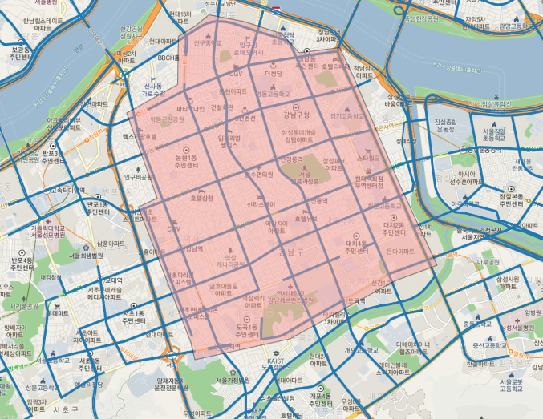
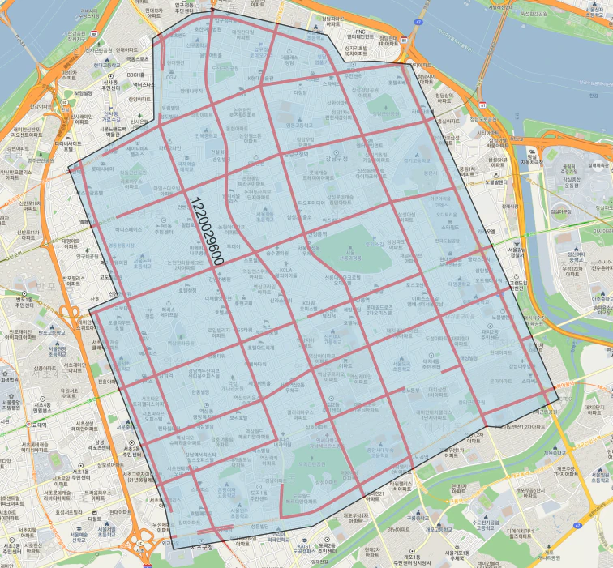
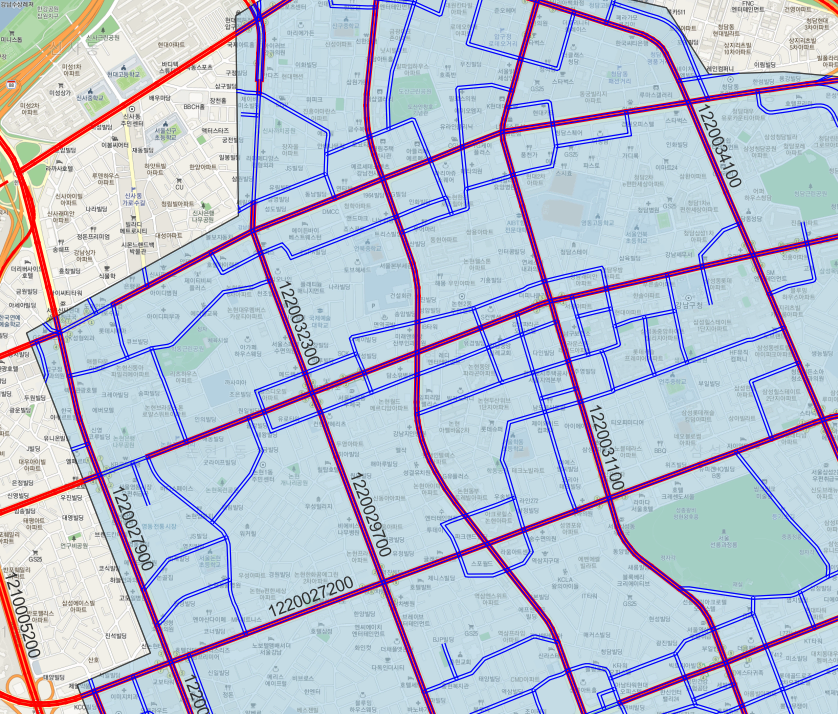
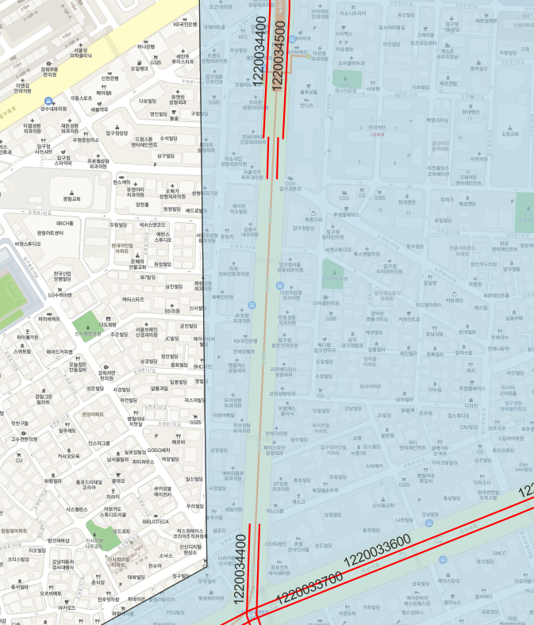
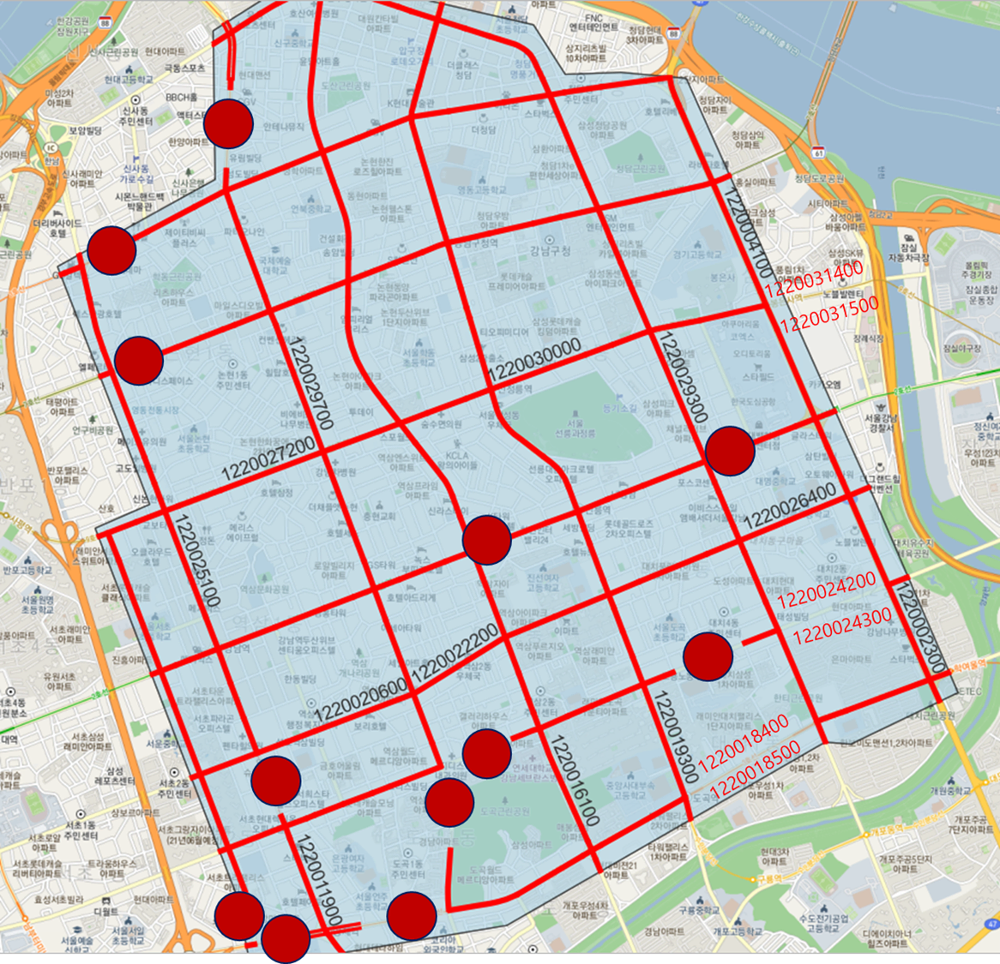
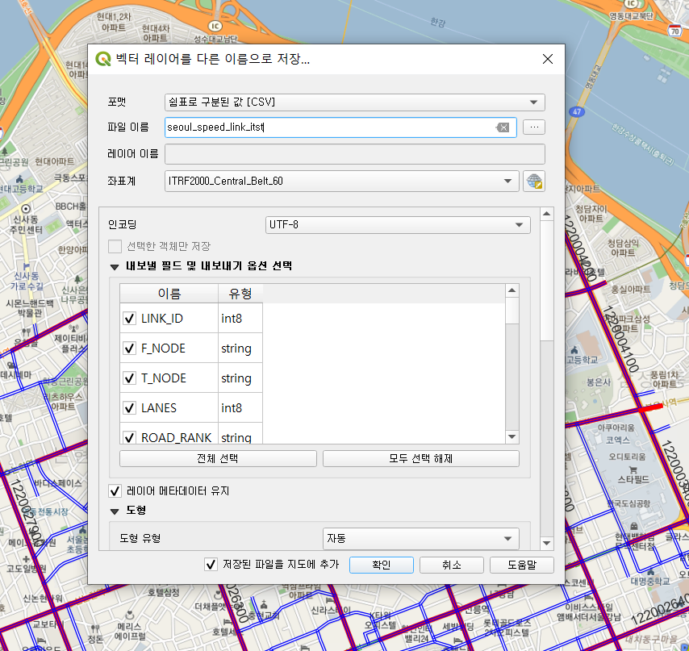
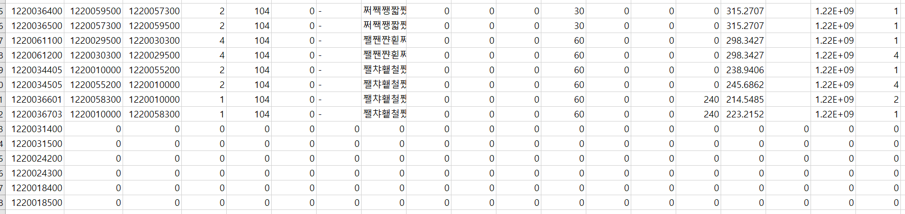
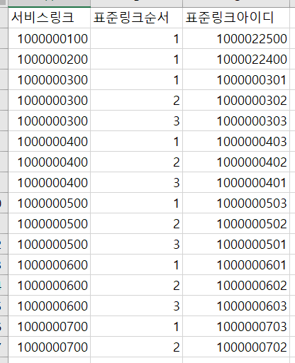
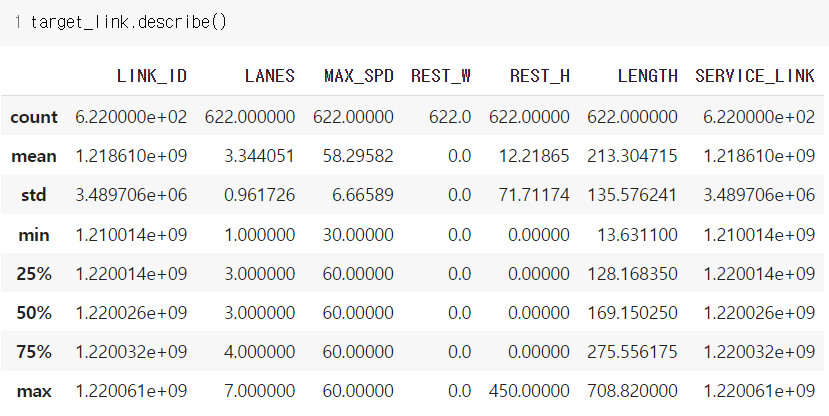

데이터가 없는 부분을 포함하여 링크 데이터를 얻으려 합니다. 서비스링크가 표준링크보다 길이가 긴 만큼 개수가 적어, 서비스링크 기준으로 뽑으면 금방 할 것 같기도 하네요.

{: width="677" height="523" }

일단 [레이어 추가](https://blog.naver.com/PostView.naver?blogId=flyproject&logNo=222023299604)로 폴리곤을 그려줍니다. 그 다음 벡터- 지리 정보 처리 도구 - 교차 영역으로 속도가 있는 영역에서 분석할 범위만 얻어보겠습니다. 마찬가지 작업을 전체 링크에도 적용해줍니다.

{: width="756" height="701" }

일단 교차 영역은 얻었는데, 끊어진 구간의 서비스링크 번호가 궁금합니다.

{: width="838" height="714" }

데이터가 있는 구간의 레이블을 띄웠습니다. 레이어에서 라벨 보이기를 선택해주고, 레이어 스타일 작업에서 단일 라벨로 원하는 속성을 골라주니 나옵니다. 좀 아쉬운 점은, 지도 줌인 줌아웃 함에 따라서 보이는 서비스링크 번호가 달라진다는 것입니다.

{: width="673" height="788" }

데이터가 없는 구간의 서비스링크 번호가 뭘지 궁금했는데, 데이터가 있는 구간의 서비스링크 번호와 같습니다. 그러니까 위 그림의 적색 라인이 없는 (데이터가 없는) 구간의 서비스 링크 번호가 1220034400과 1220034500입니다. 끊긴 구간이면 다른 서비스링크 번호를 갖고 있을 거라고 생각했는데 아니었습니다. 어차피 빈 구간 별로 없으니까 일일이 확인해보겠습니다.

적색원으로 표기한 곳은 기존 다른 서비스링크와 번호가 같은 구간입니다. 완전히 데이터가 빈 곳은 서비스링크 번호를 적었습니다.

{: width="1166" height="1125" }

이제 저 서비스링크 리스트를 csv로 저장합시다. 그리고 해당 지역의 서울시 표준링크 리스트도 저장합니다. 인접행렬 만들 때 필요한 정보는 서울시 표준링크 리스트에 있기 때문입니다.

{: width="854" height="807" }

속도 데이터가 존재하는 링크의 모음인 seoul\_speed\_link\_itst csv 파일에 속도 데이터가 없는 빈 링크들의 번호도 적어줍니다.

{: width="1772" height="421" }

서비스링크는 표준링크 번호 일의 자리 숫자를 0으로 바꾼 것입니다. 그러니까 표준링크 1220036701~1220036703은 서비스링크 1220036700에 해당합니다. (하지만 항상 그런 것은 아닙니다. 아래 표에서도 첫 예시부터 반례가 있습니다.)

{: width="416" height="512" }

이 csv 파일을 기반으로 해서, 제가 설정한 영향권 내의 링크들을 얻으려 합니다.

```python
import pandas as pd
import geopandas

# 2021년 7월 13일 기준 전국 링크 데이터
path_to_data = '[2021-07-13]NODELINKDATA/MOCT_LINK.shp'
korea_link = geopandas.read_file(path_to_data)
korea_link['LINK_ID'] = korea_link['LINK_ID'].astype(int)

# 서비스링크 컬럼 각각 추가
korea_link['SERVICE_LINK'] = (korea_link['LINK_ID']//10)*10
seoul_speed_link_itst = pd.read_csv('seoul_speed_link_itst.csv')
seoul_speed_link_itst['SERVICE_LINK'] = (seoul_speed_link_itst['LINK_ID']//10)*10

# 분석 범위 내 링크들만 고르기
target_link = korea_link[korea_link['SERVICE_LINK'].isin(seoul_speed_link_itst['SERVICE_LINK'])]

# 저장
target_link.to_file("target_link.shp")
```

{: width="829" height="416" }

이런 식으로 제가 목적하는 링크의 리스트가 담긴 shp 파일을 얻었습니다.
