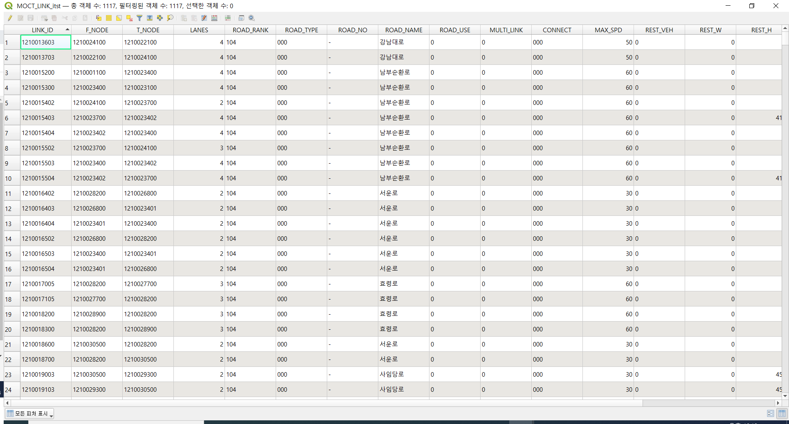

## 서비스링크 기준으로 Data Frame 만들기

[지난 글](/posts/QGIS와-python으로-지도에서-원하는-링크-선택하기/)에서 원하는 영역의 링크를 얻어오는 것까지 성공했습니다. 하지만 그 링크들은 표준링크 기준으로 작성되어서 서비스링크로 바꿔주어야 합니다.

{: width="1929" height="1039" }

표준노드링크에 대한 정보입니다. 링크는 보통 F\_NODE에서 T\_NODE 방향으로 차가 진행합니다. 1210015402~1210015404 표준링크는 같은 서비스링크에 속하므로, 서비스링크가 1210015400이면서 F\_NODE가 1210024100, T\_NODE가 1210023400이 되게 바꾸어줍니다.

```python
gangnam_target_link = pd.DataFrame(columns=['Service_Link', 'F_Node', 'T_Node', 'Length',
                                            'Avg_Lanes', 'Min_Lanes', 'Max_Lanes', 'Lane_Num_Change'])

for i, idx in enumerate(target_link['SERVICE_LINK'].unique()):
  tmp_target_link = target_link[target_link['SERVICE_LINK'] == idx]

  # Feature를 위한 최소/최대/평균 차로수, 링크 길이
  min_lanes, max_lanes = tmp_target_link['LANES'].min(), tmp_target_link['LANES'].max()
  link_length = round(tmp_target_link['LENGTH'].sum(), 4)
  area = (tmp_target_link['LANES']*tmp_target_link['LENGTH']).sum()
  avg_lanes = round(area/link_length, 4)

  # 서비스 링크의 시작 node(F NODE)와 종단 node (T NODE) 구하기
  f_node = tmp_target_link['F_NODE'].values
  t_node = tmp_target_link['T_NODE'].values
  itst_node = list(set(f_node) & set(t_node))
  f_node_service_link = list(set(f_node) - set(itst_node))
  t_node_sevice_link = list(set(t_node) - set(itst_node))
  
  tmp_list = [idx, f_node_sevice_link[0], t_node_sevice_link[0], link_length,
              avg_lanes, min_lanes, max_lanes, min_lanes!=max_lanes]

  print(tmp_list)
  gangnam_target_link.loc[i] = tmp_list

gangnam_target_link.to_csv('gangnam_target_link.csv', index=False)
```

이렇게 하면 F NODE와 T NODE를 제대로 기입하면서, 총 길이, 평균 차로수 등까지 구할 수 있습니다.

## 인접 행렬 만들기

인접행렬 자체는 간단한 코드로 구현 가능합니다. 내 T NODE를 F NODE로 갖는 링크는 내 앞에 있는 링크이므로, 전방 연결되었다고 보면 됩니다. 후방 연결의 경우 내 F NODE를 T NODE로 갖는 연결입니다. 전방 연결과 후방 연결은 전치 관계에 있지만 일단 코드 상에서는 전치 관계를 사용하지 않고 따로따로 구해주었습니다. (혹시 예외가 있을지 몰라 그렇게 했습니다.)

먼저 서비스링크들의 번호로 구성된 인접 행렬의 틀을 만듭니다. 그 다음 각 서비스 링크에 대하여 전방 인접 행렬과 후방 인접 행렬을 생성합니다.

```python
# 전방에 있는 연결을 반영하기 위한 matrix
forward_a = pd.DataFrame(columns = sorted(gangnam_target_link['Service_Link'].unique()),
                         index = sorted(gangnam_target_link['Service_Link'].unique()))

# 후방에 있는 연결을 반영하기 위한 matrix
backward_a = pd.DataFrame(columns = sorted(gangnam_target_link['Service_Link'].unique()),
                          index = sorted(gangnam_target_link['Service_Link'].unique()))


for idx in forward_a.index:
  tmp_df = gangnam_target_link[gangnam_target_link['Service_Link']==idx]
  f_node, t_node = tmp_df['F_Node'], tmp_df['T_Node']

  forward_cnct_links = gangnam_target_link[gangnam_target_link['F_Node'].isin(t_node)]['Service_Link']
  backward_cnct_links = gangnam_target_link[gangnam_target_link['T_Node'].isin(f_node)]['Service_Link']

  forward_a.loc[idx, forward_cnct_links] = 1
  backward_a.loc[idx, backward_cnct_links] = 1

forward_a = forward_a.fillna(0)
backward_a = backward_a.fillna(0)

total_a = forward_a + backward_a
# 건너편 도로인 경우 서로의 T NODE가 F NODE여서 2가 나오므로, 1로 변경
total_a = total_a.replace(2, 1)

# index가 필요한 파일이므로 index=False 문을 삭제
forward_a.to_csv('gangnam_forward_a.csv')
backward_a.to_csv('gangnam_backward_a.csv')
total_a.to_csv('gangnam_total_a.csv')
```

하지만 여기서 하나 더 처리할 것이 있습니다. 위의 알고리즘대로 처리하면 유턴이 불가능한 지역도 서로 연결되어있다고 치부해버립니다. 한국식 노드 링크 체계에 맞추어 수정이 필요한데, 그 상세한 내용에 대해서는 다른 글에서 확인해보겠습니다.
