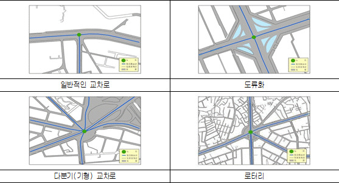
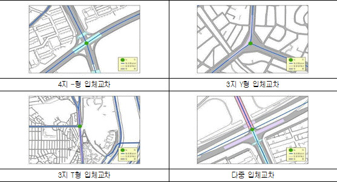
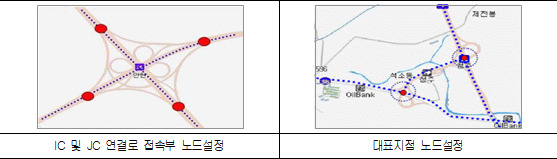
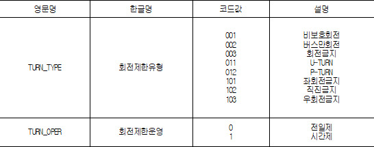

## 지능형교통체계 표준 노드링크 구축 기준

우리나라의 표준 노드링크 체계는 [행정 규칙](https://www.law.go.kr/LSW/admRulInfoP.do?admRulSeq=2100000157569)에 의해서 정해져 있습니다. 2021년 9월 28일에 일부개정되었습니다(2022년 4월 기준). 아래는 행정 규칙 중 볼 만한 내용을 그대로 가져온 것입니다.

가. 평면교차로는 도류화 또는 분기에 관계없이 교차로의 중심점에 노드를 설정함을 원칙으로 한다.

{: width="557" height="301" }

나. 교차로에서 일정방향의 교통류를 분리하고 지상부에서는 일반적인 평면교차로를 형성하는 경우 평면교차로로 간주하여 대표점에 노드를 설정한다.

{: width="557" height="301" }

다. IC 및 JC의 경우 연결로 시종점 접속부에 노드를 설정함을 원칙으로 한다. 단, 교통제공 등을 위해 IC 및 JC를 단순화할 필요가 있는 경우 대표지점에 노드 하나로 통합하여 설정할 수 있다.

{: width="557" height="159" }

이 중 다중 입체교차를 제외하면 데이터 처리에 크게 문제가 되는 경우는 없습니다.

{: width="546" height="215" }

우리는 데이터를 구축할 시에 001, 011, 012에 해당하는 경우 회전이 있다는 것을 알려주어야 하고, 그 외의 경우인 002, 003, 101, 102, 103에는 회전이 없다는 것을 알려주면 됩니다.

## 강남구 데이터에 노드링크 구축기준 적용

```python
# 회전 반영하기
turninfo = pd.read_csv("TURNINFO.csv")

# 서비스 링크 번호 생성
turninfo['ST_SERVICE_LINK'] = (turninfo['ST_LINK']//10)*10
turninfo['ED_SERVICE_LINK'] = (turninfo['ED_LINK']//10)*10

# 시작/종단 링크 둘 다 분석 범위에 있는 회전 정보만 추출
gangnam_turninfo = turninfo[turninfo['ST_SERVICE_LINK'].isin(gangnam_target_link['Service_Link'].unique()) &
                            turninfo['ED_SERVICE_LINK'].isin(gangnam_target_link['Service_Link'].unique())]

# 회전 정보 반영
for idx, turns in gangnam_turninfo.iterrows():
  turntype = turns['TURN_TYPE']
  st_link, ed_link = turns['ST_SERVICE_LINK'], turns['ED_SERVICE_LINK']

  if turntype in [2, 3, 101, 102, 103] :
      forward_a.loc[st_link, ed_link] = 0
      backward_a.loc[ed_link, st_link] = 0 

  elif turntype in [1, 11, 12] :
      forward_a.loc[st_link, ed_link] = 1
      backward_a.loc[ed_link, st_link] = 1

total_a = forward_a + backward_a
total_a = total_a.replace(2, 1)

# index가 필요한 파일이므로 index=False 문을 삭제
forward_a.to_csv('gangnam_forward_a.csv')
backward_a.to_csv('gangnam_backward_a.csv')
total_a.to_csv('gangnam_total_a.csv')
```

위와 같이 작성해주면 회전 정보를 포함할 수 있게 된다.
