이 글은 Justin Johnson 교수님의 [EECS 498 수업](https://web.eecs.umich.edu/~justincj/slides/eecs498/498_FA2019_lecture13.pdf)과 고려대학교 DMQA 연구실의 [Transformer in Computer Vision](https://www.youtube.com/watch?v=bgsYOGhpxDc) 발표, [Graph Attention Networks](https://youtu.be/NSjpECvEf0Y) 발표를 참조하였습니다. 각 슬라이드에서 그림 자료도 가지고 왔습니다.

## Seq2Seq Model

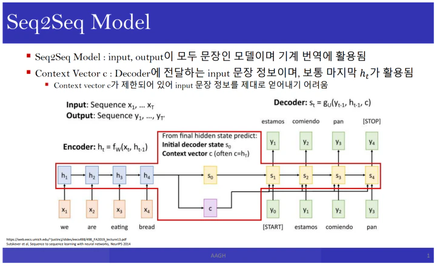{: width="1077" height="656" }

그래프 어텐션 네트워크에 대해 알아보기 전에 어텐션 메커니즘을 확인하여 보겠습니다. 어텐션 메커니즘의 등장 배경으로 흔히 Seq2Seq 모델을 이야기 합니다. 기존의 Seq2Seq 모델은 input 문장에서 단일한 context vector를 추출하여 그 context vector와 &lt;start of sentence&gt; token을 사용하여 번역을 시작하였습니다.

이러한 번역 시스템은 input sentence가 어떤 길이이든 관계 없이 단일한 context vector에 넣어야 한다는 문제점이 있었습니다. 따라서 문장이 길어진다면, 각 단어마다 context vector에 포함시킬 수 있는 본인의 정보량이 적어지면서 그만큼 번역 품질이 저하될 수 밖에 없습니다.

## Seq2Seq with Attention Mechanism

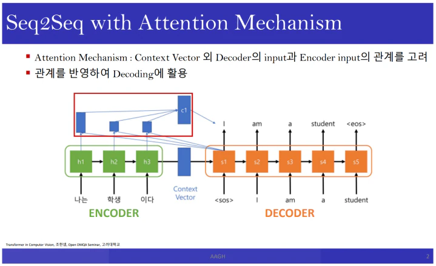{: width="958" height="585" }

이런 문제를 해결하고자 attention mechanism은 encoder의 input을 변환한 embedding(h)도 decoder embedding(s) 결과와 함께 고려하는 아이디어를 제시하였습니다. &lt;start of sentence&gt;와 \'나는\', \'학생\', \'이다\' 사이의 관계를 모두 보겠다는 것입니다. 직관적입니다. Input의 embedding(h) 데이터가 있는데 이것을 굳이 무시할 필요는 없습니다. 같이 고려하면 더 좋은 결과가 나올 것입니다.

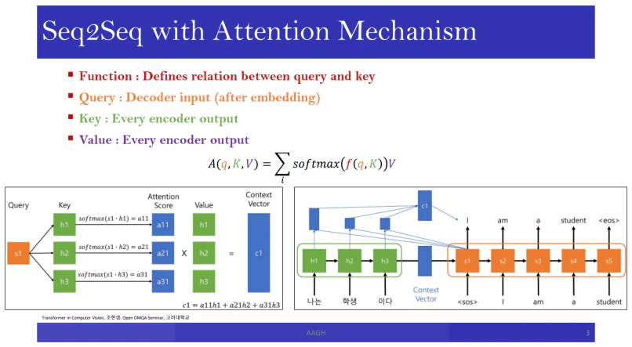{: width="995" height="547" }

Attention 메커니즘에는 네 가지 요소가 있습니다. Function, query, key, value라는 요소가 존재하는데, query는 전 step에서 나온 단어 (이 단어를 토대로 다음 단어를 알아볼 것입니다.), key는 관계를 확인하고자 하는 번역되기 전 문장의 단어입니다. Decoder의 embedding(s)과 encoder의 embedding(h) 사이의 관계는 function을 통해서 파악됩니다. 그 function의 output으로 attention score가 만들어지고, 그 attention score에 value를 곱하여 context vector를 생성합니다.

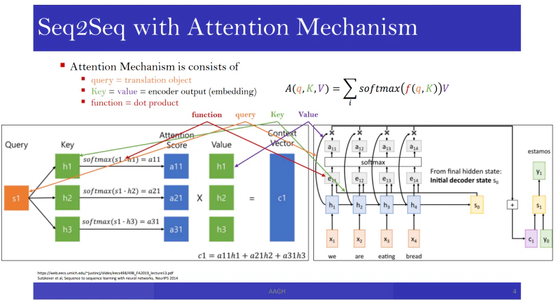{: width="811" height="439" }

왼쪽의 그림과 오른쪽 그림은 서로 다른 출처에서 얻은 그림입니다. 하지만 같은 내용입니다. 왼쪽 그림에 연산 과정이 자세히 나와있는데, 왼쪽 예시에서 function이 단순한 dot product라는 것만 인지하시면 될 것 같습니다. 결국 function이 key와 query 사이의 관계를 알아내고, 그 결과로 attention을 구하고, attention에 value를 곱하여 관계를 반영한 vector를 얻겠다는 의미입니다.

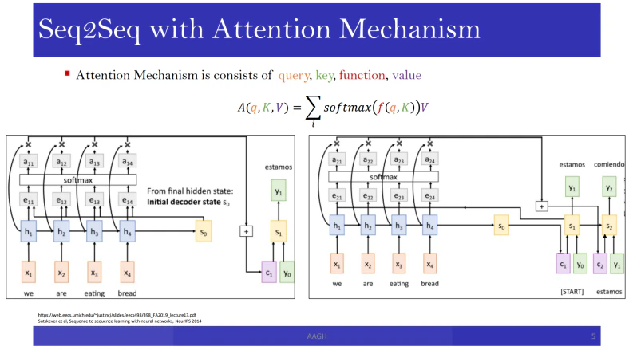{: width="1021" height="569" }

Decoder의 전 output($$y_2$$를 얻을 때는 $$s_1$$)을 받아서, 기존 input 단어들의 embedding(h)과 비교하고, 이를 function으로 이용해 attention을 구한 다음 value(encoder의 embedding h)를 곱해 context vector($$y_2$$를 얻을 때는 $$c_2$$)를 만들고, 이를 직전에 출력한 단어($$y_2$$를 얻을 때는 $$y_1$$)와 함께 decoder에 넣는 과정을 계속 반복합니다.

## Message Passing Scheme

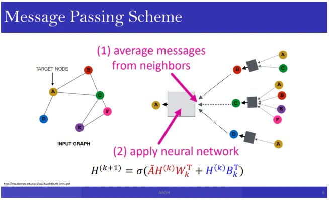{: width="1042" height="636" }

GAT에 대해 확인하기 이전에 graph neural network의 기본 구조에 대해서 확인해보겠습니다. GNN은 message를 받아들이는 부분과 그 message를 neural network로 처리하는 부분으로 나뉘어져 있습니다. 일단 각 message 들을 모으고, average(그림의 예시) 혹은 max 함수를 거친 이후에 neural network를 통과하게 됩니다.

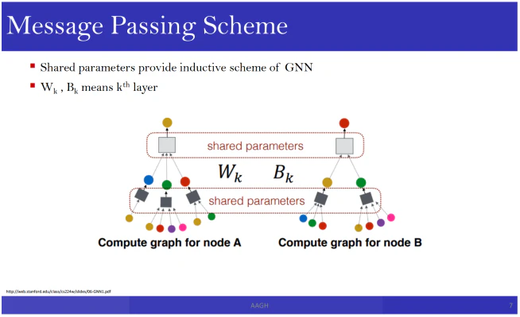{: width="900" height="548" }

이때 GNN은 neural network에 해당하는 $$W_{k}^{T}$$와 $$B_{k}^{T}$$를 학습하게 됩니다.

학습된 $$W_{k}^{T}$$와 $$B_{k}^{T}$$는 shared parameter입니다. 즉 어떤 그래프에서 node A가 본인에게서 3-hop (거리 3) 떨어진 node의 feature를 받아들이는 데 쓰이는 $$W_{k}^{T}$$와 $$B_{k}^{T}$$는 node B가 3-hop 떨어진 node feature를 받아들이는데 쓰이는 $$W_{k}^{T}$$와 $$B_{k}^{T}$$와 일치합니다. 3-hop 뿐만 아니라 n-hop에 대해서도 당연히 적용됩니다.

## Graph Attention Networks

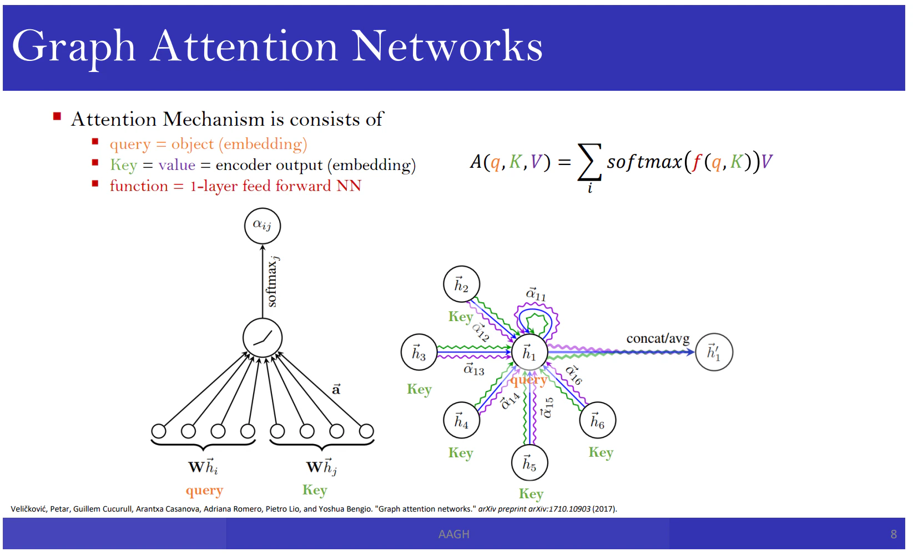{: width="1645" height="1006" }

이제 graph attention networks(GAT)에 대하여 알아보겠습니다. 어텐션 메커니즘에는 네 가지 요소가 있다고 했습니다. Query, key, value, 그리고 function 입니다. 왼쪽 그림과 같이 GAT은 node i와 그와 연결된 node 들(node j)의 attention을 고려하여 새로운 hidden embedding 을 만들게 됩니다. 이때 hidden embedding을 구하려고 하는 node i의 직전 hidden embedding이 query, node i와 연결된 node j의 직전 hidden embedding이 key가 됩니다. (엄밀히 말하면 각 embedding에 행렬곱 연산을 한 결과가 key와 query가 됩니다.)

오른쪽 그림에서 보이는 초록, 파랑, 보라색 화살표는 multi-head attention을 의미합니다. 여기서는 3-head attention을 그림으로 나타내고 있습니다.

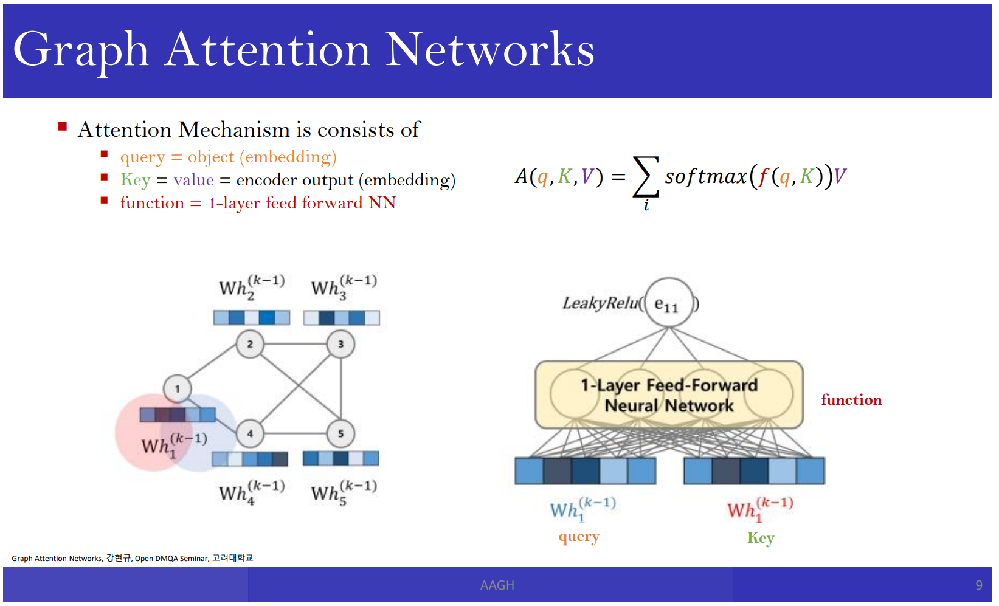{: width="1643" height="997" }

GAT는 1-layer feed forward network를 function으로 둡니다. Transformer가 dot product를 가지고 similarity를 계산한 것과 다르게, similarity를 알려주는 함수를 1-layer feed forward network로 둔 것입니다. 한 node에 대한 그 다음 번의 hidden embedding을 구하기 위해서 연결된 node 들의 hidden embedding과의 관계를 활용합니다. (오른쪽 그림) 일단은 $$h_{1}$$과 $$h_{1}$$ 그 자신에 대한 self-attention을 구해줍니다.

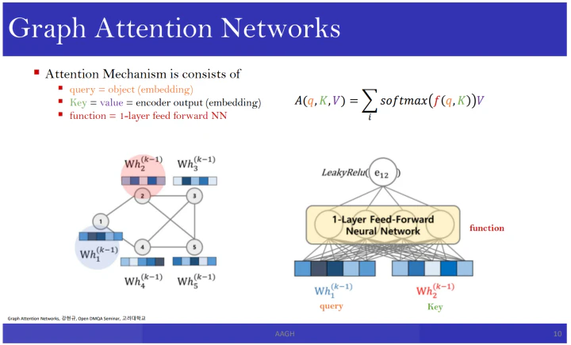{: width="889" height="537" }

같은 작업을 $$h_{1}$$과 $$h_{2}$$에 대해서도 해줍니다.

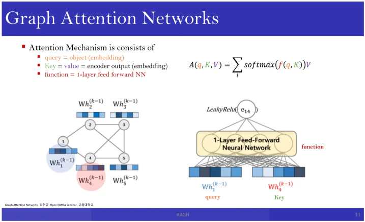{: width="888" height="539" }

$$h_{1}$$과 $$h_{4}$$의 관계까지 규명해주면 node 1에 대한 작업은 일단락 됩니다.

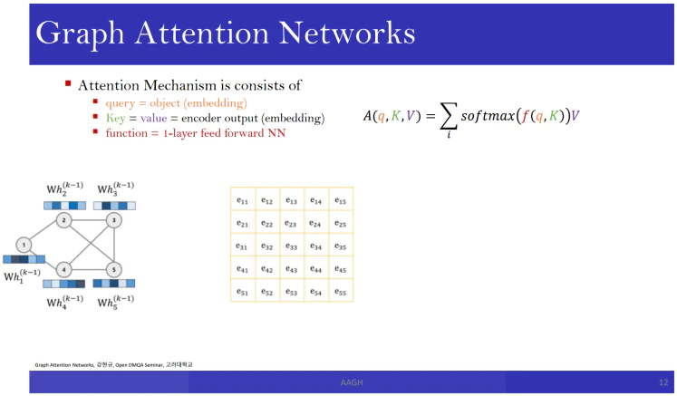{: width="988" height="578" }

실제 코드가 돌아갈 때에는 저렇게 node 1에 연결되어 있는 node만 골라서 function에 넣지는 않습니다. 일단 행렬곱으로 모든 node 사이의 관계(일단은 attention이 아닌 두 node의 hidden embedding을 1-layer FFN에 넣은 결과물, 즉 energy)를 구하고 연결성에 따라서 mask를 씌워줍니다.

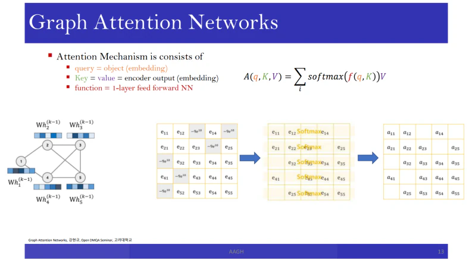{: width="990" height="549" }

Energy(1-layer FNN의 결과물)에 Mask를 씌우고, softmax를 취한 뒤, value(hidden embedding이 궁금한 그 node와 연결된 node들(자기 자신 포함)의 전단계 hidden embedding)를 곱하면 attention 값을 얻을 수 있습니다.

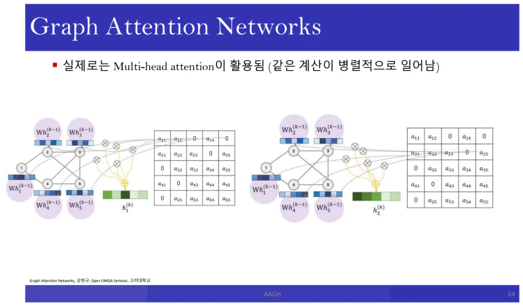{: width="936" height="548" }

실제로는 이런 계산이 병렬적으로 발생합니다. Multi-head attention을 활용하기 위함입니다.

## GAT in Transportation

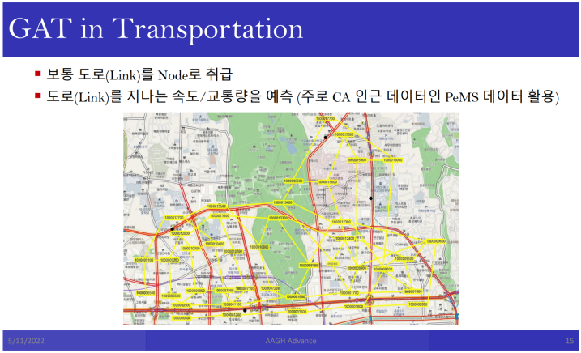{: width="1003" height="610" }

교통 분야에서는 보통 link가 node가 됩니다. Link의 속도/교통량 등이 예측하고자 하는 목적이 되는 것입니다.

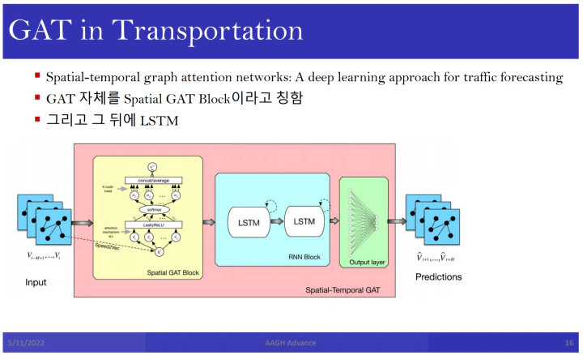{: width="930" height="566" }

GAT을 교통 분야에 응용한 대표적 논문인 \"Spatial-temporal graph attention networks: A deep learning approach for traffic forecasting\"에서는 GAT layer에 Spatial GAT Block이라는 이름을 붙였습니다. 그리고 그 결과물을 다시 LSTM에 넣었습니다. 강화학습 쪽 논문에서 어텐션을 적용할 때 이렇게 어텐션으로 얻어진 embedding을 다시 LSTM에 넣는 경우가 있던데, 그와 비슷한 케이스 같습니다. 다만 Transformer처럼 LSTM을 쓰지 않고자 어텐션만 쓰는 모델도 나온 것인데 어텐션의 결과물이 LSTM에 들어가는 것은 조금 이상하게 느껴지기는 합니다.

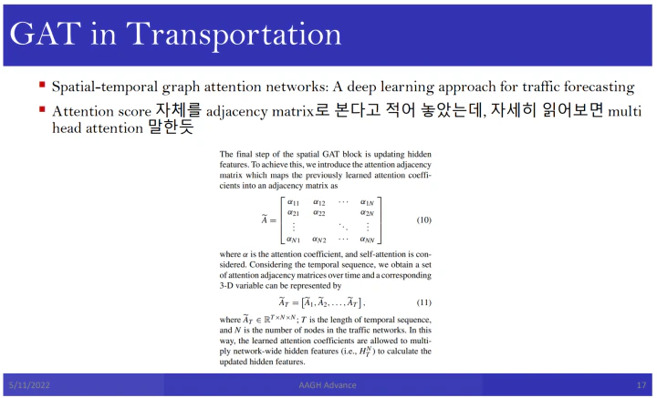{: width="975" height="592" }

Attention score를 adjacency matrix로 쓴다고 적어놓은 부분이 있는데, 따로 adjacency matrix도 정의를 한 파트가 있는 걸 보아서, masking 하는 과정을 나타낸 것으로 보입니다. 연결되지 않은 node 사이의 attention은 0으로 바뀌는 부분을 이렇게 설명한 것으로 보입니다.

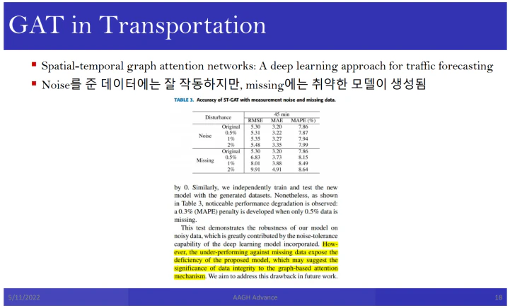{: width="1143" height="691" }

모델 개발 결과, noise를 준 데이터에는 잘 작동하지만, missing data가 있는 경우에는 굉장히 취약한 모델이 등장한 것을 알 수 있습니다. 개선이 필요한 대목입니다.

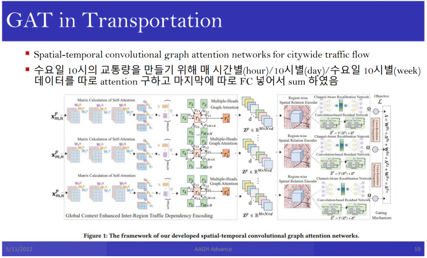{: width="1036" height="627" }

그 다음 논문인 \"Spatial-temporal convolutional graph attention networks for citywide traffic flow forecasting\"입니다. 특정 시간의 데이터를 예측하기 위해 시간별/날짜별/요일별 특징을 학습하는 모델을 각기 만든 점이 특징입니다.

이상으로 GAT과 교통 분야에서의 응용에 대해 알아보았습니다.
