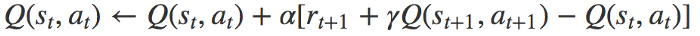
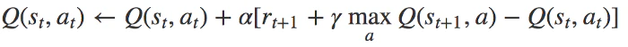
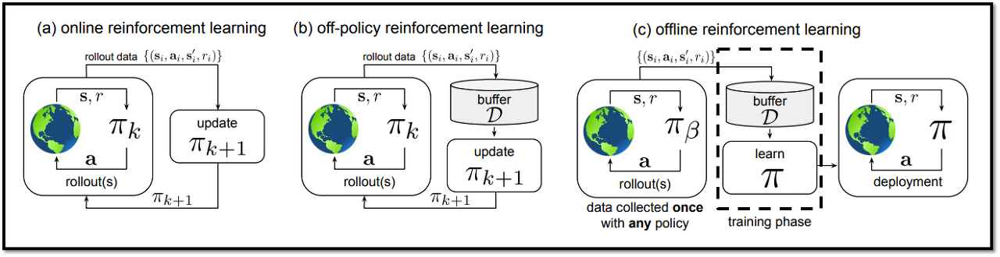
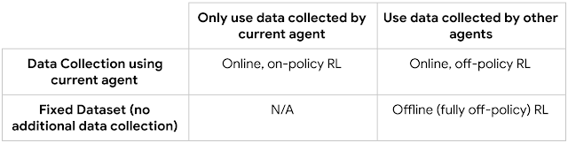

On-Policy, Off-Policy, Online, Offline 강화학습은 기본 개념에 속하는 단어이지만, 그 개념을 잘 파악하기 이전까지는 계속 헷갈리는 워딩입니다. 이번 글에서는 짤막하게 위 분류에 대해서 확인해보려 합니다.

## On-Policy/Off-Policy 강화학습

먼저 이해가 비교적 쉬운 On-Policy와 Off-Policy 강화학습부터 살펴보겠습니다. On-Policy와 Off-Policy 알고리즘에 대해서 스터디원이 해준 비유가 있습니다. 여러분이 스타크래프트를 배우려 하는 상황을 가정해봅시다. 스타크래프트를 배울 때는 내가 직접 플레이하면서 이기고 지는 것을 반복하며 배울수도 있습니다. 하지만 이와 반대로 친구가 하는 것을 뒤에서 보면서 \'아 지금은 멀티 먹지 말고 타이밍 러쉬 갔어야지\'를 깨우칠 수도 있습니다. 예상하시겠지만 전자가 On-Policy, 후자가 Off-Policy 입니다.

### On-Policy

- 내가 직접 스타크래프트를 하며 스타크래프트 하는 방법을 배움
- 데이터를 수집하는 agent (행위 알고리즘, Behavior Policy)와 학습 agent (목적 알고리즘, Target Policy)가 **같은** 경우
- On-Policy 강화학습은 필연적으로 수집한 샘플을 policy 업데이트에 쓰고 나면 버릴 수밖에 없음. 샘플이 수집되는 순간 policy가 업데이트 되고 그 뒤로는 기존과 다르게 행동하기 때문
- Q가 매번 바뀌기 때문에 transition에 대한 이전 지식을 활용할 수 없음
- 대표적 알고리즘 : SARSA

{: width="700" height="36" }
_SARSA 업데이트_

위의 식이 뭔가 어렵게 보이지만, 핵심은 다음 상태에서 현재 policy(Q에 대한 ε-greedy 등)가 실제로 선택한 행동 $$a_{t+1}$$의 $$Q(s_{t+1}, a_{t+1})$$를 이용해서 학습을 진행한다는 것입니다. SARSA 알고리즘은 행위 알고리즘과 목적 알고리즘이 같습니다. 내가 직접 스타크래프트를 플레이하면서 내 행위 알고리즘을 개선하는 방식입니다.

### Off-Policy

- 친구가 스타크래프트 하는 것을 구경하면서 스타크래프트 하는 방법을 배움
- 데이터를 수집하는 agent (행위 알고리즘, Behavior Policy)와 학습 알고리즘 (목적 알고리즘, Target Policy)가 **다른** 경우
- 대표적 알고리즘 : Q-learning

{: width="700" height="53" }
_Q-Learning 업데이트_

위 업데이트의 단 한가지 차이는, Q를 이용하지 않고 $$\underset{a}{max} Q$$를 이용하여 가치를 업데이트한다는 것입니다. 친구가 다음에 실제로 어떤 행동을 했는지와 상관없이, 다음 상태에서 지금 내가 아는 가장 좋은 행동(현재 Q 기준)을 한다고 보고 가치를 업데이트하는 것과 마찬가지입니다. 실제로 Off-Policy 강화학습은 우리가 친구가 스타하는 것 보면서 실시간으로 배우는 것과 달리, 친구의 스타 기록을 버퍼라는 공간에 잘 저장해두었다가, 꺼내 쓰면서 배우게 됩니다.

이런 버퍼를 Policy Update에 직접적으로 사용하는 강화학습 알고리즘은 Off-Policy 강화학습에 해당합니다. Q-learning은 off-policy이기 때문에 [상태, 행위, 보상, 그 다음 상태]의 pair를 메모리(replay buffer)에 쌓아두었다가 꺼내 쓰면서 학습할 수도 있습니다(DQN이 대표적인 예입니다).

## Online/Offline 강화학습

On-Policy, Off-Policy보다 이름은 간단하지만, On-Policy, Off-Policy를 모르면 이해할 수 없는 개념이 Online, Offline 강화학습입니다. On-Policy, Off-Policy, Online, Offline이 서로 약간의 연관성이 있기 때문입니다.

### Online 강화학습

- agent가 직접 환경과 상호작용
- 데이터 저장이 힘든 경우에 Online 강화학습을 사용
- 지속적으로 환경과 상호작용을 가정하는 문제 상황의 경우에 사용
- Online + On-Policy (e.g. PPO) / Online + Off-Policy (e.g. DQN, SAC) 알고리즘 모두 존재

Online RL은 policy optimization을 수행할때 지속적으로 환경과 상호작용하면서 샘플을 수집하는 상황을 가정합니다. 한번 action을 취할때마다 policy 한번씩 업데이트하거나, episode 한번 끝날때마다 policy 여러 번 업데이트하는 등의 상황입니다.

### Offline 강화학습

- agent가 직접 환경과 상호작용하지 않음 (행위 알고리즘이 따로 존재)
- 환경과 상호작용 전혀 없이 고정된 데이터만으로 동작하는 문제 상황의 경우에 Offline 강화학습을 활용
- Offline 강화학습은 policy optimization을 수행하는 동안 추가적인 샘플이 전혀 주어지지 않고, 이미 수집해놓은 데이터만을 이용해 policy를 수렴할때까지 학습시킴
- 추가적인 데이터 수집(exploration)이 없기 때문에 기본적으로 uncertainty가 높은 action은 피하는게 타당

그림을 통해서 확인해보면 아래와 같습니다. Off-Policy 강화학습(b)와 Offline 강화학습(c)에서는 Online 강화학습(a)에서 보지 못했던 버퍼를 확인할 수 있습니다.

{: width="1280" height="330" }
_https://medium.com/@sergey.levine/decisions-from-data-how-offline-reinforcement-learning-will-change-how-we-use-ml-24d98cb069b0_

문제 정의상 Offline 강화학습 알고리즘은 반드시 Off-Policy 알고리즘이어야 하지만, 모든 Off-Policy 강화학습이 Offline 상황에서 동작하는건 아닙니다. 예를 들어서 SAC는 Off-Policy 알고리즘이기 때문에 이미 수집된 데이터(Replay Buffer)만으로도 Policy Optimization이 잘 동작해야 할 것 같습니다만, 실제로 돌려보면 잘 동작하지 않습니다. Out-Of-Distribution(OOD) action에 해당하는 Q-value가 과대추정되었을때, Policy는 Q가 (비정상적으로) 높은 action 영역을 샘플링하도록 업데이트되고, 동시에 과대추정된 Q를 bootstrap하는 과정에서 Q의 값이 발산하는 모습을 쉽게 관찰할 수 있습니다.

Online 상황에서는 데이터가 없는 부분의 Q가 (실제론 좋은 action이 아님에도) 과대추정되는 일이 생기더라도, 환경에서 그 action을 실제로 취해보면서, 사실 해당 action은 안좋았었다는걸 자연스럽게 깨닫고 Q 학습이 보정 됩니다만, Offline 상황에선 추가적인 데이터 수집이 안되기 때문에 문제가 발생하는 것입니다. 그렇기 때문에 Offline 강화학습 알고리즘들은 단순히 Online 상황을 가정하고 만든 Off-Policy 강화학습 알고리즘과는 좀 다릅니다. Offline 강화학습 알고리즘들은 Off-Policy learning을 기본으로 깔고, 여기에 uncertainty가 높은 action을 피하는 메커니즘이 추가된 경우가 많습니다.

Exploration/exploitation에 대해서 생각해보면, uncertainty가 높은 action을 피하는게 최선이 아닐수도 있습니다. uncertainty가 높은 action을 선택해보는게 exploration에 도움이 될수도 있기 때문입니다. Online 강화학습에서는 Q의 에러가 추가적인 데이터 수집에 의해 자연스럽게 보정되어 OOD에 대한 이슈가 일부 경감됩니다. 이에 반해 Offline 강화학습은 exploration을 배제하고 exploitation을 최대한 잘해보자는 문제 세팅입니다. 알고리즘들을 보면 단순히 추정을 더 \'정확\'하게 하는걸 넘어서 uncertainty에 \'패널티\'를 가합니다. 이런 패널티는 exploration 논문 (e.g. RND)에서 새로운(uncertainty가 높은) 상태에 주는 보너스와 정반대의 효과를 발휘하므로, exploration이 가능한 Online 상황이라면 바람직하지 않습니다. 하지만 추가적인 데이터 수집이 불가능한 Offline 상황에서는 타당한 선택입니다.

## 정리

위의 내용을 표로 정리하면 아래와 같이 나타납니다. Data Collection using current agent가 Online 강화학습, Fixed Dataset (no additional data collection)이 Offline 강화학습 입니다.

{: width="640" height="162" }
_https://ai.googleblog.com/2020/04/an-optimistic-perspective-on-offline.html_

- 목표로하는 \"policy optimization을 수행하는 동안\" 환경과 (지속적인) 상호작용이 있는지 여부, 즉 추가적인 데이터가 꾸준히 들어오는지 여부가 Online/Offline을 구분함
- On-Policy 알고리즘은 필연적으로 샘플을 한 번 보고 버릴 수 밖에 없음. Policy를 업데이트 하고 나면 데이터를 수집할 때의 policy와 달라지게 되기 때문. 모든 on-policy 알고리즘은 online 상황에서만 작동함
- Off-policy RL 알고리즘은 Online/Offline에 적용될 수 있습니다.

## 출처

- [https://kowshikchilamkurthy.medium.com/off-policy-vs-on-policy-vs-offline-reinforcement-learning-demystified-f7f87e275b48](https://kowshikchilamkurthy.medium.com/off-policy-vs-on-policy-vs-offline-reinforcement-learning-demystified-f7f87e275b48)

> **[Off-policy vs On-Policy vs Offline Reinforcement Learning Demystified!](https://kowshikchilamkurthy.medium.com/off-policy-vs-on-policy-vs-offline-reinforcement-learning-demystified-f7f87e275b48)**  
> Simplifying RL for Beginners  
> <small>kowshikchilamkurthy.medium.com</small>

- [https://talkingaboutme.tistory.com/entry/RL-Offline-Reinforcement-Learning](https://talkingaboutme.tistory.com/entry/RL-Offline-Reinforcement-Learning)

> **[[RL] Offline (batch) Reinforcement Learning의 의미와 적용](https://talkingaboutme.tistory.com/entry/RL-Offline-Reinforcement-Learning)**  
> (해당 글은 U.C. Berkeley 박사과정에 재학중인 Daniel Seita가 작성한 포스트 내용을 원저자 동의하에 번역한 내용입니다) Offline (Batch) Reinforcement Learning: A Review of Literature and Applications Re..  
> <small>talkingaboutme.tistory.com</small>

- 강화학습 스터디 방
