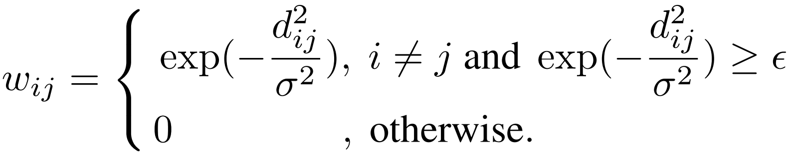
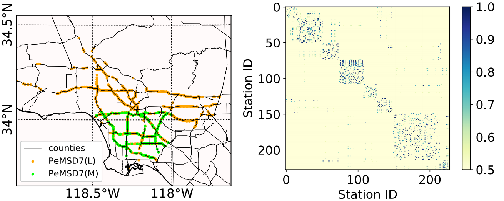
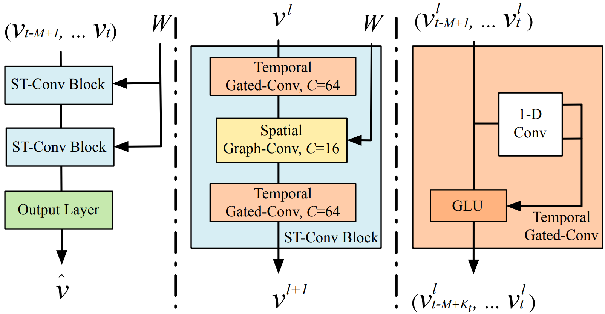
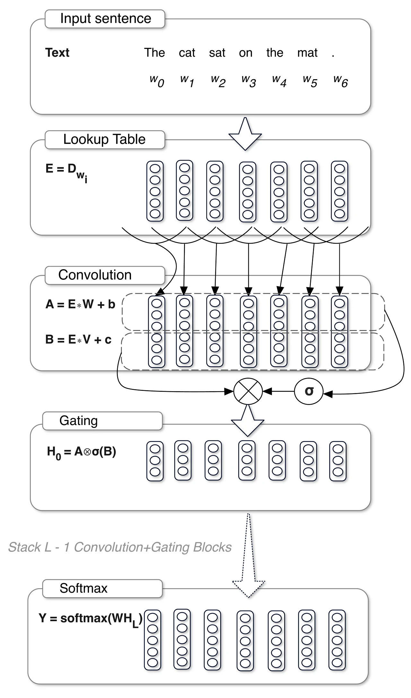
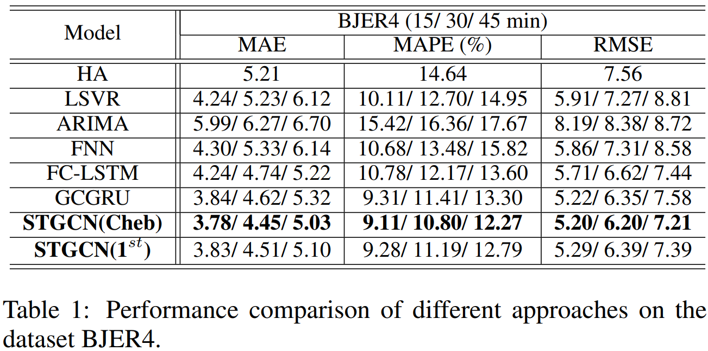
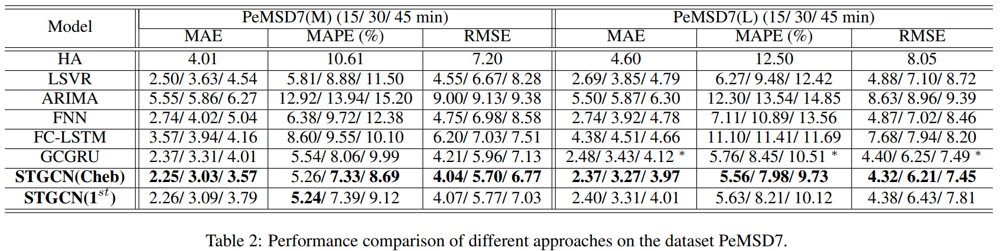
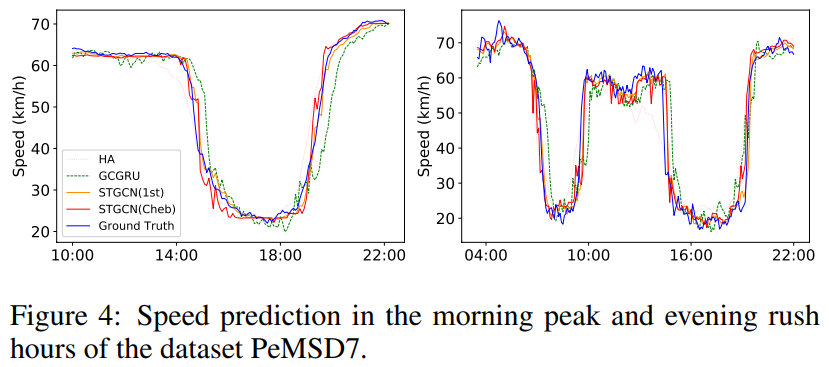
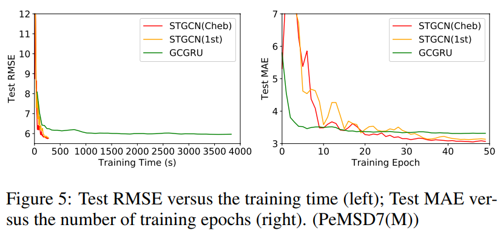
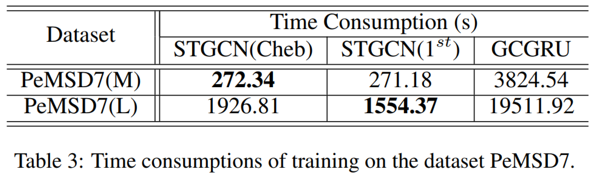

몇 개의 글을 거쳐서 graph neural network를 활용하여 시계열 예측을 한 사례들을 확인해보고자 합니다. 첫 논문은 Spatio-Temporal Graph Convolutional Networks: A Deep Learning Framework for Traffic Forecasting입니다.

## Spatio-Temporal Graph Convolutional Networks: A Deep Learning Framework for Traffic Forecasting

- 2017년 9월 14일 최초 공개, 2018년 7월 12일 최종 수정
- In Proceedings of the 27th International Joint Conference on Artificial Intelligence (IJCAI-18), arXiv:1709.04875
- 2022년 8월 4일 기준 citation 수 1500회
- Bing Yu, Haoteng Yin, and Zhanxing Zhu

북경대의 연구진들이 진행한 연구입니다. 주안점 및 과거 연구의 한계, 활용 데이터 및 기타 설정, 인접 행렬 설계, 모델 설계 사항, 모델 내 데이터 차원, 모델 설계 특이점, 결과 및 분석, 결과 특이 사항, 교통 공학적 분석 내용, 의문점 및 느낀점 순으로 정리해보겠습니다.

## 주안점 및 과거 연구의 한계

- 적은 파라미터의 개수로 보다 빠른 training 가능
- Traffic network 자체를 그래프로 input으로 넣어 connectivity와 globality of the networks를 고려 (GNN 모델들의 일반적인 특징)
- 시간 축에 대해서 convolutional layer를 활용하여 recurrent 한 특성을 살림
- Traffic prediction 분야에서 recurrent networks는 너무 많은 iteration, 복잡한 gate 메커니즘, 그리고 dynamic한 변동에 대한 낮은 적응성 문제를 보임
- Spatio-temporal graph convolutional networks를 설계하였음. Convolutional neural network(CNN)은 학습이 빠르고, 구조가 간단하며, 전 step에 대한 종속성이 없음. Gehring et al. 2017 연구에 착안하여 전체를 convolutional structure로 편성

## 활용 데이터 및 기타 설정

- BJER4 (Beijing Municipal Traffic Commission에서 취득): 12개 도로, 5분 단위 집계, 속력 데이터, 2014년 7월 1일~8월 31일 중 주말 제외, 2014년 7월이 training set, 2014년 8월이 validation set과 test set
- PeMSD7(M) (California Department of Transportation에서 취득): 228개 수집점, 30초 단위 원시 데이터를 5분 단위로 집계, 속력 데이터, 2012년 5월~2012년 6월 중 주말 제외, 2012년 5월이 training set, 2012년 6월이 validation set과 test set
- 결측치는 linear interpolation
- Z-Score로 normalization
- Loss는 sum of squared errors 사용

## 인접 행렬 설계

- BJER4: 각 도로의 origin-destination direction을 활용하여 directed graph로 인접 행렬 설계 (By direction and origin-destination points of each road, the ring route system can be digitized as a directed graph)
- PeMSD7: 수집점(station) 간 거리 기반으로 설계. $$\sigma^2=10, \epsilon=0.5$$로 설정. 아래 그림에 시각화 되어 있음

{: width="622" height="123" }

{: width="1310" height="525" }

## 모델 설계 사항

- Graph convolutional layer로 이루어진 spatio-temporal convolutional block을 구축
- Convolutional sequence learning layer로 spatial/temporal 종속성을 모델링

{: width="1605" height="836" }

- ST-Conv Block이 spatio-temporal convolutional block (왼쪽 그림)
- ST-Conv Block은 temporal gated sequential convolution layer - spatial graph convolution layer - temporal gated sequential convolution layer로 구성됨 (가운데 그림)
- 각 block 내부에는 residual connection과 bottleneck strategy가 적용됨
- Temporal gated sequential convolutional layer에는 $$K_{t}$$폭의 kernel이 1-D causal convolution에 활용됨. 그 이후에는 gated linear unit(GLU)이 있음. (우측 그림) $$K_{t}$$폭의 kernel은 feature의 길이를 $$K_{t}-1$$ 만큼 감소시킴

## 모델 내 데이터 차원

- $$M$$ = sequence의 길이
- $$C_{i}$$ = channel의 수
- Temporal convolutional layer의 input $$Y \in \mathbb{R}^{M \times C_{i}}$$
- Temporal convolutional kernel $$\Gamma \in \mathbb{R}^{K_{t} \times C_{i} \times 2C_{o}}$$
- Temporal convolutional layer의 output $$[P \space Q] \in \mathbb{R}^{(M-K_{t}+1) \times (2C_{o})}$$ (output을 P와 Q로 나눔)
- GLU output $$P \otimes \sigma (Q) \in  \mathbb{R}^{(M-K_{t}+1) \times (C_{o})}$$

참고로 GLU는 [Language Modeling with Gated Convolutional Networks](https://proceedings.mlr.press/v70/dauphin17a/dauphin17a.pdf)에서 소개되었던 방법으로, 간단히 말하면 convolution 결과를 반 잘라서 하나는 sigmoid같은 non-linear에 통과시킨 다음, 그 둘을 element-wise 곱 연산에 통과시키는 방법입니다.

{: width="535" height="906" }

- 같은 작업을 모든 node feature $$\mathcal{Y_{i}} \in \mathbb{R}^{M \times C_{i}}$$ 에 대해 시행
- 그래프 $$\mathcal{G}$$에 $$n$$개의 node가 있으므로, $$\mathcal{Y} \in \mathbb{R}^{M \times n \times C_{i}}$$에 대해 시행하게 됨
- ST-Conv Block $$l$$의 input $$v^{l} \in \mathbb{R}^{M \times n \times C^{l}}$$
- ST-Conv Block $$l$$의 output $$v^{l+1} \in \mathbb{R}^{(M-2(K_{t}-1)) \times n \times C^{l+1}}$$
- 2개의 ST-Conv Block과 output layer의 temporal convolution을 거친 output $$Z \in \mathbb{R}^{n \times c}$$
- 최종 output $$\hat{v} = Zw +b \in \mathbb{R}^{n}$$

## 모델 설계 특이점

- Temporal gated sequential layer에서는 단일 node 내부의 temporal 특성을 얻고, spatial graph convolution layer에서 그래프 연산을 하여 spatial한 특성을 얻음
- 흐름 기반 인접 행렬이 시도 되었음 (BJER4)

## 결과 및 분석

- STGCN(Cheb)는 Chebyshev polynomials approximation을 활용한 것(graph convolution kernel size $$K=3$$으로 설정, 즉 2차 Chebyshev 다항식까지 사용)
- STGCN(1st)는 Chebyshev polynomials approximation의 1차 근사까지만 포함한 것
- 직관적으로 STGCN(Cheb)가 더 잘 나올 것 같고, 결과도 그렇게 나옴

{: width="650" height="323" }

{: width="1693" height="426" }

## 결과 특이 사항

- STGCN이 spatial topology를 고려하기 때문에, 그 장점이 BJER4 보다 네트워크가 더 복잡한 PeMSD7에서 더 잘 나타났다고 함. 하지만 잘 모르겠음. 수치적으로는 에러 감소 비율이 큰 차이는 없는 것 같음
- 아래 그림에서 다른 모델보다 morning peak와 evening rush를 잘 잡았다고 함. 특히 rush hour의 ending을 잘 맞췄다고 함. 맞는 말로 보이며, peak-time에 대한 분석을 해야겠다는 생각은 누구나 직관적으로 한다는 것을 알 수 있음

{: width="666" height="295" }

- STGCN이 GRU 기반 모델보다 학습이 훨씬 빠름. 이건 GNN 모델 학습시키면 종종 경험하는 일

{: width="659" height="309" }

{: width="679" height="202" }

## 교통 공학적 분석 내용

- 인접 행렬 활용 시 교통 흐름을 반영하였음
- Peak-time에 대한 분석을 시행함

## 의문점 및 느낀점

- 과연 convolutional 레이어가 recurrent한 특성을 capture 하는 것이 적합한가? GLU 모델이 왜 잘 되는지에 대한 의문이 있음
- 미래 time step 예측치를 그 전 time step의 값으로 하는 모델도 잘 될 것 같은 느낌. 그리고 생각보다 HA가 좋은 모델임
- PeMSD7(M)에서는 STGCN(1st)가 STGCN(Cheb)보다 별로 빠르지 않음(271.18초 vs 272.34초) 왜 그럴까?
