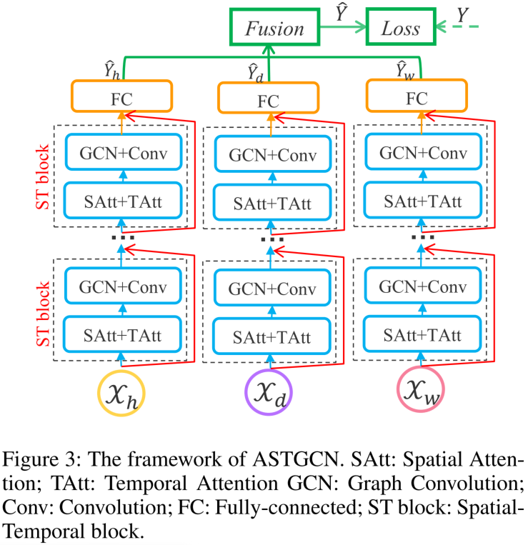
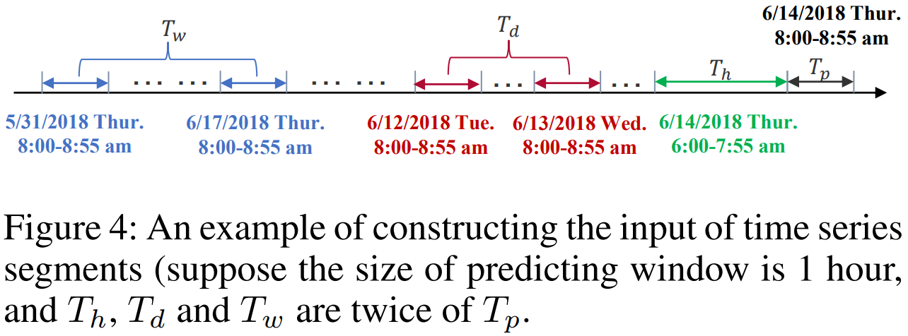
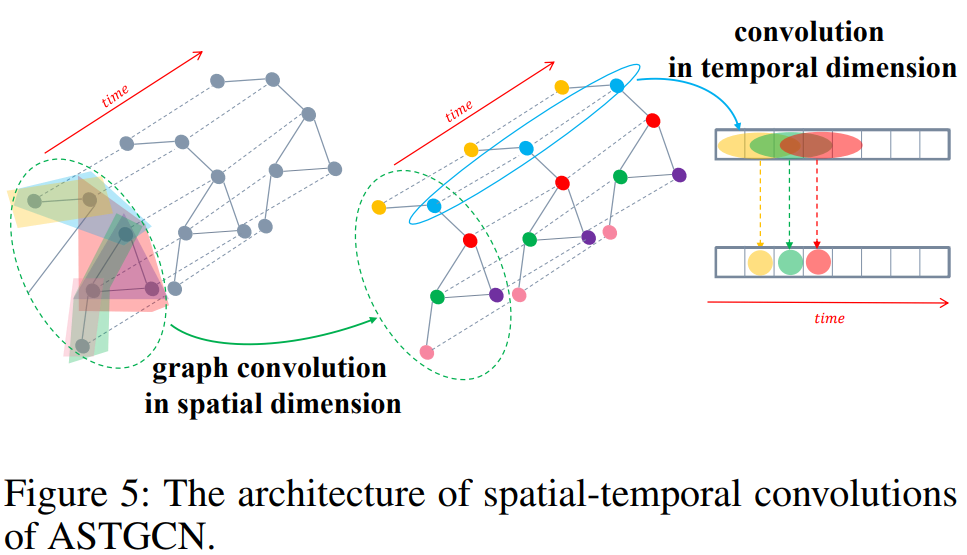
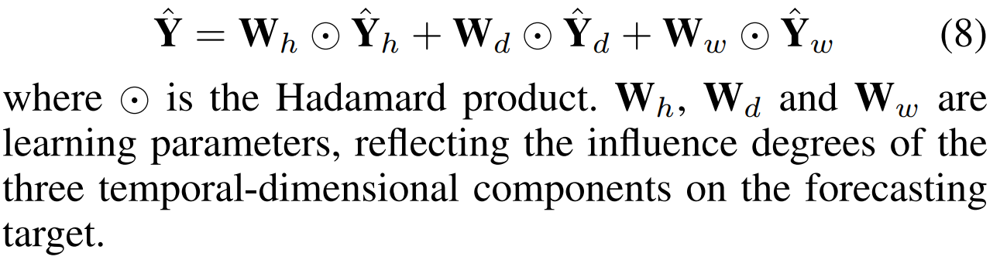
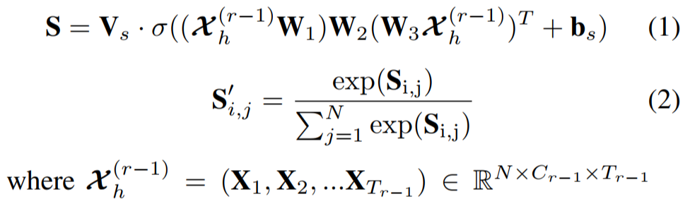
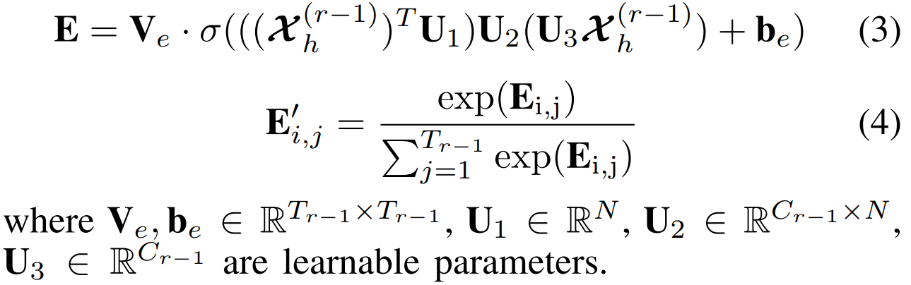
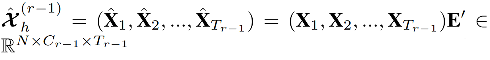
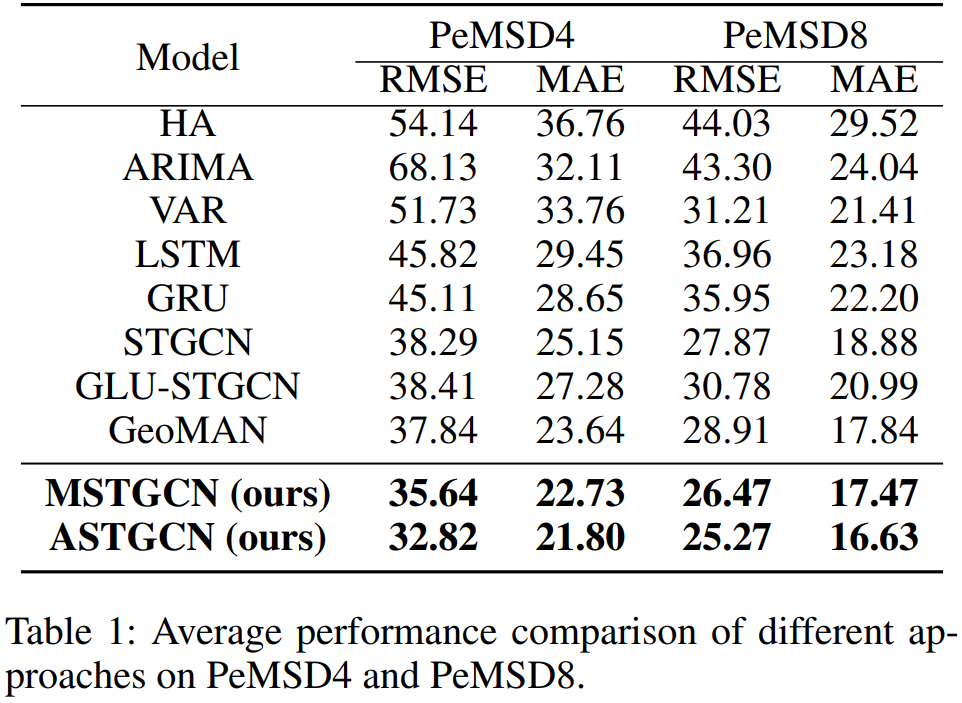
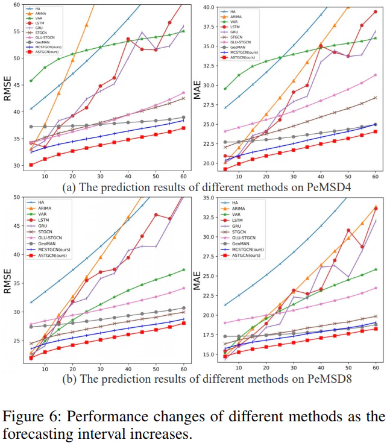
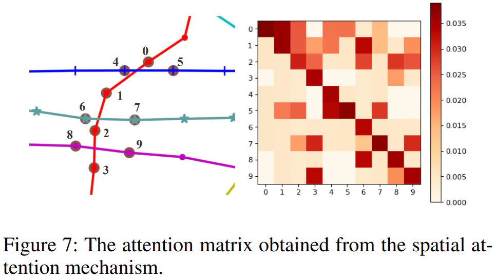

두 번째 graph neural network(GNN)을 활용한 시계열 예측 논문입니다. 제목은 Attention Based Spatial-Temporal Graph Convolutional Networks for Traffic Flow Forecasting입니다.

## Attention Based Spatial-Temporal Graph Convolutional Networks for Traffic Flow Forecasting

- 2019년 7월 17일 publish
- In Proceedings of the AAAI conference on artificial intelligence
- Shengnan Guo, Youfang Lin, Ning Feng, Chao Song, and Huaiyu Wan
- 2022년 8월 7일 기준 citation 수 692회

북경 교통대학교 연구진들의 연구 내용입니다. 주안점 및 과거 연구의 한계, 활용 데이터 및 기타 설정, 인접 행렬 설계, 모델 설계 사항, 모델 내 데이터 차원, 모델 설계 특이점, 결과 및 분석, 결과 특이 사항, 교통 공학적 분석 내용, 의문점 및 느낀점 순으로 정리해보겠습니다.

## 주안점 및 과거 연구의 한계

- 기존 연구들은 동적인 traffic data의 spatio-temporal 한 특징을 파악할 수 없음
- Input이 2D/3D 그리드에 그치는 경우가 많음
- Recent, daily-periodic, weekly-periodic 종속성을 반영하기 위해 세 종속 파트를 결합함
- 각 종속 파트는 spatio-temporal 어텐션 메커니즘과 spatio-temporal convolution(graph convolution) 파트로 구성됨
- Attention based Spatial-Temporal Graph Convolution Network (ASTGCN)를 제시함
- Spatial attention과 temporal attention을 각각 적용하였고, 각 attention을 위한 convolution module을 제작
- 특히 spatial attention을 위해서는 graph convolution을 활용함

## 활용 데이터 및 기타 설정

- PeMSD4 (California Department of Transportation에서 취득): 3848개 수집점(29개 도로), 30초 단위 원시 데이터를 5분 단위로 집계, 속력/교통량/점유율 데이터, 2018년 1월~2월, 첫 50일이 training set, 나머지가 test set
- PeMSD8 (California Department of Transportation에서 취득): 1979개 수집점(8개 도로), 30초 단위 원시 데이터를 5분 단위로 집계, 속력/교통량/점유율 데이터, 2016년 7월~8월, 첫 50일이 training set, 나머지가 test set
- 수집점 사이의 간격이 3.5 miles 이상이 되게 하기 위해서 그보다 작은 거리에 있는 센서는 제외시켰음. PeMSD4에는 307개, PeMSD8에는 170개 데이터 포인트만 남음
- 없는 데이터는 linear interpolation
- Zero-mean normalization ($$x'=x-mean(x)$$)

## 인접 행렬 설계

- 설명 없음. 보통 이런 경우는 거리 반비례로 많이 함

## 모델 설계 사항

- Recent segment, daily-periodic segment, weekly-periodic segment로 구성됨

{: width="657" height="678" }

- 6월 14일의 오전 8:00~8:55의 교통 정보를 예측한다고 하고, 예측 시간의 2배에 해당하는 데이터를 사용한다고 가정. $$T_h$$는 그 직전 2시간, $$T_d$$는 같은 시간대의 2일 전까지의 데이터, $$T_w$$는 같은 시간, 요일의 2주 전까지의 데이터 사용. 참고로 아래 그림의 $$T_w$$에 6월 17일은 오타로 보이며, 실제로는 6월 7일을 표기하고 싶었던 듯

{: width="690" height="256" }

- Residual learning framework 적용함. 대부분의 논문들이 residual learning을 사용하는 것으로 보임
- 같은 시점(time step)에서는 graph convolution, 시간 축으로 전개하는 과정에서는 같은 node끼리 convolution함

{: width="967" height="555" }

- 학습 가능한 가중치와의 Hadamard(element-wise) 곱 및 더하기 연산으로 서로 다른 시간 단위에서 얻어진 feature들을 fusion하였음

{: width="1291" height="336" }

- 제안하는 ASTGCN에서 spatial-temporal attention을 제거하여 낮은 성능을 나타내는 Multi-Component Spatial-Temporal Graph Convolution Networks (MSTGCN)를 같이 비교하였음

## 모델 내 데이터 차원

- \$$G=(V,E,\mathbf{A})$$
- \$$\vert V\vert =N, \space \mathbf{A}\in\mathbb{R}^{N \times N}$$
- $$F$$ = number of features(각 node의 time series 개수), $$C$$ = number of channels(첫 block의 input에서는 $$C_0=F$$), $$\tau$$ = length of time slice
- \$$x_{t}^{c,i} \in \mathbb{R}, \space \mathbf{x}_{t}^{i}\in \mathbb{R}^F, \space \mathbf{X}_{t}=(\mathbf{x}_t^1,\mathbf{x}_t^2, ..., \mathbf{x}_t^N)\in\mathbb{R}^{N \times F}$$
- \$$\mathbf{\chi} = (\mathbf{X}_1,\mathbf{X}_2, ..., \mathbf{X}_\tau)^T \in \mathbb{R}^{N \times F \times \tau}$$
- Traffic flow of node $$i$$ at time $$t$$ in the future $$y_t^i=x_t^{f,i} \in \mathbb{R}$$
- Future traffic flow sequences $$\mathbf{Y} = (\mathbf{y}^1,\mathbf{y}^2,...,\mathbf{y}^N)^T \in \mathbb{R}^{N \times T_p}$$
- Future traffic flow of node $$i$$ from $$\tau+1$$ $$\mathbf{y}^i = (y^i_{\tau+1},y^i_{\tau+2},...,y^i_{\tau+T_p}) \in \mathbb{R}^{T_p}$$
- The recent segment $$\mathbf{\chi}_h = (\mathbf{X}_{t_0-T_h+1},\mathbf{X}_{t_0-T_h+2}, ..., \mathbf{X}_{t_0}) \in \mathbb{R}^{N \times F \times T_h}$$
- 최종 input 차원은 $$\mathbb{R}^{N \times F \times T_x}$$, 여기서 $$x$$는 $$h$$, $$d$$, $$w$$ 중 하나이며, $$T_x$$는 prediction 목표인 $$T_p$$의 정수배
- Spatial attention 부분에서 $$\mathbf{\chi}_h^{(r-1)}$$가 $$r$$th spatial-temporal block의 input일 때

{: width="976" height="282" }

- \$$\mathbf{V}_s,\mathbf{b}_s \in \mathbb{R}^{N \times N}, \space \mathbf{W}_1 \in \mathbb{R}^{T_{r-1}}, \space \mathbf{W}_2 \in \mathbb{R}^{C_{r-1} \times T_{r-1}}, \space \mathbf{W}_3 \in \mathbb{R}^{C_{r-1}}$$
- Spatial attention matrix $$S' \in \mathbb{R}^{N \times N}$$
- Temporal attention 부분은 아래와 같음

{: width="1289" height="404" }

{: width="1278" height="158" }

- 시간 차원 맞추어서 데이터가 나오게 spatial attention과 temporal attention을 설계하였음

## 모델 설계 특이점

- 같은 time step에서는 그래프 내부의 convolution, 다른 timestep 끼리는 temporal convolution 진행. 이제는 일반적인 approach라고 봐야 할듯

## 결과 및 분석

- MSTGCN, ASTGCN 모두 나아진 성능을 보였음. 다만 어떤 식으로 측정하였는지 확인 필요함.

{: width="962" height="703" }

## 결과 특이 사항

- 예측하고자 하는 시간이 현재 time stamp에서 멀수록 error가 증가함. ASTGCN이 증가분이 작은 것을 확인할 수 있음
- 네트워크의 스케일이 큰 PeMSD4에서 더 큰 에러를 보임

{: width="642" height="735" }

## 교통 공학적 분석 내용

- 170개 데이터 포인트를 가진 PeMSD8 데이터 중 10개를 골라서 average spatial attention matrix를 시각화 하였음

{: width="964" height="543" }

## 의문점 및 느낀점

- 시간 차원 맞추어서 데이터가 나오게 spatial attention과 temporal attention을 설계하였는데, 과연 차원만 맞춘다고 그것이 spatial attention 혹은 temporal attention이 되는가? 될 것 같은 생각도 듦. 같은 time stamp 값 사이의 attention을 구한다면, spatial 해질 것이고, 다른 time stamp 값 사이의 attention을 구하면 temporal할 것
- RMSE가 30이 넘어가는데, 그럼 12개 time stamp의 에러를 더한 것인가?
- 위의 Figure 7에서 8번 수집점에 대한 attention value가 가장 큰 것이 2, 3, 9번이 아니라 간접적으로 연결되어 있는 6번인데 그 이유는 무엇인가?
