세 번째 graph neural network(GNN)을 활용한 시계열 예측 논문입니다. 제목은 GMAN: A Graph Multi-Attention Network for Traffic Prediction 입니다.

## GMAN: A Graph Multi-Attention Network for Traffic Prediction

- 2020년 4월 3일 publish
- In Proceedings of the AAAI conference on artificial intelligence
- Chuanpan Zheng, Xiaoliang Fan, Cheng Wang, and Jianzhong Qi
- 2022년 8월 10일 기준 citation 수 342회

샤먼 대학교 연구진들의 연구 내용입니다. (샤먼 대학교는 샤먼시에 위치하는데, 무속인과는 관계가 없습니다. 샤먼은 하문이라는 한자를 중국어로 읽었을 때의 음에 해당합니다.) 주안점 및 과거 연구의 한계, 활용 데이터 및 기타 설정, 인접 행렬 설계, 모델 설계 사항, 모델 내 데이터 차원, 모델 설계 특이점, 결과 및 분석, 결과 특이 사항, 교통 공학적 분석 내용, 의문점 및 느낀점 순으로 정리해보겠습니다.

## 주안점 및 과거 연구의 한계

- Encoder-decoder architecture의 설계
- 과거 연구들과 유사하게 같은 time stamp 안에서는 spatial correlation, 다른 time stamp 끼리는 temporal correlation을 적용함

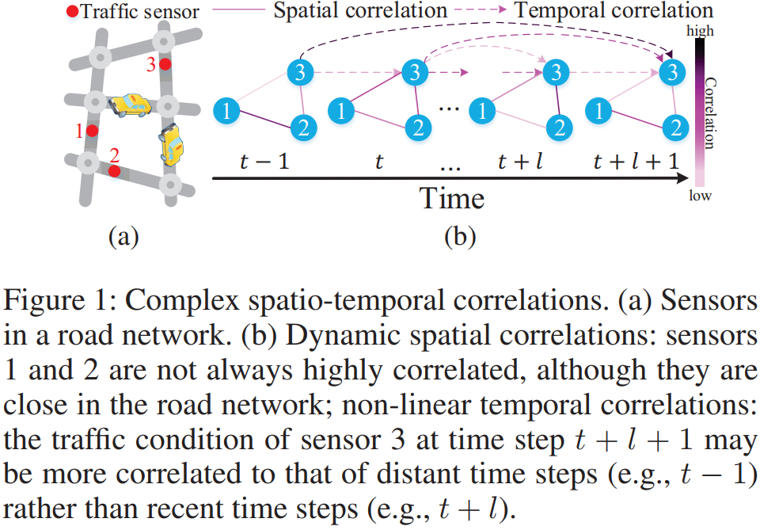{: width="733" height="511" }

- Complex spatio-temporal correlations을 파악하였음. Dynamic spatial correlations은 시간에 따라서 중요도가 높은 센서가 변함. Non-linear temporal correlations은 temporal correlation의 non-linear한 부분을 파악함. 동일 시간에서는 spatial correlation을 보고, 동일 node에 대해서는 temporal correlation을 보는 듯
- Sensitivity to error propagation을 해결함. 현재의 error는 미래에 큰 error로 증폭될 수 있는데, 그 문제를 완화 시킴

## 활용 데이터 및 기타 설정

- Xiamen dataset (Wang et al. 2017): 95개 수집점, 교통량 데이터, 5분 단위 집계, 2015년 8월 1일~2015년 12월 31일
- PeMS dataset (Li et al. 2018b): 325개 수집점, 속도 데이터, 5분 단위 집계, 2017년 1월 1일~ 2017년 6월 30일
- Z-score method로 normalize
- 70% training, 10% validation, 20% testing
- 1시간 데이터로 그 다음 1시간 예측
- Adam optimizer, learning rate = 0.001, Xiamen data는 19개/PeMS data는 37개의 그룹으로 계산
- Attention block 수 $$L=3$$, Attention head 수 $$K=8$$, 그리고 각 head의 차원 $$d=8$$ ($$D=64$$)

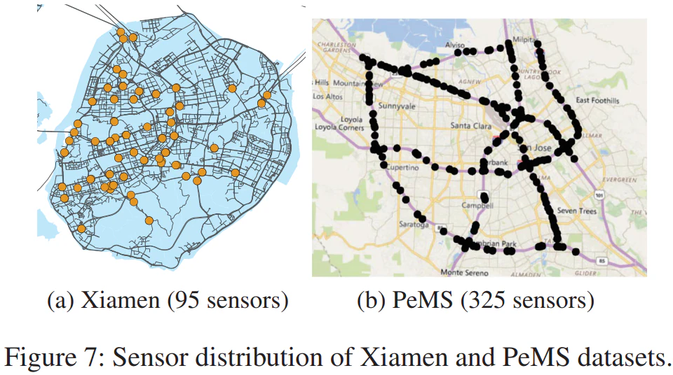{: width="744" height="415" }

## 인접 행렬 설계

- 거리 기반으로 인접행렬 설계하였음
- The adjacency matrix represents the proximity (measured by the road network distance) between vertex $$v_i$$ and $$v_j$$.

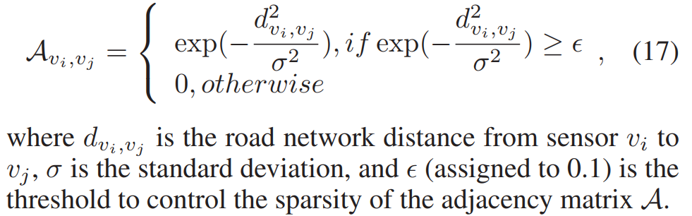{: width="738" height="230" }

## 모델 설계 사항

- 아래 Figure 2(a)는 GMAN의 전체 framework, Figure 2(b)는 Spatio-Temporal Embedding(STE), Figure 2(c)는 ST-Attention Block의 모습임
- STE는 그래프 $$G$$와 시간 $$t_1, ..., t_P, ..., t_{P+Q}$$를 input으로 받음. 그래프 구조 자체와 시간의 time stamp를 input으로 받는듯. 여기서 만들어진 embedding은 element-wise합이 되어서 각 block에 쓰임
- ST-Attention Block은 전 ST-Attention Block의 $$H^{(l-1)}$$을 input으로 받아서 각각 Spatial Attention과 Temporal Attention으로 전달함. 그 이후에 Gated Fusion을 거쳐 $$H^{(l)}$$ 생성

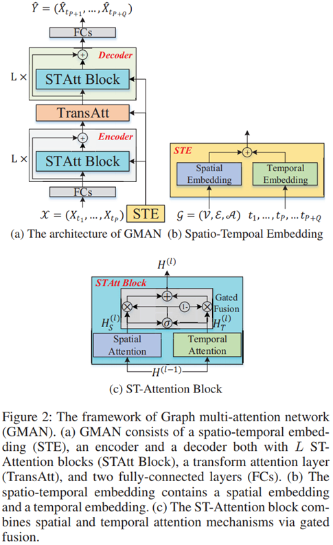{: width="557" height="911" }

- Spatial Embedding: Spatio-Temporal Embedding에서는 [여기서](/posts/CS224w-03-Node-Embeddings/) 소개한 적 있는 node2vec을 기반으로 spatial embedding을 진행함. 그 결과물을 2-layer FC에 넣어서 spatial embedding $$e^{S}_{v_{i}} \in \mathbb{R}^{D}$$ where $$v_{i} \in V$$를 얻음. (여기서 S는 단순히 spatial이라는 것을 나타내기 위해 붙인 첨자)
- Temporal Embedding: 조금 특이하게, 이 모델에서는 시간 자체를 embedding함. (propose a temporal embedding to encode each time step into a vector). 일주일에 요일이 7개고, 하루를 5분으로 쪼개면 288개니까 $$\mathbb{R}^{7}$$ 차원의 벡터랑 $$\mathbb{R}^{288}$$ 차원의 벡터 concatenate해서 $$\mathbb{R}^{295}$$ 차원 벡터를 얻음. 그리고 그 $$\mathbb{R}^{295}$$ 차원 벡터를 2-layer FC에 넣어서 $$\mathbb{R}^{D}$$를 얻음. Historical(input) 시간이 $$P$$이고, future(output) 시간이 $$Q$$일 때, 결론적으로 $$e^{T}_{t_{j}} \in \mathbb{R}^{D}$$ where $$t_{j}=t_{1},...,t_{P},...,t_{P+Q}$$. 마찬가지로 $$T$$는 temporal의 T
- STE는 spatial embedding과 temporal embedding을 element-wise로 더하여 $$e_{v_{i},t_{j}}= e^{S}_{v_{i}}+e^{T}_{t_{j}}$$로 함. 이때 $$e_{v_{i},t_{j}} \in E, \space E \in \mathbb{R}^{(P+Q) \times N \times D}$$
- ST-Attention Block의 input $$H^{(l-1)}$$에는 node(vertex) $$v_i$$의 시간 time step $$t_j$$에 대한 $$h_{v_{i},t_{j}}^{(l-1)}$$가 있고, $$h_{v_{i},t_{j}}^{(l-1)} \in H^{(l-1)}$$. Spatial attention의 output $$H_{S}^{(l)}$$, Temporal attention의 output $$H_{T}^{(l)}$$. Node(vertex) $$v_i$$의 시간 time step $$t_j$$에 대한 hidden state는 spatial attention에서 $$hs_{v_{i},t_{j}}^{(l)}$$, temporal attention에서 $$ht_{v_{i},t_{j}}^{(l)}$$

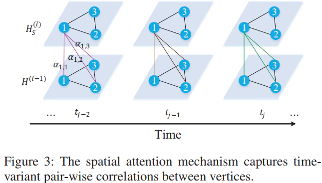{: width="645" height="367" }

- Spatial Attention: $$hs_{v_{i},t_{j}}^{(l)}= \sum_{v \in V} \alpha_{v_i, v} \cdot h_{v, t_j}^{(l-1)}, \space \sum_{v \in V}\alpha_{v_i, v}=1$$, 여기서 $$\alpha_{v_i, v}$$는 $$v_i$$에게 $$v$$가 얼마나 중요한지를 나타냄. 위 식이 equation 2에 해당함

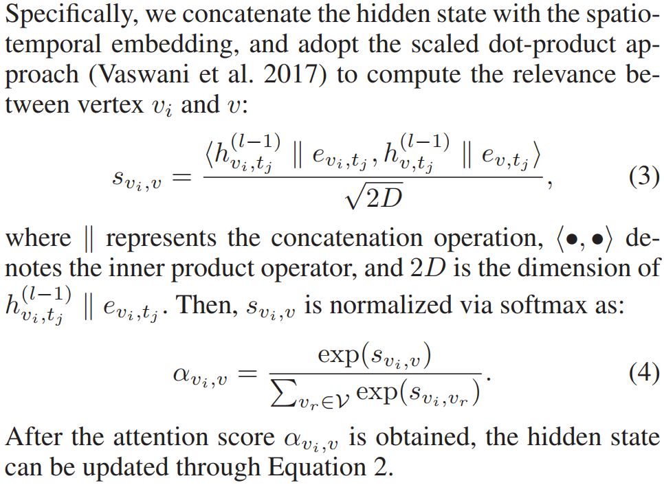{: width="671" height="490" }

- Non-linear transformation을 아래와 같이 정의하고, multi-head attention으로 전체 과정을 stabilize함. 위의 equation 3, equation 4와 다른 점은 multi-head attention 여부와 non-linear transformation의 여부

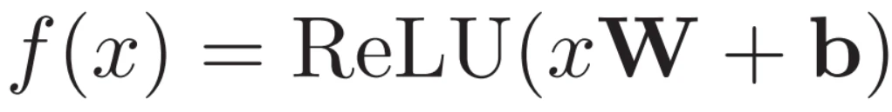{: width="370" height="47" }

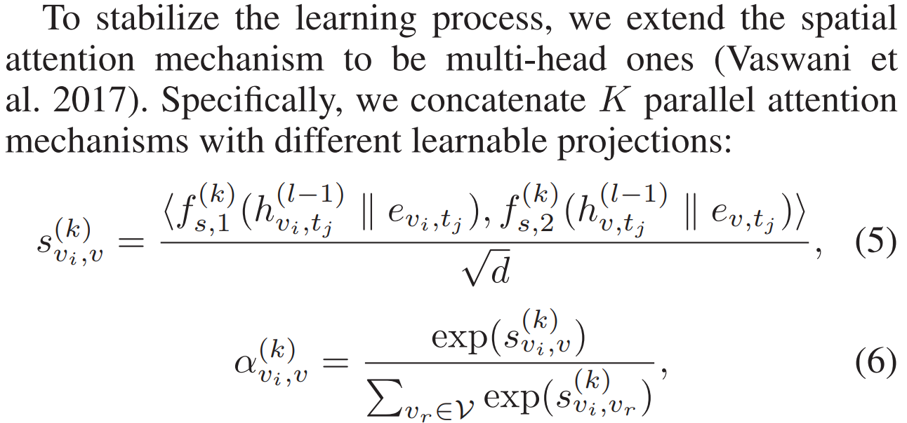{: width="680" height="318" }

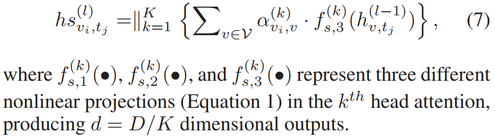{: width="687" height="193" }

- Temporal Attention: 전 time step의 feature가 뒤에도 영향을 미칠 수 있도록 모델이 설계되었음. 이때에도 마찬가지로 attention mechanism이 포함됨

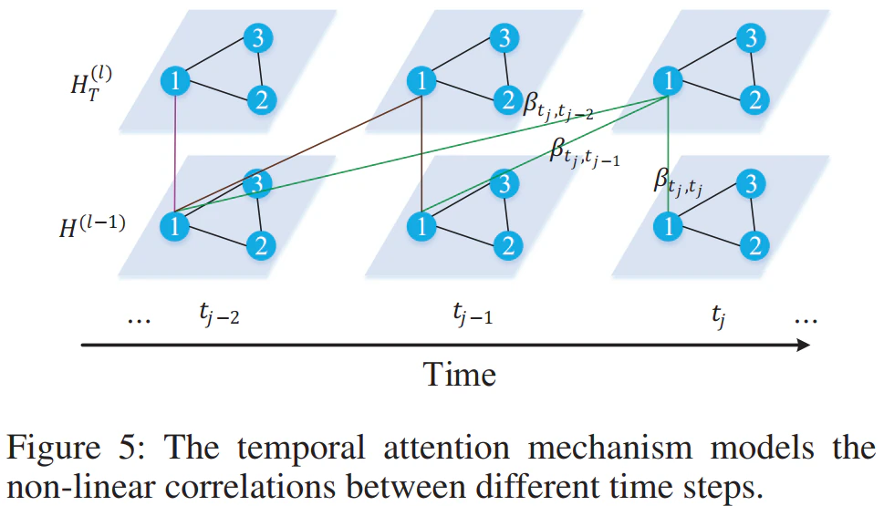{: width="727" height="416" }

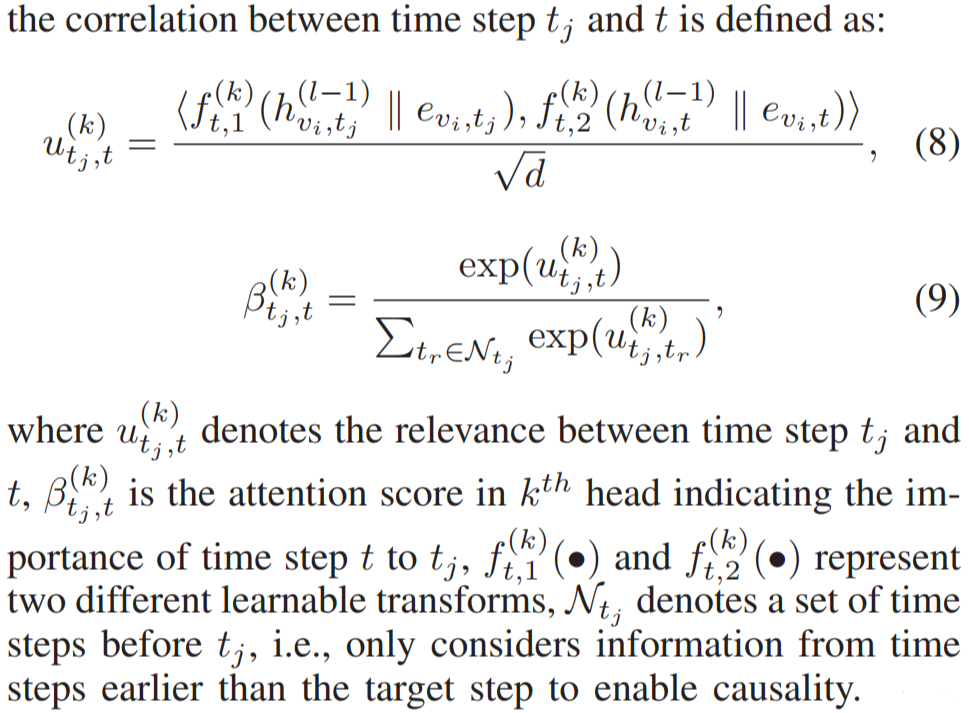{: width="730" height="537" }

- 최종적으로 얻어지는 $$ht_{v_{i},t_{j}}^{(l)}$$는 아래와 같음

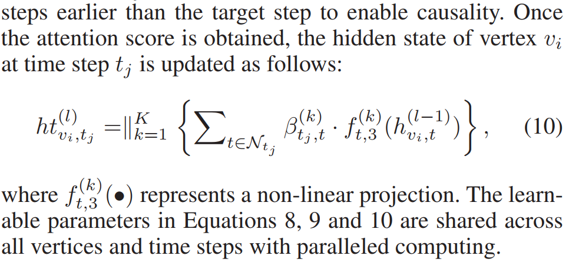{: width="721" height="332" }

- Spatial attention과 temporal attention은 연산 적용 대상은 다르지만 같은 연산 과정을 가짐. STE의 결과물과 전 layer의 hidden embedding을 concat하고, 이를 non-linear를 포함하는 FC에 통과시키고, 목적하는 node(혹은 time step)와 내적하여 값(energy)을 얻어냄. 그 값을 마치 transformer의 energy처럼 softmax 시킨 것을 attention value로 하여서 $$(l)$$ layer의 embedding을 구함
- Gated Fusion: 쉽게 말하면 spatial한 feature와 temporal한 feature 사이에 가중치를 둔 것인데, 그냥 두지 않았음. 세개의 learnable parameter를 가지고 그 가중치를 학습하게 했음

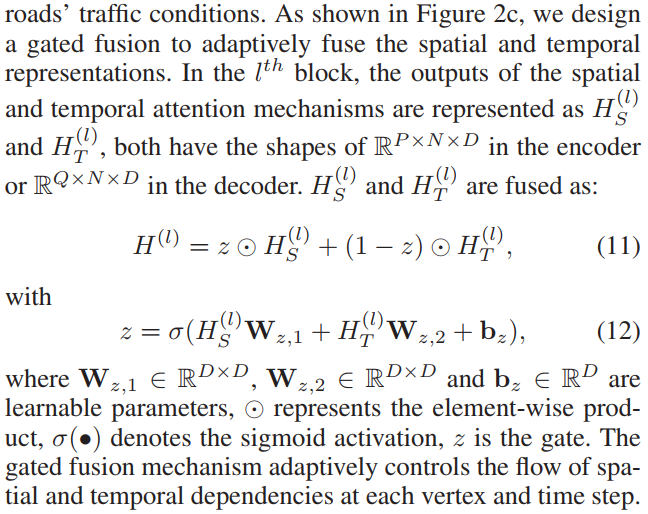{: width="710" height="563" }

- Transform Attention: 매 future time step($$t_j = t_{P+1}, ..., t_{P+Q}$$)과 모든 historical time step($$t=t_1, ..., t_P$$)의 관계를 고려함. 결국 여기서도 또 어텐션이 활용됨. 리뷰어 의견을 원천 차단하려고 관계가 있는거는 모조리 어텐션을 쓴 것 같음

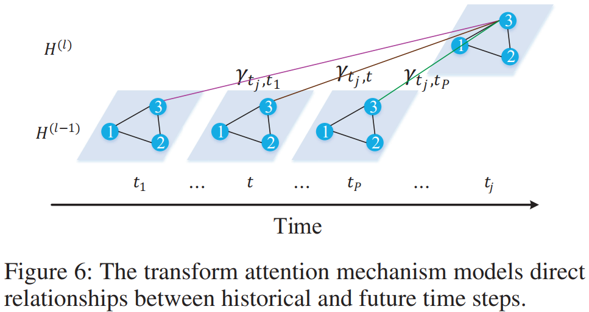{: width="709" height="376" }

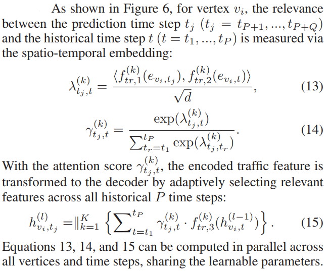{: width="710" height="589" }

- Encoder-Decoder: Minor한 부분을 제외하고, 크게 보자면 전체 과정은 다음과 같음. Encoder에 들어가기 전, historical observation $$\mathbf{\chi} \in \mathbb{R}^{P \times N \times C}$$는 FC를 통해서 $$H^{(0)} \in \mathbb{R}^{P \times N \times D}$$로 변환됨. $$L$$번째 layer에서도 $$H^{(L)} \in \mathbb{R}^{P \times N \times D}$$가 유지됨. Transform attention에서 $$H^{(L+1)} \in \mathbb{R}^{Q \times N \times D}$$로 바뀌며, decoder의 마지막까지 $$H^{(2L+1)} \in \mathbb{R}^{Q \times N \times D}$$ 차원으로 감. 마지막 FC layer에서 $$\hat{Y} \in \mathbb{R}^{Q \times N \times C}$$로 종결되며, loss는 MAE loss를 사용함

## 모델 내 데이터 차원

- \$$G=(V,E,\mathbf{A})$$
- \$$\vert V\vert =N, \space \mathbf{A}\in\mathbb{R}^{N \times N}$$
- $$C$$ = number of features, Traffic condition at time step $$t$$은 graph signal $$\mathbf{X}_{t} \in \mathbb{R}^{N \times C}$$
- Historical $$P$$ time steps $$\mathbf{\chi} = (\mathbf{X}_{t_1},\mathbf{X}_{t_2}, ..., \mathbf{X}_{t_P}) \in \mathbb{R}^{P \times N \times C}$$
- Predictions of next $$Q$$ time steps $$\hat{\mathbf{Y}} = (\hat{\mathbf{X}}_{t_{P+1}},\hat{\mathbf{X}}_{t_{P+2}}, ..., \hat{\mathbf{X}}_{t_{P+Q}}) \in \mathbb{R}^{Q \times N \times C}$$
- Spatial embedding $$e^{S}_{v_{i}} \in \mathbb{R}^{D}$$ where $$v_{i} \in V$$
- Temporal embedding $$e^{T}_{t_{j}} \in \mathbb{R}^{D}$$ where $$t_{j}=t_{1},...,t_{P},...,t_{P+Q}$$
- STE $$e_{v_{i},t_{j}} \in E, \space E \in \mathbb{R}^{(P+Q) \times N \times D}$$
- \$$h_{v_{i},t_{j}}^{(l-1)} \in H^{(l-1)}$$
- Historical observation $$\mathbf{\chi} \in \mathbb{R}^{P \times N \times C}$$ $$\to$$ FC $$\to$$ $$H^{(0)} \in \mathbb{R}^{P \times N \times D}$$ $$\to$$ Encoder $$H^{(L)} \in \mathbb{R}^{P \times N \times D}$$ $$\to$$ Transform Attention $$H^{(L+1)} \in \mathbb{R}^{Q \times N \times D}$$ $$\to$$ Decoder $$H^{(2L+1)} \in \mathbb{R}^{Q \times N \times D}$$ $$\to$$ FC $$\to$$ $$\hat{Y} \in \mathbb{R}^{Q \times N \times C}$$

## 모델 설계 특이점

- Temporal Embedding에서 시간 자체를 embedding하는데, (propose a temporal embedding to encode each time step into a vector) 시간 embedding 과정을 세세하게 보여준 논문은 드문듯
- Attention을 n개 node에 대해서 다 하면 n-by-n으로 연산량 너무 높으니까, group을 지어 연산하기도 하였다. Intra-group spatial attention을 구하고, max-pooling한 이후 inter-group spatial attention을 구했음. 다만 이 max-pooling이 무엇을 기준으로 했는지 확실하지 않음. $$h_{v_{i},t_{j}}^{(l-1)}$$ value를 기반으로 했다고 생각함

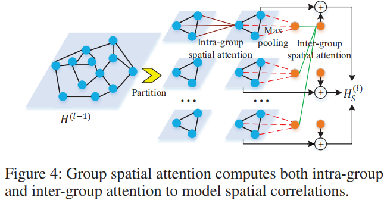{: width="645" height="336" }

## 결과 및 분석

- 먼 시간 간격을 두고 있는 문제에 대해서 좋은 성능을 보임

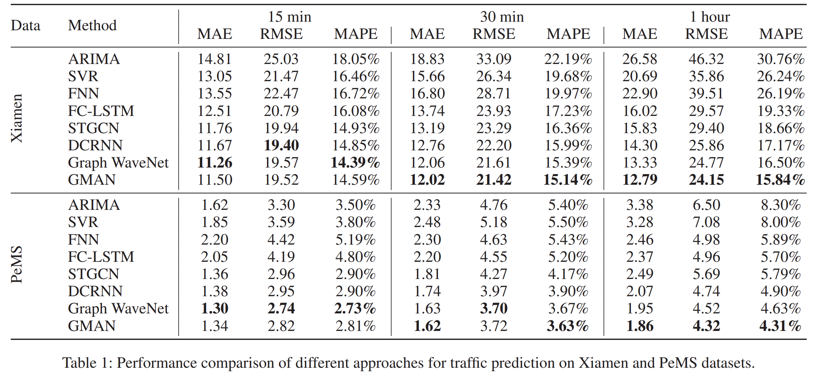{: width="2357" height="1093" }

## 결과 특이 사항

- 예측 시간이 멀때 더 좋은 결과를 보임. 해당 결과는 T-test로 입증 (하지만 test set이 충분히 커서 작은 차이도 통계적으로 유의하게 나올 여지가 있을듯)
- 10~90% 비율로 random하게 0을 집어넣었음. 이때의 결과는 GMAN이 가장 좋음. Xiamen시 data에서 fault-ratio 50%까지 MAE 약 25 수준으로 버팀. PeMS는 훨씬 잘 버팀

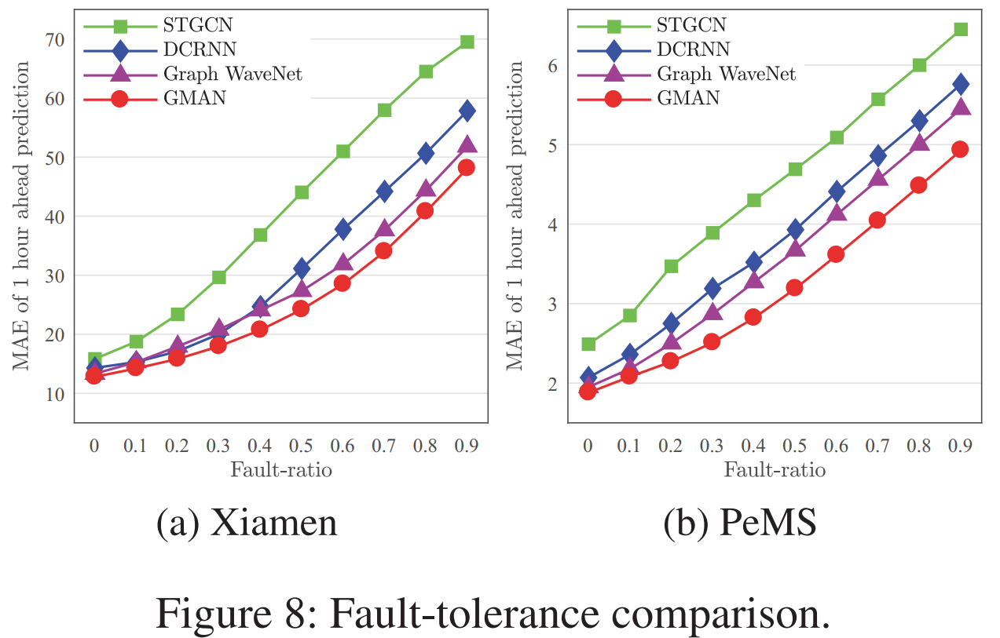{: width="611" height="390" }

- 각 모듈의 효과를 평가하기 위해 모듈의 구성 요소를 제외하였을 때의 효과를 평가하였음. 당연히 모든 요소가 다 있는 것이 잘 되고, non-gated fusion, non-transform attention, non-temporal attention, non-spatial attention 순으로 모델이 안 좋아짐. Spatial attention이 의미가 있다는 점이 중요한 대목인듯 (Xiamen 데이터 기준. PeMS는 구분이 어려움)

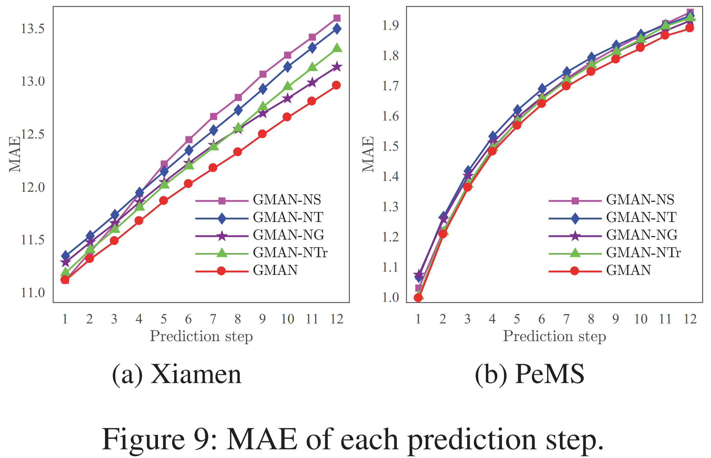{: width="1976" height="1273" }

## 교통 공학적 분석 내용

- 시간 간격이 멀리 떨어진 데이터를 예측하면 application 측면에서 이득이 많다고 주장함
- 교통 상황에서 결측이 발생하는 경우가 있을 수 있음. 이런 경우를 모사하기 위한 노력을 하고, 모델의 robustness를 측정함

## 의문점 및 느낀점

- Spatial Embedding과 Temporal Embedding을 단순히 더하는 것으로 모델이 STE 내부의 spatial한 특성과 temporal한 특성을 잘 파악할까? Transformer에서 positional encoding을 embedding에 더한 것에서 착안한 것 같은데, 지금도 왜 되는지 신기한 면이 있음
- 무거운 모델임. Spatial/Temporal/Transform 세 요소에 모두 어텐션을 활용했음. 애초에 softmax 계산이 그렇게 쉬운 계산이 아님. 단순하게 가는 법이 없고 최소한 1개의 FC layer는 포함하여 parameter를 결정함
- 엄밀히 말하면, 이 모델은 GCN과는 거리가 있음. Adjacency matrix를 기반으로 message passing을 하는 기존 scheme과 다르게 spatial embedding을 구하고, SE를 다른 node feature embedding에 concat해서 활용하기 때문
