[DIYA](https://blog.diyaml.com/)에서 리뷰했던 \"Distilling the Knowledge in a Neural Network\" 요약 및 설명입니다. Knowledge distillation이라는 분야를 창시한 논문이라고 할 수 있습니다. (다만 큰 모델의 지식을 작은 모델로 옮긴다는 아이디어 자체는 [Buciluǎ et al. KDD 2006](https://doi.org/10.1145/1150402.1150464)에서 먼저 제안되었습니다.) 2015년 논문이며 [Geoffrey Hinton](https://scholar.google.com/citations?user=JicYPdAAAAAJ&hl=en&oi=ao), [Oriol Vinyals](https://scholar.google.com/citations?user=NkzyCvUAAAAJ&hl=en&oi=ao), 그리고 [Jeff Dean](https://scholar.google.com/citations?hl=en&user=NMS69lQAAAAJ)이 저자로 참여했습니다. 2022년 5월 12일 당시 인용수는 9,689건입니다.

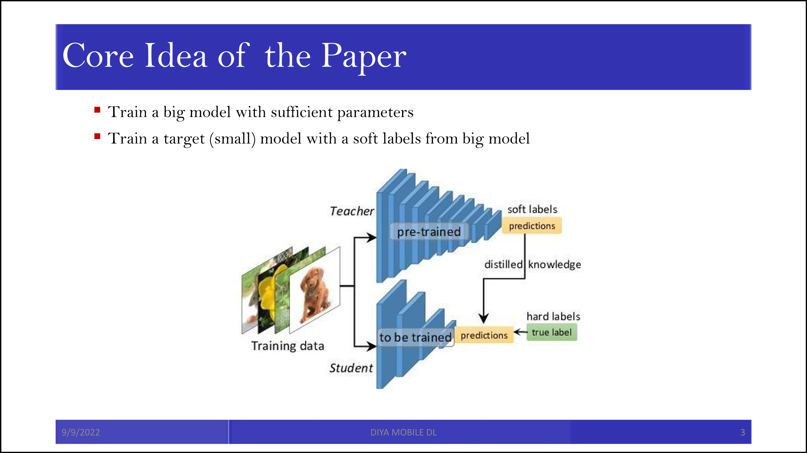{: width="4000" height="2250" }

논문의 core idea는 간단합니다. 크고 무거운 teacher network의 지식을 비교적 적은 수의 parameter를 갖는 student network로 옮기는 것입니다. Student network를 훈련시킬 때 기존 training dataset의 hard label(one-hot encoding 된 ground truth)과 teacher network의 soft label을 함께 활용합니다.

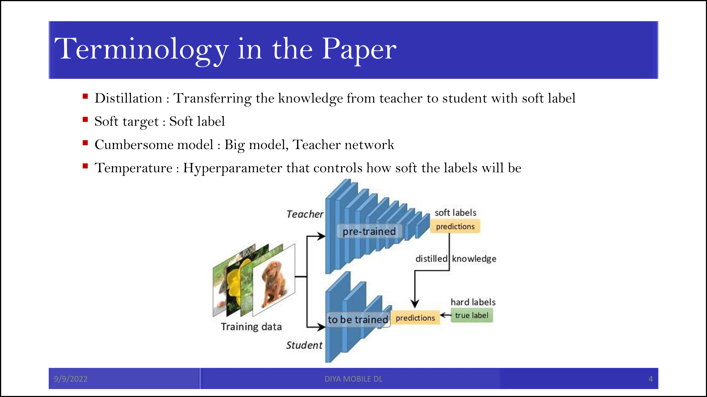{: width="4000" height="2250" }

위 논문에서 distillation이라는 단어는 soft label을 활용하여 teacher network에서 student network로 knowledge를 전달하는 과정을 의미합니다. Soft target은 soft label과 같은 의미이며, cumbersome model이 우리가 흔히 알고 있는 big model, teacher network라는 의미로 사용되었습니다. Temperature는 soft label을 soft 하게 하는 수준을 결정하는 hyperparameter입니다.

이 논문에서는 ensemble 기법을 모델의 robust 한 성능을 위한 중요 요소로 이야기합니다. 여러 dropout을 거치며 훈련된 big model이 dropout 모델들의 ensemble과 같다는 주장을 합니다.

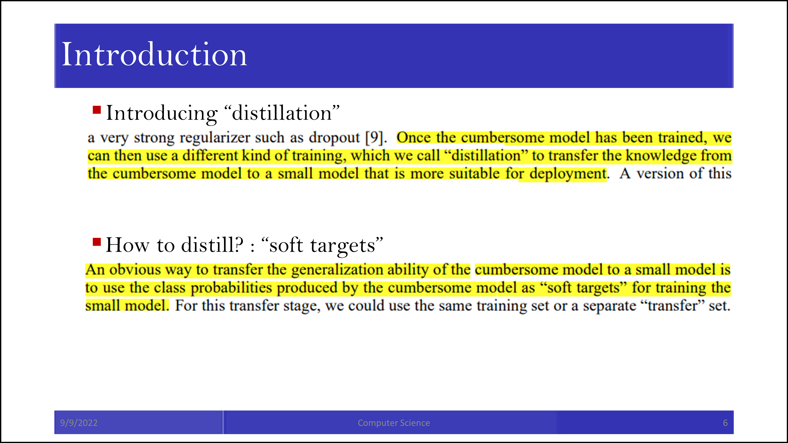{: width="4000" height="2250" }

각각 distillation과 distillation을 하는 방법인 soft target(soft label)을 소개하는 부분입니다.

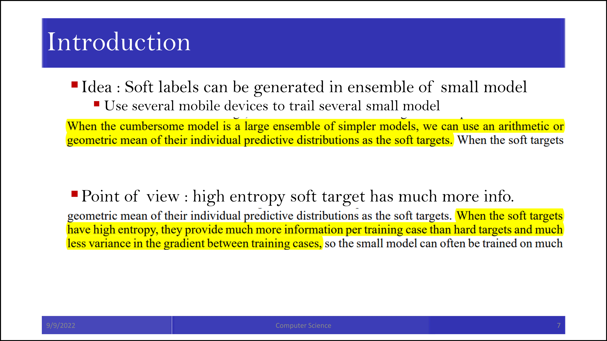{: width="4000" height="2250" }

만약 cumbersome model이 더 작은 모델들의 ensemble이라면 cumbersome model의 output 자체를 target으로 활용할 수 있을 것입니다. 그리고 entropy가 높은 label은 (MNIST의 경우 10개 label에 대해서 유사한 prediction score를 갖는 label) 그만큼 많은 정보를 갖고 있다고 말할 수 있습니다. 확실하지 않으니 옳지 않은 label이라고 보는 일반적인 시각과 대조적입니다.

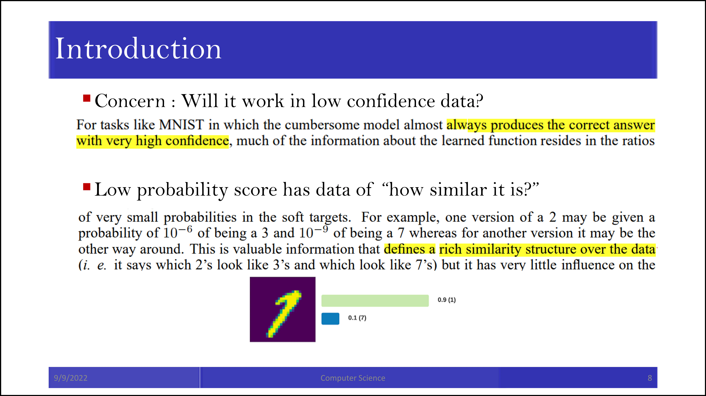{: width="4000" height="2250" }

MNIST 같은 dataset에서는 잘 작동할 수 있습니다. 하지만 특정 label에 대한 신뢰도가 떨어지는 dataset의 경우에도 잘 작동할지는 의문입니다. (Adversarial attack과 knowledge distillation의 관계를 다룬 논문이 있었던 것으로 기억합니다.)

정답 label이 아닌 다른 label에 대해서도 높은 score를 주었다면 그 나름대로의 이유가 있을 것입니다. 이 score는 structural similarity에 대한 정보를 담게 됩니다. 오답 label에서도 그 의미를 찾는, 마치 가능성 높지만 아직 논리 준비가 안된 학생의 연구를 바라보는 대가와 같은 시선을 보이고 있습니다.

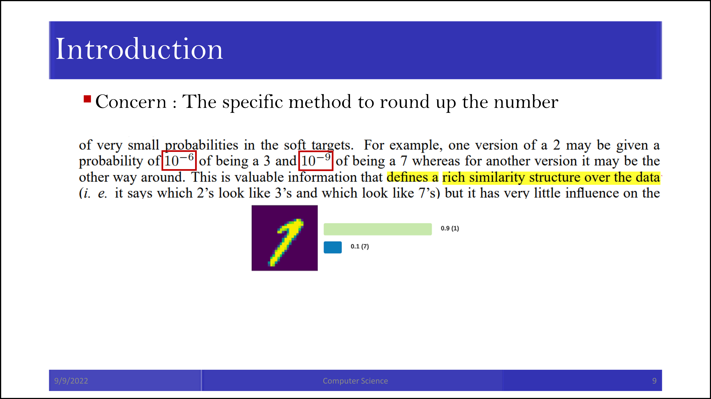{: width="4000" height="2250" }

하지만 다른 숫자를 나타내는 확률이 너무 작다면 정보 전달로서는 의미가 떨어질 수 있습니다. 그래서 아마 temperature를 활용한 smoothing이 등장하는 것 같습니다.

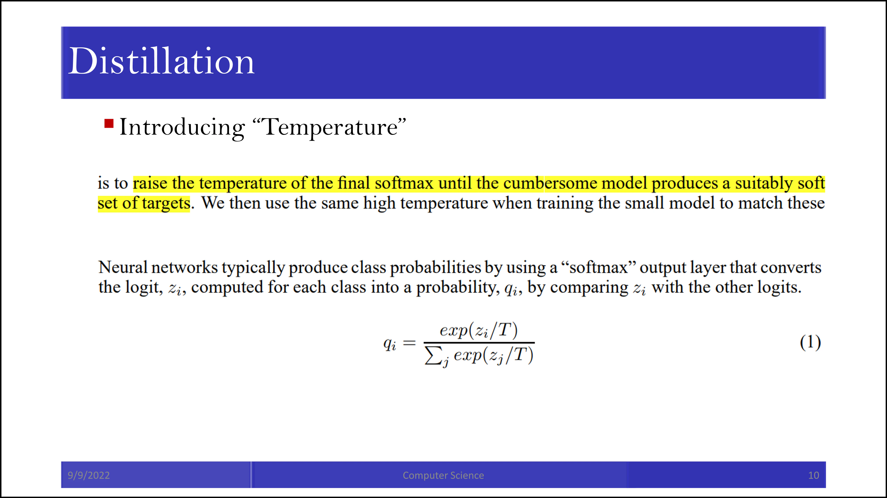{: width="4000" height="2250" }

기존에 얻어진 probability를 그대로 활용하는 대신, logit을 temperature로 나눈 이후의 exponential 연산을 통해 한번 더 smoothing을 했습니다. 높은 temperature는 보다 높은 smoothing(낮은 probability를 갖는 label에도 높은 probability를 다시 부여)을 만듭니다.

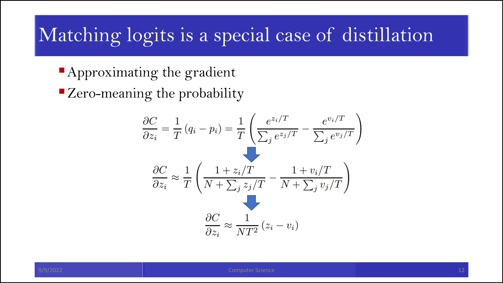{: width="4000" height="2250" }

이때 temperature가 logit의 크기보다 충분히 크다고 보고(logit의 평균은 0으로 가정) gradient에 근사를 취해주면, gradient가 teacher와 student의 logit 차이에 비례하게 됩니다. 즉 높은 temperature에서는 distillation이 logit을 직접 맞추는 방법(matching logits)과 같아집니다.

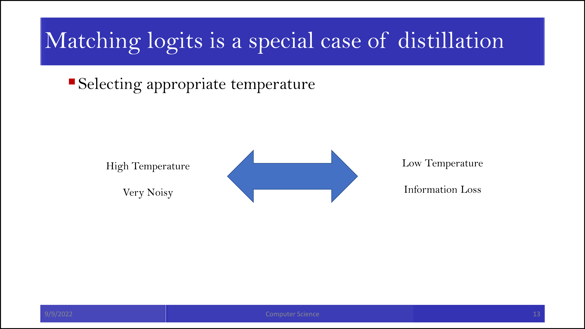{: width="4000" height="2250" }

만약 높은 temperature를 고른다면 전체적으로 probability가 퍼지면서 noisy 한 label로 학습해야 할 것입니다. 그와 반대로 low temperature로 학습을 진행하면 soft label에 들어있는 소중한 정보들을 잃게 됩니다. 이 사이에서 밸런스를 찾는 것이 중요하겠습니다.

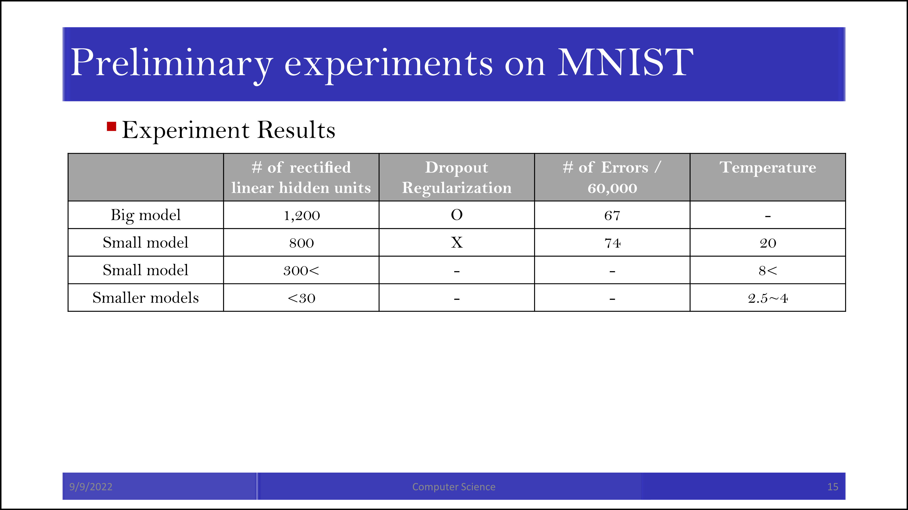{: width="4000" height="2250" }

논문에서는 표로 정리되어 있지 않고 줄글로 정리되어 있는 결과입니다. Smaller model에서도 big model과 비슷한 효과를 얻었다고 합니다.

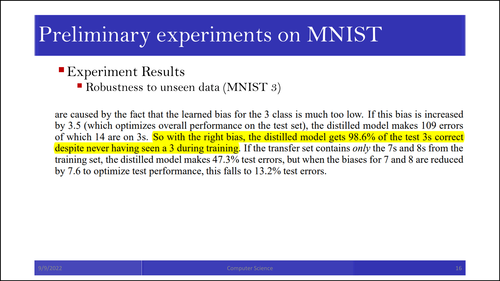{: width="4000" height="2250" }

Soft label을 사용한 경우 3을 제외하고 학습을 시켜도, 3 class의 bias를 3.5만큼 올려 주면 3에 대한 정답률이 98.6%로 나타났다고 합니다(bias를 올리기 전에는 약 87%). Soft label에서 일부 정보가 전달된 결과로 보입니다. (예를 들어 5가 3과 비슷하게 보였다면, 5에 0.7, 3에 0.3의 probability가 부여되는 식으로 3에 대한 학습을 간접적으로 수행할 수 있습니다.)

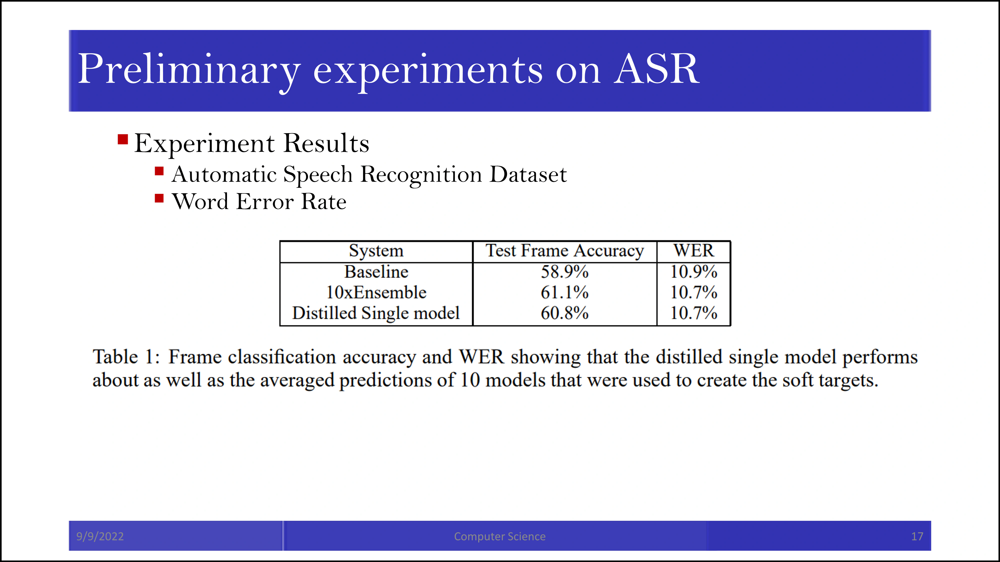{: width="4000" height="2250" }

MNIST 외에 다른 dataset에 대해서도 시도해본 결과 ensemble 모델과도 거의 유사한 효과가 나왔습니다. Soft label이 ensemble의 효과를 전달하도록 하는 것이 이 논문의 중요한 포인트 중 하나입니다.

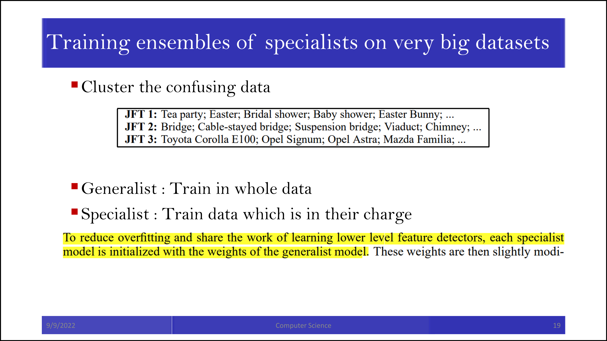{: width="4000" height="2250" }

뒤의 내용은 ensemble의 중요성을 피력하는 내용입니다. 모든 label에 대해 학습된 generalist 모델과 서로 헷갈리기 쉬운 class들의 묶음(confusable subset)만 담당하는 specialist 모델을 함께 활용할 때 성능의 증가가 발생합니다.

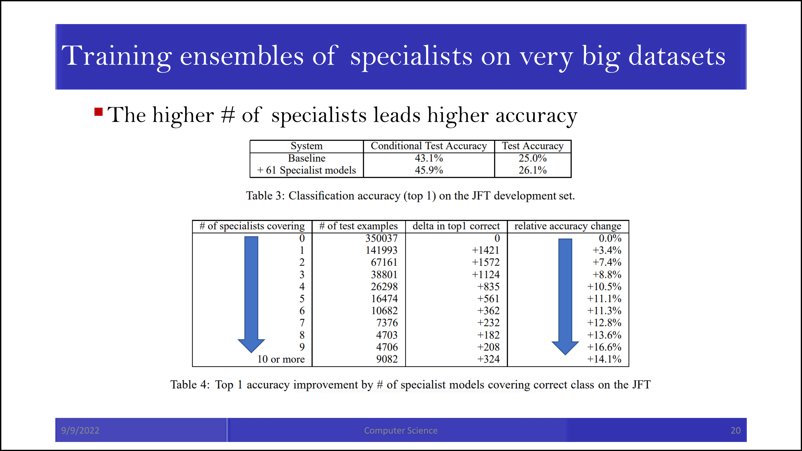{: width="4000" height="2250" }

Specialist 모델들이 cover 해주는 정도가 높아질수록 accuracy가 함께 증가합니다.

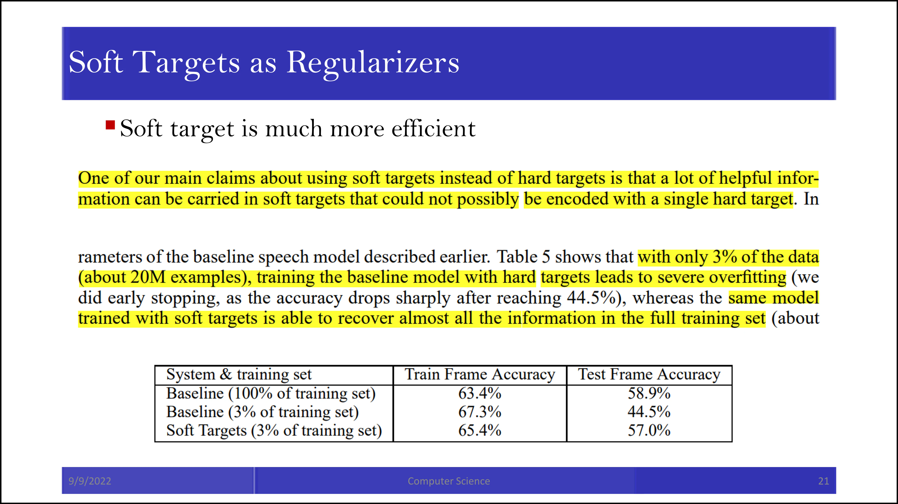{: width="4000" height="2250" }

하지만 결국 이 논문의 가장 중요한 점은 soft label을 통한 knowledge distillation입니다. Soft label을 활용하면 데이터의 3%만 활용해도 꽤 높은 정확도를 얻을 수 있습니다.

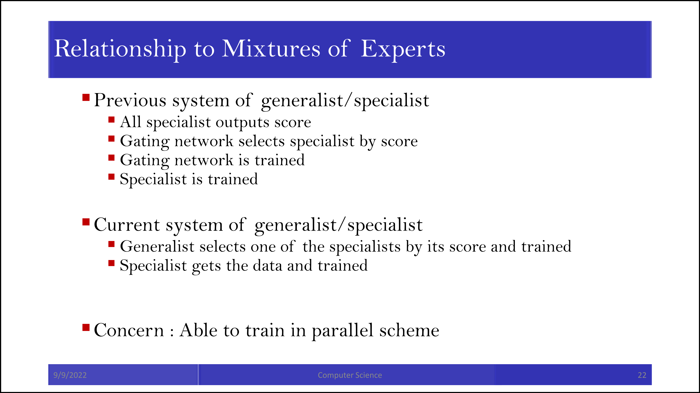{: width="4000" height="2250" }

본 논문에서 제안한 generalist/specialist 시스템은 generalist의 예측을 바탕으로 각 specialist가 맡을 class 묶음을 미리 정해 두고 specialist들을 서로 독립적으로 학습시키며, 추론 시에는 generalist의 예측에 따라 사용할 specialist를 고릅니다. Generalist가 먼저 데이터를 3이라고 분류한 이후, 3을 판별하는 specialist에게 데이터를 보내는 식입니다. 이런 scheme은 기존의 generalist/specialist score를 기반으로 다른 gating network를 학습시키는 scheme에 비해 빠르고 parallel 한 training을 가능하게 합니다.
