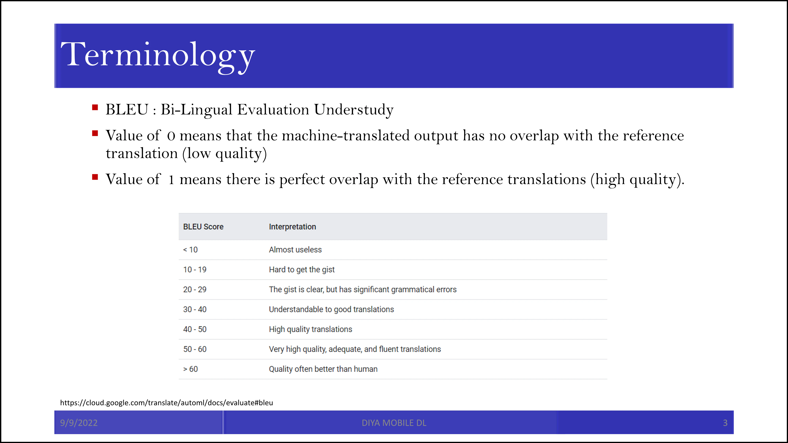
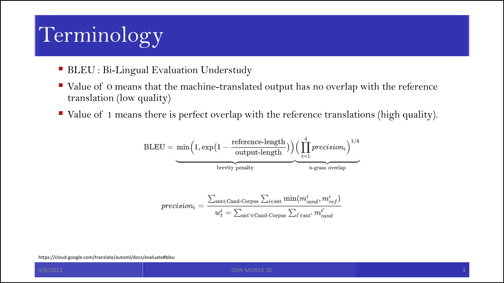
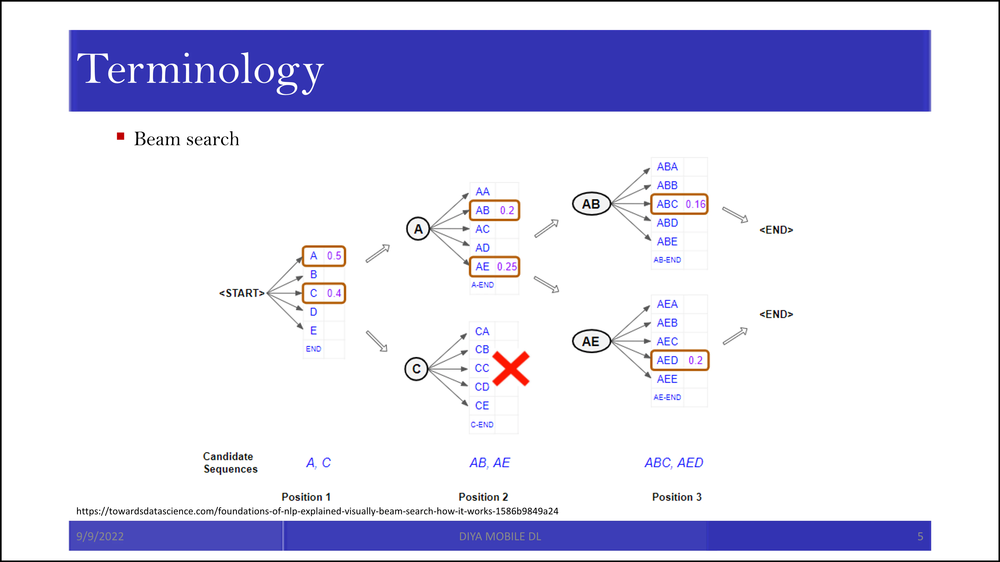
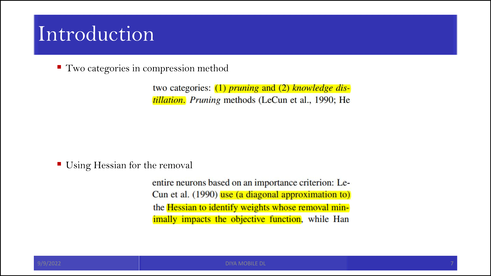
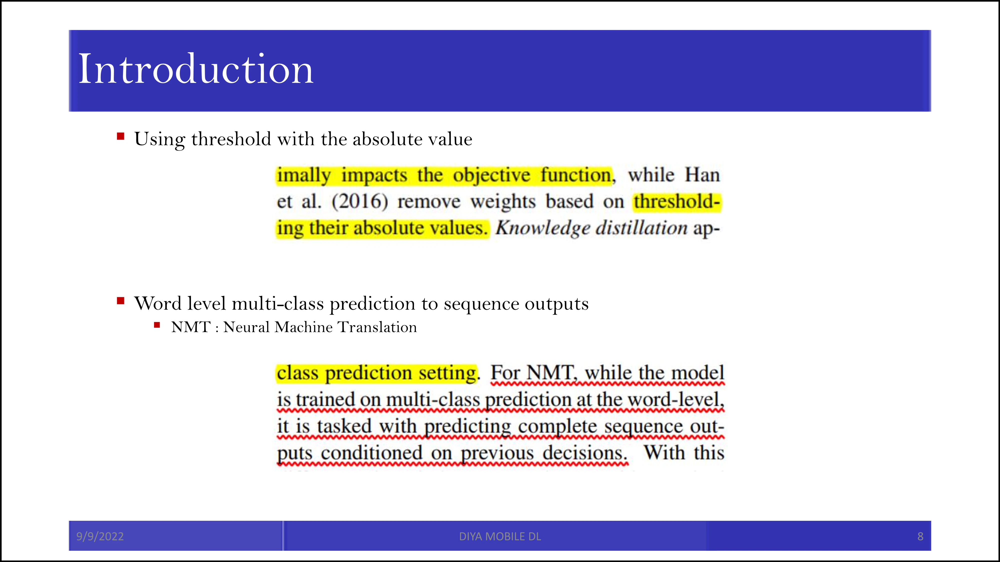
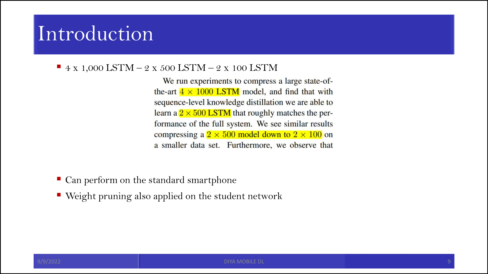
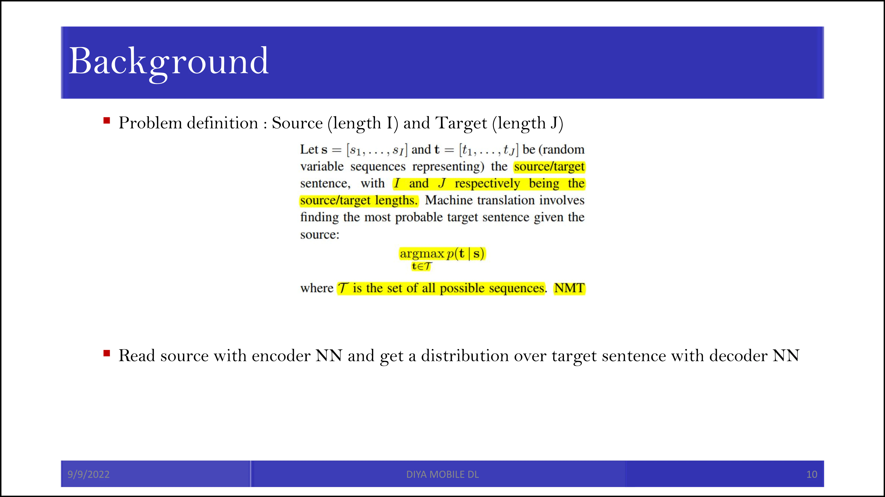
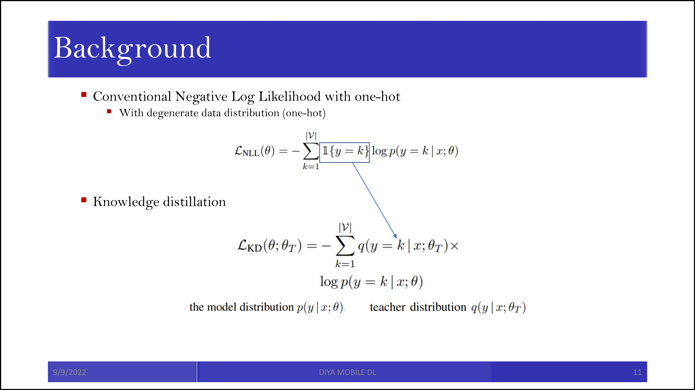
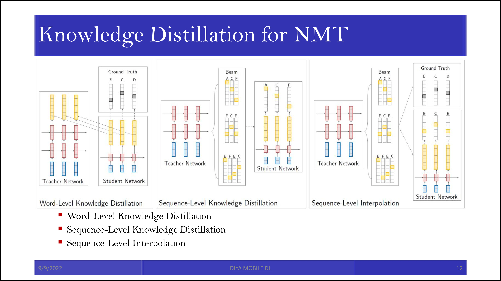
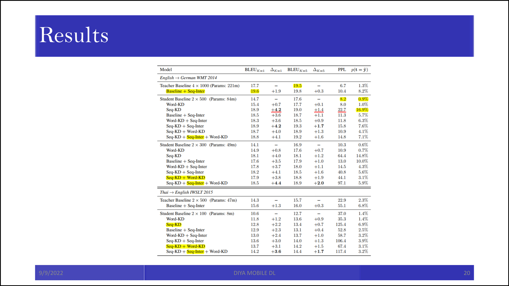

[DIYA](https://blog.diyaml.com/)에서 리뷰했던 \"Sequence-Level Knowledge Distillation\" 요약 및 설명입니다. 2016년 논문이며 [Yoon Kim](https://scholar.google.com/citations?user=n_ts4eYAAAAJ&hl=en&oi=sra)과 [Alexander M. Rush](https://scholar.google.com/citations?user=LIjnUGgAAAAJ&hl=en&oi=sra)가 저자로 참여했습니다. 2022년 5월 26일 당시 인용수는 642건입니다.

{: width="4000" height="2250" }

논문 리뷰를 시작하기에 앞서 알아야 할 개념이 존재합니다. BLEU라는 evaluation metric입니다. 0~1(0~100%) 사이의 값으로 나타나는데 구글에서 제공하는 자료에 따르면 0.3(30%)을 넘어가면 그런대로 알만한 번역이 된다고 합니다.

{: width="4000" height="2250" }

BLEU는 두 가지 척도로 번역 품질을 판단합니다. 첫 번째는 정답 문장과 얼마나 겹치는지 판단합니다. 두 번째로는 reference(정답)과 비교하여 output이 과도하게 짧지는 않은지 판단합니다. \"나는 남자 아이다\"라는 문장의 영어 번역 reference가 \"I am a boy\"라고 할 때, 그냥 \"boy\"라고 번역해버리면 overlap으로는 나쁘지 않지만 brevity penalty에서는 penalty를 먹게 됩니다.

{: width="4000" height="2250" }

그리고 그 다음으로 알아야 할 개념은 Beam search입니다. 간단히 말하면 너비 우선 탐색(BFS)의 변형인데, 전부 다 탐색을 해버리면 경우의 수가 너무 많아지니 매 단계마다 누적 확률이 높은 상위 몇 개(beam size, 위 그림에서는 2개)만 살리면서 탐색을 하자는 것입니다.

{: width="4000" height="2250" }

인트로 부분에 model compression에 대한 개괄적인 설명들이 잘 나와있습니다. 인공 신경망의 연결 자체를 간소화 하는 pruning 방법도 있고, big model에서 soft label을 배워오는 knowledge distillation도 가능합니다.

Pruning을 할 때 Hessian 값을 기준으로 결과에 영향을 덜 미치는 weight를 지우기도 합니다.

{: width="4000" height="2250" }

적당한 threshold를 잡고 그 이하가 되면 weight를 제거합니다. (위 슬라이드 내용과 일치)

신경망 기반 기계 번역 모델을 Neural Machine Translation(NMT)라고 부르는데, 기존의 모델들은 긴 문장이 있으면 단어 단위로 지금까지의 단어를 가지고 그 다음 단어를 예측하는 식으로 작동했습니다. 이 논문은 이런 예측 방식은 그대로 두고, knowledge distillation을 단어 단위(word-level)가 아니라 문장(sequence) 단위로 하자는 것이 핵심입니다.

{: width="4000" height="2250" }

결론적으로 4x1000 LSTM을 2x500 LSTM으로, 더 작은 데이터셋에서는 2x500 LSTM을 2x100 LSTM까지 줄인 것으로 보입니다.

{: width="4000" height="2250" }

본 논문에서는 source와 target sentence를 각각 s, t로 정의했고, 각 문장의 길이를 I와 J라고 하였습니다. 결국 번역이라 함은 s가 주어졌을 때 가장 높은 확률을 나타내는 $$p(t\vert s)$$의 t를 찾는 문제입니다. 이 확률을 인공 신경망을 통해서 찾겠다고 합니다.

{: width="4000" height="2250" }

위 부분은 기존의 one-hot과 knowledge distillation을 위한 soft encoding과의 차이를 보여줍니다. Teacher distribution의 결과를 사용한다는 점만 아시면 되겠습니다.

{: width="4000" height="2250" }

Word-level knowledge distillation은 단어 단위로 knowledge distillation을 진행합니다. \"나는 너를 사랑한다\"를 \"I love you\"로 번역한다면, 각 단어 위치(예를 들어 정답이 \"I\"인 첫 번째 위치)마다 teacher network가 출력한 단어 확률 분포(soft label)와 student network가 출력한 단어 확률 분포 사이의 cross-entropy를 최소화하도록 학습시킵니다.

Sequence-level knowledge distillation에서는 일단 가능성 있는 문장들을 teacher network에서 beam search하여 몇개 생성해두고, 그 생성한 문장중 가장 높은 score를 갖는 문장을 따라하도록 학습합니다. 그 score는 teacher network가 그 문장의 각 단어에 부여한 조건부 probability의 곱입니다.

Sequence-level interpolation은 beam search로 teacher network에서 뽑힌 가능한 문장 중, 정답 문장과의 유사도를 나타내는 sim 함수(BLEU)가 높은 문장과 일치하도록 학습되었습니다.

{: width="4000" height="2250" }

보통 논문이 그러하듯, 본 논문에서도 sequence-level interpolation을 같이 고려했을 때 가장 높은 성능이 나타남을 알 수 있었습니다. 그리고 그 성능을 작은 student network에서 이룩하였다는 점에서 의미가 있습니다.
