[DIYA](https://blog.diyaml.com/)에서 리뷰했던 \"Similarity-Preserving Knowledge Distillation\" 요약 및 설명입니다. 2019년 ICCV에 나온 논문이며, [Frederick Tung](https://scholar.google.com/citations?user=T4EeZ9gAAAAJ&hl=en&oi=sra)과 [Greg Mori](https://scholar.google.com/citations?user=Bl9FSL0AAAAJ&hl=en&oi=sra)가 저자로 참여했습니다. 두 분은 현재 [Borealis AI](https://www.borealisai.com/)라는 회사에 함께 계시는 듯합니다. 2022년 6월 9일 당시 인용수는 348건입니다.

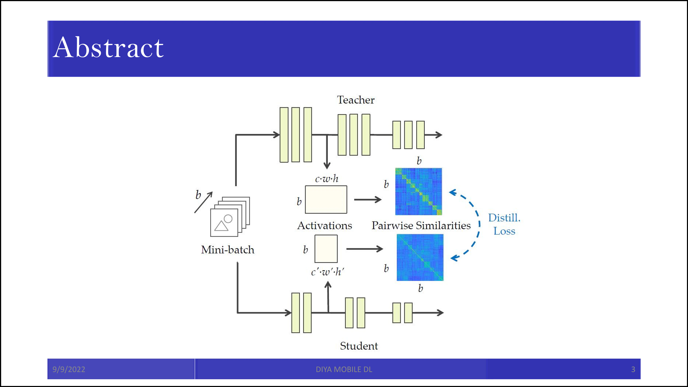{: width="4000" height="2250" }

논문의 코어는 위 그림에 담겨있습니다. 단순 soft label을 전달받는 것을 넘어서 teacher의 activation에서 뭔가를 배워야 한다고 생각하는 것입니다. 그 뭔가는 \"teacher가 비슷하다고 생각하는 것은 student도 똑같이 비슷하게 생각하고, teacher가 다르다고 생각하는 것은 student도 다르게 생각하자\"입니다.

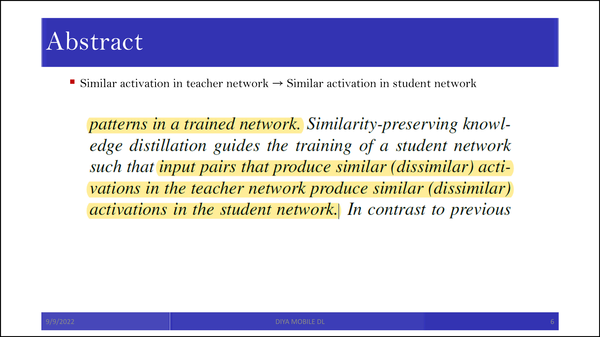{: width="4000" height="2250" }

그래서 이 논문에서는 knowledge distillation loss를 activation pattern을 반영하여 정의합니다. Teacher에서도 비슷한 activation pattern을 보인 sample pair는 student에서도 비슷한 activation pattern을 보여야 한다고 주장합니다.

이렇게 하면 student는 단순히 teacher의 representation space(soft label을 통해서 전달되는)를 따라 하는 것이 아니라, 자신만의 representation space를 구축하면서 knowledge distillation을 할 수 있다고 합니다. Teacher의 label을 그대로 배우는 것보다는 teacher가 비슷하다고 생각하는 pair가 비슷하다는 지식을 배운다는 점에서 이런 주장이 나왔습니다.

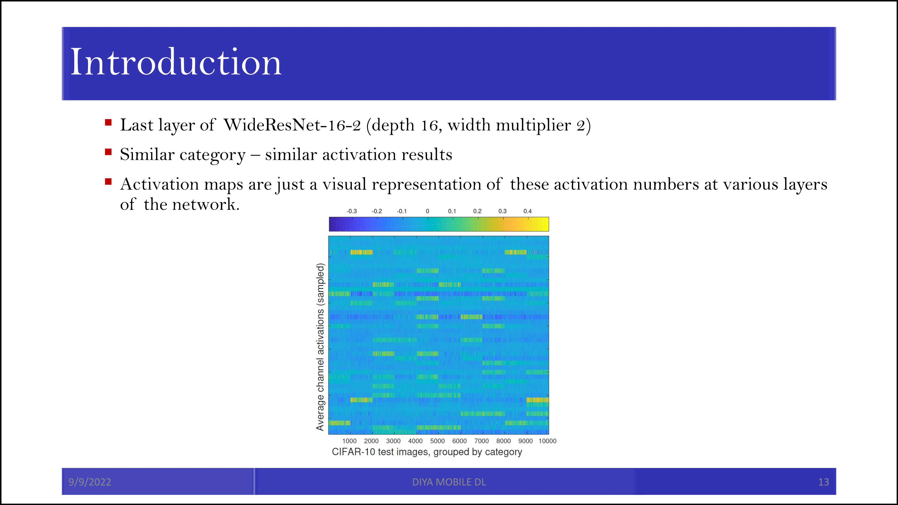{: width="4000" height="2250" }

CIFAR-10은 10개의 카테고리로 이루어진 이미지 데이터셋입니다. 위의 그림을 자세히 보면 색 분포가 x축 1,000개 단위마다 비슷한 것을 알 수 있습니다. 이는 1,000개씩 같은 class이기 때문에 그렇습니다. 같은 비행기라면 activation map이 활성화되는 양상이 비슷한 것이죠. 참고로 Activation map은 filter가 훑고 지나간 값을 의미합니다. 이에 대한 자세한 설명은 [여기](https://medium.com/@chriskevin_80184/feature-maps-ee8e11a71f9e#:~:text=Feature%20Map%20is%20also%20called%20as%20Activation%20map.,number%20amount%20of%20feature%20maps.)를 참조하시면 됩니다. Batch 별로 activation map 값의 pair-wise값(내적 등)이 유사하면, teacher와 student가 유사한 값을 냈다고 판단할 수 있습니다.

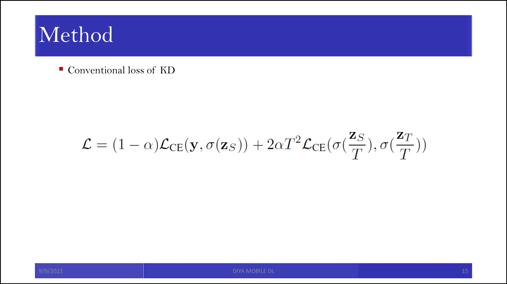{: width="4000" height="2250" }

기존의 KD에서는 위의 loss만을 사용했습니다. 하지만 이제 다른 loss가 추가됩니다.

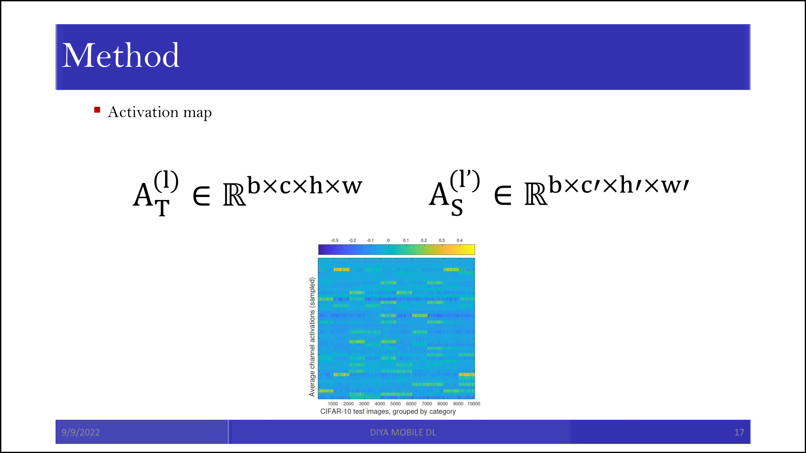{: width="4000" height="2250" }

Teacher의 activation map의 차원, 그리고 student의 activation map의 차원은 서로 다릅니다. 네트워크의 구조가 다르기 때문입니다. 하지만 batch size는 맞출 수 있습니다.

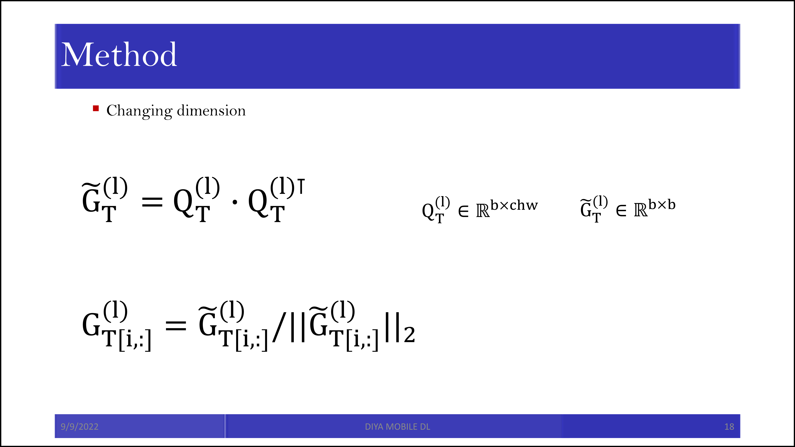{: width="4000" height="2250" }

그래서 batch size \* batch size의 행렬을 만들기 위해 행렬을 reshape 시켜주고, 행렬 곱을 해버립니다. Normalize도 같이 진행합니다.

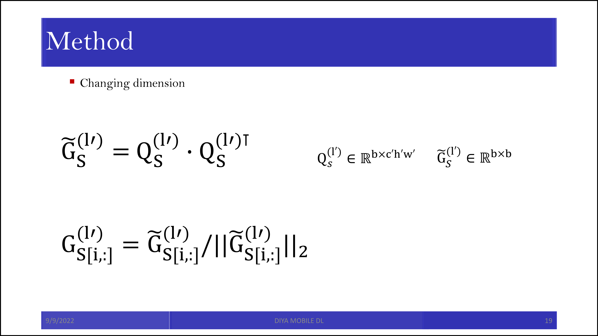{: width="4000" height="2250" }

똑같은 작업을 student에 대해서도 합니다.

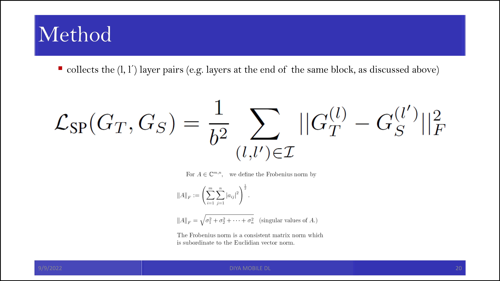{: width="4000" height="2250" }

그래서 추가되는 similarity preserving loss는 teacher와 student에서 각각 새롭게 만들어진 batch size \* batch size 크기 행렬의 차이에 대한 Frobenius norm(특잇값의 제곱의 합의 제곱근)을 제곱해 batch size의 제곱으로 나눈 값입니다.

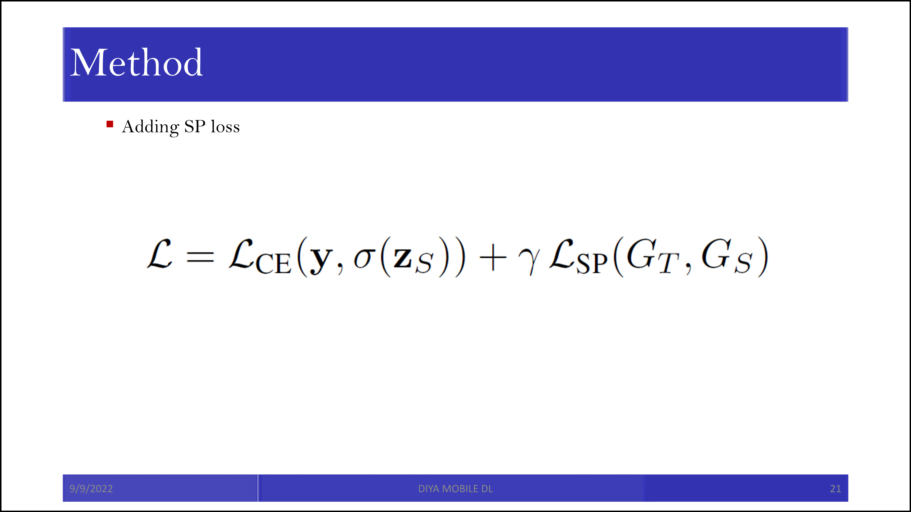{: width="4000" height="2250" }

새로운 loss는 cross entropy loss와, 가중치(hyperparameter) γ를 곱한 similarity preserving loss를 더한 값입니다.

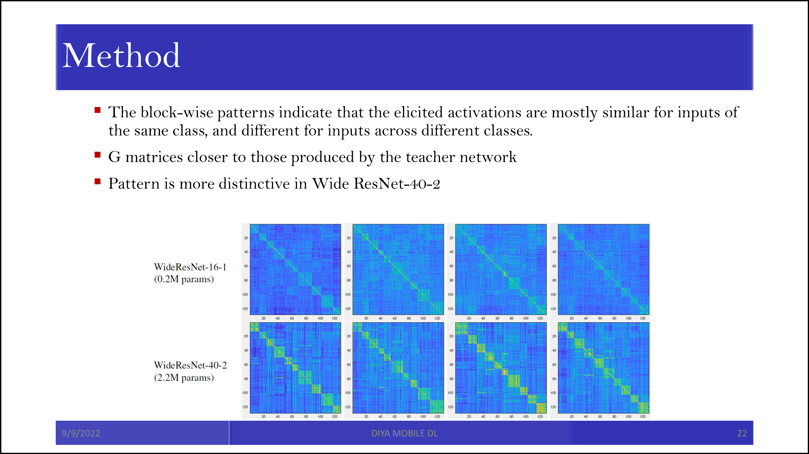{: width="4000" height="2250" }

WideResNet-16-1이 student, WideResNet-40-2가 teacher인데, student에서 행렬곱 값의 크기가 작기는 하지만, 그래도 그 양상은 teacher와 유사합니다.

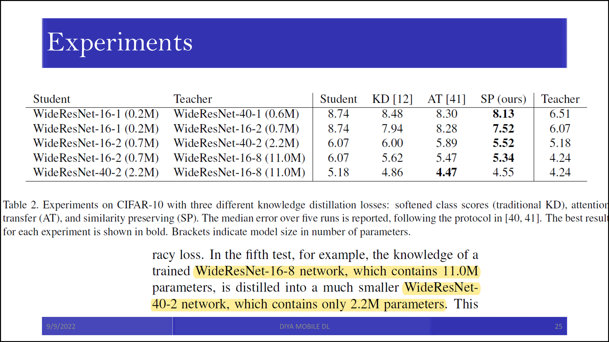{: width="4000" height="2250" }

결론적으로 아주 잘 나왔다는 이야기입니다.

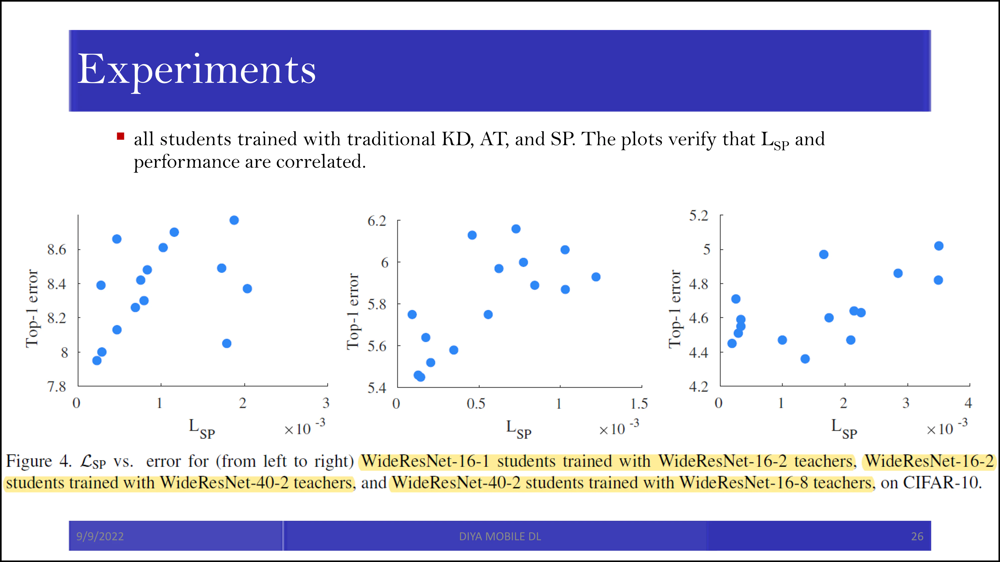{: width="4000" height="2250" }

그리고 similarity preserving loss가 컸을수록 error도 컸습니다. 이 점을 similarity preserving loss의 근거로 보고 있습니다.

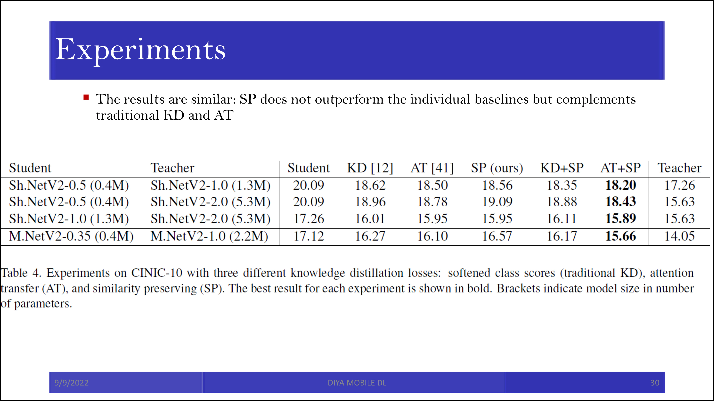{: width="4000" height="2250" }

참고로 SP 자체로는 기존의 KD를 이기지 못하는 경우도 있었지만, 함께 활용되었을 때는 좋은 성능을 보였습니다. 특히 attention transfer와 합이 잘 맞습니다. 서로 다른 종류의 정보를 student에 전달하는 것으로 보입니다.

적당한 아이디어를 바탕으로 loss를 추가할 수 있다면 논문을 쓸 수 있다는 것을 알 수 있습니다. 하지만 이건 2019년 이야기이고, 2022년에도 그게 통할지는 미지수입니다.
