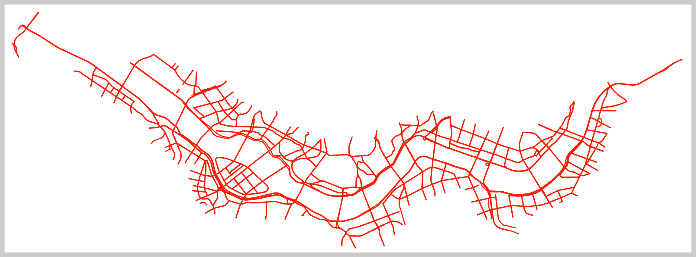
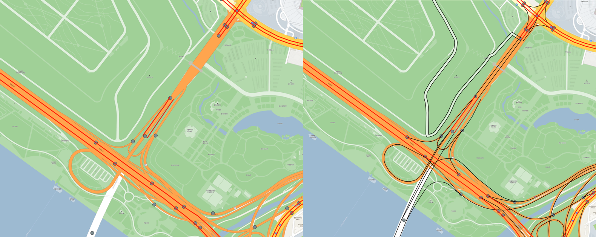
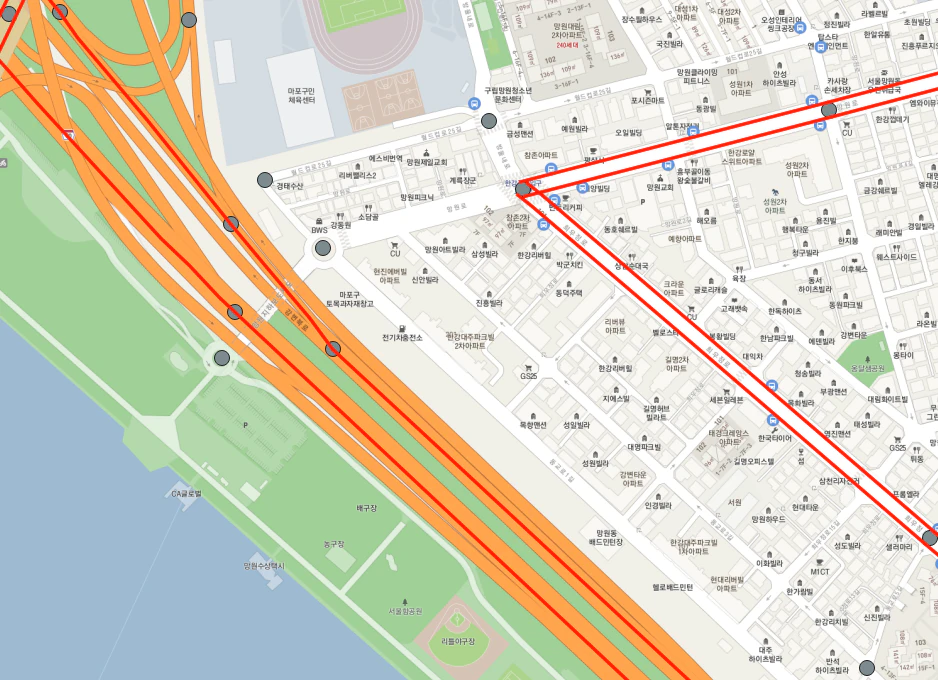
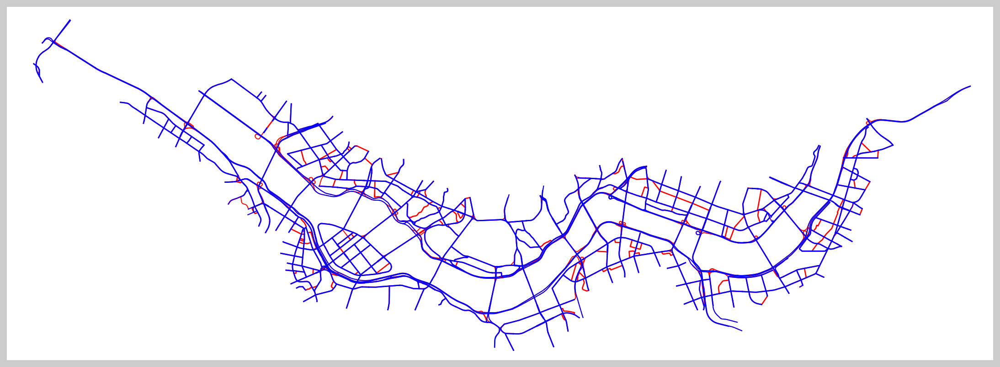

이번 글의 목표는 한강을 중심으로한 주요 간선도로들을 연결한 온전한 그래프를 만드는 것입니다. 일단 서울특별시 속도 자료와 노드링크 체계는 [이 글](/posts/서울시-교통정보-시스템과-국가-표준-노드-링크-체계-맞추기/)의 내용을 기반으로 적당히 맞추었다고 가정하겠습니다.

{: width="2303" height="853" }

일단 간선도로 위주로 얻어봤습니다. 이 링크들은 \"1. [국가교통정보센터](https://www.its.go.kr/)에서 제공하는 [전국표준노드링크](https://www.its.go.kr/nodelink/nodelinkRef)\"중에서, \"2. 서울시 교통정보 시스템에서 제공하는 [서비스링크와 표준노드링크 매핑 자료](https://topis.seoul.go.kr/refRoom/openRefRoom_3_3.do)에 있는 링크\"중에서, \"3. [서울시 교통정보 시스템](https://topis.seoul.go.kr/)에서 제공하는 [주요 도로에 대한 속도 정보](https://topis.seoul.go.kr/refRoom/openRefRoom_1.do)가 제공되는 링크\"로 3차례 필터링 한 것입니다. (그 중에서도 한강 위주로 뽑았습니다.)

괜찮은 도로망 그래프로 보이지만, 사실 그렇지 않습니다.

{: width="1580" height="629" }

연결이 되어 있었어야 할 검은색 라인이 빨간색 라인에는 없는 것을 알 수 있습니다. 왜 이런 일이 일어났을까요? 저도 정확히는 모르겠습니다. 마음이 아프네요. 저렇게 중간중간 끊긴 아이들이 많습니다. 3단계의 필터링 과정에서 한번이라도 누락되면 빌 수 밖에 없는 상황입니다. 그렇다고 저 부분의 속도를 null로 할 수도 없고, 연결성이 훼손된 상황에서 그냥 두고 보기도 뭐합니다.

간단한 방법으로는 1. 다친 아이들이 많은 link 데이터 셋의 unique node list를 얻는다 2. unique node list의 pair-wise 모든 조합을 itertools로 찾는다 3. 이 중 이미 존재하는 링크들은 뺀다 4. 존재하는 링크는 뺀 데이터 중 [전국표준노드링크](https://www.its.go.kr/nodelink/nodelinkRef) 데이터에는 있는 값이 있다면, 다친 아이를 발견한 것

```python
path_to_nodes = '20220924_riverside_olympic/re_link_qgis_nodes.shp'
selected_nodes = geopandas.read_file(os.path.join(par_path, path_to_nodes))
selected_nodes['NODE_ID'] = selected_nodes['NODE_ID'].astype('int64')

path_to_links = '20220924_riverside_olympic/re_link_qgis.shp'
re_link2 = geopandas.read_file(os.path.join(par_path, path_to_links))
re_link2.drop(columns=['LINK_NAME', 'F_NODE_NAM', 'T_NODE_NAM', 'REMARK'], inplace=True)
print(f'research link length = {len(re_link2)}')


path_to_seoul_links = '20220924_riverside_olympic/MOCT_LINK_qgis.shp'
seoul_link = geopandas.read_file(os.path.join(par_path, path_to_seoul_links))
seoul_link['F_NODE'] = seoul_link['F_NODE'].astype('int64')
seoul_link['T_NODE'] = seoul_link['T_NODE'].astype('int64')
seoul_link.drop(columns=['REMARK'], inplace=True)

print(f'seoul link length = {len(seoul_link)}')

# re_link2 : 다친 아이들이 포함된 링크 데이터셋 (궁극적으로 이 링크 데이터가 온전하길 바람)
# seoul_link : 모든 링크를 포함한 데이터셋
```

일단 데이터를 불러옵니다.

```python
# 1. 다친 아이들이 많은 link 데이터 셋의 unique node list를 얻는다 
re_link2_nodes = np.unique(np.concatenate((np.unique(re_link2['F_NODE'].values), np.unique(re_link2['T_NODE'].values)), 0))

# 2. unique node list의 pair-wise 모든 조합을 itertools로 찾는다
import itertools
re_link2_nodes_iter = list(itertools.product(re_link2_nodes, re_link2_nodes))

# 3. 이 중 이미 존재하는 링크들은 뺀다
re_link2_target = list(set(re_link2_nodes_iter) - set(list(zip(re_link2['F_NODE'], re_link2['T_NODE']))))

# 4. 존재하는 링크는 뺀 데이터 중 전국표준노드링크 데이터에는 있는 값이 있다면, 다친 아이를 발견한 것
# 가끔 발생하는 피치 못할 에러는 try except 문으로 피해줍시다.
from tqdm import tqdm 

i=0
for link in tqdm(re_link2_target):
    tmp = seoul_link[((seoul_link['F_NODE'] == link[0]) & (seoul_link['T_NODE'] == link[1]))]
    if len(tmp)>0:
        try:
            i+=1
            tmp.insert(len(tmp.columns)-1, 'SERVICE_LI', re_link_qgis[re_link_qgis['F_NODE']==tmp['T_NODE'].values[0]][['SERVICE_LI']].values[0][0])
            tmp.insert(len(tmp.columns)-1, 'STANDARD_L', re_link_qgis[re_link_qgis['F_NODE']==tmp['T_NODE'].values[0]][['STANDARD_L']].values[0][0])
            tmp.insert(len(tmp.columns)-1, 'MAP_DIST', re_link_qgis[re_link_qgis['F_NODE']==tmp['T_NODE'].values[0]][['MAP_DIST']].values[0][0])
            re_link_qgis = pd.concat([re_link_qgis, tmp])
        except:
            pass
print(i)
```

생각보다 케이스가 많아서 걱정입니다. 원래 데이터가 2674건인데, 500건 넘게 끊겨있던 링크를 발견했습니다. 그렇다고 연결을 포기할 수도 없고, 거리 기반으로 연결하기도 곤란합니다.

{: width="938" height="680" }

망원로와 강변북로는 서로 연결되어 있지 않습니다. 하지만 거리 기반으로 연결을 해버리면 저 둘이 아주 강하게 연결되어있다고 착각을 해버립니다. 한강대교 근처에는 강변북로와 올림픽대로, 그리고 각종 강변의 작은 도로들이 섞여서 이런 문제가 더 클 것으로 보입니다.

{: width="2188" height="803" }

파란색이 원래 있던 링크들, 적색이 새롭게 연결된 링크들입니다. 같은 작업을 몇번 더 하면 모든 링크가 연결될텐데, 그건 또 그 나름대로 연구의 정확성을 훼손하게 됩니다. 그런 의미에서 이 정도만 하고 멈추기로 합시다.
