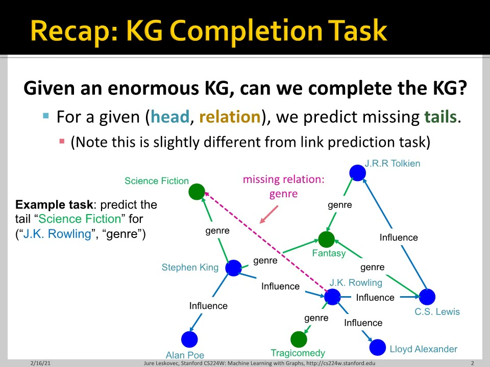
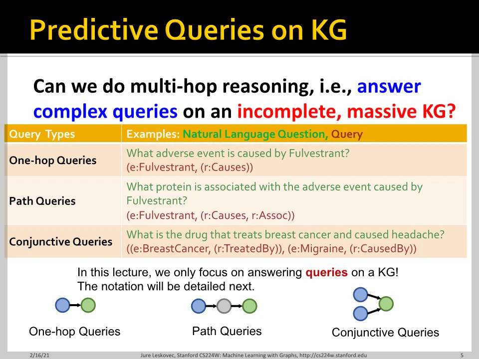
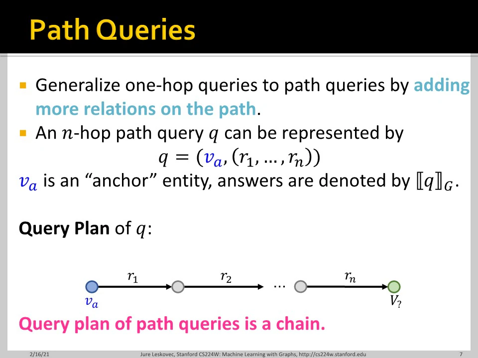
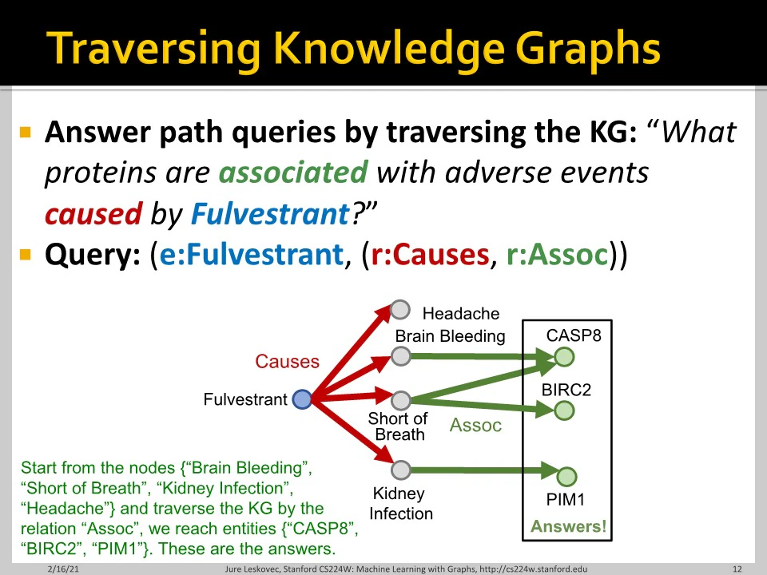
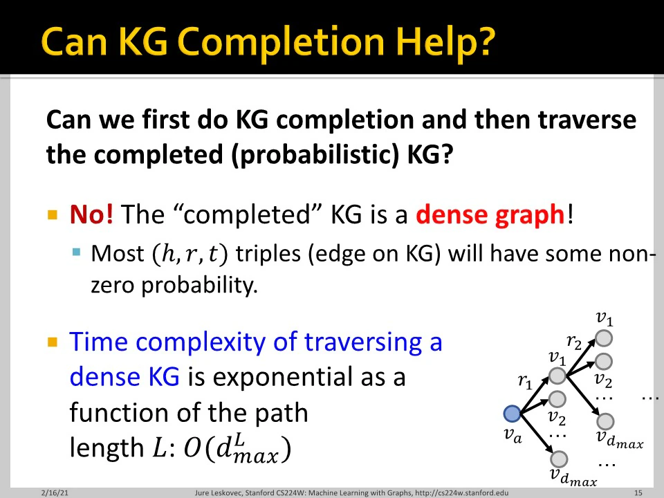
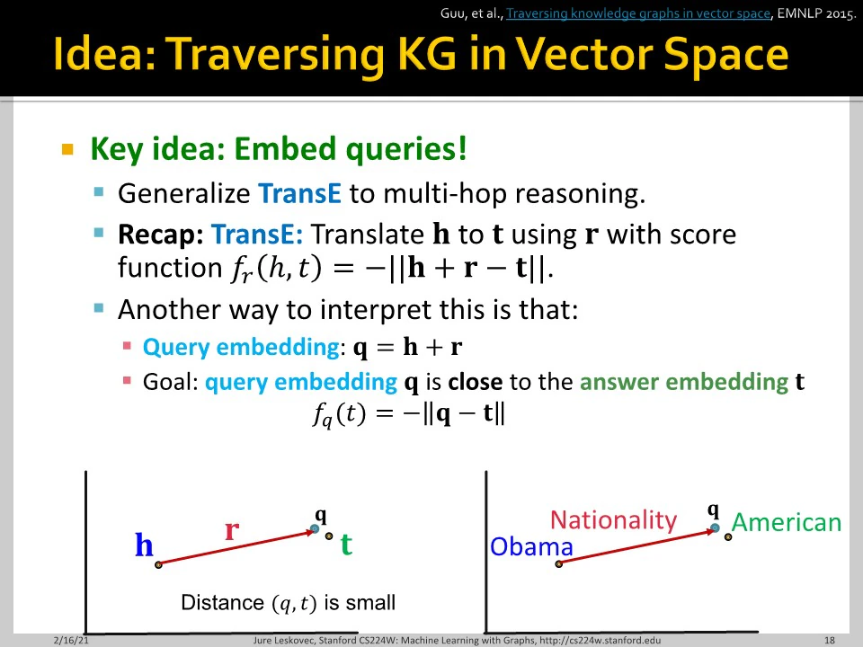
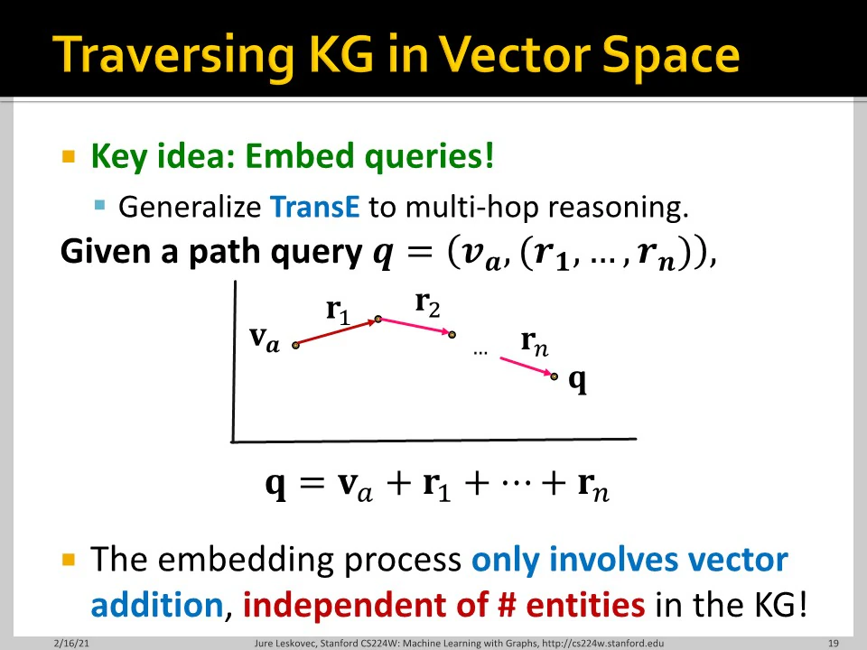
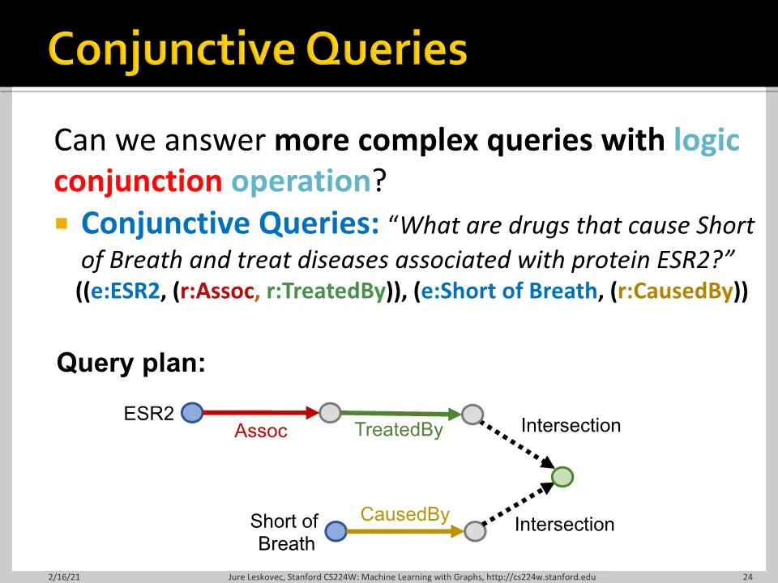
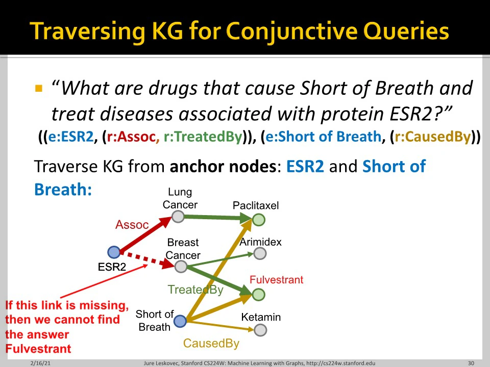

Knowledge graph completion task를 계속 진행해 봅시다. 이제는 Multi-hop KG completion이 task로 나왔습니다.

## Recap: KG Completion Task

{: width="960" height="720" }

KG completion task는 큰 KG가 주어졌을 때, KG completion을 하는 방법을 찾는 문제입니다. 구체적으로 이야기하면, $$(head, relation)$$이 주어지고, missing $$tail$$을 맞추는 task입니다.

{: width="960" height="720" }

여기서는 one-hop query에서 나아가 complex query에 대한 답을 하는 것이 목표입니다. Path query와 conjunctive query가 예시입니다. Path query는 multi-hop query라 볼 수 있고, conjunctive query는 두 query를 and 조건으로 만족하는 query라고 볼 수 있습니다.

{: width="960" height="720" }

Path query는 one-hop query의 연속으로 generalize 가능합니다. $$v_a$$를 anchor entity라고 하며, query $$q$$에 대한 답을 $$[q]_G$$로 표기합니다.

{: width="960" height="720" }

가장 직관적인 path query에 대한 답변 방식은 KG를 모두 훑어보는 것입니다. 하지만 KG에는 필연적으로 빈 연결이 존재합니다. 우리가 기존에 사용중인 약물 중에서 COVID-19을 치료하는 약물이 이미 나왔을 수도 있습니다. 다만 우리가 모르고 있을 뿐입니다. 이런 빈 연결들 때문에 무작정 traverse(훑어보는)하는 것으로는 답을 모두 찾을 수 없습니다.

정리하면, KG는 incomplete하고, 그 어떤 상태에서도 complete 하다고 단정할 수 없습니다. Missing relation, missing entity가 매우 많습니다. 따라서 모든 entity에 대한 답을 traversing 하면서 얻는 것은 불가능 합니다.

{: width="960" height="720" }

그렇다면 KG completion을 전부 수행한 이후에 traverse하면 괜찮을까요? 그렇지 않습니다. Completion을 마친 KG는 dense한 graph로 모든 연결성을 확인할 수는 없습니다. Time complexity가 $$O(d^L_{max})$$이기 때문에, 이는 매우 infeasible한 대안입니다. 우리는 incomplete한 KG에서도 predictive query에 대한 답을 하기 위해 missing information을 암묵적으로(implicitly) imputation해야만 합니다.

## Answering Predictive Queries on Knowledge Graphs

Answering에서 가장 중요한 아이디어는 query를 embedding space로 mapping하고, 그 space상에서 reasoning을 하는 것입니다.

{: width="960" height="720" }

Query $$\mathbf{q} = \mathbf{h} + \mathbf{r}$$ 라고 표현할 수 있습니다. 이때 answer embedding은 $$\mathbf{t}$$이고, $$(\mathbf{q}, \mathbf{t})$$ 사이의 거리를 최소화해야 합니다. TransE의 아이디어와 동일합니다.

{: width="960" height="720" }

이런 형태로 answering 문제를 풀게 되면, 단순 addition으로 path query를 해결할 수 있습니다. TransR, DistMult, ComplEx는 composition relation을 표현하지 못하여 path query에 적합하지 않습니다.

{: width="960" height="720" }

그렇다면 conjunctive query에는 어떻게 답할 수 있을까요? 이때는 두 node에서 출발한 두 relation에 대한 답을 구해야만 합니다.

{: width="960" height="720" }

Traverse method로 답을 구할수도 있겠지만, 만약 특정 link가 missing이라면 traverse의 결과는 정상적인 답은 아닐 것입니다. 이를 극복하기 위해서는 implicit하게 관계를 impute 해야합니다. KG에서는 edge 하나가 missing이어도 주변 node들로 유추해서 impute할 수 있는 경우가 있습니다. ESR2가 상호작용하는 다른 protein들을 활용해서 관계를 구할 수 있지 않을까요? 서로 연결된 node의 set을 어떻게 표현할 수 있고, intersection을 latent space에서 어떻게 표현할 수 있을까요? 해당 내용은 part 2에서 이어집니다.
