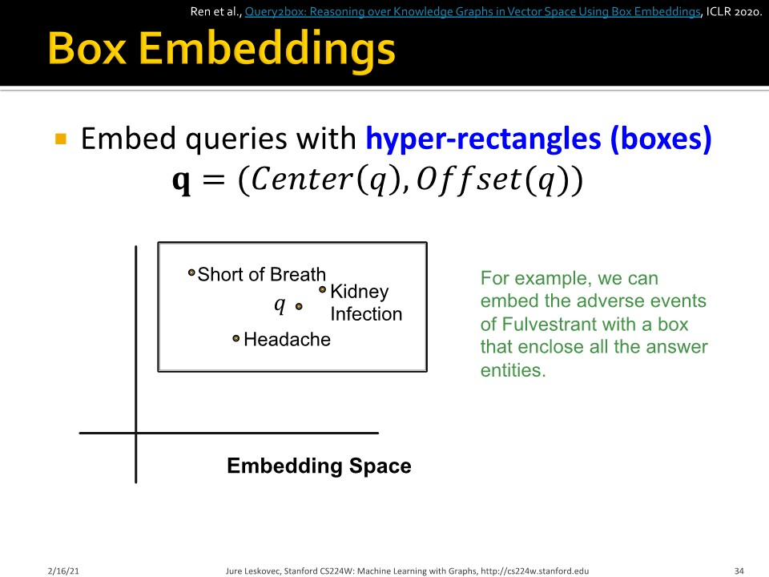
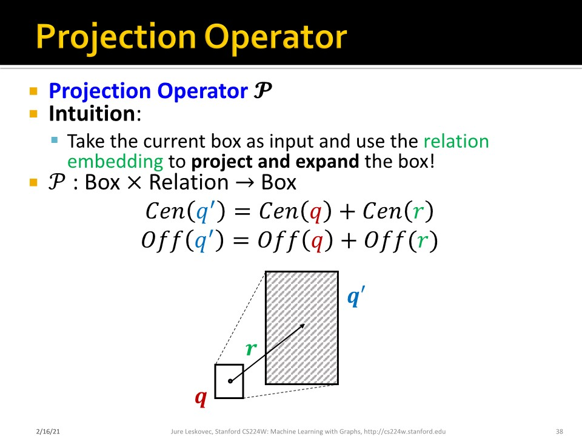
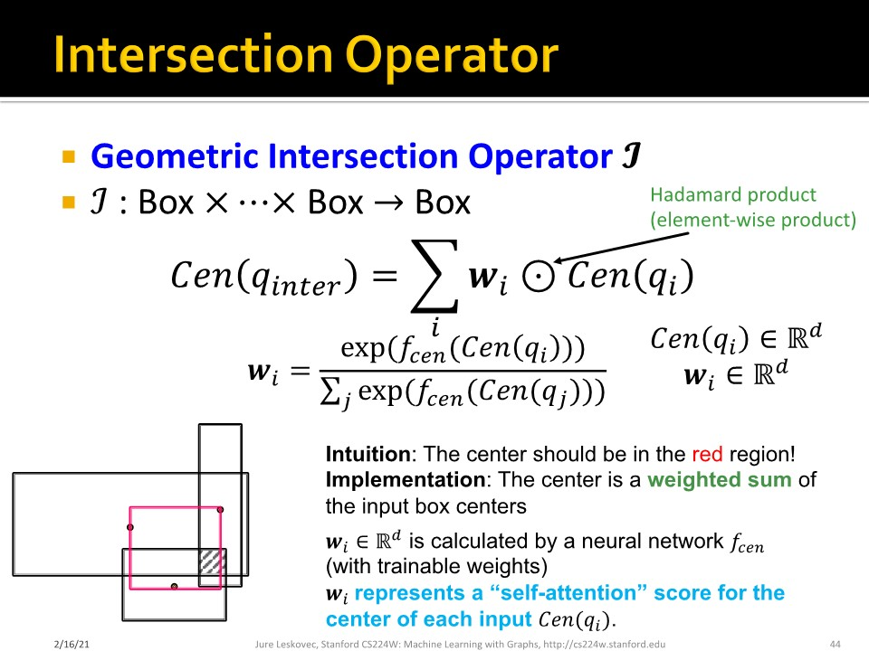
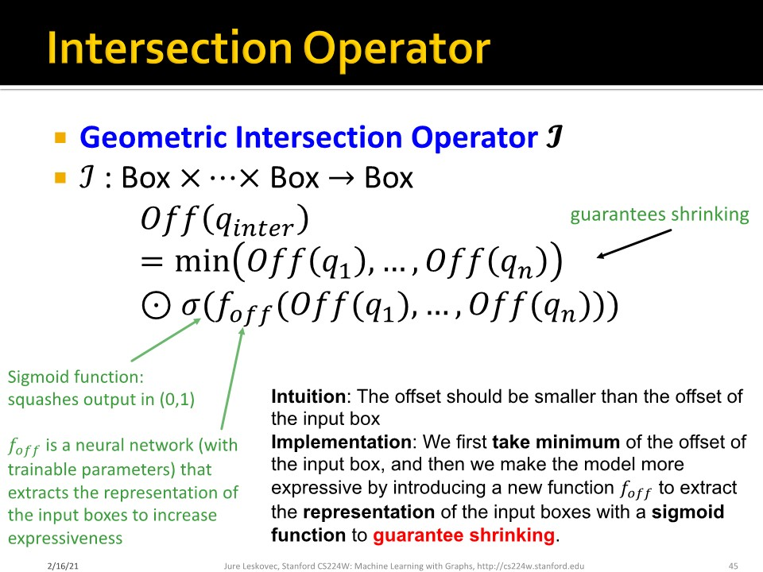
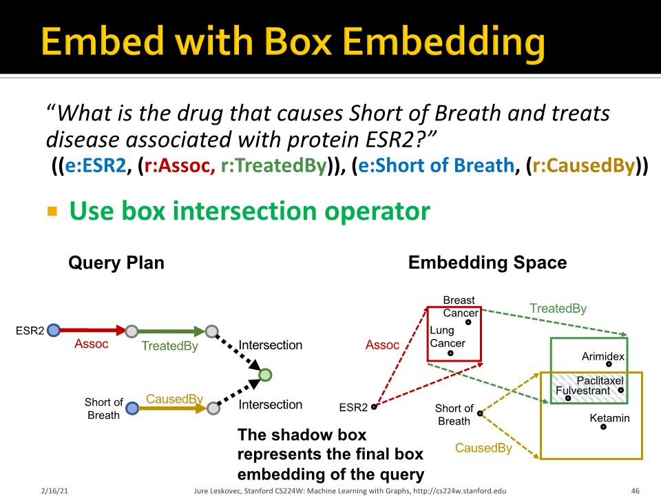
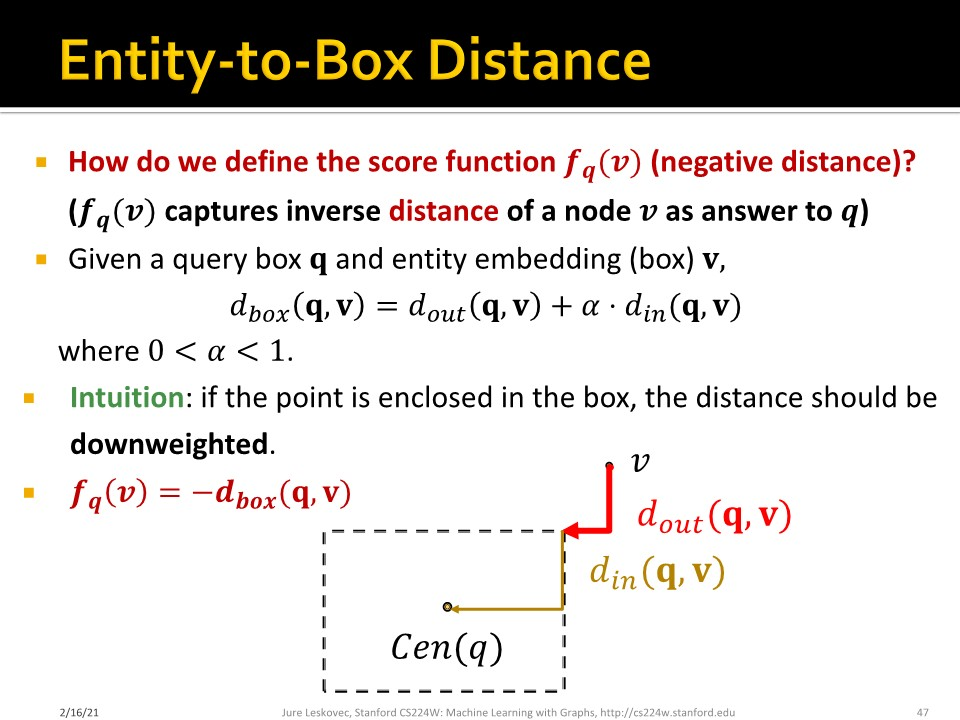
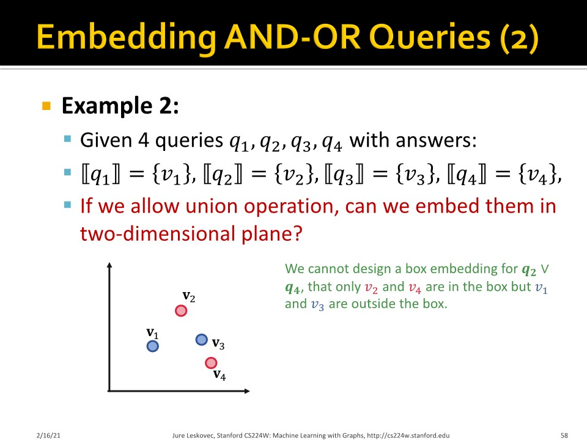
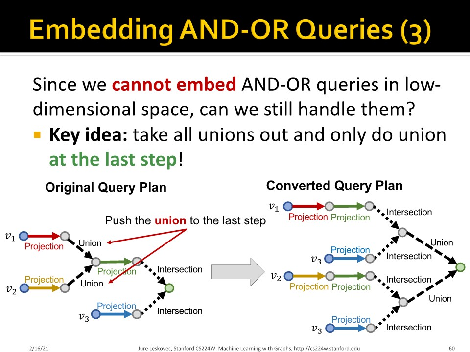
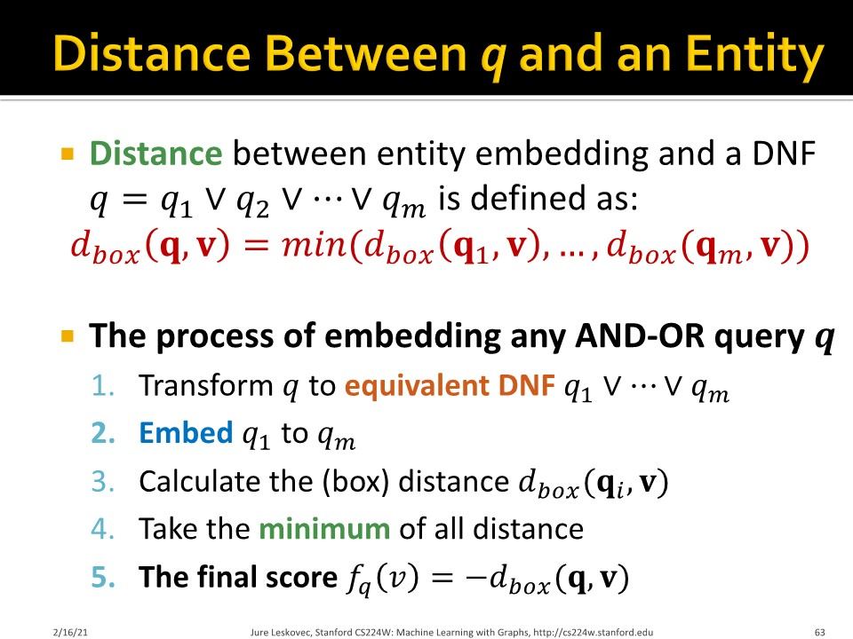

## Query2box: Reasoning over KGs Using Box Embeddings

{: width="960" height="720" }

각 query를 box로 embedding 해봅시다. 예를 들어서 Fulvestrant의 adverse event를 하나의 box에 담는 것입니다. 이렇게 box로 표현할 때의 좋은 점은, intersection을 표현하기가 쉽다는 것입니다. 겹치는 영역으로 intersection을 표현할 수 있고, 실제로 intersection operator도 겹치는 영역을 neural net으로 계산해서 output을 뱉습니다. 이런 표현형에서 parameter 수와 정보는 아래와 같습니다.

- Entity embeddings: $$d \vert V\vert $$ (Entity는 zero-volume box)
- Relation embeddings: $$2d\vert R\vert $$ (relation마다 d차원 center vector와 d차원 offset vector를 가짐)
- Intersection operator $$f$$: Box를 input으로 받아 다른 box를 output으로 뱉음

{: width="960" height="720" }

Projection operation의 경우 relation embedding을 활용해 projection과 expansion을 수행합니다. Center도 vector로 표현하고, offset도 vector로 표현합니다.

{: width="960" height="720" }

Box의 intersection을 표현하는 방법이 조금 특이합니다. 기하학적으로 하기에는 고차원 vector여서 어려움이 있을 것입니다. 그 때문인지 새로운 center를 neural network를 통해 얻은 attention으로 구하게 됩니다.

{: width="960" height="720" }

Offset도 특이하게 구합니다. 각 input box의 offset중에서 minimum을 취한 다음에, 거기에 0과 1사이 값을 갖는 sigmoid를 곱해서 shrinking을 진행합니다.

{: width="960" height="720" }

이렇게 box로 표현한 projection과 intersection을 통해서 conjunctive query에 대한 답을 합니다.

{: width="960" height="720" }

그렇다면 어떻게 score $$f_q(v)$$를 계산할 수 있을까요? Score는 entity와 box 사이 거리의 음수(negative distance)입니다. Out-distance ($$d_{out}$$)과 in-distance ($$d_{in}$$)의 weighted sum으로 값을 얻고, 이때, out-distance에 더 penalize를 진행합니다.

{: width="960" height="720" }

다양한 종류의 query는 어떻게 표현할 수 있을까요? and나 or가 섞인 query를 어떻게 반영할지 확인해볼 필요가 있습니다. 수학적으로 answer가 서로 겹치지 않는 $$M$$개의 conjunctive query가 있을 때, 이들을 OR(union)로 조합한 모든 query를 처리하려면 최소 $$\Theta(M)$$ 의 dimension 이 필요합니다. 따라서 dimension이 작은 embedding에 대해서는 연결할 수 있는 query의 수가 한계에 도달합니다.

{: width="960" height="720" }

이런 문제를 해결하기 위해, 중간의 union을 모두 제거하고, 마지막을 union으로 바꾸면, embedding dimension으로 인해 발생하는 문제를 피할 수 있습니다.

모든 AND-OR query는 동치의 disjunctive normal form(DNF)로 바뀔 수 있습니다. 어떤 AND-OR query $$q$$이더라도 아래와 같이 표현 가능합니다.

$$q = q_1 \vee q_2 \vee ... \vee q_m$$, 이때 $$q_i$$: conjunctive query

먼저 모든 $$q_i$$를 embedding 하고, 마지막 step에서 aggregate 하면 되는 것입니다. 이때 query $$q$$와 entity $$v$$ 사이의 거리는 다음으로 정의합니다.

\$$d_{box}(\mathbf{q}, \mathbf{v}) = \min (d_{box}(\mathbf{q}_1, \mathbf{v}), ..., d_{box}(\mathbf{q}_m, \mathbf{v}))$$

{: width="960" height="720" }

전체 과정은 위와 같습니다.

Training 과정은 아래와 같습니다.

1. Training graph $$G_{train}$$으로부터 query를 randomly sample 하고, answer와 negative answer도 sampling 합니다.
2. Query $$\mathbf{q}$$를 embed 합니다.
3. Score $$f_q(v)$$와 $$f_q(v')$$를 계산합니다.
4. $$f_q(v)$$를 maximize 하고, $$f_q(v')$$를 minimize 합니다. 이때 loss는 $$\ell = - \log \sigma(f_q(v)) - \log (1-\sigma(f_q(v')))$$ 입니다.
