이번 강의의 내용은 크게 세 가지로 나누어집니다.

- Subgraphs and Motifs
- Neural Subgraph Representations
- Mining Frequent Motifs

Subgraph와 motif를 어떻게 neural network를 이용하여 표현하고, counting할지에 대한 내용을 담고 있다고 보시면 됩니다.

## Subgraphs and Motifs

강의 가장 처음에 나오는 내용은 node-induced subgraph와 edge-induced subgraph에 대한 내용입니다. 각각 target graph의 비교 기준이 node와 edge인데, 크게 중요하지 않은 내용이므로 넘어가겠습니다. 우리는 node label이 다 달라도 어떻게 특정 graph가 target graph의 subgraph인지 아닌지 판단하는 방법에 대해 학습해볼 것입니다.

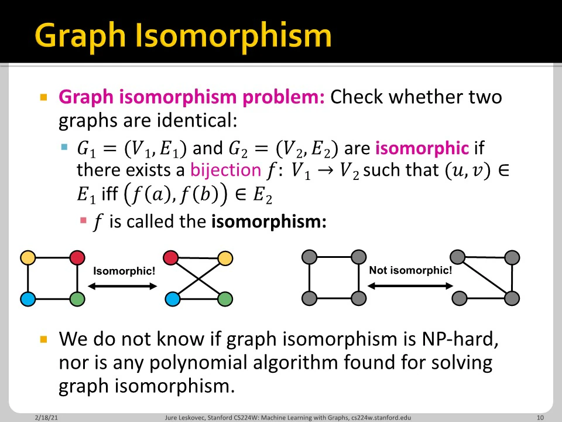{: width="960" height="720" }

Graph isomorphism은 두 그래프가 같은 그래프인지 아닌지에 관한 개념입니다. 두 그래프의 node 사이에 edge 연결 관계를 보존하는 일대일 대응(bijection)이 존재하는지 확인하면 되는데, 아직까지 이를 polynomial하게 푸는 알고리즘은 없습니다.

Subgraph isomorphism은 subgraph가 isomorphic한지 판단하는 문제로 NP-hard에 속합니다.

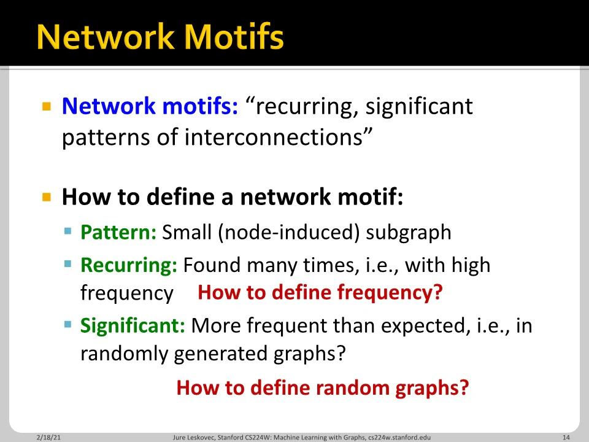{: width="960" height="720" }

Graph에는 motif라는 개념이 있습니다. Pattern, recurring, significant로 정의될 수 있습니다. 반복적으로 등장하는 주요 패턴이라고 보시면 됩니다. 강의 뒤에 어떻게 빈도를 정의하고, \"주요\" 패턴인지 어떻게 파악하는지에 대한 내용이 등장합니다. (여기서 \"주요\"는 역할이라기보다 random graph에 비해 significant하게 빈번히 등장하는가를 의미합니다.)

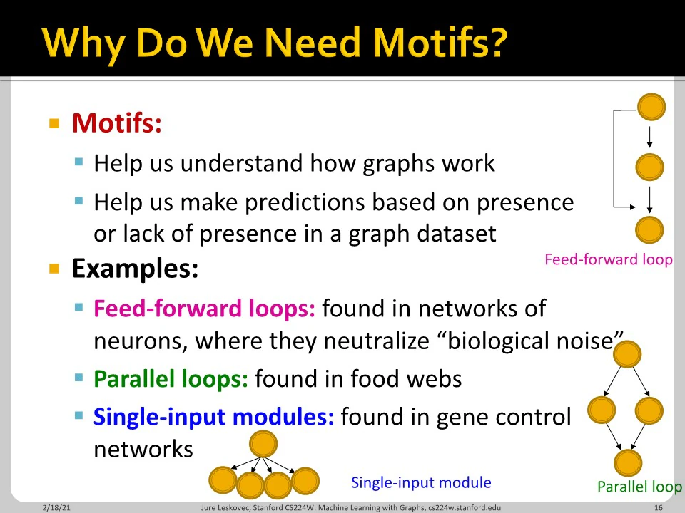{: width="960" height="720" }

Motif에 대한 학습을 하는 이유는, motif를 통해서 graph가 어떻게 작동하는지에 대한 정보를 얻을 수 있기 때문입니다.

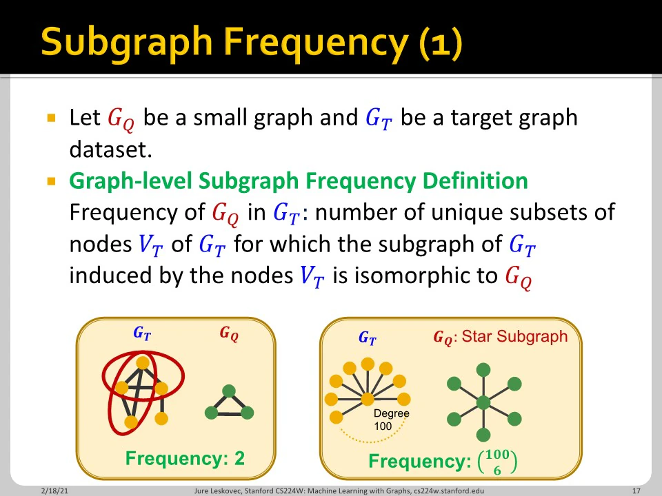{: width="960" height="720" }

Frequency를 얻는 방법에는 크게 두가지가 있습니다. Graph 자체의 출현 빈도를 셀 수도 있고, anchor node의 등장 빈도를 셀 수도 있습니다. 위의 슬라이드는 graph의 출현 빈도를 세는 방법으로, anchor node를 따로 정하지 않고 subgraph의 수를 셉니다.

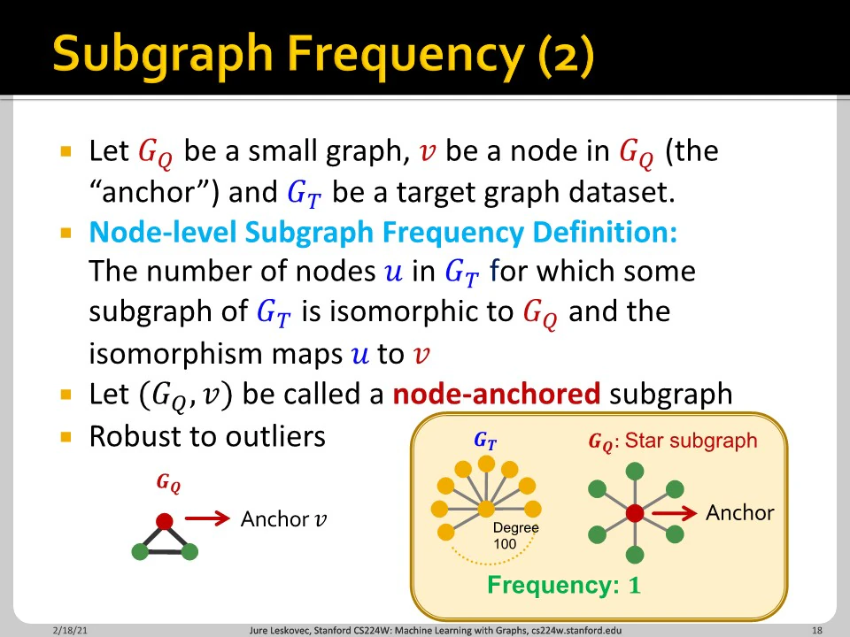{: width="960" height="720" }

Node-level에서는 anchor node를 정하고, 이 anchor에 mapping되는 target graph의 node가 몇 개인지를 셉니다.

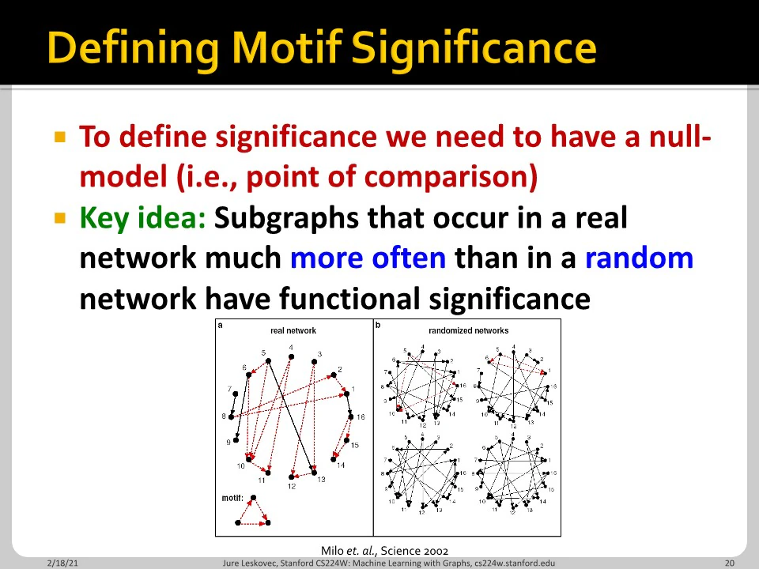{: width="960" height="720" }

그렇다면 특정 그래프가 significant한지를 어떻게 파악할 수 있을까요? \"특정 motif가 random network에 비해 유의미하게 많이 등장한다면 significant한 것이다\"라는 아이디어로 significant함을 측정합니다.

Random한 그래프는 두 가지 방법을 통해서 얻을 수 있습니다. 특정 개수의 node로 이루어진 그래프에 대해서 특정 확률로 edge가 생기도록 할 수도 있습니다. G(5, 0.6)은 5개의 node로 이루어진 graph에서 각 node 사이의 edge가 0.6의 확률로 생성되는 graph입니다. 이를 Erdős–Rényi random graph라고 합니다.

그다음 방법은 configuration model이라고 불립니다. 각 node의 degree까지 정해둔 방법으로, 각 node degree만큼 pair들을 연결시키는 방법입니다. 가끔 node 사이에 두 개 이상의 edge가 나올 때가 있는데, 그런 일이 많지는 않아 무시할 수 있습니다.

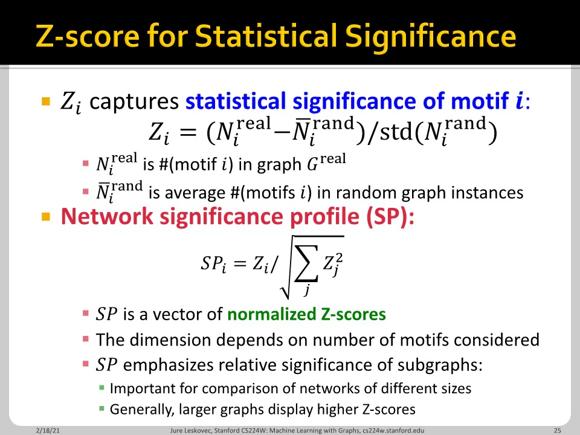{: width="960" height="720" }

Motif의 significance는 random graph와의 counting 비교를 통해 판단합니다. 수학적인 significance 측정은 motif의 $$Z_{i}$$를 통해서 할 수 있습니다. $$Z_i$$는 real network의 motif 개수와 random network들의 평균 motif 개수의 차이를, random network motif 개수의 표준편차로 나눈 값입니다. 여기서 얻은 Z-score를 통해 network significance profile $$SP_{i}$$를 구할 수 있습니다. $$SP_i$$ 는 각 motif의 Z-score를 normalize한 값입니다.

Network의 종류에 따라서 significance profile이 달라집니다. Z-score가 크다면 over representation으로 random한 network에 비해 해당 motif가 많이 등장한 것입니다. Z-score가 작다면 under representation으로 random한 network에 비해 해당 motif가 적게 등장한 것입니다. 둘 다 network를 표현하는데 중요한 의미를 가집니다.

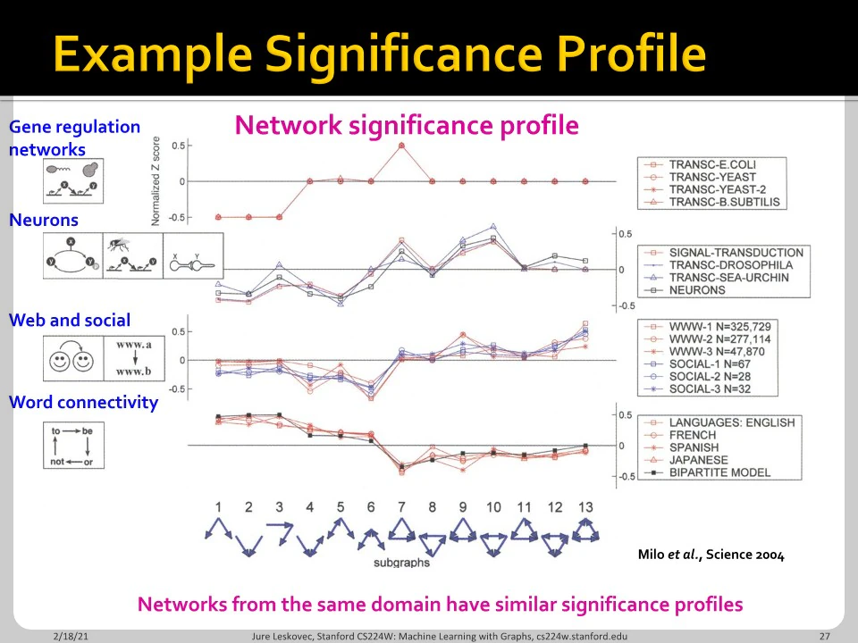{: width="960" height="720" }

하나의 예시로 6번 motif가 social network에서 작은 Z-score를 가지고, 13번 motif는 큰 Z-score를 갖게 됩니다.

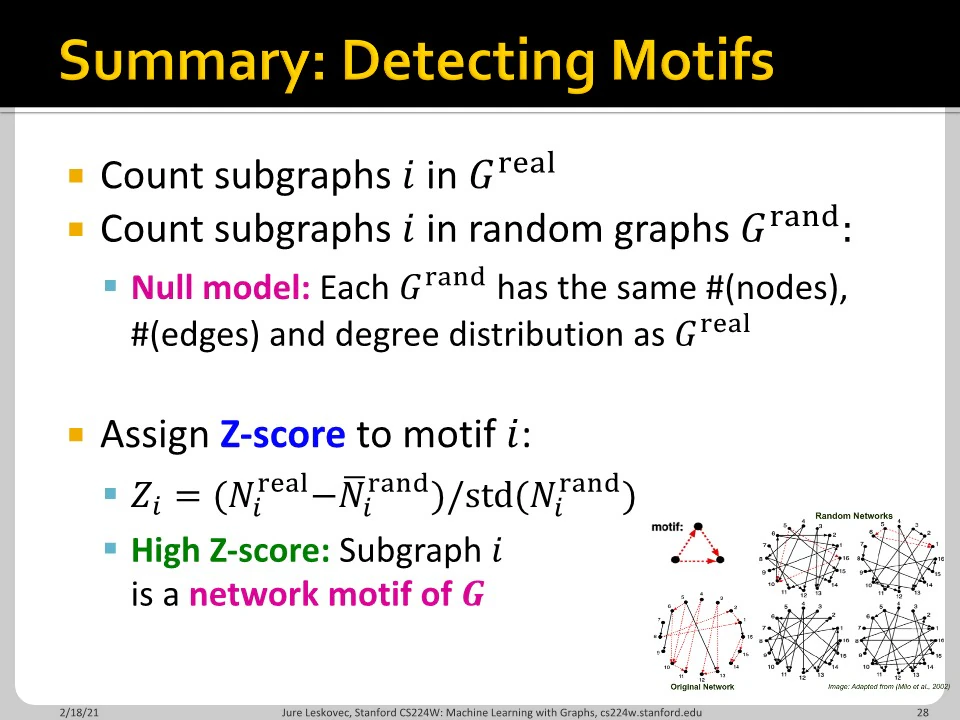{: width="960" height="720" }

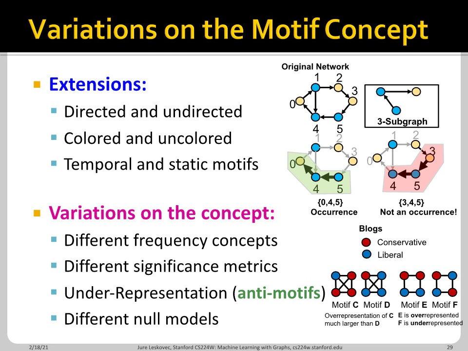{: width="960" height="720" }

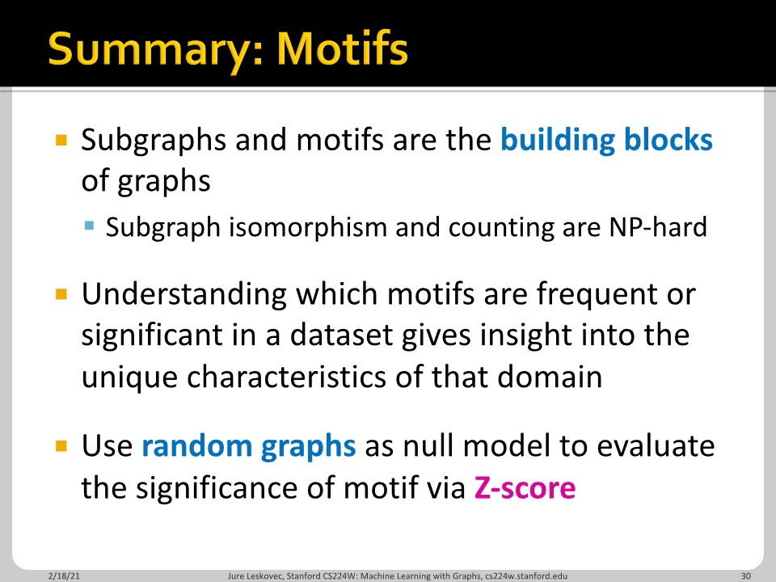{: width="960" height="720" }

지금까지 내용의 요약입니다. Z-score를 통해서 motif의 중요성을 파악한다는 것이 중요한 내용입니다.
