## Neural Subgraph Representations (Subgraph Matching)

지금까지는 motif counting해서 중요한 motif를 확인하는 방법을 알아봤습니다. 하지만 counting에 필요한 subgraph matching이 어렵다는 단점이 있습니다.

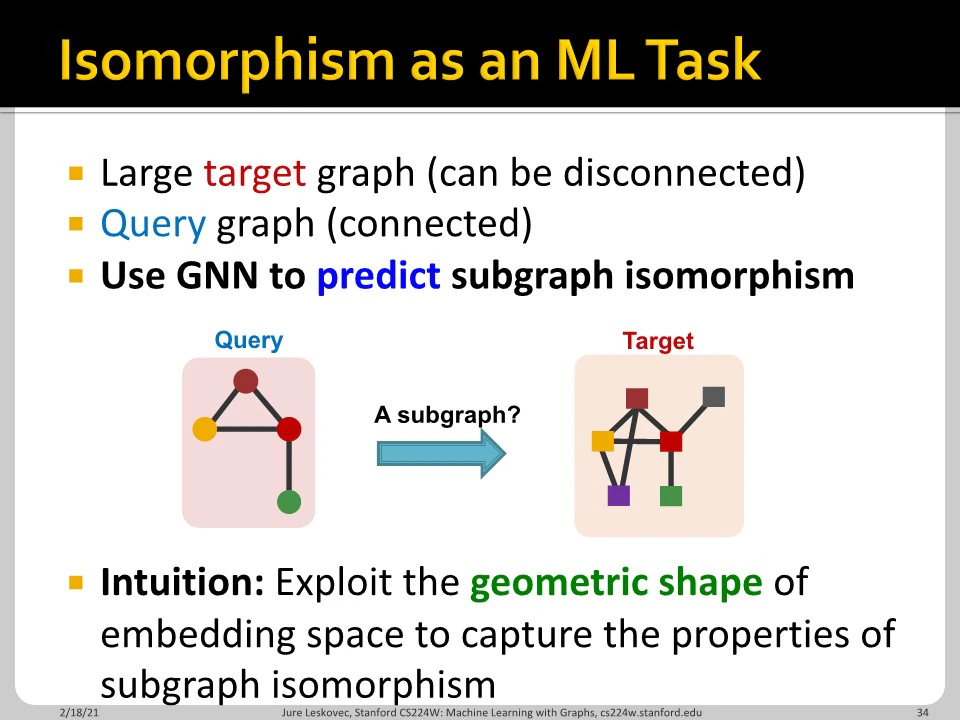{: width="960" height="720" }

Matching problem은 query graph가 target graph의 subgraph인지 확인하는 binary prediction task와 일치합니다. 이때 query graph의 embedding과 target graph에서 sampling한 node의 neighborhood embedding을 구하여 비교한다.

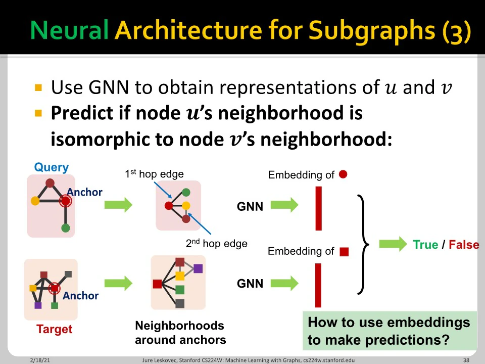{: width="960" height="720" }

Query subgraph에서 anchor를 잡고, target graph에서도 anchor를 잡습니다. 그 이후에 해당 anchor의 k-hop neighborhood에 대해서 embedding을 만듭니다. 이 embedding으로 포함 관계에 대한 binary prediction 문제를 풀게 됩니다.

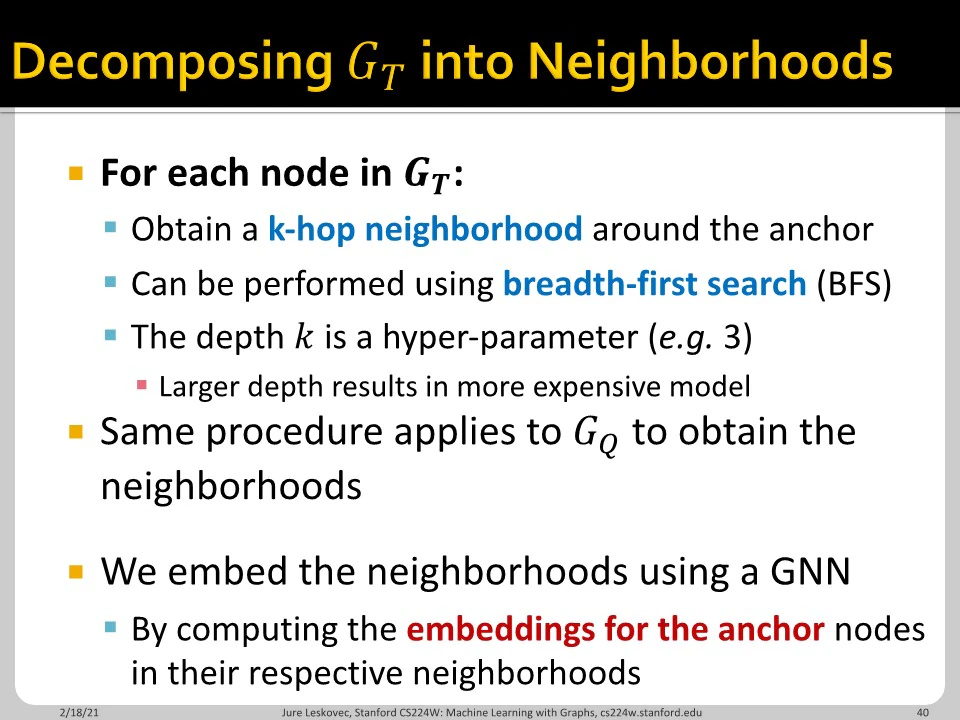{: width="960" height="720" }

전 슬라이드의 내용을 자세히 말하면, target graph $$G_T$$에서 각 anchor에 대하여 k-hop neighborhood embedding을 얻어냅니다. 마찬가지 방법으로 $$G_Q$$에 대해서도 neighborhood embedding을 구합니다. Embedding을 이용해 $$G_Q$$가 $$G_T$$의 subgraph인지 판단하는 방법은 무엇일까요? Order embedding space라는 방법을 활용합니다.

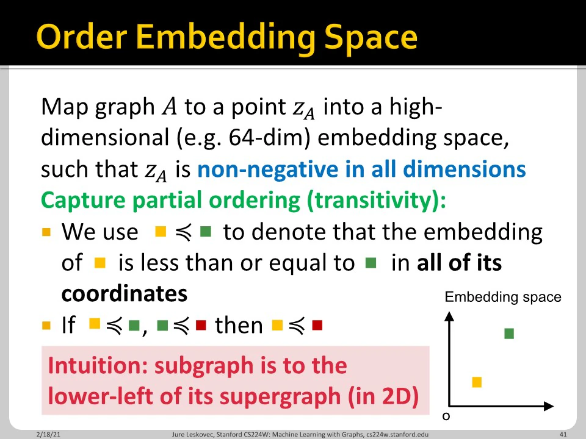{: width="960" height="720" }

한 embedding vector의 값이 다른 embedding vector보다 모든 차원에서 작거나 같다면, 2D 상에서는 그 vector의 lower-left에 위치하는 셈입니다. 이때 embedding space는 모두 non-negative 하게 생성합니다.

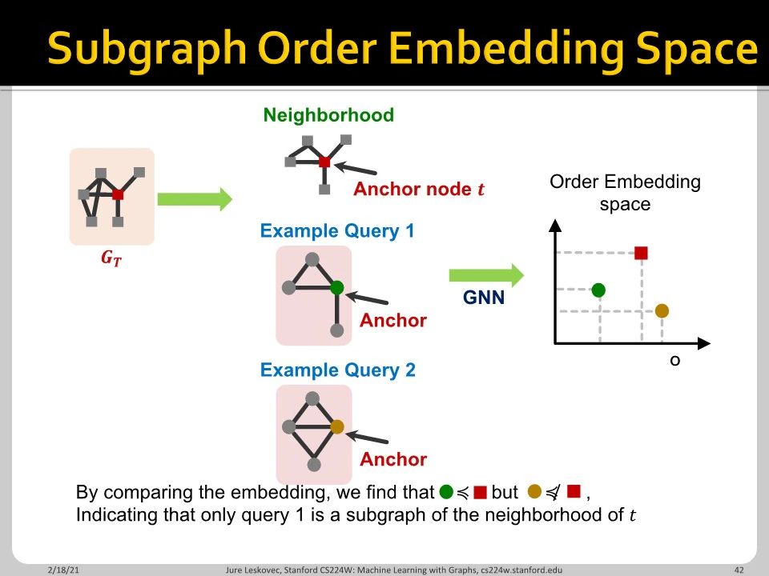{: width="960" height="720" }

Query graph의 embedding이 target graph의 embedding보다 lower-left에 있다면 query graph가 target graph의 subgraph가 되도록 학습을 진행합니다. 이런 order embedding은 다양한 관계를 표현할 수 있습니다.

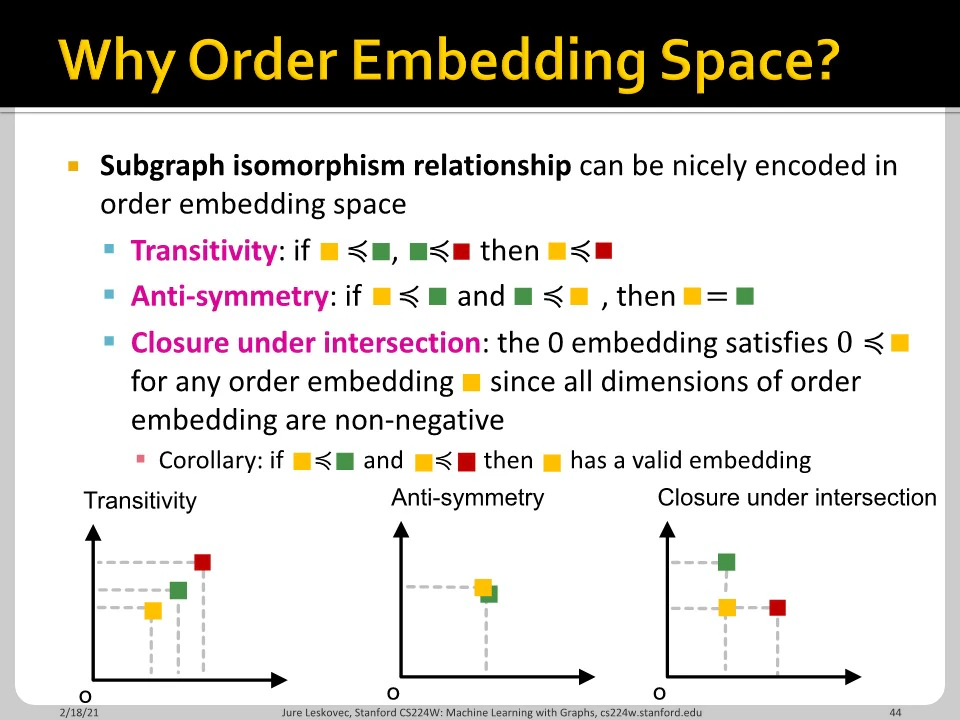{: width="960" height="720" }

여러 그래프의 순차적인 subgraph 관계를 나타내기에도 좋고, 두 graph embedding의 위치가 같다면 isomorphic하다고 말할 수도 있습니다. 이렇게 학습되기 위해서 어떤 식으로 loss를 정의할지 확인해봅시다.

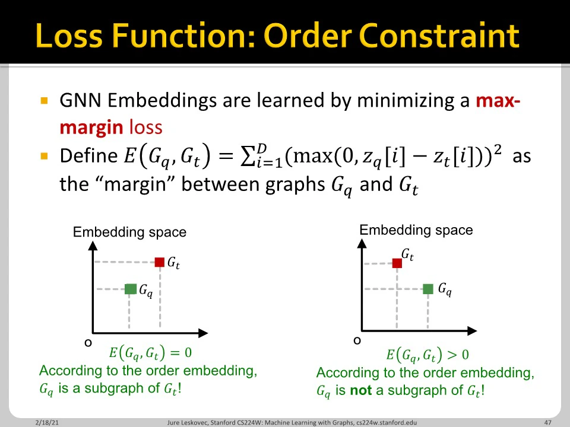{: width="960" height="720" }

여기서 max-margin loss를 도입하여 subgraph가 항상 lower-left하게 만듭니다. Max-margin loss는 lower-left가 맞으면 0이고, 만약 lower-left가 아니라면 양수의 값을 가집니다.

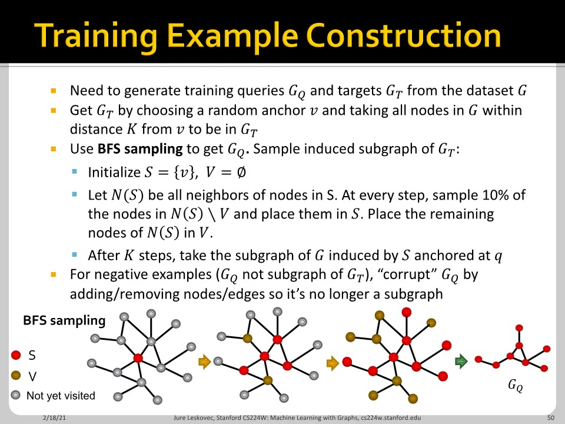{: width="960" height="720" }

Training 과정은 기존의 graph training과 일치합니다. Positive sample과 negative sample을 얻어서 loss를 minimize하는 것입니다. Positive sample에 대해서는 $$E(G_q, G_t)$$ 를 최소화시킵니다. Negative example에 대해서는 $$max(0, \alpha - E(G_q, G_t))$$ 를 최소화하게 됩니다. $$\alpha$$ 는 0보다 큰 hyperparameter로 negative sample의 $$E(G_q, G_t)$$ 값이 $$\alpha$$ 이상이 되도록 학습하는 것입니다.

Training set의 경우 target graph에서 anchor node를 뽑고, anchor node의 neighborhood node들을 sampling 합니다. Negative sample은 query graph에 node나 edge를 추가하거나 삭제해서(corrupt) 더 이상 subgraph가 아니게 만들어 얻습니다. 매 iteration마다 새로운 sample을 얻어 overfitting을 방지하고, 3~5 hop을 활용합니다.

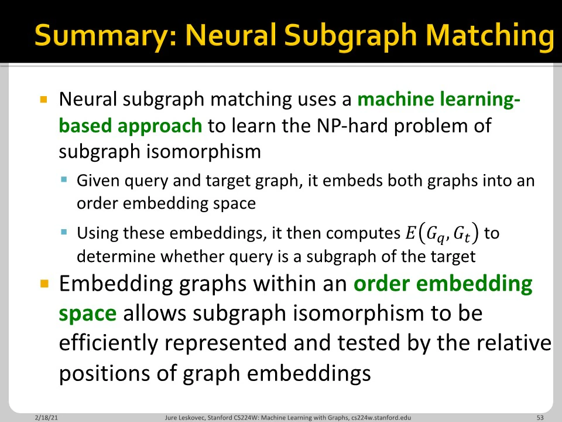{: width="960" height="720" }

이번 절의 요약입니다.

## Finding Frequent Subgraphs

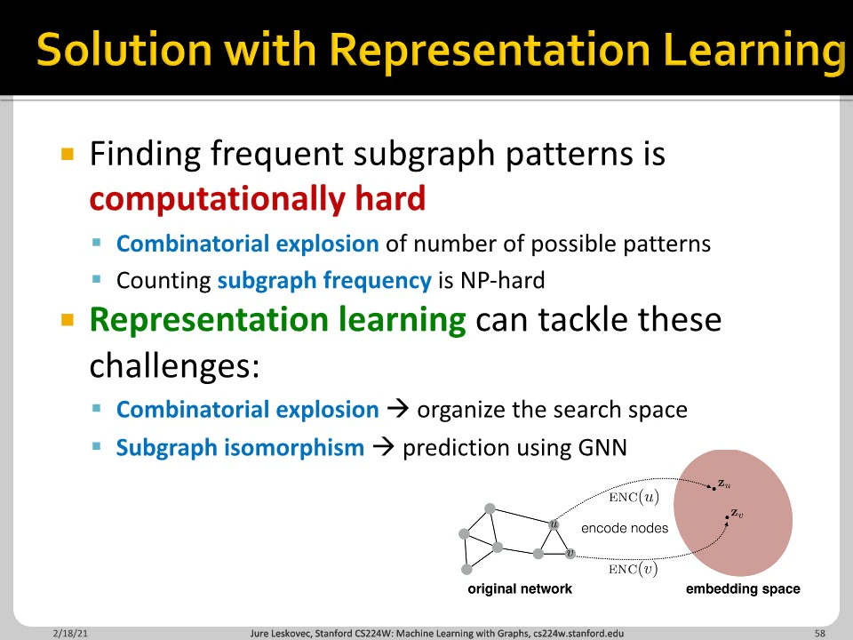{: width="960" height="720" }

실제로 target graph에 대해서 frequent subgraph를 counting할 수는 없습니다. 따라서 counting이 아니라 prediction을 하게 됩니다. Prediction을 anchor로부터의 k-hop neighbor에 대해서 할 수 있어야 하고, k가 클수록 의미가 커질 것입니다.

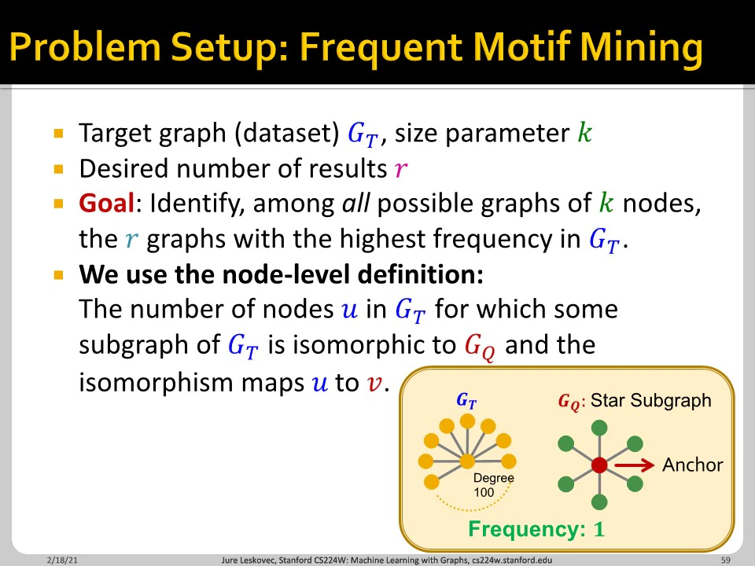{: width="960" height="720" }

문제 상황을 다시 설명하면, size-k의 graph 중에서 target graph에 가장 많이 나타난 graph를 찾아야만 합니다.

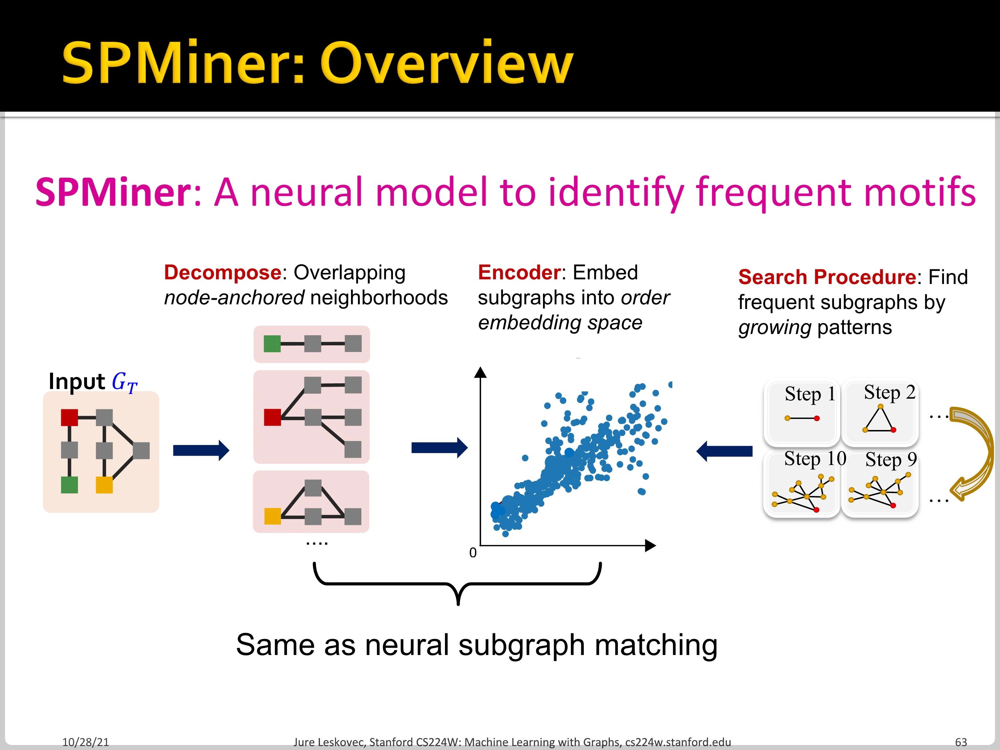{: width="3000" height="2250" }

이를 위해서 SPMiner라는 방법을 활용하게 됩니다. SPMiner는 target graph를 여러 subgraph로 나눈 뒤 각 subgraph의 embedding을 구한다. 그다음 size 별로 frequent한 subgraph를 greedy algorithm으로 구할 수 있습니다. Growing patterns라고도 하는데, 뒤에서 자세히 설명하겠습니다. 이런 방법은 brute force보다 훨씬 빠르고 효율적입니다.

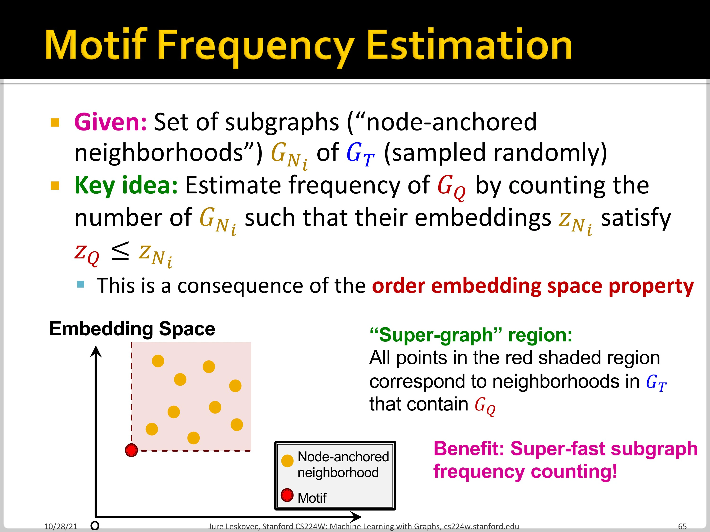{: width="3000" height="2250" }

Node-anchored subgraph는 노란색으로 표현되어 있습니다. 현재 motif(빨간색)를 포함할 가능성이 있는 neighborhood들이 motif의 오른쪽 위에 위치하게 됩니다. 가능성 있는 subgraph가 많을수록 빈번한 motif로 생각할 수 있습니다.

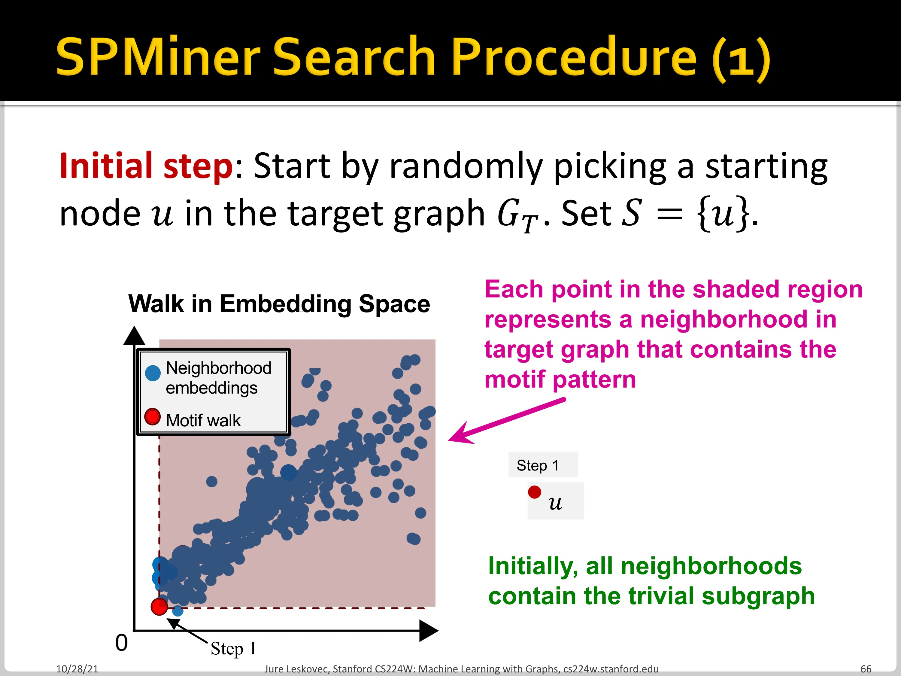{: width="3000" height="2250" }

처음 시작할 때는 size 1 node graph로 시작합니다. 이때는 모든 sample subgraph (neighborhoods)에 대해서 포함되어 있습니다.

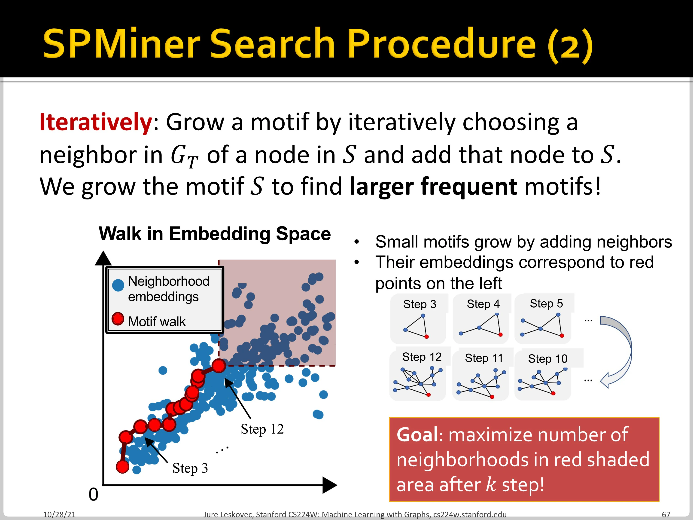{: width="3000" height="2250" }

Node를 하나씩 증가시키면서 shaded region을 최대로 하는 motif를 찾습니다. 매 step마다 node가 1개씩 추가됩니다. Shaded region은 현재 motif를 포함하는 neighborhood들이 있는 영역으로, 이 영역 안에 들어오는 neighborhood가 많을수록 motif의 frequency가 높다는 것입니다. 이 과정에서 특정 크기의 graph에 도달하면 작업을 종료합니다.

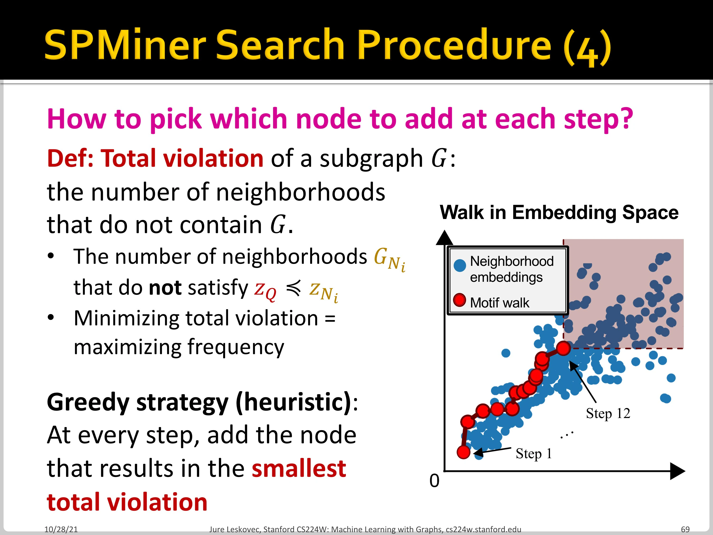{: width="3000" height="2250" }

위에서 말한대로 node를 추가할 때마다 size가 커지는 매 step에서 total violation이 가장 작은 node를 추가합니다. (greedy algorithm) 이때 total violation은 해당 motif를 포함하지 않는 neighborhood의 개수입니다. SPMiner의 효과는 작은 motif와 큰 motif에서 모두 발견할 수 있습니다.

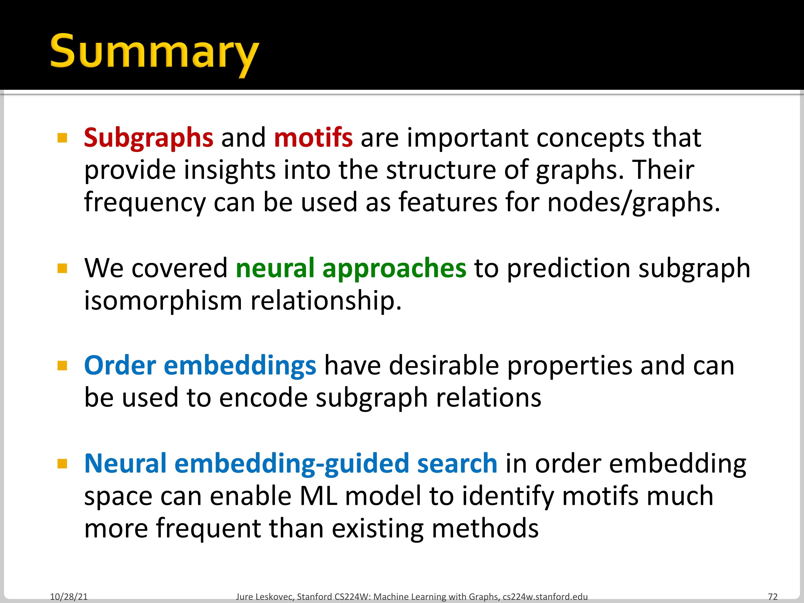{: width="3000" height="2250" }

내용의 요약입니다.
