## Recommender Systems Tasks and Evaluation

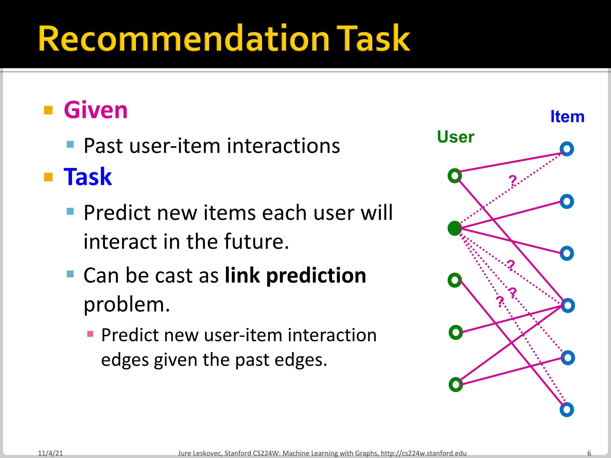{: width="3000" height="2250" }

Recommender system의 graph는 user와 item, 두 가지 노드로 이루어진 bipartite graph입니다. Recommendation task를 정의하자면 과거의 user-item interaction을 통해 새로운 user-item interaction을 예측하는 link prediction으로 볼 수 있습니다.

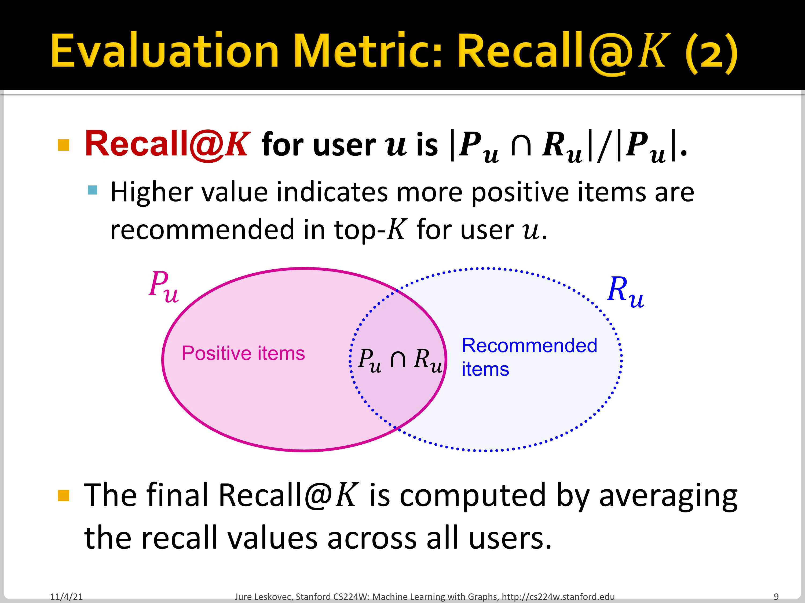{: width="3000" height="2250" }

유저에게 K개의 item을 추천해주되, 그 K개의 item 안에 interaction 가능성이 높은 item이 최대한 많이 포함되도록 하는 것이 목표입니다. 주로 Recall @K를 evaluation metric으로 사용합니다.

## Recommender Systems: Embedding-Based Models

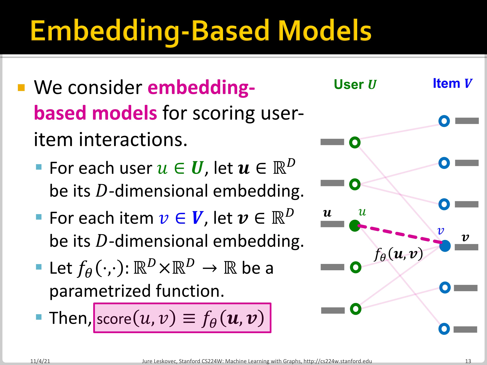{: width="3000" height="2250" }

Top-K의 item을 고르기 위해서 score function이 필요합니다. User U와 Item V 사이의 점수를 파악하는 score(u, v)가 정의되어야 합니다. 이 Score가 가장 높은 K개의 item들이 recommend 됩니다.

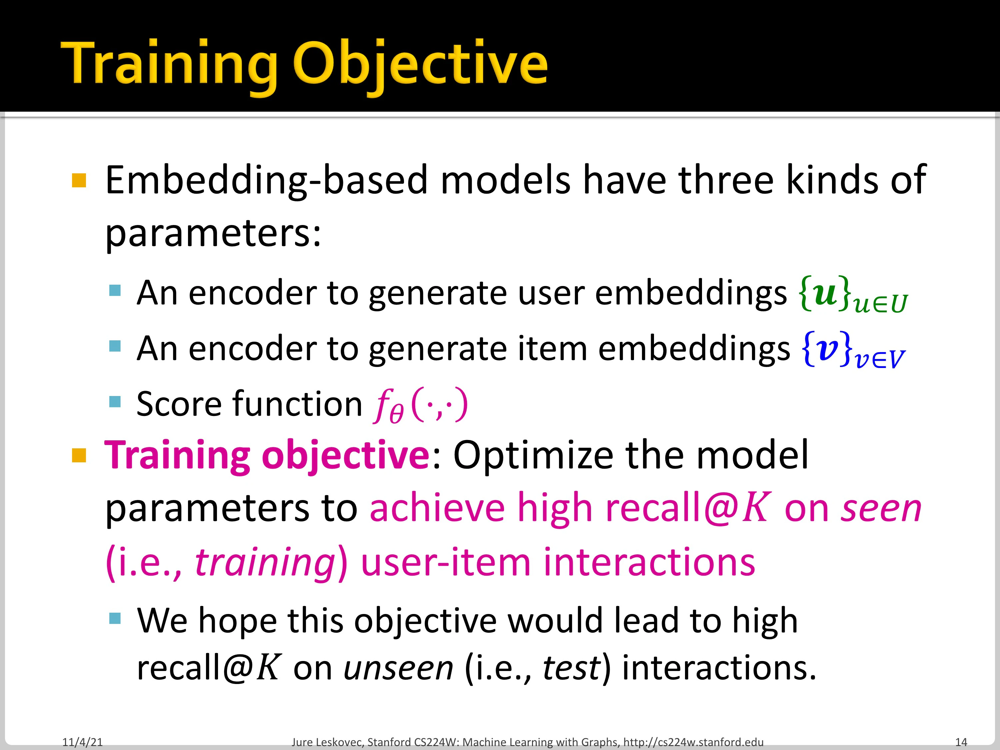{: width="3000" height="2250" }

이때 embedding을 활용하게 됩니다. User/item embedding을 기반으로 score를 계산하게 됩니다. Embedding을 계산하기 위한 encoder가 필요하고, score function이 seen user-item interaction에 대해 high recall@K를 내도록 학습합니다.

이때 학습에 필요한 loss는 surrogate loss가 사용됩니다. Training recall@K는 differentiable하지 않으므로, surrogate loss function이 정의되어야 합니다. 크게 두 가지 loss가 사용됩니다. Binary loss와 Bayesian Personalized Ranking (BPR) loss가 그것입니다. 이 surrogate loss는 differentiable하면서 동시에 original objective와의 align이 잘 되어야 합니다.

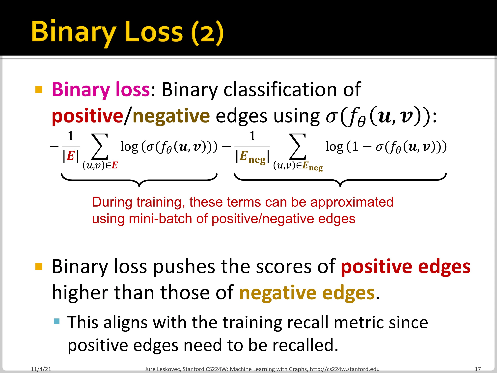{: width="3000" height="2250" }

Binary loss는 positive edge의 score가 negative edge의 score보다 더 높아지도록 합니다. 이때 sigmoid function을 활용합니다. Binary loss는 모든 positive edge를 모든 negative edge보다 높은 score를 갖게 하는 데에 초점을 둡니다. 그리고 positive edge와 negative edge를 비교하고, penalize하는 과정에서 문제가 발생합니다.

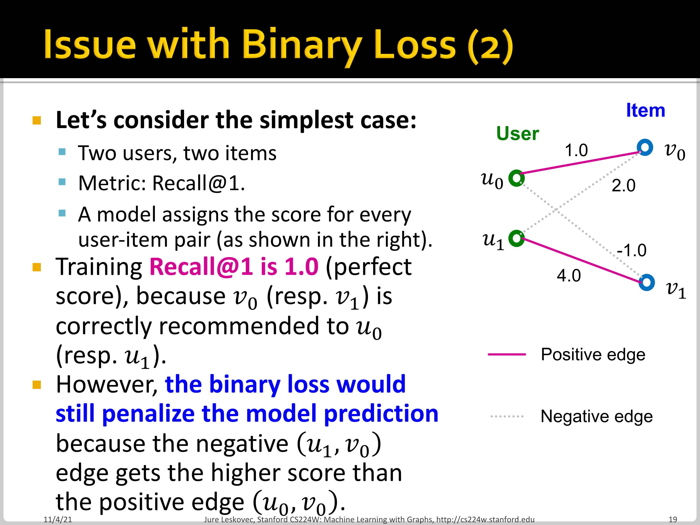{: width="3000" height="2250" }

예를 들어, 위의 모델은 $$u_{0}$$은 $$v_{0}$$를 선택하였고, $$u_{1}$$은 $$v_{1}$$을 선택하였으니 모든 선택이 정상적으로 이루어졌습니다. 하지만 그럼에도 불구하고, 2.0의 score를 갖는 negative edge가 1.0의 score를 갖는 positive edge보다 score가 높은 case가 존재하기 때문에 모델은 계속해서 이를 penalize합니다.

위의 예시에서 Binary loss는 user별로 personalized 되어 있지 않다는 문제가 있음을 확인할 수 있습니다. 따라서 각 user의 positive item이 negative item에 비해 더 높은 score를 갖게 하는 loss가 존재해야 합니다. 우리는 특정 상품에 대해서 user 사이의 ordering까지는 신경 쓰고 싶지 않은 것입니다. 이런 측면에서 Bayesian Personalized Ranking (BPR) loss가 등장하게 됩니다.

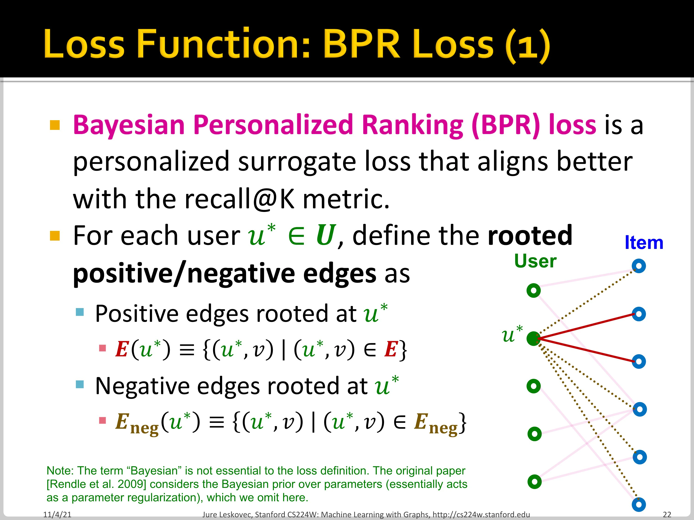{: width="3000" height="2250" }

BPR loss는 user별로 positive/negative edge loss를 계산합니다. Binary loss를 user별로 나눈 것으로, user 별 positive edge의 score가 negative edge의 score보다 높아지도록 합니다.

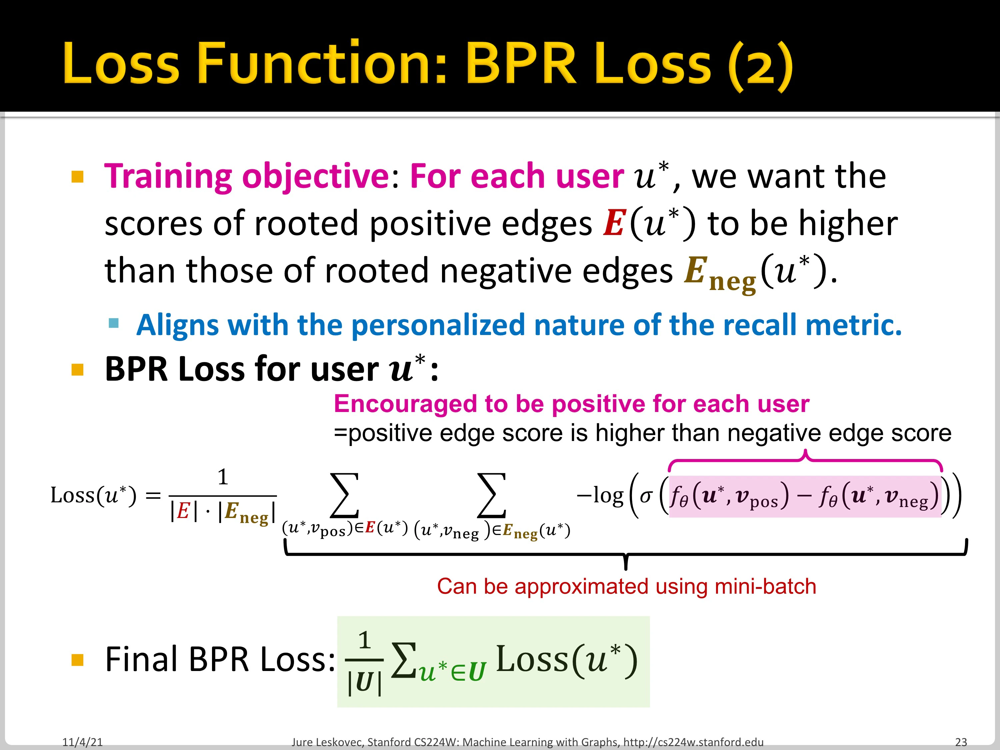{: width="3000" height="2250" }

User 별로 positive item과 negative item을 짝지어, 각 쌍의 score 차이 $$f_\theta(u^*, v_{pos}) - f_\theta(u^*, v_{neg})$$에 $$-\log \sigma(\cdot)$$를 취한 값의 평균을 계산합니다. 이를 mini-batch내 user set들에 대해 개별적으로 수행하여 loss average를 구하여 Final BPR loss를 얻습니다.

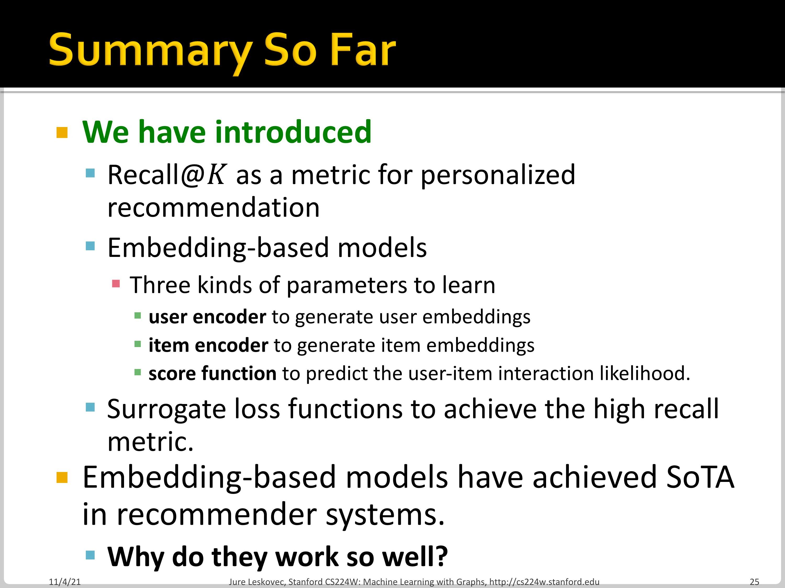{: width="3000" height="2250" }

지금까지의 정리입니다. User, item에 대한 encoder가 필요하고, score function이 필요합니다. 또한 recall에 대한 surrogate loss function이 필요합니다.

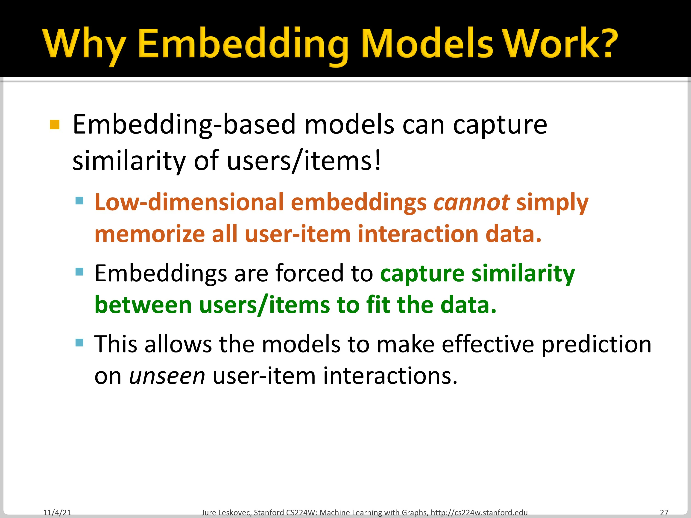{: width="3000" height="2250" }

이 모델이 왜 잘 작동할까요? Embedding model은 비슷한 user의 선호를 비슷하게 합니다. 이 similarity는 어떻게 capture 될까요? Low-dimensional embedding을 만드는 과정에서 user-item interaction은 더 낮은 차원의 vector로 표현됩니다. 모든 관계를 다 외울 수 없기 때문에, embedding vector가 관계에 대한 정보를 함축적으로 담습니다. 이 과정에서 유사한 관계는 유사한 embedding vector를 가집니다.

이제 서로 다른 종류의 recommender system을 학습하도록 하겠습니다. 각각 Neural Graph Collaborative Filtering (NGCF), LightGCN, 그리고 PinSAGE입니다.

## Neural Graph Collaborative Filtering

기존의 collaborative filtering은 matrix factorization을 기반으로 합니다. User와 item 선택에 대한 행렬을 분해하여 embedding을 만들고, 이 embedding을 내적 했을 때 score가 나오도록 되어있습니다. 이런 구조에서는 graph 구조를 반영하지 못하고, multi-hop의 관계를 반영하지 못합니다. (Only the first-order graph structure is captured)

따라서 그래프 구조를 반영하면서 high-order graph 구조도 반영할 수 있는 recommender system을 고안하게 됩니다. 대표적으로 Neural Graph Collaborative Filtering과 LightGCN이 이 아이디어에서 파생되었습니다.

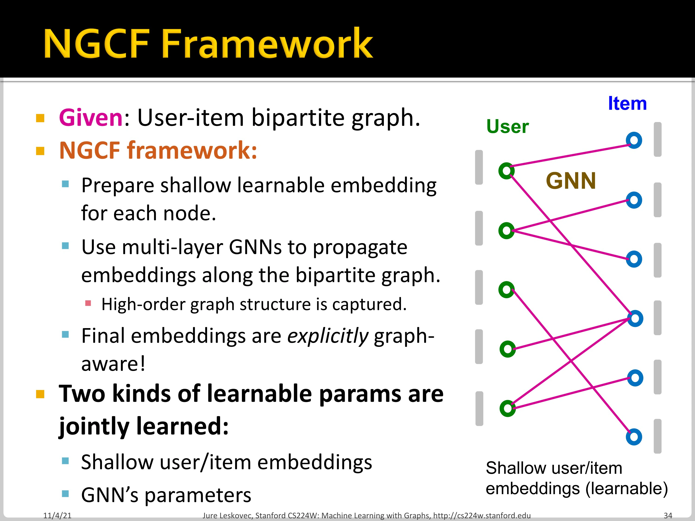{: width="3000" height="2250" }

NGCF는 high-order 정보가 전파된 embedding을 만들고자 합니다. 먼저 각 node에 shallow learnable embedding을 준비하고, multi-layer GNN으로 bipartite graph에서 embedding을 전파시킵니다. 결과적으로 shallow user/item embedding과 GNN parameter가 학습됩니다.

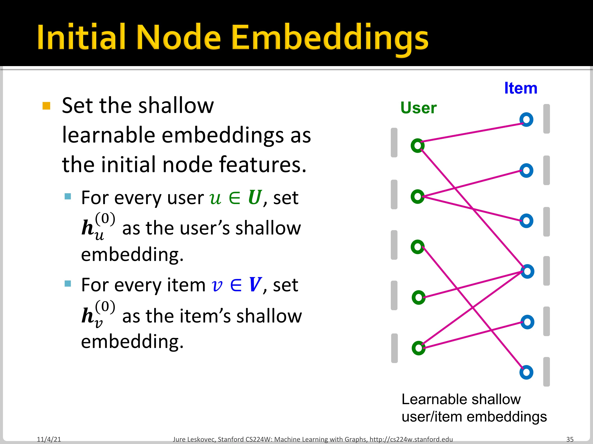{: width="3000" height="2250" }

첫 step에서 node feature로 initial node embedding을 할당합니다.

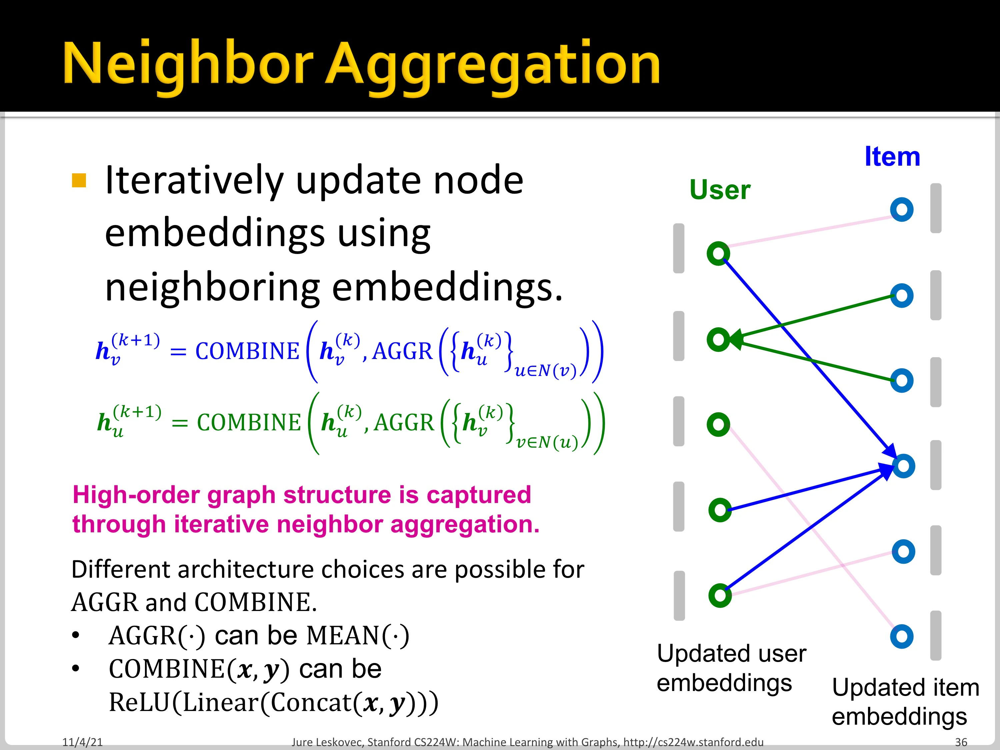{: width="3000" height="2250" }

그다음 step에서 item은 연결된 user embedding을 aggregate해서 update되고, user는 연결된 item embedding을 aggregate해서 update됩니다.

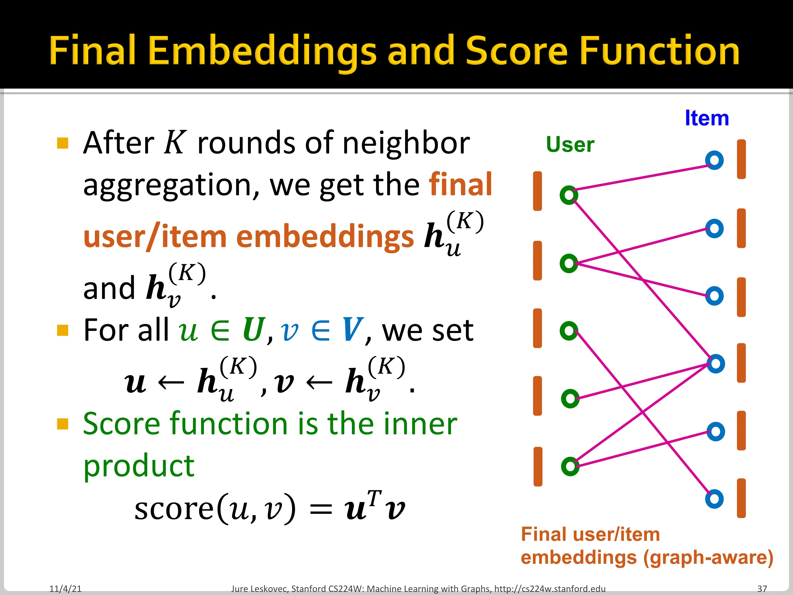{: width="3000" height="2250" }

Final embedding을 inner product하여 score를 구합니다. GNN을 적용할 수 있는 가장 naive한 approach라고 할 수 있습니다. NGCF는 conventional CF와는 다르게 high-order graph structure를 인지할 수 있습니다. 다음 절에서는 LightGCN에 대해서 확인해보겠습니다.
