## Community Detection in Networks

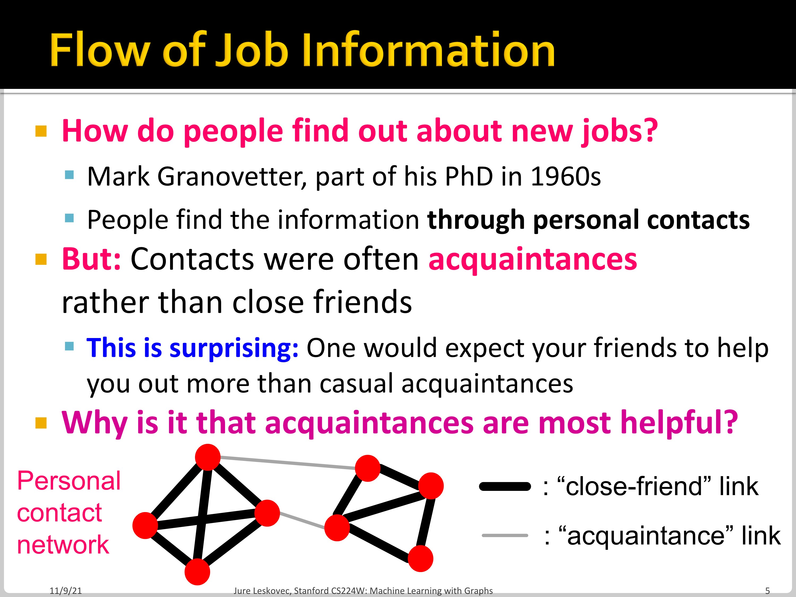{: width="3000" height="2250" }

Granovetter의 연구에서는 close-friend 보다 지인의 중요성을 설명합니다. 강의 전반과 강하게 연결되는 내용은 아니지만, 우리 삶에서는 자주 느낄 수 있는 포인트입니다.

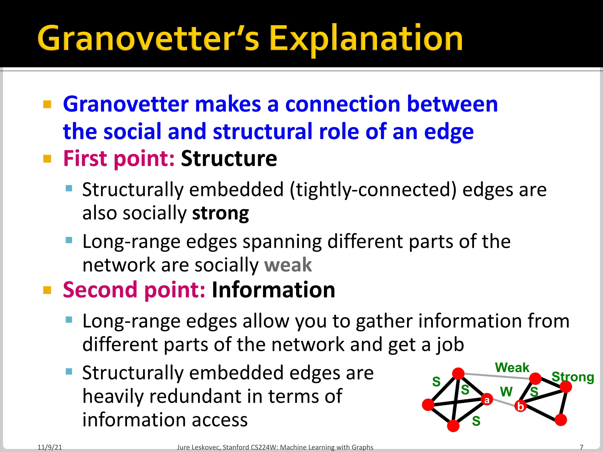{: width="3000" height="2250" }

그 이유는 강한 친밀도의 친구끼리는 이미 많은 정보가 공유되고 있기 때문입니다. 이미 그들 사이의 정보는 redundant information일 확률이 높습니다.

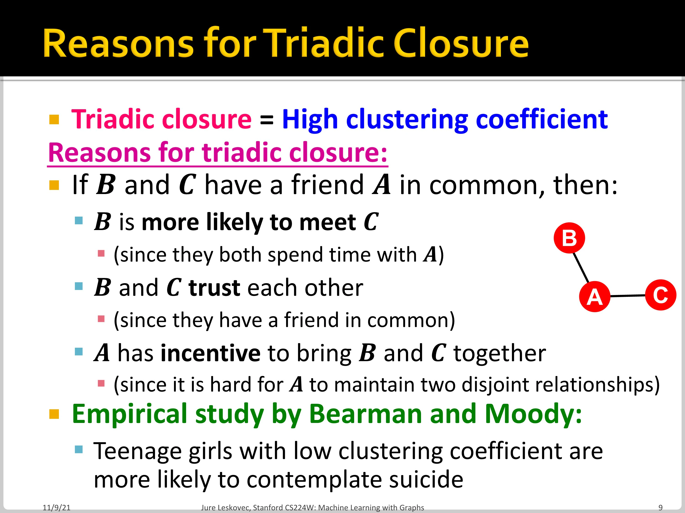{: width="3000" height="2250" }

어떤 식으로 community를 정할지에 대한 고민을 하는 과정에서, triadic closure를 이야기할 수 있습니다. A와 B가 연결되어있고, A와 C가 연결되어 있다면 B와 C도 연결될 가능성이 높다고 보는 것이 triadic closure입니다.

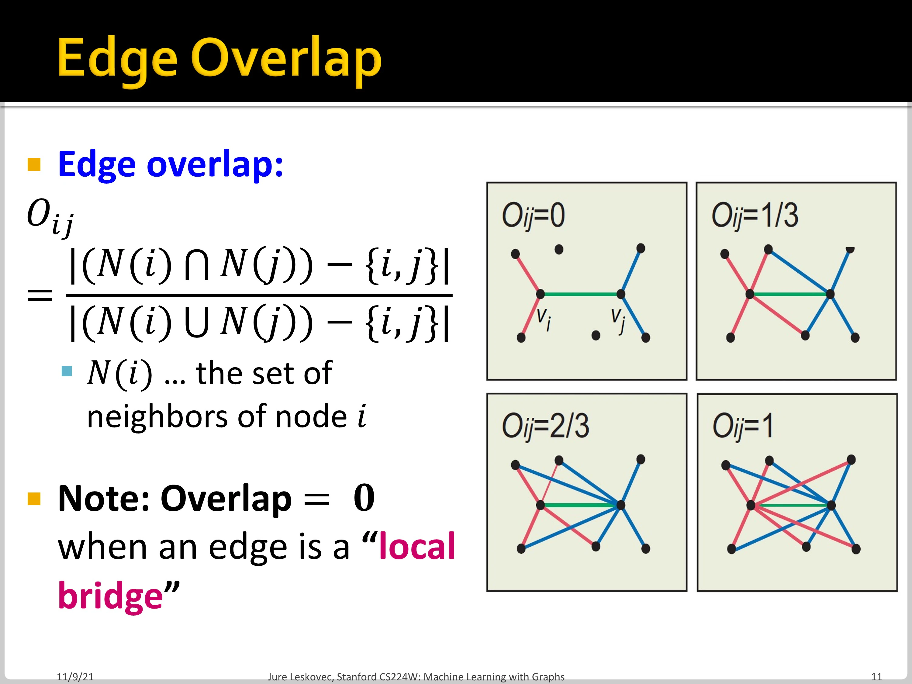{: width="3000" height="2250" }

또한 edge overlap을 통해서도 community를 찾을 수 있습니다. 뒤에서 보듯이 edge overlap 분석은 network가 촘촘하게 연결된 node 집합(community)들로 이루어져 있다는 직관을 뒷받침합니다.

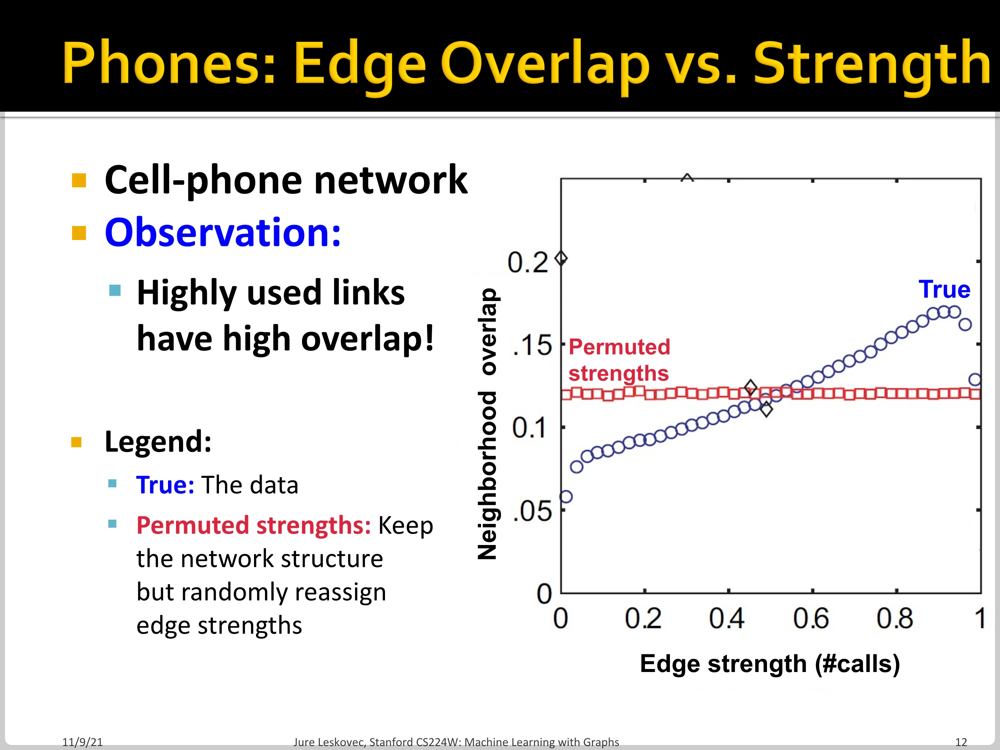{: width="3000" height="2250" }

일반적으로 overlap이 많을수록 edge strength도 증가합니다. Random하게 strength가 assign된 경우에는 edge strength에 따른 neighborhood overlap의 차이가 크지 않은 반면, 실제 데이터(통화 횟수를 edge strength로 사용)에서는 strength가 클수록 overlap이 대체로 linear하게 증가하는 것이 증거입니다.

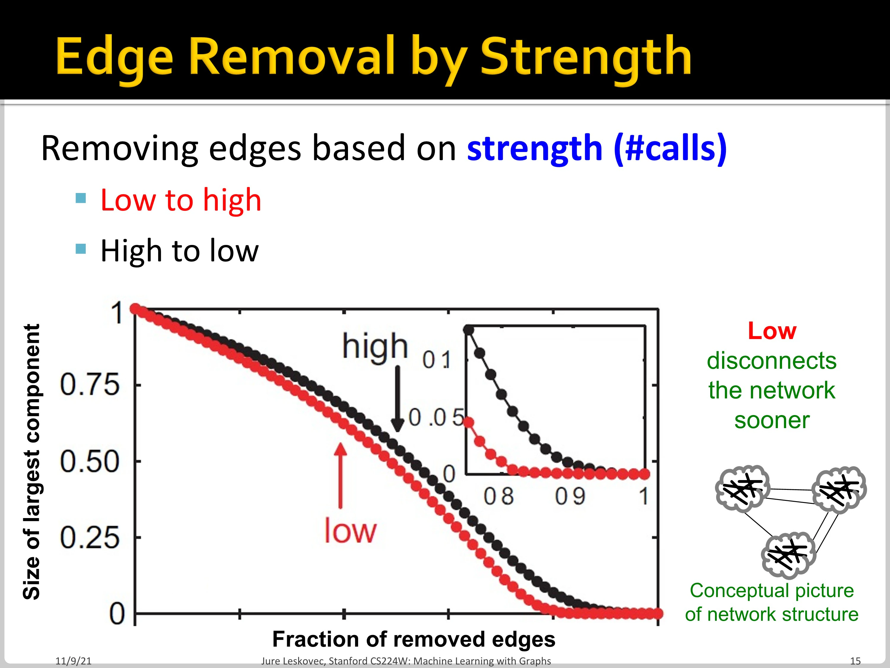{: width="3000" height="2250" }

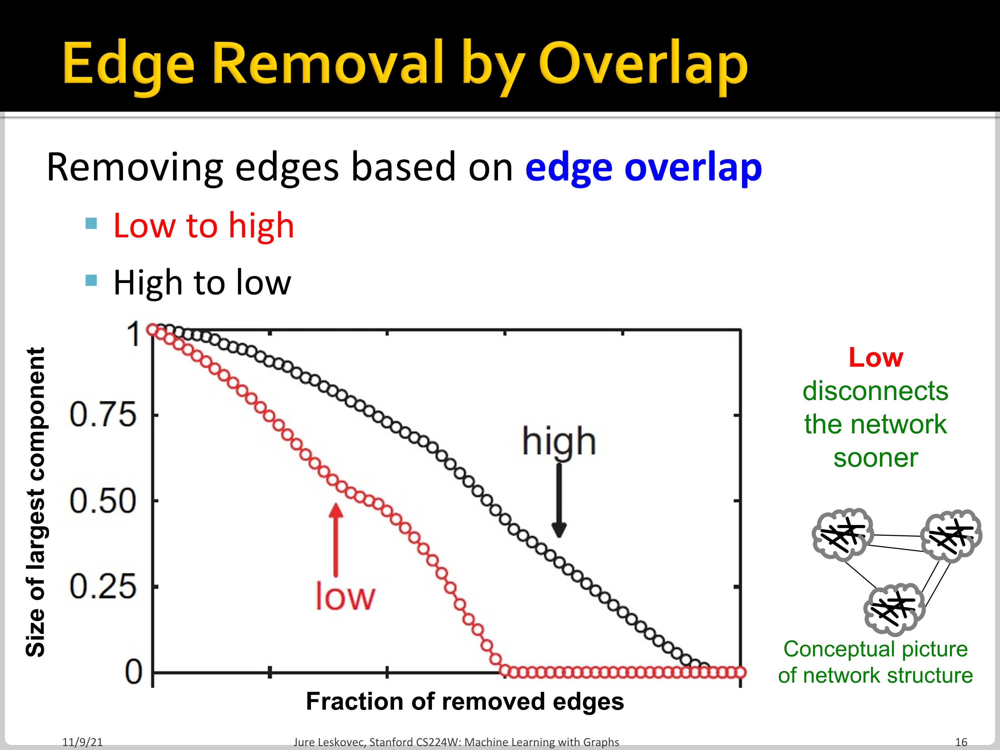{: width="3000" height="2250" }

지금은 graph의 edge를 잘라가면서 largest component의 size 양상을 확인하는 과정입니다. Edge strength를 기준으로 할때, edge overlap을 기준으로 할때 둘다 low를 먼저 자를 때 graph가 더 빠르게 파편화 되는 것을 알 수 있습니다.

## Network Communities

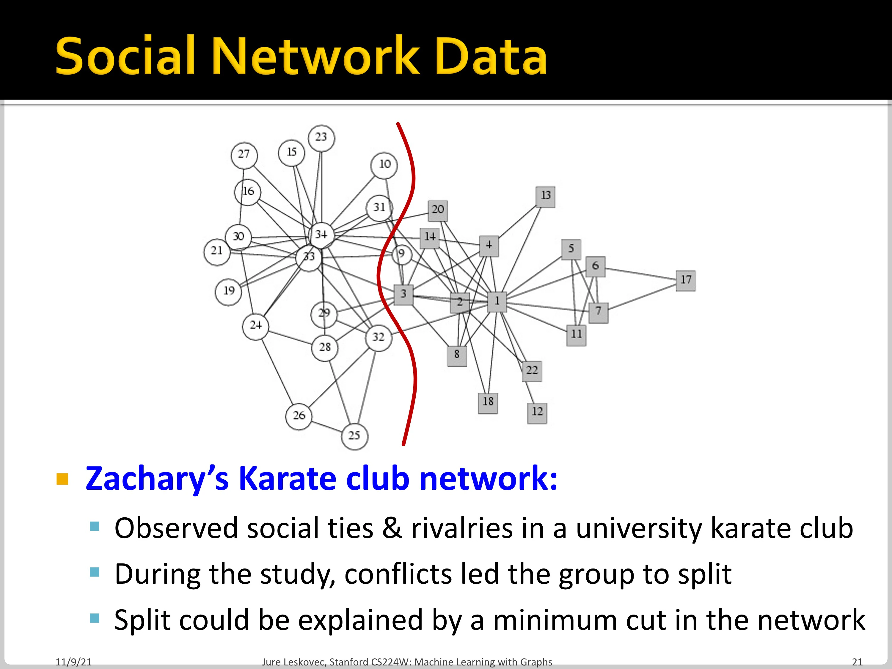{: width="3000" height="2250" }

Karate club을 조사하는 과정에서, 그룹 사이의 conflict가 발생했고 이 때문에 두개의 community가 생겼습니다. 이때 발생한 두 community의 모습은 마치 mincut과 같았다고 합니다. 여기서 우리는 overlap이 약한 곳을 기준으로 community를 나누는 것에 대한 정당성을 얻을 수 있습니다. 뒤에 나올 modularity Q는 이런 community 구조가 얼마나 뚜렷한지를 측정하는 index입니다.

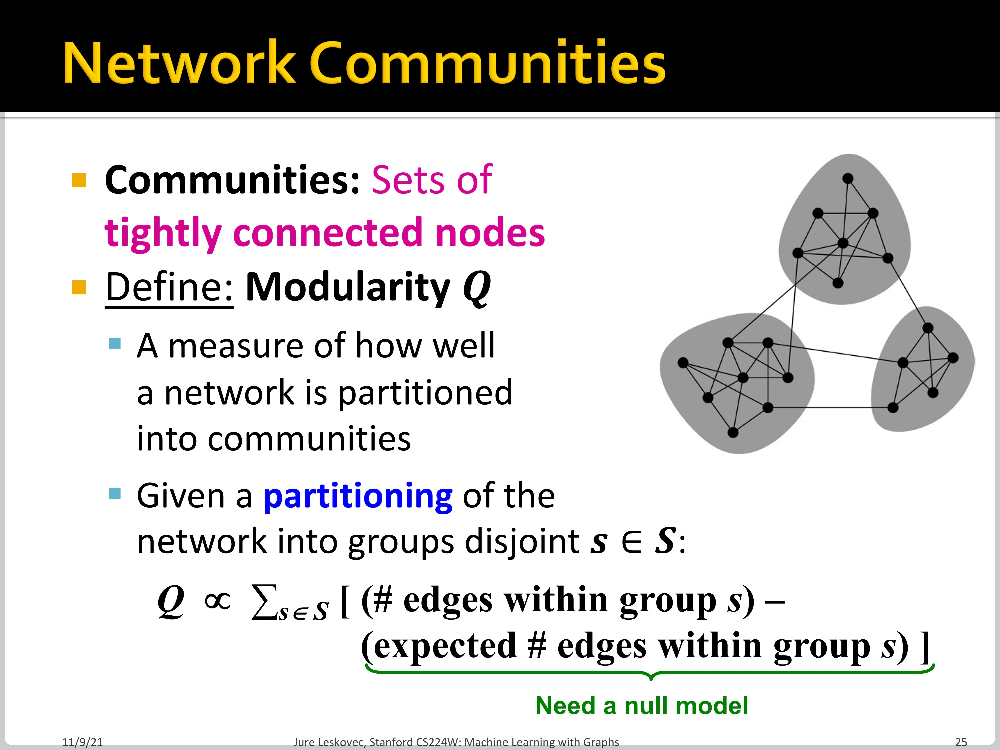{: width="3000" height="2250" }

Modularity Q는 network가 community로 얼마나 잘 나뉘었는지를 측정하는 지표입니다. 실제로 있는 # edges에서 expected # edges를 제외하면 이 community가 얼마나 강한지 확인할 수 있습니다. 이때 expected # edges를 파악하기 위해 null model이 필요합니다.

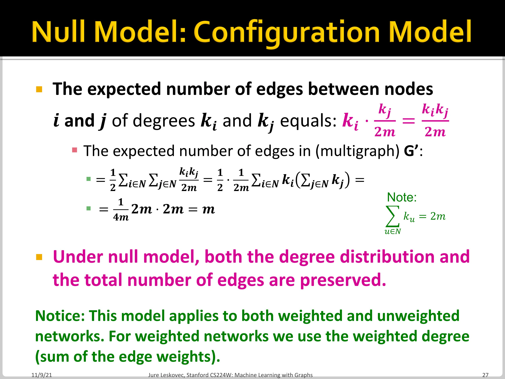{: width="3000" height="2250" }

각 node가 원래의 degree를 유지하면서 연결되도록 유도하면 됩니다. 이런 null model을 활용하면 기존의 # edges를 유지할 수 있습니다.

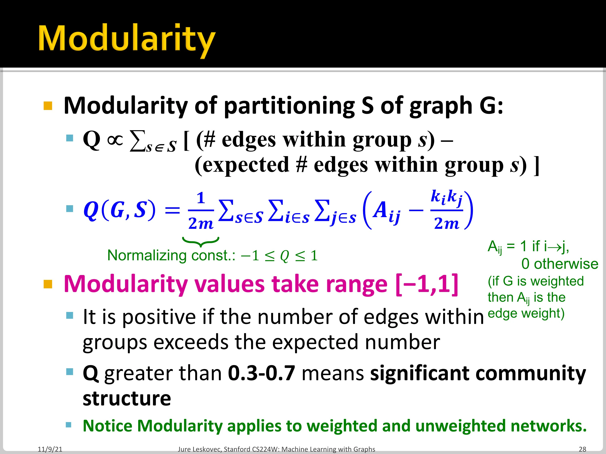{: width="3000" height="2250" }

결론적으로 Modularity Q는 각 node의 degree는 유지한 상황에서 무작위로 edge가 연결되었을 때의 상호 연결성과 현재의 연결성을 비교합니다.

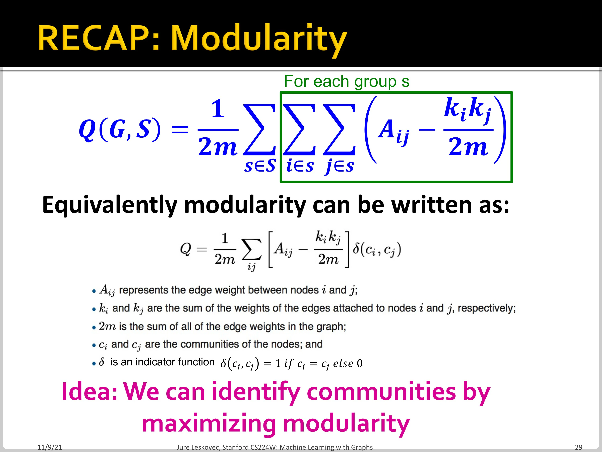{: width="3000" height="2250" }

지금까지 내용의 요약입니다.
