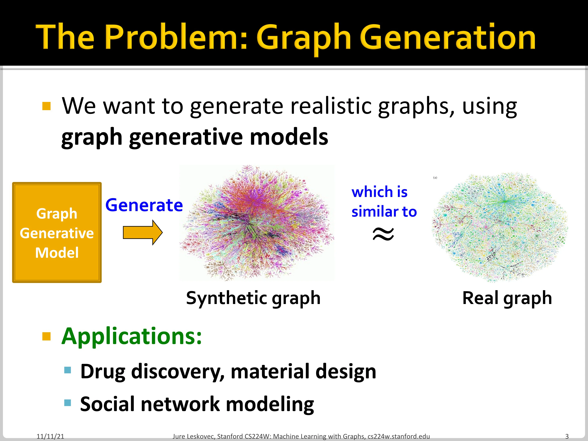
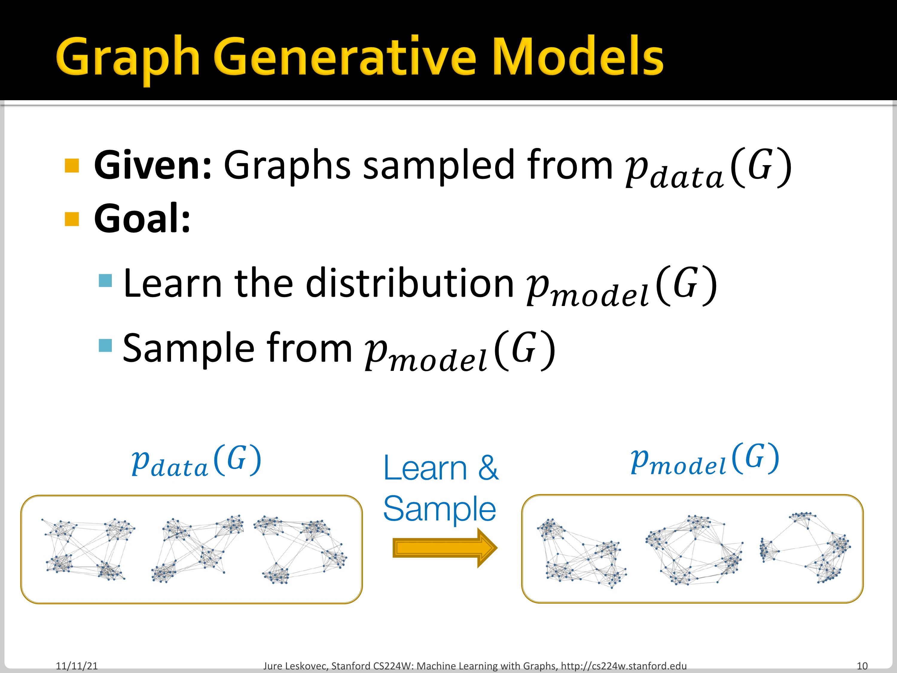
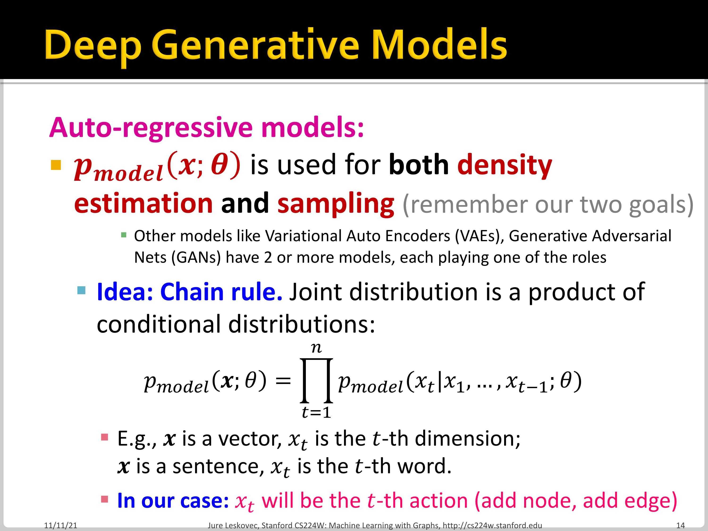
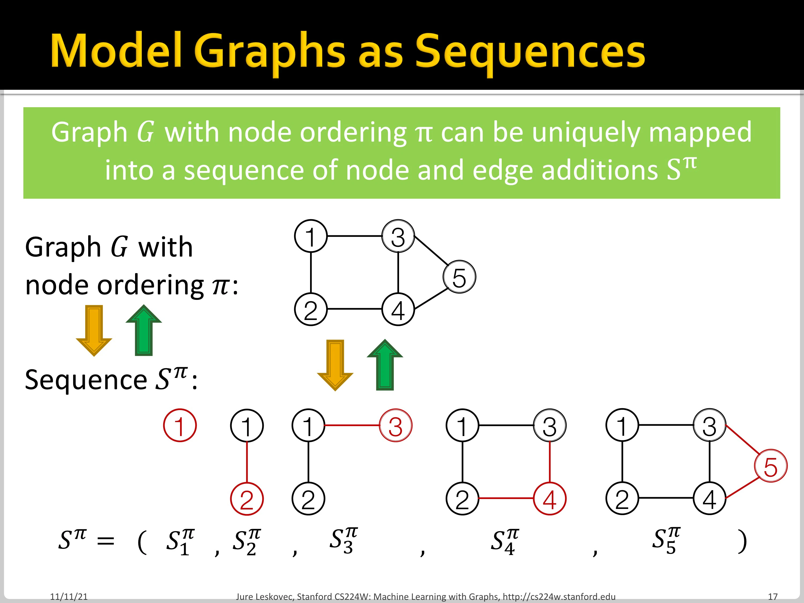
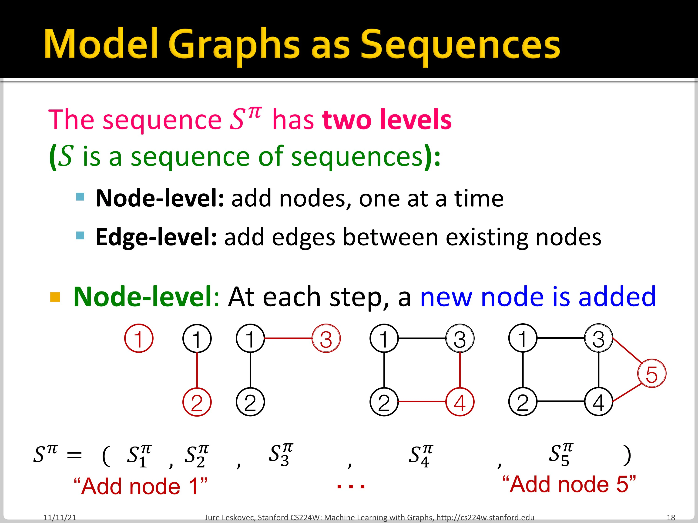
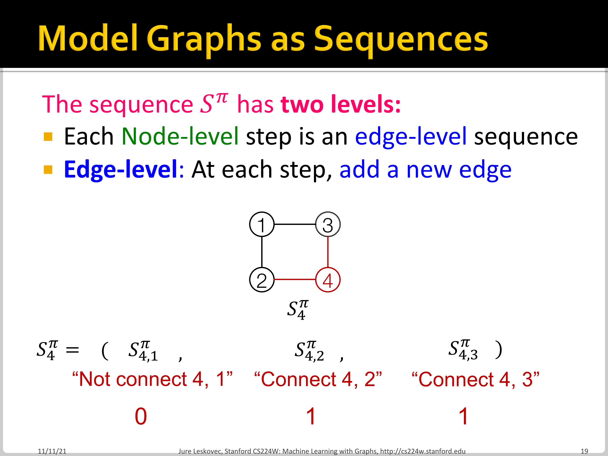
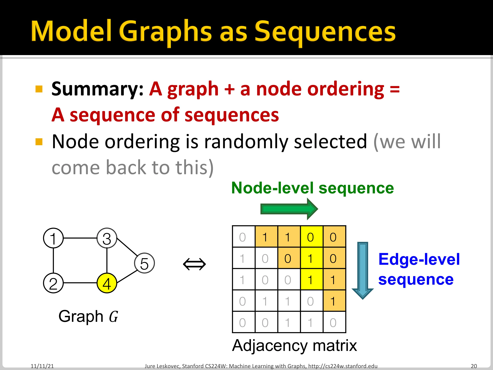
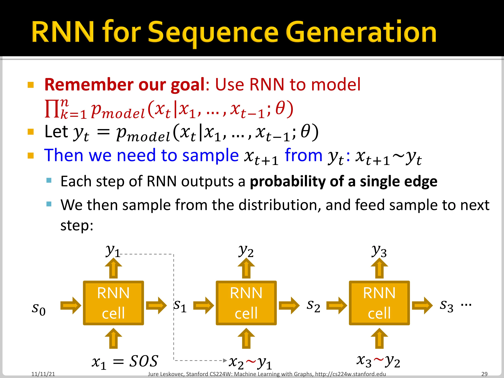
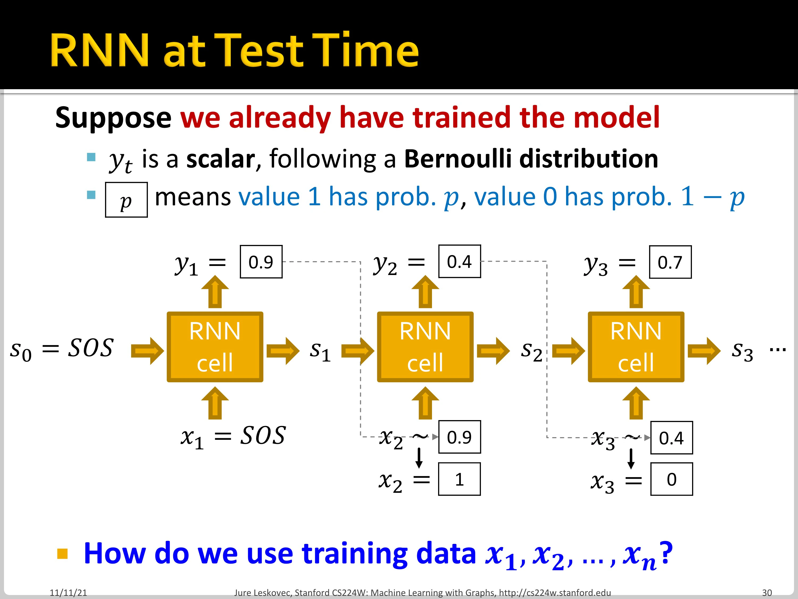
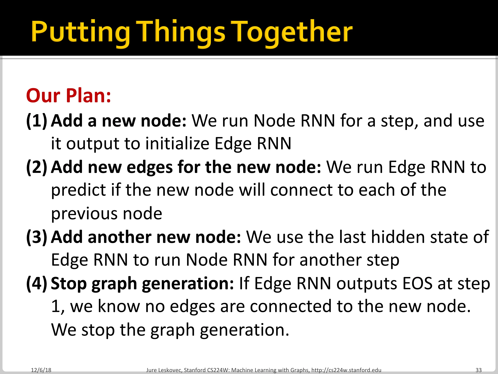

그래프 generation은 지금까지 다룬 graph 문제와는 또 다른 형태의 problem formulation 입니다.

{: width="3000" height="2250" }

Synthetic graph를 만드는 방법에 대해서 이야기하는 chapter입니다. Graph generation은 drug discovery, social network modeling 등에 적용할 수 있습니다. 다른 활용 범위로는 아래의 예시들이 있습니다.

Graph generation을 학습하는 이유

- Insights: graph formulation/structure에 대한 insight 획득
- Predictions: graph의 미래 변형에 대한 예측
- Simulations: graph instance에 대해 simulation. (요즘 3D simulation에 graph가 많이 쓰입니다.)
- Anomaly detection: graph가 normal/abnormal 인지 결정하는 데에 사용

Graph generation은 아래와 같은 과정으로 발전하였습니다.

- Real-world graph의 특성을 이해하는 task
- 전통적인 graph generative models 구축
- Deep graph generative models

이번 chapter에서 다룰 부분은 deep graph generation model입니다. 지금까지 우리가 graph를 embedding으로 encoding 하는 작업을 했다면, 이제 embedding에서 graph를 generate하는 decoding 문제를 풀어야 합니다.

## Machine Learning for Graph Generation

Graph generation tasks는 크게 두 가지로 나뉩니다.

- Task 1: Realistic graph generation
  - 주어진 graph data와 유사한 형태의 graph를 생성하는 task.
  - 이번 lecture 15에서 주로 다루는 내용
- Task 2: Goal-directed graph generation
  - 어떤 objective나 constraint를 만족하는 graph를 생성하는 task
  - 어떤 물성을 가지도록 약물을 generation

{: width="3000" height="2250" }

Graph generative model은 기본적으로 MLE (maximum likelihood estimation)입니다.

Graph Generation 문제의 setup과 goal은 아래와 같습니다.

- Setup
  - $$p_{data}(x)$$: data distribution
    - 알려지지 않았고, 알 수도 없음
    - $$x_i \sim p_{data}(x)$$ 에서 sampling 된 $$x_i$$ 활용
  - $$p_{model}(x;\theta)$$: model
    - Model is parametrized by $$\theta$$
    - $$p_{data}(x)$$를 approximate 하는 데 사용
- Goal
  - Density estimation
    - $$p_{model}(x;\theta)$$를 $$p_{data}(x)$$에 비슷해지도록 만듦
  - Sampling
    - $$p_{model}(x;\theta)$$에서 sampling하여 graph를 생성

Generative model의 두 가지 goal은 각각 다음과 같이 달성합니다.

- Density estimation
  - Key principle: Maximum Likelihood
  - \$$\theta^* = argmax_\theta \mathbb{E}_{x \sim p_{data}} \log p_{model}(x \vert  \theta)$$
  - 즉, data $$x$$를 만들어 냈을 것 같은 model을 찾는 것이 목적입니다.

<!-- -->

- Sampling
  - 어떤 complex distribution에서 graph sampling을 하는 단계
    - Simple noise distribution에서 sampling
    - \$$z_i \sim N(0,1)$$
  - 어떤 함수 $$f(\cdot)$$에 의해 noise를 transform하는 단계
    - \$$x_i = f(z_i;\theta)$$
    - 이때 $$f$$는 deep neural network를 사용해 학습

{: width="3000" height="2250" }

Auto-regressive model에서 $$p_{model}(x;\theta)$$는 density estimation과 sampling 모두에 사용됩니다. Chain rule에 의해, joint distribution은 conditional distribution의 product입니다.

\$$p_{model}(x;\theta) = \prod^n_{t=1}p_{model}(x_t \vert  x_1, ..., x_{t-1};\theta)$$

$$x_t$$는 node를 추가하고, edge를 추가하는 $$t$$번째 action 입니다.

## GraphRNN: Generating Realistic Graphs

{: width="3000" height="2250" }

GraphRNN에서는 node와 edge를 순차적으로 추가하면서 graph를 generate합니다. Graph를 sequence로 modeling하여 two level approach를 시행합니다. Node/Edge-level RNN으로 나누는 것인데요, Node-level RNN이 edge-level RNN을 위한 initial state를 만들어 줍니다. Edge-level RNN은 순차적으로 새로운 node가 다른 이전의 node들과 연결될지 안 될지를 예측합니다.

{: width="3000" height="2250" }

{: width="3000" height="2250" }

위처럼 Node-level RNN은 node를 추가하고, Edge-level RNN은 edge를 추가합니다.

{: width="3000" height="2250" }

위 matrix에서 행 방향은 Node-level sequence, 열 방향은 Edge-level sequence임을 알 수 있습니다.

{: width="3000" height="2250" }

Graph generation을 RNN sequence로 보면, 이전 cell의 output을 다음 cell의 input으로 사용하여 graph를 generate할 수 있습니다. 하지만 이 방법은 deterministic합니다.

우리의 목표는 $$\prod^n_{t=1}p_{model}(x_t\vert x_1, ..., x_{t-1};\theta)$$를 modeling 하는 것이므로, $$x_{t+1}$$을 $$y_t$$에서 sampling 해서 사용할 수 있습니다.

{: width="3000" height="2250" }

Time step $$t$$에서 $$y_t$$를 예측하고, Bernoulli distribution에 따라 $$x_{t+1}$$을 $$y_t$$에서 sampling 된 0 또는 1로 부여합니다. 그 0 혹은 1의 값을 그다음 cell의 input으로 사용합니다. 이때 학습 시에는 teacher forcing을 활용합니다. 전 단계에서 틀린 값을 예측해도 맞는 값을 넣어주면 됩니다. Loss는 node/edge의 유무에 따라 binary cross entropy를 활용합니다.

{: width="3000" height="2250" }

지금까지의 내용을 정리하면 위처럼 됩니다.
