## Limitations of Graph Neural Networks

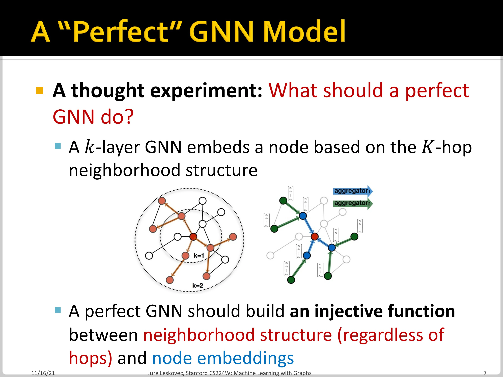{: width="3000" height="2250" }

먼저 GNN이 갖는 한계에 대해서 알아봅시다. Perfect GNN model이라고 한다면, 같은 neighbor를 가지는 node는 같은 embedding을 가지고, 다른 neighbor를 가지는 node는 다른 embedding을 가지는 것입니다. 하지만 그렇게 만들기 쉽지 않습니다.

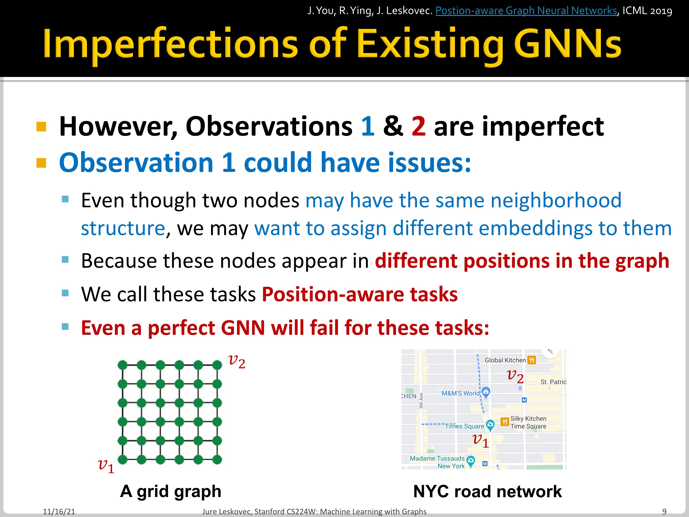{: width="3000" height="2250" }

먼저, 같은 neighbor를 가지지만 position에 따라서 다르게 embedding해야 되는 경우 문제가 생깁니다. $$v_1$$과 $$v_2$$는 완벽하게 같은 neighbor를 갖지만(모든 node가 같은 feature를 갖는다면), 위치가 다르기 때문에 다른 embedding이 주어지는 것이 맞습니다.

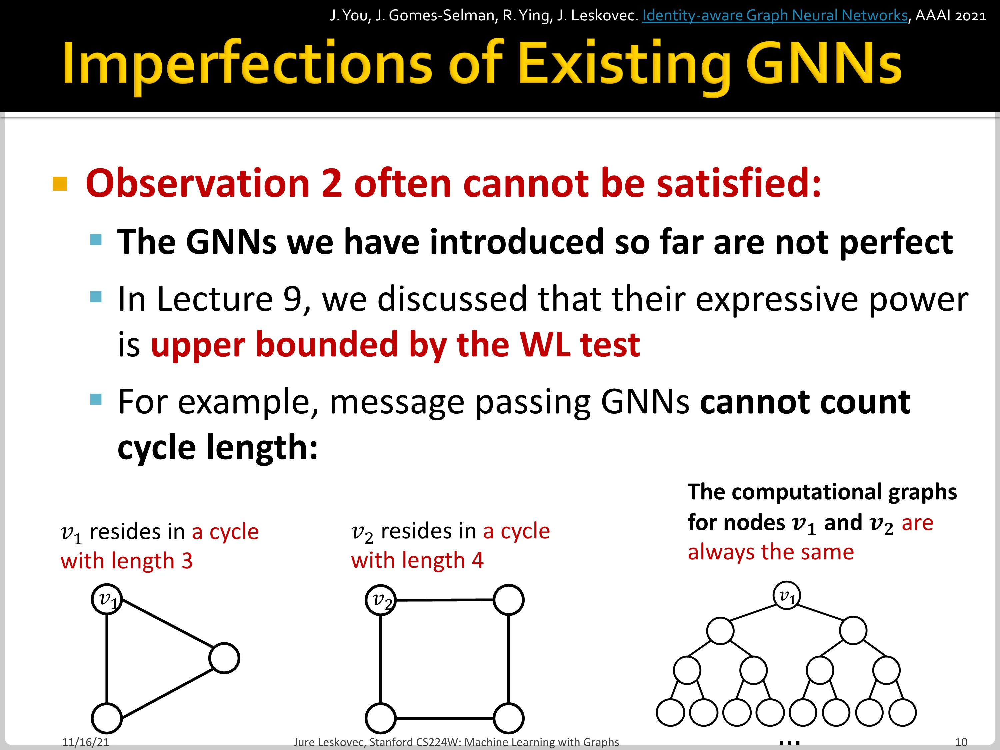{: width="3000" height="2250" }

다른 neighbor를 가지지만 computational graph가 같은 경우 같은 embedding이 발생하는 문제도 있습니다. $$v_1$$, $$v_2$$ 모두 2개의 neighbor, 그 하위 노드도 2개의 neighbor를 가져 computational graph가 같아집니다.

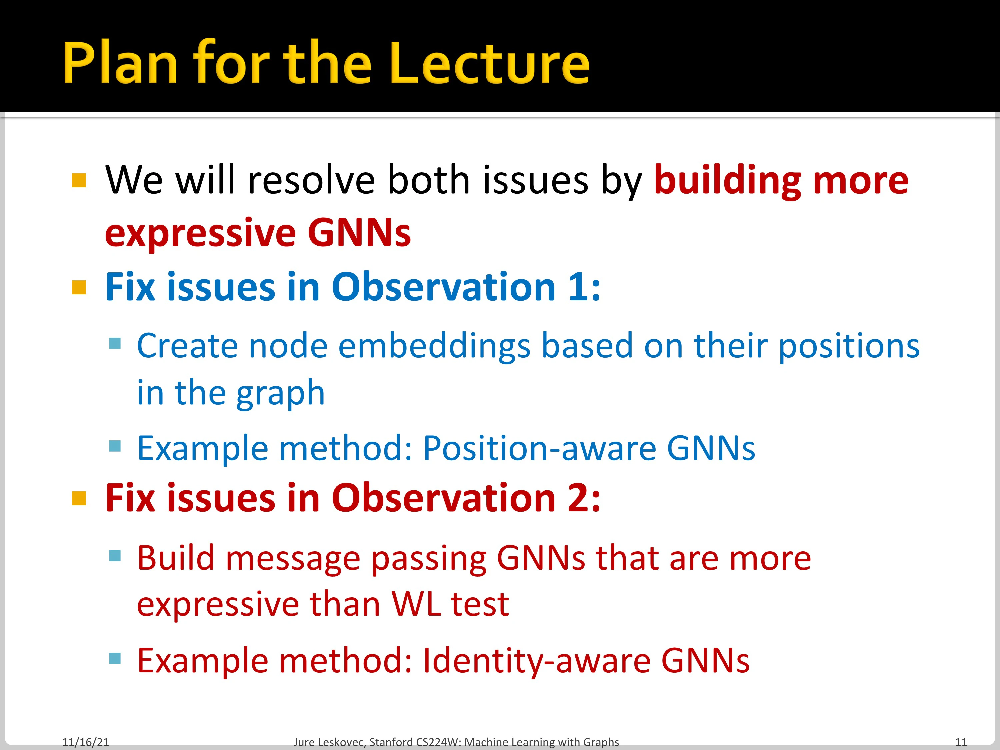{: width="3000" height="2250" }

따라서 본 강의에서는 이 두 가지 문제를 해결할 수 있는 방법에 대해 알아봅니다.

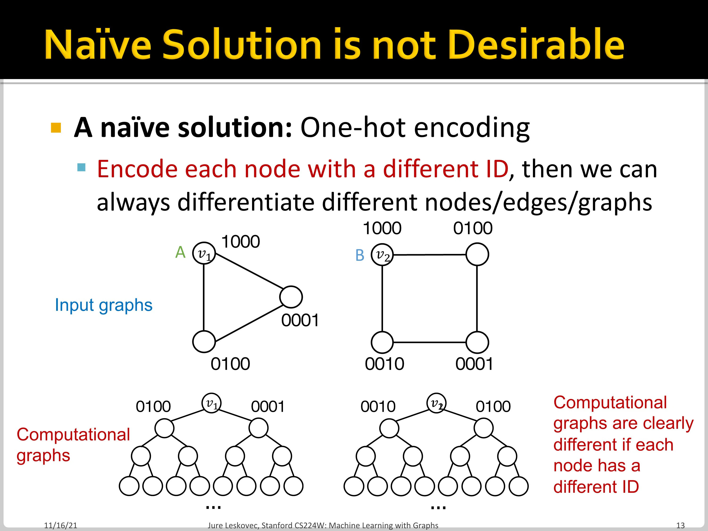{: width="3000" height="2250" }

Naive한 solution으로는 모든 node에 one-hot으로 다른 embedding을 부여할 수 있습니다. 하지만 computational cost가 커서 scalability가 전혀 없는 방법입니다. 그리고 inductive하지도 않습니다.

## Position-aware Graph Neural Networks

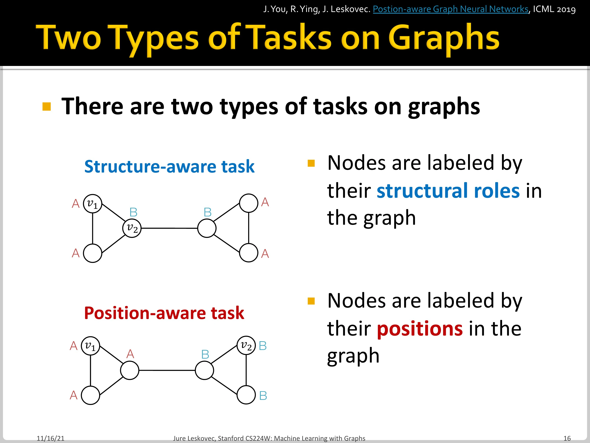{: width="3000" height="2250" }

Structure-aware와 position-aware task로 두 가지 종류의 GNN task가 있습니다.

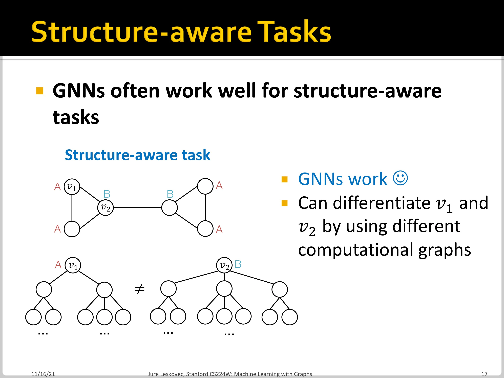{: width="3000" height="2250" }

Structure-aware의 경우 기존 GNN도 잘 작동합니다. A와 B를 구분하는 모습을 보여줍니다.

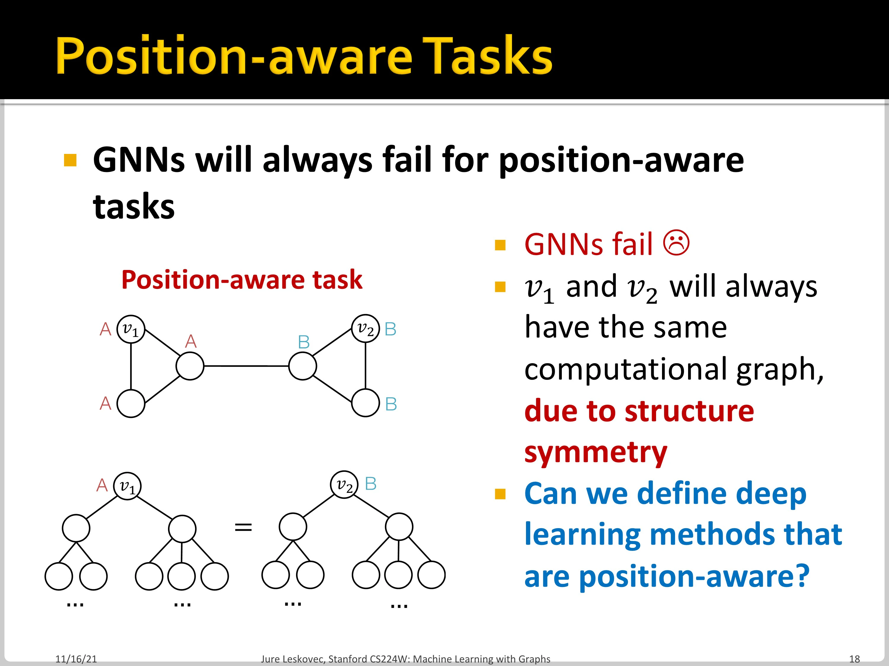{: width="3000" height="2250" }

하지만 Position-aware task의 경우 computational graph가 동일하기 때문에 구분할 수 없다는 단점이 있습니다.

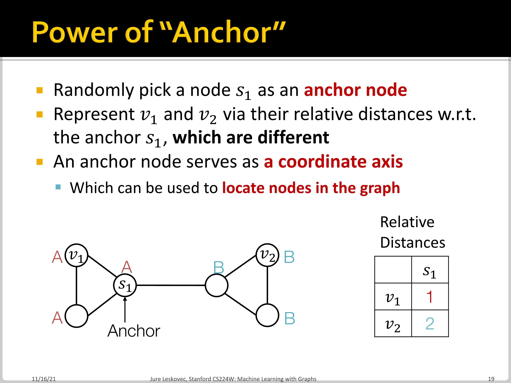{: width="3000" height="2250" }

Position에 대한 정보를 나타내는 방법으로 여러 개의 anchor를 뽑아 anchor로부터의 distance를 측정하는 방법이 있습니다.

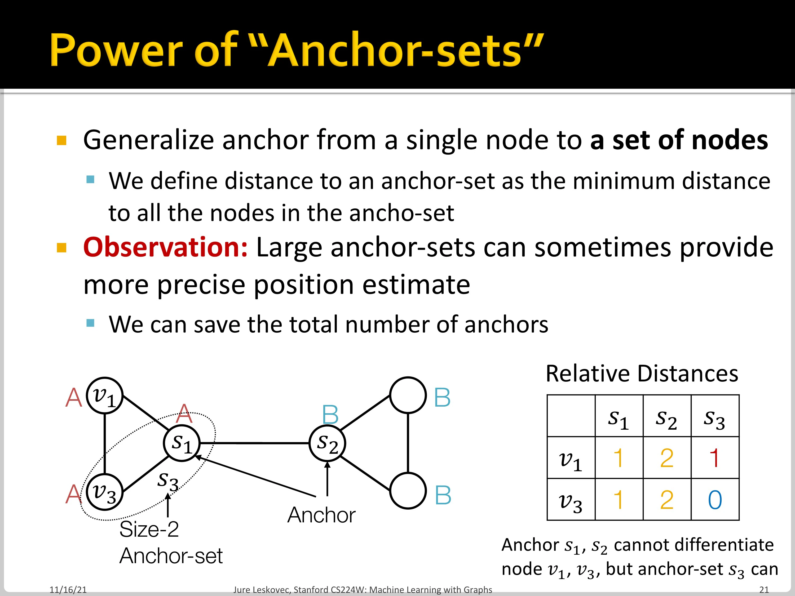{: width="3000" height="2250" }

Anchor-set을 만들어서 상대적인 거리를 측정하기도 합니다. Anchor-set이 일반 anchor보다 더 높은 표현력을 보여주는 경우가 있습니다.

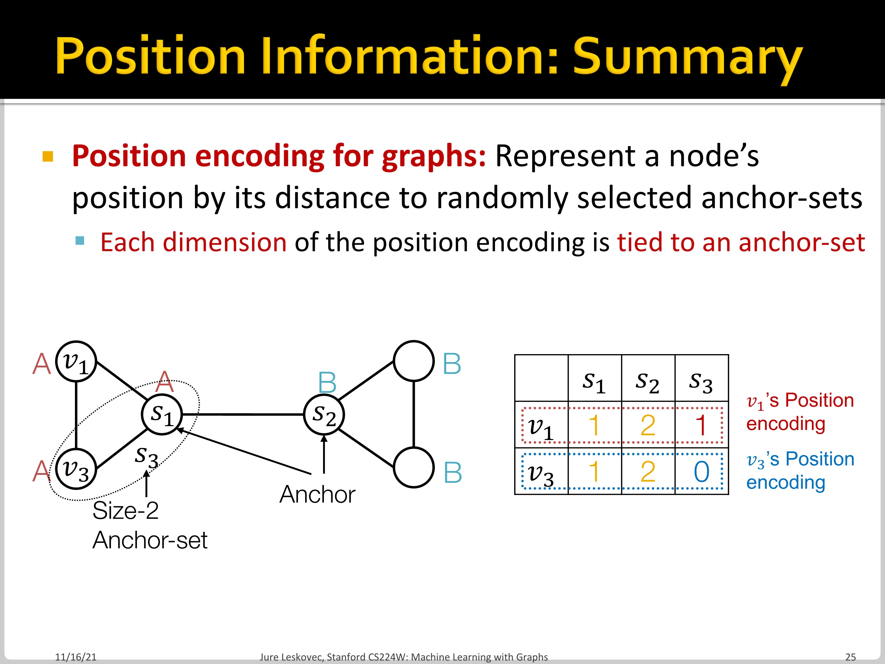{: width="3000" height="2250" }

이렇게 해서 구한 position encoding을 각 node의 feature에 덧붙여 GNN의 입력으로 사용합니다. Node feature의 augmentation이라고 생각할 수도 있습니다.
