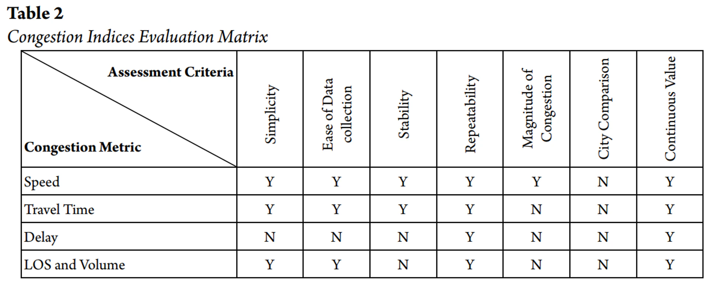
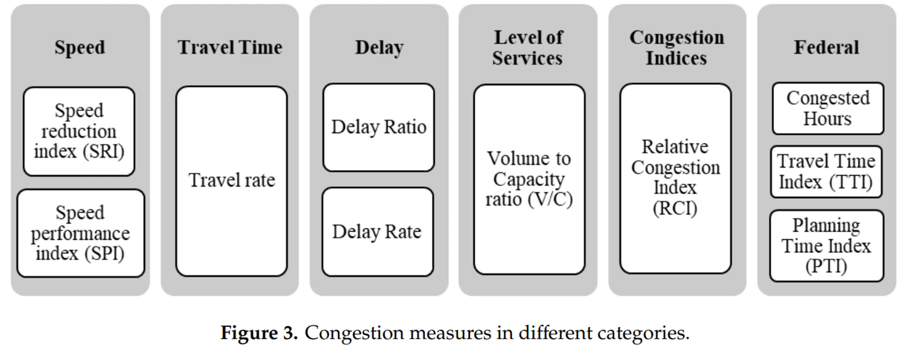
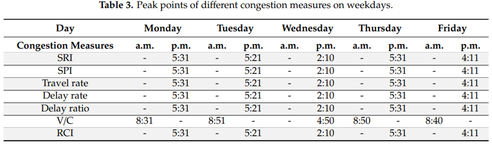
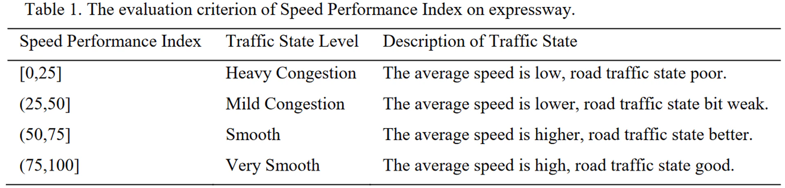
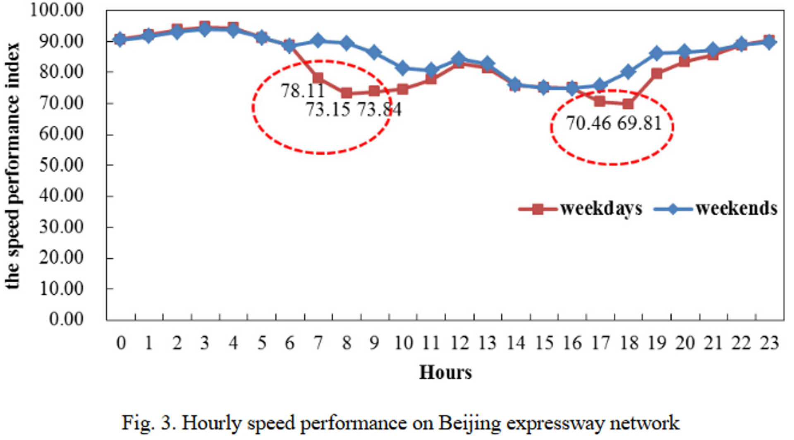

## 1. Measuring Urban Traffic Congestion – A Review (2012)

- Journal: International Journal for Traffic and Transport Engineering
- Authors: Amudapuram Mohan Rao, and Kalaga Ramachandra Rao
- Cited by 320 (2022-12-08)

혼잡에는 (a) micro-level factors (b) macro-level factors가 있다고 합니다. 혼잡은 micro-level에 의해 trigger 되고(e.g. on the road), macro-level에서 driven 됩니다. 예를 들어, micro-level factors는 \"many people want to move at the same time, too many vehicles for limited road space\"같은 상황을 들 수 있습니다. Macro-level factors는 \"land-use patterns, car ownership trends, regional economic dynamics\"등이 있습니다.

{: width="1920" height="765" }

다양한 congestion metric중에서 speed 기반 metric이 쓸만하다는 것을 알 수 있습니다. 2011년도에 생긴 저널에 실린 논문입니다. 지표를 정리한 논문이 없어서 그런지 citation이 꽤 많습니다.

## 2. A Survey of Road Traffic Congestion Measures towards a Sustainable and Resilient Transportation System

- Journal: Sustainability
- Authors: Tanzina Afrin, and Nita Yodo
- Cited by 136 (2022-12-08)

MDPI의 Sustainability에 실린 논문입니다. MDPI라서 조금 걱정되지만 인용수가 136회라서 이 논문 또한 congestion measure를 정리한 논문 중에서는 주요합니다.

{: width="1920" height="740" }

Speed Reduction Index(SRI)

- \$$SRI= (1-v_{ac}/v_{ff}) \times 10$$
- $$v_{ac}$$: actual travel speed
- $$v_{ff}$$: free-flow speed
- Congestion은 index value가 4, 5를 넘으면 발생한다고 정의
- Free-flow speed는 85th percentile of the off-peak period speed (FHWA’s Urban Congestion Report of 2019)
- The off-peak period is Mon-Fri, 9:00 a.m. to 4:00 p.m. and 7:00 p.m. to 10:00 p.m., and Sat-Sun 6:00 a.m. to 10:00 p.m.

Speed Performance Index(SPI)

- \$$SPI=(v_{avg}/v_{max}) \times 100$$
- $$v_{avg}$$: average travel speed
- $$v_{max}$$: maximum permissible road speed
- 25, 50, 75 threshold values

{: width="1920" height="564" }

속도 기반의 지표인 SRI와 SPI가 잘 작동한다는 것을 보였습니다.

## 3. A Traffic Congestion Assessment Method for Urban Road Networks Based on Speed Performance Index

- Journal: Procedia engineering
- Authors: Feifei He, Xuedong Yan, Yang Liu, and Lu Ma
- Cited by 164 (2022-12-08)

Speed performance index를 활용해서 계절/요일별 분석을 진행한 논문입니다.

Speed Performance Index: 우리가 이미 살펴본 일반적인 형태의 SPI입니다.

- \$$R_{v}=\frac{v}{V_{max}} \times 100$$
- $$R_{v}$$: speed performance index
- $$v$$: average travel speed, km/h
- $$V_{max}$$: maximum permissible road speed, km/h

{: width="1920" height="462" }

Road Segment Congestion Index: SPI에서 시간 요소가 들어갔습니다. 한 road segment에 대해 관측 기간 동안의 평균 SPI를 적용하고, 그리고 거기에 non-congestion state에 속하는 시간의 비율도 곱했습니다. 혼잡에 이중으로 페널티를 주었다고도 볼 수 있겠습니다.

- \$$R_{i}=\frac{\bar{R_{v}}}{100} \times R_{NC}$$
- \$$R_{NC}=\frac{t_{NC}}{T_{t}}$$
- $$R_{i}$$: road segment congestion index
- $$\bar{R_{v}}$$: average of speed performance index
- $$R_{NC}$$: proportion of non-congestion state (smooth, very smooth)
- $$t_{NC}$$: duration of non-congestion state, minute
- $$T_{t}$$: length of the observation period, minute

Road Network Congestion Index: 위에서 구한 Road Segment Congestion Index의 평균치입니다.

- \$$R=\frac{\sum_{i}R_{i}L_{i}}{\sum_{i}L_{i}}$$
- $$R$$: road network congestion index
- $$L_{i}$$: length of road segment, km

{: width="1920" height="1066" }

네트워크의 주말과 주중의 SPI 차이를 잘 보여주었습니다. 네트워크 전체의 평균치를 제시해준 것은 좋은데, 혼잡의 전파 인식과는 다른 형태의 문제입니다.
