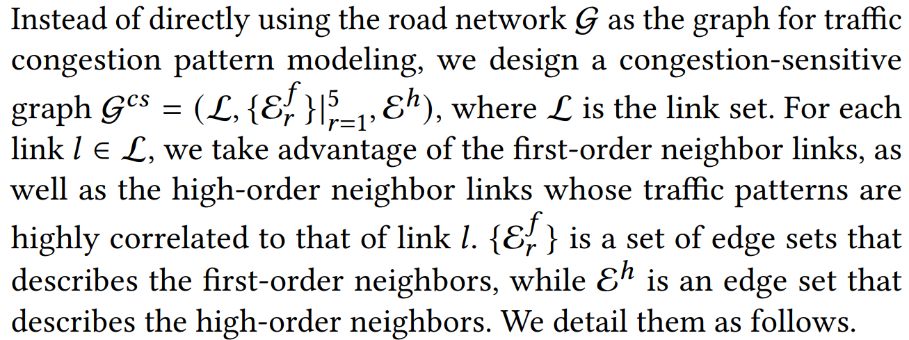
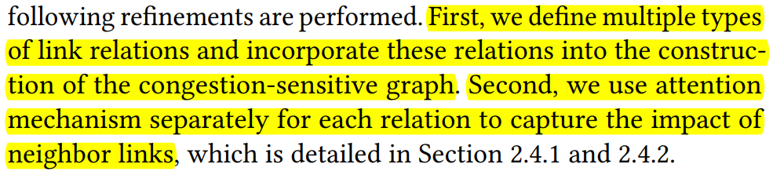
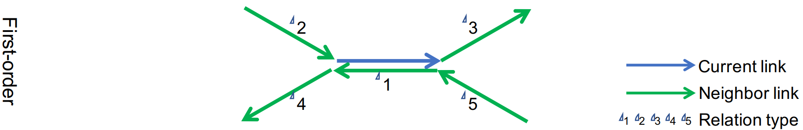
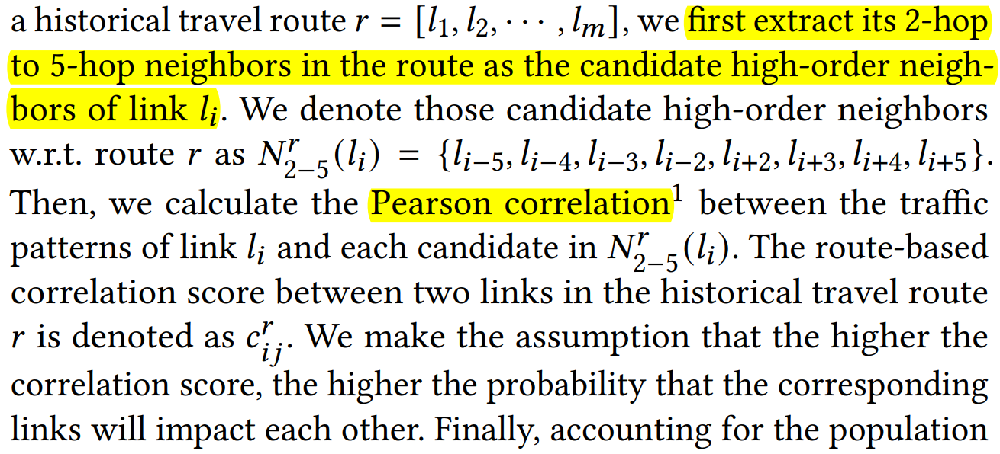
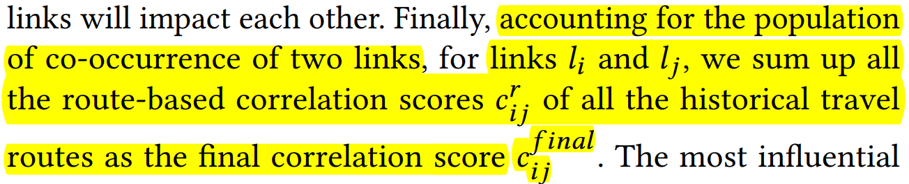
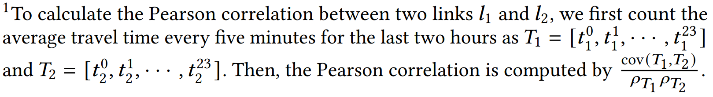
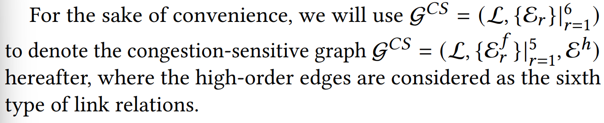
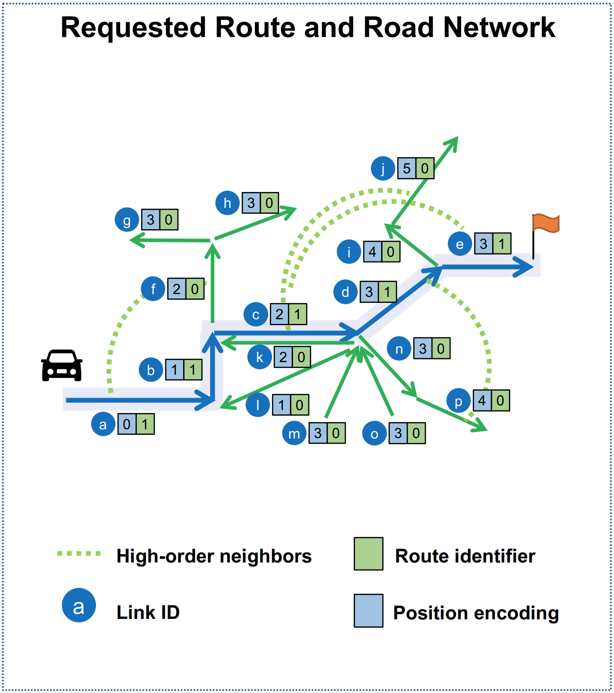
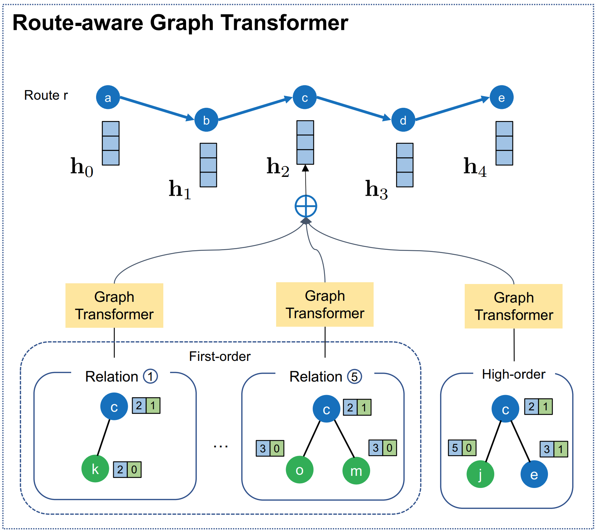

## DuETA: Traffic Congestion Propagation Pattern Modeling via Efficient Graph Learning for ETA Prediction at Baidu Maps

- 2022년 10월 17일 학회에서 발표됨
- In Proceedings of the 31st ACM International Conference on Information & Knowledge Management
- Jizhou Huang, Zhengjie Huang, Xiaomin Fang, Shikun Feng, Xuyi Chen, Jiaxiang Liu, Haitao Yuan, and Haifeng Wang
- 2022년 12월 23일 기준 citation 수 2회

바이두 연구진들이 바이두 데이터를 기반으로 작성한 논문입니다. 데이터가 매우 풍부할 것으로 예상되어 기대되는 논문입니다.

## 주안점 및 과거 연구의 한계

- 이미 과거에 spatial-temporal interaction(ConSTGAT)과 driving behavior(SSML)을 고려한 논문을 발표한 바가 있음
- Although existing studies have applied spatial-temporal graph neural networks(STGNNs) to model traffic conditions, 그들은 directly connected road segments에만 신경을 쓰며, 이는 두 가지 limitations 가짐
- (1) The long-distance correlations of indirectly connected road segments are not explicitly modeled, which inevitably suffer from information loss during the multi-step message passing. Message passing은 long distant한 correlation에 약함을 지적함. (얼마나 먼 hop까지 care하려는 것인지 궁금)
- (2) Traffic conditions are not sufficiently transmitted between two road segments that are spatially distant, because they typically execute only a few steps of message passing (one step in most cases), due to the computational complexity of STGNNs. Message passing의 단계가 적기 때문에 long distant는 불가능함. 그래서 multi-hop matrix가 의미가 있는 것인데, 여기서는 그걸 활용하지는 않았음

결국 두 단점 모두 유사한 이야기를 하고 있습니다. 먼 거리의 correlation이 반영되지 않음에 대한 아쉬움입니다. 그래서 어떤 것을 시행했는지 확인해봅시다.

- DuETA is designed to model traffic congestion propagation patterns via efficient graph learning.
- Specifically, instead of directly using the road network as a graph, we construct a congestion-sensitive graph based on the correlations of traffic patterns. 인상적인 문구로, congestion-sensitive한 graph를 어떻게 만들었는지 궁금
- In addition, we develop a route-aware graph transformer to directly learn the long-distance correlations of the road segments. Graph transformer는 message passing 방식이 아니라고 했던 것 같은데, 뒤에 구조를 더 읽어봐야할듯. 일단은 graph transformer를 활용했다 정도의 정보로 인식하면 될듯

Introduction은 아니지만 중간중간 도로 네트워크에 대한 insight 기반의 이야기들을 전달합니다.

- Our previous work [7] has demonstrated that different types of neighbor links play varying roles in the future traffic of a given link
- We aim to model the interactions between the link pairs that are spatially distant but highly correlated

## 모델 설계 사항

- Static feature와 Dynamic feature로 분리함
- Static feature: Road network information(the link ID, the length, the width, the number of lanes, the type of road, the speed limit, the type of crossing, and the kind of traffic light), contextual information (e.g., departure time and user profile). Type of crossing과 kind of traffic light를 어떻게 넣었을지 궁금
- Dynamic feature: Traffic conditions. 과거 1시간의 5분 집계 데이터 활용. median speed, max speed, min speed, mean speed, and record counts as features
- 두 feature가 linear transformation을 거쳐서 same shape으로 바뀜.
- For link $$l_i \in \mathcal{L}$$, the feature vector is denoted as $$x_i$$

{: width="1307" height="489" }

- Congestion-sensitive graph $$\mathcal{G}^{CS}$$은 route 1~5번까지의 first-order neighbor link set을 input으로 받는 것 같은데, 어떤 의미인지 차차 확인 필요

{: width="985" height="223" }

- 핵심적으로 고려한 내용들. Multiple types of link relation 고려, attention mechanism 활용

{: width="1820" height="297" }

- 1~5번의 관계를 고려한 이유를 여기서 알 수 있음. 한 링크를 기준으로 upstream(2), downstream(3), 그리고 반대편 link(1), 반대편 link의 upstream(5), downstream(4)으로 관계 정의

{: width="1310" height="596" }

- High-order neighbor를 care하는 방법에 대해 서술함. Route에 포함된 link에 대해서 그 link 주위 2~5 hop까지 link를 모음. (특정 route에 포함되었던 link만 보는 것 같음) 그 다음에 현재 link $$l_i$$랑 pearson correlation을 구함. 그 값이 $$c^{r}_{ij}$$

{: width="1304" height="266" }

- 그 다음 역대 route data에서 $$c^{r}_{ij}$$를 모두 더한 것이 $$c_{ij}^{final}$$. 각 link에 대해서 top-5 influential high-order neighbor를 얻고, 그것들을 연결한 edge set이 $$\mathcal{E}^h$$임
- 크게 두가지 의문이 듦. 첫번째로, 역대 route에서만 데이터를 얻었다면 route에 포함되지 못해 관계를 밝히지 못한 case도 있을 것. (물론 아주 많은 case가 있어서 거의 모든 경우의 수가 다 고려되긴 하였을 것. 오히려 모든 경우의 수를 고려하는 것보다는 route 데이터를 기반으로 관계가 있는 것으로 보여진 link 끼리만 보는 것도 답일수도. 그래도 내 생각에는 많은 경우의 수를 고려한 와중에 의미를 선별하는 것이 더 좋아보임) 두번째로, 그냥 pearson correlation을 하면 time lag을 반영하지 않은 것인가? 이것은 문제가 있음. 필자들이 Granger Causality 개념을 보고 오면 더 좋은 논문이 나올 수 있을 듯

{: width="1619" height="223" }

- 조금 더 근본적인 의문은, route에 포함된 link중에서 pearson correlation이 높은 link를 골라서 연결시키는 행위가 congestion propagation과 어떤 연관이 있느냐 하는 것

{: width="1291" height="264" }

- High-order edge를 sixth edge로 본다고 함. 단순 notation 변화임

{: width="1318" height="1487" }

{: width="1675" height="1492" }
