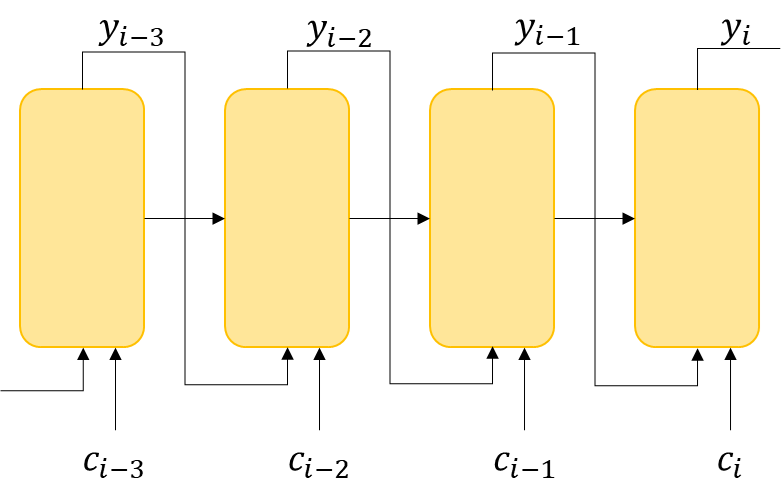
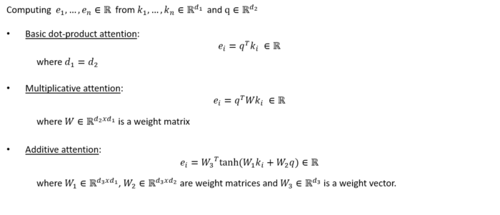
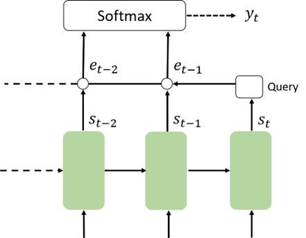
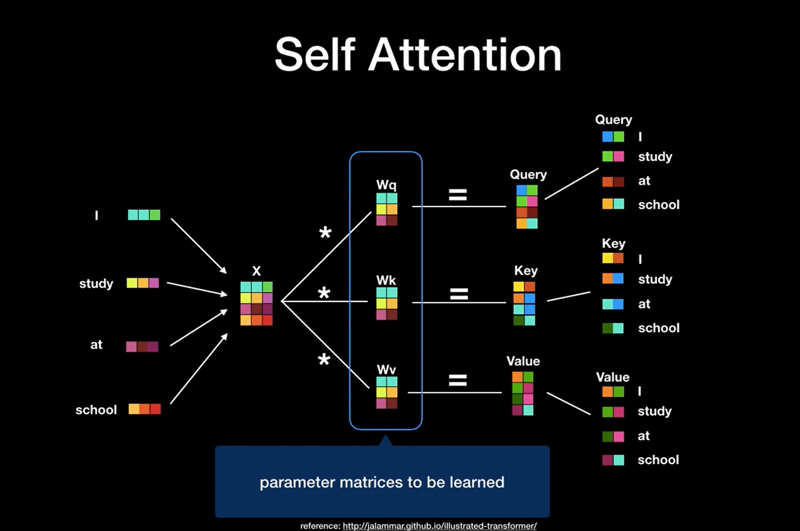
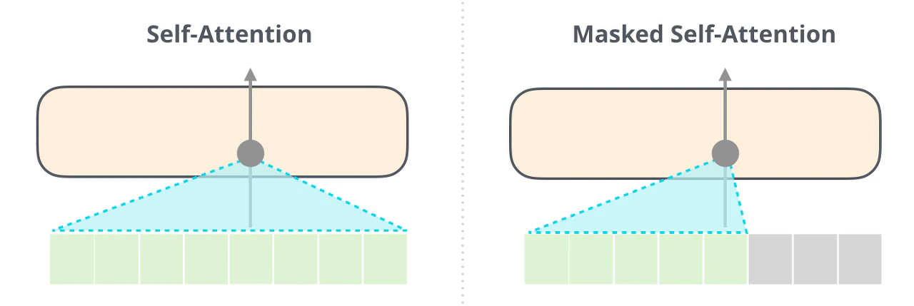
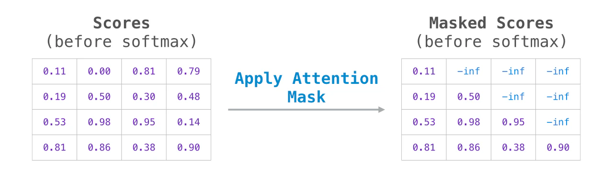
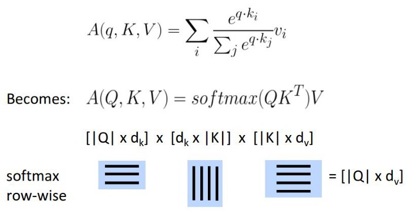

## 어텐션 메커니즘 개요

어텐션 메커니즘은 참조할 정보들(encoder의 hidden embedding 등)을 현재 예측과의 관련도에 따라 weighted sum하여 예측에 활용하는 기법입니다.

{: width="781" height="489" }

위와 같은 구조로 미래에 대한 예측치 $$y$$를 얻는 경우, context vector $$c$$에 attention mechanism이 적용됩니다.

$$c_i = \sum ^{T_x}_{j=1} \alpha_{ij}h_{j}$$

과거의 hidden embedding에 attention value를 곱한 값을 context vector로 받게 됩니다. 이 attention은 energy 값의 softmax로 얻어집니다.

$$\alpha_{ij} = softmax(e_{ij})=\frac{exp(e_{ij})}{\sum^{T_x}_{k=1}exp(e_{ik})}$$

위의 식을 일반화하면 query(q), key(K), value(V) 사이의 관계로 attention을 나타낼 수 있습니다.

$$A(q, K, V)= \sum_{i} \frac{exp(e_{qk_{i}})}{\sum_j exp(e_{qk_{j}})} v_{i}$$

이때 softmax에 들어가는 energy $$e$$를 구하기 위하여, 다른 vector들과의 관계를 측정하기 위한 f가 정의되어야 합니다. 정의 내용은 아래와 같습니다.

$$e_{ij}=f(s_{i-1},h_j)$$

여기서 $$s_{i-1}$$은 그전 timestep의 hidden state에 해당합니다.

## 어텐션의 종류

어텐션의 종류를 정의함에 있어, 첫째로 함수 f의 형태에 따라 정의할 수 있습니다. 함수 f는 다양한 형태로 정의할 수 있습니다. 가장 간단하게는 dot product가 있고, multiplicative attention, additive attention도 존재합니다.

{: width="700" height="301" }
_https://towardsdatascience.com/attention-and-its-different-forms-7fc3674d14dc_

### Self-Attention

함수 f의 종류 외에도, 계산에 포함되는 요소의 종류로도 구분할 수 있습니다. Self attention은 query, key, value를 모두 같은 sequence(자기 자신의 hidden state들)에서 얻는 기법입니다. 아래 RNN 예시에서는 현재 hidden state가 과거의 hidden state들을 참조합니다.

{: width="441" height="343" }
_https://towardsdatascience.com/attention-and-its-different-forms-7fc3674d14dc_

이때 $$s_t$$는 query이며, hidden state $$s_0, ..., s_{t-1}$$은 key와 value의 역할을 동시에 수행합니다.

{: width="1280" height="851" }
_https://aimb.tistory.com/182_

위 그림에서도 단어 토큰의 matrix가 query, key, value로 모두 작동하는 것을 알 수 있습니다.

### Masked Self-Attention

Transformer 논문([Attention Is All You Need](https://arxiv.org/abs/1706.03762), Vaswani et al., 2017)에는 masked self-attention 개념도 등장합니다. 미래 단어 예측을 진행할 때는 예측하고자 하는 단어 이후의 단어를 모르는 상태이기 때문에, masking을 통해서 모르는 단어임을 표기합니다.

{: width="1280" height="429" }
_https://aimb.tistory.com/182_

Multi-head attention 또한 attention의 한 종류라고 볼 수 있습니다. multi-head attention은 head마다 서로 다른 projection weight로 attention을 병렬로 여러 번 계산하므로, 2개 이상의 vector가 attention mechanism의 결과물로 얻어지고 이를 이어 붙인(concat) 뒤 다시 projection해서 사용합니다.

{: width="1280" height="382" }
_https://aimb.tistory.com/182_

위 그림처럼 마스킹 과정에서는 참조하면 안 되는 단어에 음의 무한대 값을 지정해줍니다.

{: width="700" height="361" }
_https://towardsdatascience.com/attention-and-its-different-forms-7fc3674d14dc_

## 출처

- [https://towardsdatascience.com/attention-and-its-different-forms-7fc3674d14dc](https://towardsdatascience.com/attention-and-its-different-forms-7fc3674d14dc)
- [https://aimb.tistory.com/182](https://aimb.tistory.com/182)
