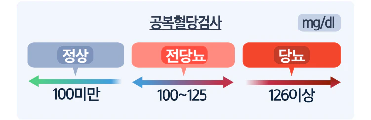

## 4줄 요약

- 우리 주위 식품에는 과도한 당을 포함한 제품이 많다. 손 가는 대로, **평소 습관대로 먹으면** 생각보다 **많은 정제 탄수화물과 액상 과당**을 먹게 된다.
- 덕분에 우리 췌장은 인슐린 분비하느라 지쳐가고 있다. 게다가 몸이 점점 인슐린 저항성을 띠게 된다. 이러한 작용과 연관된 질병은 **췌장암과 당뇨병**이다.
- 발병 확률을 줄이는 방법 1: 식사는 **야채-단백질-탄수화물** 순서로. 밥 먹은 다음에는 10분간 걷자. 흰쌀밥, 빵, 떡, 면은 피하자.
- 발병 확률을 줄이는 방법 2: **잘 자고, 스트레스받지 말고, 근력 운동하자.**

> 🥖 조금 더 알아보고 싶은데, 시간이 없으면 “4. 그래서 어떤 것을 해야 하나” 참조

## 1. 어떤 억까를 당했는가?

- 혁용이형, 성연이가 열심히 개발 중인 “글루코핏” 이라는 서비스가 있다. 애보트 사의 연속 혈당 측정기(Continuous Glucose Monitoring, CGM)에서 얻어진 정보로 직관적인 혈당 관리를 도와주는 서비스이다.
- 나는 평소 건강에 관심이 많아서 글루코핏을 사용해 보았다. 사용 첫날부터 공복 혈당 116mg/dL의 전당뇨 단계의 공복 혈당 수치가 나왔다.

{: width="751" height="244" }

- 혁용이형은 내 나이에, 나 같은 운동 습관에, 가족력이 없으면 센서 에러 확률이 높다고 이야기했다. 그래서 새 센서를 받았는데, 교체한 센서에서도 같은 결과가 나왔다.
- 걱정되어서 학교 보건소에서 건강검진을 받아봤다. 결과는 공복 혈당 111mg/dL. 오피셜하게 전당뇨가 되었다.
- 20대의 나이에, 가족력도 딱히 없고, 주에 3~4회는 운동하고, 간식도 잘 먹지 않는데 이런 혈당이 나오다니, 억까가 아닐 수 없다.

## 2. 당신도 억까 당할 수 있다.

- 식품 산업은 우리 사회에 풍족한 영양을 공급해 주었다. 질 좋은 음식을 제공해 주는 훌륭한 회사들이 많다. 하지만 어떤 회사들은 도파민을 자극하는 중독성 있는 식품으로 돈을 번다.
- 마치 일부 SNS 산업이 사람들 시간을 뺏어서 돈을 버는 것처럼, 일부 식품 산업은 사람들 건강을 뺏어서 돈을 번다. 우리는 인류 역사상 전례 없이 많은 정제당을 섭취하고 있다.
- 이런저런 이유 덕분에 2021년 기준 5억 2,900만 명 정도인 전 세계 당뇨병 환자가 2050년에는 13억 명으로 늘어날 전망이다.
  - Ong, Kanyin Liane, Lauryn K. Stafford, Susan A. McLaughlin, Edward J. Boyko, Stein Emil Vollset, Amanda E. Smith, Bronte E. Dalton et al. \"Global, regional, and national burden of diabetes from 1990 to 2021, with projections of prevalence to 2050: a systematic analysis for the Global Burden of Disease Study 2021.\" The Lancet (2023).

## 3. 당을 먹었을 때 몸에서 일어나는 일

- 우리 몸에는 혈당을 높이기 위한 다양한 기작들이 있다. 하지만 혈당을 낮추는 호르몬은 사실상 인슐린 하나밖에 없다. 당신이 흰쌀밥이나 정제 탄수화물을 먹으면, 일단 혈당이 치솟는다. (혈당 스파이크)

> 🥖 저널 검색 키워드: glucose spike(peak), postprandial spike, postprandial hyperglycemia

- 혈당이 치솟으면 몸에서는 인슐린을 분비하여 당을 근육과 간에 글리코겐으로 저장한다. 그게 안 되면 지방으로 쌓는다. 인슐린에 의하여 고등학교 때 배운 동화작용이 발생한다.
- 이렇게 발생한 혈당 스파이크는 몇 가지 문제를 야기한다.

> 1\. 일반적으로, 높은 혈당은 인슐린 저항성을 증대시킨다. 쉽게 말해서 몸이 인슐린에 무뎌져서 어느 순간부터 혈당을 낮추기 위한 기작이 제대로 돌아가지 않는다. 당뇨병에 걸리는 것이다. 당뇨는 심혈관계 질환을 발생시키는데, 평균 혈당이 높은 것도 문제지만, 특히 혈당 스파이크가 심혈관계 질환을 촉발한다는 연구가 있다. (Hanssen, Nordin MJ, Michael J. Kraakman, Michelle C. Flynn, Prabhakara R. Nagareddy, Casper G. Schalkwijk, and Andrew J. Murphy. \"Postprandial glucose spikes, an important contributor to cardiovascular disease in diabetes?.\" Frontiers in cardiovascular medicine 7 (2020): 570553.)
>
> 2\. 췌장이 혈당 스파이크에 대응하여 인슐린을 만드는 과정에서 산화 스트레스가 발생한다. 췌장이 노화된다는 뜻이다. (Blaak, E. E., J‐M. Antoine, D. Benton, Inger Björck, Lutgarda Bozzetto, F. Brouns, M. Diamant et al. \"Impact of postprandial glycaemia on health and prevention of disease.\" Obesity reviews 13, no. 10 (2012): 923-984.)
>
> 3\. 위와 관계하여, 공복 혈당이 높을수록 췌장암 발생 확률이 높다. 뚜렷한 비례 관계가 있다. (Koo, Dong-Hoe, Kyung-Do Han, and Cheol-Young Park. \"The incremental risk of pancreatic cancer according to fasting glucose levels: Nationwide population-based cohort study.\" The Journal of Clinical Endocrinology & Metabolism 104, no. 10 (2019): 4594-4599.)

## 4. 그래서 어떤 것을 해야 하나

- 가장 중요한 것. 아침에 혈당 스파이크가 발생하는 식단을 피하자. 과일만 먹거나, 잼을 바른 빵을 먹는 등의 식단이다. 혹시 아침에 콘플레이크나 시리얼을 먹는 분이 계신다면, 그만두시기를 강력하게 추천한다. 가장 확실하게 혈당 스파이크를 발생시키는 방법이다.
  - Hall, Heather, Dalia Perelman, Alessandra Breschi, Patricia Limcaoco, Ryan Kellogg, Tracey McLaughlin, and Michael Snyder. \"Glucotypes reveal new patterns of glucose dysregulation.\" *PLoS biology* 16, no. 7 (2018): e2005143.
- 에너지 밀도가 낮은 것부터 높은 순서대로 먹자. 야채-단백질-탄수화물의 순서이다. 높은 에너지 밀도를 가진 식품을 나중에 먹자. 에너지 밀도가 높은 탄수화물 식품은 혈당 스파이크를 발생시킨다.
  - Tey, Siew Ling, Nurhazwani Salleh, Christiani Jeyakumar Henry, and Ciaran G. Forde. \"Effects of consuming preloads with different energy density and taste quality on energy intake and postprandial blood glucose.\" *Nutrients* 10, no. 2 (2018): 161.
- 식후에는 10분간 걷자. 그리고 평소에 근력 운동을 열심히 하자. 가성비가 가장 좋은 운동은 허벅지 근육이 커지는 운동이다. 너무 시간이 없으면 데드 리프트나 스쿼트만 하자.
- 흰쌀밥, 빵, 떡, 면은 피하자. 그리고 과자를 먹지 말자. 경험상 통밀빵은 좀 낫다.
- 간식을 줄이자. 초콜릿, 아이스크림, 음료수를 먹지 말자. 설탕이나 액상 과당 같은 당이 많이 들어있는 음식들이다. 고과당콘시럽과 옥수수시럽 성분이 들어간 음식도 피하자.
- 밤에 너무 배가 고프면 견과류를 먹자.
- 술을 줄이자. 술은 인슐린에 의한 동화작용을 방해하며 인슐린 저항성을 유발한다.
- 잘 자고, 스트레스를 줄여야 한다. 글루코핏을 사용하면서 체감한 스트레스의 혈당 상승효과는 대략 20% 정도였다. 이 정도면 정상 수치가 나오던 사람도 전당뇨, 심하면 당뇨가 나올 수도 있다. 수면 부족의 효과도 유사하다.
  - Cheung, N. Wah, KY Carmen Wong, Pramesh Kovoor, and Mark McLean. \"Stress hyperglycemia: a prospective study examining the relationship between glucose, cortisol and diabetes in myocardial infarction.\" *Journal of Diabetes and its Complications* 33, no. 4 (2019): 329-334.

## 5. 당신의 건강은 소중하다.

- 이 글을 읽고 있는 당신의 건강은 소중하다. 당신이 얼마나 건강 수명을 유지하는지가 당신 주위 사람의 행복과, 거시적으로는 국가의 실물 경제에까지 영향을 미친다.
- 부디 건강을 유지해서 오랜 기간 많은 것을 경험하길 바란다.
