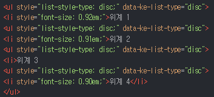

[이 글](/posts/티스토리-북클럽-글씨-크기-및-리스트-여백-변경/)에서 썼던 내용인데, 리스트(unordered list, ul 혹은 ordered list, ol)의 글씨 크기를 바꾸는 방법은 여러 블로그에 소개되어 있다.

그런데 나의 경우, unordered list의 하위 위계로 갈수록 글씨 크기가 커지는 요상한 현상을 겪고 있다.

- 위계 1
  - 위계 2
    - 위계 3
      - 위계 4

갖은 방법을 시도해보다가, 노가다에 가까워서 맘에 들지는 않지만, 방법을 찾긴 했다.

\# 스킨 초기화 이후 문제가 해결되었습니다. 최소한 글씨 크기가 커지진 않습니다.

HTML li의 시작 태그에 font-size 옵션을 강제로 주면 된다. &lt;li style=\"font-size: 0.925em;\"&gt; 이런 식이다. 수정하기에서 기본모드 말고 HTML로 들어가면 바꿀 수 있다.

- 위계 1
  - 위계 2
    - 위계 3
      - 위계 4

{: width="353" height="160" }

그런데 이게 최선일까? 절대 아닐 것 같다. 혹시 근본적인 해결책을 아시는 분이 계시다면 답글 남겨주시면 감사하겠습니다.
