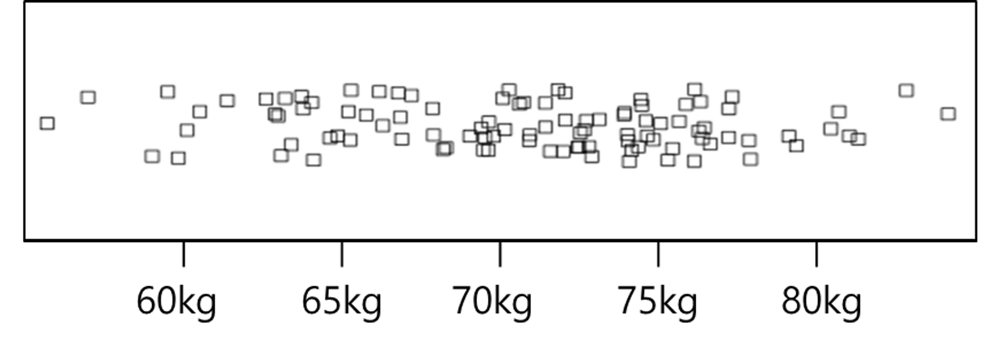

이 글에서는 확률론과 통계학에서 널리 사용되는 추정 기법 중 하나인 최대 우도 추정(Maximum Likelihood Estimation, 이하 MLE)에 대해 설명할 것입니다. MLE는 관측 데이터로부터 “가장 Likelihood가 높은” 확률 분포의 파라미터를 추정하는데 사용되는 기법입니다. (Likelihood가 무엇인지는 뒤에서 이야기하도록 하겠습니다.)

## MLE의 기본 원리

### 1. 확률 분포의 선택

MLE를 수행하기 위해서는 먼저 데이터를 잘 설명할 수 있는 적절한 확률 분포를 선택해야 합니다. 예를 들어 봅시다. 아래는 대구 경북고등학교 3학년 1반 학생들의 몸무게 분포를 조사하여 점으로 표기한 것입니다. 대략 어떤 분포로 근사하면 저 분포를 잘 설명할 수 있을까요?

{: width="1920" height="661" }

표준 편차가 적절히 조절된 정규 분포면 잘 설명하지 않을까 싶습니다. 방금 진행한 과정이 확률 분포의 선택입니다. 정규 분포는 평균 $$\mu$$와 표준편차 $$\sigma$$로 정의 됩니다. 평균과 표준편차를 잘 조절해서 아래의 식이 위의 분포와 제일 비슷하게 되도록 만들어봅시다.

$$f(x)=\frac{1}{\sigma \sqrt{2 \pi}} e^{-\frac{1}{2}\left(\frac{x-\mu}{\sigma}\right)^2}$$

### 2. Likelihood(우도) 함수 정의

보통 확률이라고 하면 주어진 확률 분포에서 관측값이나 관측 구간이 분포 안에서 어떤 확률을 보여주는지를 이야기 합니다. 예를 들어 위의 정규 분포 예시라면, 평균 $$\mu$$=70, 표준편차 $$\sigma$$=10이 주어지고, 각 좌표에서는 확률밀도 값을, 각 구간에서는 그 구간에 데이터가 들어갈 확률을 얻게 됩니다. 식으로 표현하면 아래와 같습니다.

$$Probability = P(observation|probability \space distribution)$$

하지만 likelihood는 반대 입니다. Likelihood에서는 데이터가 주어지고, 주어진 데이터에서 각 파라미터 값들이 그 값으로 주어졌을 가능성을 뜻 합니다. 그래서 식을 조금 수정해야 합니다.

$$Likelihood = L(probability \space distribution|observation) = P(observation|probability \space distribution)$$

주어진 모델 파라미터에서 데이터가 발생할 가능성이 높을수록 우도 함수의 값은 커집니다. MLE는 이 우도 함수를 최대화하는 모델 파라미터를 찾는 것을 목표로 합니다. 데이터가 $$x_1, x_2, … x_n$$까지 있을 때 주어진 파라미터에서 (데이터가 서로 독립이라고 가정하고) 각 데이터가 발생할 확률(연속 분포라면 확률밀도)을 모두 곱한다면, 그 값이 얻어진 데이터 분포에 대해서 주어진 파라미터가 옳을 정도, 즉 likelihood를 의미합니다. Probability distribution(파라미터)를 $$\theta$$, 데이터를 $$x_k$$라고 두면 Likelihood는 아래와 같이 표현됩니다.

$$Likelihood= \prod_{k=1}^{n}P(x_k|\theta)$$

### 3. 로그 우도 함수

보통 곱의 계산은 번거롭기 때문에, likelihood 대신 계산이 용이한 log-likelihood를 많이 활용합니다.

$$Log-Likelihood=L(\theta, x)=logP(x|\theta)=\sum_{i=1}^{n}logP(x_i|\theta)$$

곱의 연산이 합의 연산으로 바뀌어서 처리가 더 간편해졌습니다. Log를 취했을 때 가장 좋은 점은 미분을 간단하게 할 수 있다는 점이고, probability distribution의 파라미터로 Log-likelihood를 미분해서 미분값이 0이 나오는 지점을 찾으면 됩니다.

## 실제에서의 MLE 활용

하지만 log-likelihood를 사용하더라도, MLE는 해석적으로(닫힌 형태로) 해를 구하기 어려운 경우가 많기 때문에, 일반적으로 최적화 알고리즘을 사용하여 수치적으로 해를 구합니다. 대표적인 최적화 알고리즘으로는 경사 하강법, Newton-Raphson법, BFGS 같은 준뉴턴법 등이 있으며, 데이터의 양과 모델의 복잡도에 따라 적절한 알고리즘을 선택해야 합니다.

활용처에는 매우 다양한 예시가 있습니다. 우리가 흔히 알고 있는, 데이터의 분포가 정규분포라고 가정했을 때 모평균의 최대우도추정값이 각 데이터의 산술평균(표본평균)이라는 사실도 MLE를 통해서 구해진 사실입니다. 좀 더 다양한 응용은 아래와 같이 제시할 수 있습니다.

1. **금융 분야**: 주가 예측이나 투자 의사 결정에서 MLE를 사용하여 확률적인 모델을 구축하고 파라미터를 추정합니다. 주식 시장의 가격 변동성 예측 등에 활용됩니다.
2. **의료 분야**: 의료 데이터를 통해 환자들의 건강 상태를 예측하고 질병의 위험 요소를 파악하는데 MLE가 사용됩니다. 환자 데이터로부터 통계적인 모델을 구축하고 파라미터를 추정하여 의사 결정에 활용됩니다.
3. **자연 언어 처리(Natural Language Processing, NLP)**: 자연어 처리에서 언어 모델, 토픽 모델링 등에 MLE를 사용하여 텍스트 데이터를 모델링하고 파라미터를 추정합니다.
4. **이미지 처리**: 이미지 데이터의 확률적 특성을 파악하기 위해 MLE가 사용됩니다. 이미지 생성, 분류, 세그멘테이션 등에 활용됩니다.
5. **심층 학습(Deep Learning)**: 딥러닝 모델에서도 MLE를 사용하여 가중치와 편향 등의 파라미터를 추정합니다. 음의 로그 우도(예: 교차 엔트로피)를 손실 함수로 두고, 역전파 알고리즘으로 구한 기울기로 이를 최소화하며 학습합니다.
6. **패턴 인식**: 음성 인식, 얼굴 인식 등의 패턴 인식 문제에서도 MLE가 사용됩니다. 통계적 모델을 통해 패턴을 분석하고 파라미터를 추정합니다.
7. **통계적 모델링**: 다양한 통계적 모델을 구축하기 위해 MLE를 사용합니다. 예를 들어, 선형 회귀, 로지스틱 회귀, 포아송 회귀 등이 있습니다.

## MLE의 장점과 한계

MLE는 통계적으로 강력한 기법이지만, 몇 가지 주의할 점이 있습니다.

장점:

- 통계적 이론에 기반한 강력한 기법으로, 적절한 확률 분포를 가정하면 매우 정확한 추정이 가능합니다.
- 수치적 최적화 기법을 사용하므로, 다양한 모델에 적용 가능합니다.

한계:

- 데이터의 양이 적을 경우 파라미터 추정이 불안정할 수 있습니다.
- 잘못된 확률 분포를 가정하면 잘못된 추정 결과를 얻을 수 있습니다.
- 파라미터 공간이 복잡하거나 다차원일 경우 최적화가 어려울 수 있습니다.

## 출처

[https://angeloyeo.github.io/2020/07/17/MLE.html](https://angeloyeo.github.io/2020/07/17/MLE.html)

> **[최대우도법(MLE) - 공돌이의 수학정리노트 (Angelo\'s Math Notes)](https://angeloyeo.github.io/2020/07/17/MLE.html)**  
> <small>angeloyeo.github.io</small>

[https://www.youtube.com/watch?v=XepXtl9YKwc](https://www.youtube.com/watch?v=XepXtl9YKwc)


